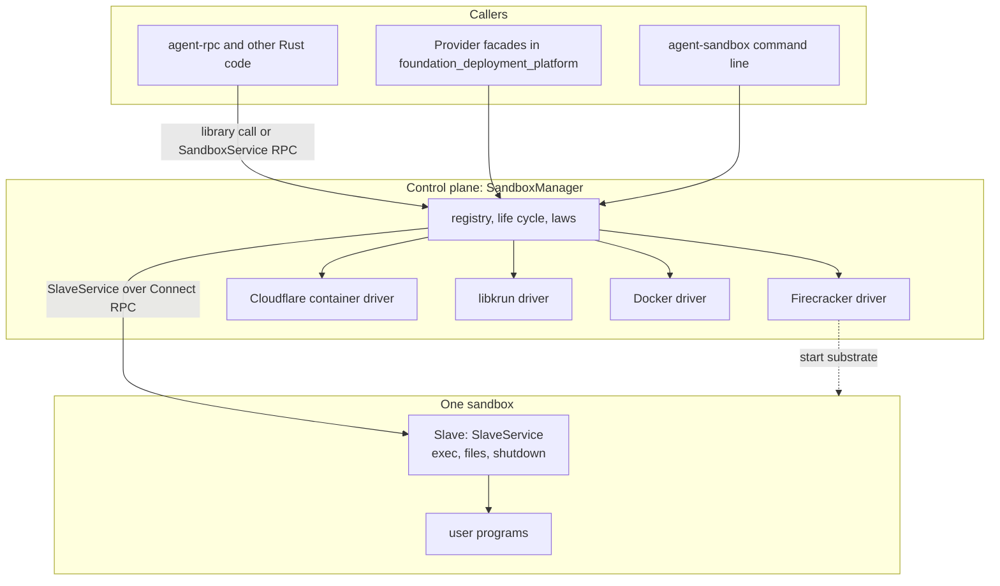
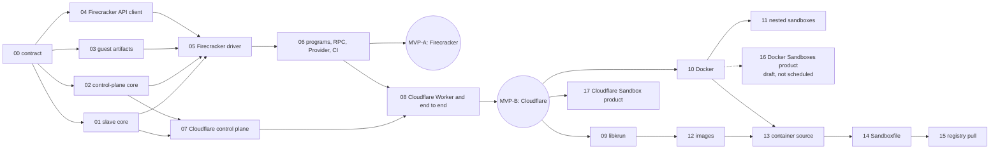

# Spec 77: Sandboxes (`foundation_platform_sandbox`)

_Written in ASD-STE100 Simplified Technical English (STE). Code and identifiers stay as they
are._

**Abbreviations in this file.** application programming interface (API); remote procedure
call (RPC); virtual machine (VM); virtual machine monitor (VMM); Kernel-based Virtual
Machine (KVM); Hypervisor.framework (HVF); Unix domain socket (UDS); Hypertext Transfer
Protocol (HTTP); JavaScript Object Notation (JSON); process identifier (PID); Durable Object
(DO); WebAssembly (wasm); Open Container Initiative (OCI); Transparent Socket Impersonation
(TSI); behaviour-driven development (BDD); acceptance-test-driven development (ATDD);
deterministic simulation testing (DST); continuous integration (CI); pull request (PR);
minimum viable product (MVP); AeroSpace and Defence Industries Association of Europe (ASD),
the owner of the STE standard ASD-STE100.

## Glossary

| Term | Meaning |
|---|---|
| sandbox | An isolated Linux environment that runs commands for a caller. |
| substrate | The technology that gives the isolation: a Firecracker microVM, a libkrun microVM, a Docker container, a Docker Sandboxes microVM or a Cloudflare container. |
| Docker Sandboxes | A Docker product. Its program is `sbx`. Each sandbox is a microVM that Docker manages. It is not a Docker container. |
| Cloudflare Sandbox | A Cloudflare product: a Durable Object and the container that it starts, with a helper package (`@cloudflare/sandbox`) and a helper program in the image (`sandbox-shim`). |
| control plane | The code that owns all sandbox set-up: it starts a substrate, waits for the slave, and passes commands to it. The program is `agent-sandbox`. |
| slave | The code that runs inside each sandbox and does what the control plane asks: start a program, move a file, stop. The program is `agent-slave`. |
| driver | The control-plane part for one substrate. It knows how to start and stop that substrate. |
| core | The library code of `foundation_platform_sandbox`. Programs and Workers call it; they add no logic. |
| boundary | A thin wrapper that plugs the core into a place where it runs: a `main` function, a DO class, a `Provider` implementation. |
| `SlaveService` | The RPC interface that the slave serves. |
| `SandboxService` | The RPC interface that the control plane serves. |
| nested sandbox | A microVM that a slave starts inside its own container. |
| sandbox image | The thing that a sandbox boots: a root file system and a manifest (features 12 to 15). |
| `Provider` | The trait in `foundation_deployment_platform/src/providers/mod.rs`. |
| `Ctx` | The shared context of spec 76: the clock, the random number generator and typed entries. |

## 1. Problem

The platform can start Docker containers and QEMU or UTM VMs. It cannot start a small,
isolated sandbox fast and run commands in it. Agent workloads need this: they run code that
the platform does not trust. The agent-rpc system (spec 65) needs a component that owns
sandbox set-up, on a server and on Cloudflare.

Each substrate has a different control model:

| Substrate | Where | How a caller controls it | What runs a command |
|---|---|---|---|
| Firecracker | Linux with KVM | A REST API on a UDS. One process is one VM. | Nothing. The guest needs its own program. |
| libkrun | Linux with KVM, macOS on Apple silicon | A C library that takes over the calling process. | Its built-in init runs one program. |
| Docker container | A Docker daemon | The Docker API (`foundation_deployment_docker`). | `exec` in the Docker API. |
| Cloudflare container | Cloudflare | Only a DO can reach its container, through `fetch` to a port. | A program in the container. |

This spec gives them one model.

## 2. The model

### 2.1 Two roles, one core



_Caption: callers talk to one control plane; the control plane starts a substrate through a driver and then talks to the slave inside it over RPC._

- **The control plane** (`SandboxManager`) owns every sandbox: it validates the request,
  asks a driver to start the substrate, waits until the slave answers, keeps the registry,
  passes commands to the slave, and cleans up. One implementation, in `shared/`.
- **The slave** serves `SlaveService`. It is PID 1 in a microVM, or the main process or a
  sidecar in a container. One implementation of its behaviour.
- **A driver** starts and stops one kind of substrate and says how to reach the slave in
  it. Drivers are the only substrate-specific code in the control plane.
- **A caller** uses the control plane as a library (`SandboxControl` trait on
  `SandboxManager`), or over RPC (`SandboxService`, with `SandboxRpcClient` that
  implements the same trait). agent-rpc can use either.

### 2.2 The same core in every place

The control plane is library code with no assumption about where it runs. A boundary gives
it what that place has.

| Where the control plane runs | Boundary | Drivers available | How it reaches a slave |
|---|---|---|---|
| A Linux or macOS host (the general case) | the program `agent-sandbox` | Firecracker (Linux), libkrun, Docker, Docker Sandboxes | HTTP on a UDS (vsock behind it) or TCP |
| A Docker container on that host (the operator's choice) | the program `agent-sandbox` in the control-plane image, with the host's Docker socket | Docker | TCP, or a UDS in a shared directory |
| A Cloudflare DO | a `#[durable_object]` class | Cloudflare container | `container.get_tcp_port(port).fetch(..)` |
| Inside a Docker container (nested) | the program `agent-slave` with the control feature | Firecracker | HTTP on a UDS |

The last row is the nested case: a slave in a container holds the same control-plane core
and can start microVMs inside its container. One container then gives many sandboxes. It
needs `/dev/kvm` in the container. Docker can give that. A Cloudflare container does not
have it today, so there the slave reports that it cannot control, with the same code
(feature 11, section 6.6).

### 2.3 The systems

The owner named six systems. Two of the names are products (owner answer, 2026-11-12).

| System | Meaning in this spec | Feature |
|---|---|---|
| Firecracker | The control plane starts a Firecracker microVM; the slave is PID 1. | 05 |
| Cloudflare container | The control plane, in a DO, starts its container; the slave is the container's main process. | 07, 08 |
| Cloudflare Sandbox (the product) | The same primitive as the row above: a DO and its container. An image made for the product runs under our control plane, and an application of the product can call our control plane. | 17 (on 07, 08) |
| libkrun | The control plane starts a libkrun microVM; the slave is the program of the libkrun init. | 09 |
| Docker container | The control plane talks to the Docker Engine of the host and starts containers that hold the slave. The slave is the entry point or a sidecar process. | 10 |
| Docker Sandboxes (the product) | The control plane runs the `sbx` program; each sandbox is a microVM that Docker manages, with the slave in it. **Draft, not a must have** (decision D14). | 16 (draft) |

Where the control plane runs is a different question from which system it drives:

- **General case:** `agent-sandbox` runs on the host and drives each local system.
- **By choice:** `agent-sandbox` runs in a Docker container with the host's Docker socket
  and starts sibling containers (feature 10, section 6.8).
- **On Cloudflare:** the control plane is the DO. It runs `agent-slave` in its Cloudflare
  container. A Cloudflare container cannot start a container or a microVM, so Cloudflare
  has no nested case (feature 11, section 6.6).

### 2.4 Crates, modules and boundaries

| Path | Kind | Content |
|---|---|---|
| `backends/foundation_platform_sandbox` | library | **All logic.** |
| `.../src/shared/` | all targets | Domain types, laws, the two RPC contracts, `SandboxManager`, `SandboxControl`, `SlaveClient`, the slave's request handling that needs no operating system. |
| `.../src/native/` | not wasm | The slave engine (processes, mounts, PID 1), the Firecracker, libkrun, Docker and Docker Sandboxes drivers, the native side effects, the RPC servers on UDS, vsock and TCP. |
| `.../src/cloudflare/` | wasm32 with the `cloudflare` feature | The Cloudflare container driver, the `Fetcher` RPC transport, the DO storage registry, the DO request handler. |
| `.../src/cli/` | not wasm | The command structures of `agent-sandbox` and `agent-slave` (arguments, sub-commands, `run(ctx, args)`). |
| `backends/foundation_deployment_platform/src/bin/agent_sandbox.rs` | program | `main`: build the `Ctx`, call `foundation_platform_sandbox::cli::sandbox::run`. |
| `bin/agent_slave/src/main.rs` | program | `main`: build the `Ctx`, call `foundation_platform_sandbox::cli::slave::run`. It is its own package because it must be a static musl program, and `foundation_deployment_platform` does not build for musl today (decisions D4 and D11). |
| `backends/foundation_deployment_platform/src/providers/sandbox/` | library | `Provider` facades. They call `SandboxManager`. No logic. |
| `infrastructure/sandbox_worker` | Cloudflare Worker (Rust, wasm) | The `#[durable_object]` class and the Worker entry. They call `foundation_platform_sandbox::cloudflare`. No logic. |

The split `shared` / `native` / `cloudflare` follows `foundation_connectrpc`,
`foundation_http` and `foundation_auth`. A `wasm/` module is added only when a browser-only
part exists; this spec has none (the RPC client is in `shared/`).

Docker capability lives in `foundation_deployment_docker` (the existing Docker client).
`foundation_platform_sandbox` uses it behind the `docker` feature.

### 2.5 The two RPC contracts

Both are Connect RPC services on `foundation_connectrpc`, defined code-first with the
`#[service]` macro, with the JSON codec. Every call is **unary or server-streaming**. The
`fetch` transport of a Worker cannot stream a request body, so no call uses client
streaming, and the same contract works on every transport. Feature 00 has the full
definitions.

| Service | Server | Calls |
|---|---|---|
| `SlaveService` | slave | `Info`, `Prepare`, `Exec` (stream), `ExecInput`, `ExecSignal`, `FileWriteBegin`, `FileWriteChunk`, `FileWriteCommit`, `FileWriteAbort`, `FileRead` (stream), `Shutdown`. Feature 12 adds `UnpackBegin`, `UnpackChunk`, `UnpackCommit`, `UnpackAbort`. |
| `SandboxService` | control plane | `Probe`, `Create` (stream of progress), `Get`, `List`, `Stop`, `Kill`, and the `Exec*` and `File*` calls with a sandbox ID, which the control plane passes to the slave |

How the control plane reaches a slave:

| Substrate | Slave listens on | Control plane connects through |
|---|---|---|
| Firecracker | `AF_VSOCK` port 1024 | The Firecracker UDS, with the line `CONNECT 1024\n` first |
| libkrun | `AF_VSOCK` port 1024 | A UDS that libkrun makes for the port |
| Docker container | TCP port 1024 in the container | The published host port on `127.0.0.1` |
| Cloudflare container | TCP port 1024 in the container | `container.get_tcp_port(1024).fetch(..)` |
| tests | a UDS | the UDS |

## 3. Spec-level stories

- **S1**: "A caller asks the control plane for a sandbox from a root file system and gets a
  handle when it is ready."
- **S2**: "A caller runs a command in a sandbox, sends it input, reads its output while it
  runs, and gets its exit status."
- **S3**: "A caller puts a file into a sandbox and reads a file out."
- **S4**: "A caller stops a sandbox, and nothing of it stays on the host."
- **S5**: "A sandbox fails to start, or its slave stops answering; the caller gets a typed
  reason, and nothing stays."
- **S6**: "The same request works when the control plane is in a host program, in a
  Cloudflare DO, or inside a container."
- **S7**: "agent-rpc uses the control plane through Rust calls or through RPC, with the same
  results."
- **S8**: "A caller with a `Provider` starts a sandbox like any other platform resource."

## 4. Context map

One writer for each piece of data. A feature owns the entities in its row.

| Bounded context | Entities it owns | Feature |
|---|---|---|
| Contract | `SandboxSpec`, `Command`, `ExitStatus`, `SandboxError`, `SandboxLimits`, the two service definitions | 00 |
| Slave | Program, process group, program root, upload, slave state | 01 |
| Control plane | Sandbox record, sandbox state, registry, exec session (control side) | 02 |
| Guest artifacts | Cache entry, artifact spec, initramfs | 03 |
| Firecracker API | Generated types, API client | 04 |
| Firecracker driver | Launch plan, VMM process, run directory | 05 |
| Programs and facades | Command lines, `Provider` facades, `SandboxRpcClient` | 06 |
| Cloudflare control plane | DO registry record, container handle, idle alarm | 07 |
| Cloudflare Worker | Worker entry, DO class, container image | 08 |
| libkrun driver | Runner configuration, runner process | 09 |
| Docker driver | Container record | 10 |
| Nested control | The control plane inside a slave | 11 |
| Images | Image manifest, image store, unpack, build cache | 12 to 15 |

## 5. Spec-level laws

Each feature turns these into its own numbered invariants and tests.

| # | Law | Kind |
|---|---|---|
| L1 | A sandbox is `Ready` only after its slave answered `Info` and `Prepare`, and all of that happens inside one `boot_timeout`. | ordering |
| L2 | A sandbox state moves only along `Creating -> Ready -> Stopping -> Stopped` or `Creating/Ready -> Failed -> Stopped`. | monotone |
| L3 | A failed `Create` leaves nothing: no process, no container, no directory, no registry record in state `Ready`. | atomicity |
| L4 | After `Stopped`, the substrate and every host resource of the sandbox are gone. | conservation |
| L5 | The source root file system of a sandbox never changes. | freeze |
| L6 | A sandbox gets no host environment variable, and no network unless the spec asks for it. | bound |
| L7 | Output events of one command arrive in the order the program wrote them on each stream, and the exit event is last and unique. | ordering |
| L8 | `ExecInput` and `FileWriteChunk` are idempotent on their sequence number or offset: a repeat has no second effect, and a gap is rejected. | idempotence |
| L9 | A file write is atomic: the target path has the old content or the complete new content. | atomicity |
| L10 | `Stop` and `Kill` are idempotent: later calls return the first result. | idempotence |
| L11 | The control plane gives the same outcome for the same request through the library call and through `SandboxService`. | linkage |
| L12 | The core has no logic in a boundary: a program, a DO class and a `Provider` only translate. | linkage |
| L13 | Every wait has a deadline from the injected clock; every size has a limit from configuration; every side effect comes from the `Ctx`. | bound |
| L14 | Nothing is buffered without a bound. Bodies stream. | bound |

## 6. The public API (control plane)

All functions that wait are `async fn` (root rule 6). A sync caller wraps them with
`foundation_core::valtron::block_on_future`. Feature 00 has the types; feature 02 has the
implementation.

```rust
/// The control plane, as a trait. `SandboxManager` (local) and `SandboxRpcClient`
/// (remote) both implement it.
pub trait SandboxControl: Send + Sync + 'static {
    fn probe(&self) -> BoxFuture<'_, SandboxResult<Vec<HostReport>>>;
    fn create(&self, spec: SandboxSpec) -> BoxFuture<'_, SandboxResult<Sandbox>>;
    fn create_with_progress(&self, spec: SandboxSpec) -> CreateStream;
    fn get(&self, id: SandboxId) -> BoxFuture<'_, SandboxResult<Sandbox>>;
    fn list(&self) -> BoxFuture<'_, SandboxResult<Vec<SandboxInfo>>>;
}

impl Sandbox {
    pub fn id(&self) -> &SandboxId;
    pub fn info(&self) -> SandboxInfo;                       // driver, state, created time
    pub async fn exec(&self, command: Command) -> SandboxResult<ExecHandle>;   // streamed
    pub async fn run(&self, command: Command) -> SandboxResult<ExecOutput>;    // bounded capture
    pub async fn write_file(&self, path: &str, mode: u32, data: impl ByteStream) -> SandboxResult<u64>;
    pub async fn read_file(&self, path: &str) -> SandboxResult<FileStream>;
    pub async fn stop(&self) -> SandboxResult<ExitReport>;
    pub async fn kill(&self) -> SandboxResult<ExitReport>;
}
```

### 6.1 `SandboxSpec`

| Field | Type | Default | Notes |
|---|---|---|---|
| `driver` | `Option<DriverId>` | `None` | `None`: the control plane picks the first usable driver in its configured order. |
| `rootfs` | `RootFs` | required | `Directory`, `Ext4Image`, `SquashfsImage`, `ContainerImage(String)`, `Image(ImageRef)`. A driver rejects a kind that it cannot use. |
| `root_mode` | `RootMode` | `Overlay` | `Overlay`: writes go to a memory layer. `ReadOnly`: only `/tmp`, `/run` and the work directory are writable. |
| `vcpus` | `u8` | 1 | |
| `memory_mib` | `u32` | 512 | |
| `network` | `NetworkMode` | `None` | `None` or `Host`. The driver table of each feature says what `Host` means. |
| `dns` | `Vec<String>` | `["1.1.1.1", "8.8.8.8"]` | Used only with `NetworkMode::Host`. |
| `env` | `Vec<(String, String)>` | empty | Base environment of each command. |
| `workdir` | `String` | `/workspace` | The slave makes it. |
| `mounts` | `Vec<HostMount>` | empty | Host directory to guest path. Only drivers with the capability accept it. |
| `kernel` | `Option<KernelSource>` | driver default | Firecracker only. |
| `limits` | `SandboxLimits` | section 6.3 | |

### 6.2 Errors

`SandboxResult<T>` is `Result<T, ErrorTrace<SandboxError>>`. Feature 00 defines every
variant. Over RPC, each variant maps to a Connect code and a `detail` with the variant name
and fields, and the client maps it back, so law L11 holds for errors too.

| Group | Variants |
|---|---|
| Host set-up | `HostNotConfigured`, `NoDriver { reports }`, `DriverUnavailable { driver, reason }`, `BinaryNotFound`, `LibraryNotFound`, `LibraryTooOld`, `NotSigned` |
| Spec | `InvalidSpec { field, reason }`, `UnsupportedRootFs`, `UnsupportedNetwork`, `UnsupportedMount`, `SocketPathTooLong` |
| Start | `SubstrateExited { code, log_tail }`, `SubstrateApi { status, message }`, `BootTimeout { stage }`, `SlaveHandshake` |
| Use | `NotFound { what }`, `SandboxStopped`, `ExecTimeout`, `SlaveError { code, errno, message }`, `SequenceGap`, `InputQueueFull`, `StreamLost`, `TooManySessions` |
| Artifacts and images | `ArtifactHashMismatch`, `ArtifactUnsafePath`, `ArtifactTooLarge`, `ImageArchMismatch`, `BuildStepFailed` |
| Transport | `Rpc { code, message }`, `Unauthorized`, `Io { op }` |

### 6.3 Limits (root rule 8)

All are fields of `SandboxLimits` with builder methods.

| Field | Default | Source of the default |
|---|---|---|
| `boot_timeout` | 10 s | Firecracker reaches user space in about 125 ms; a cold Cloudflare container takes seconds. 10 s covers both and a slow CI host. |
| `shutdown_grace` | 5 s | Half of the Docker stop default (10 s). |
| `rpc_timeout` | 5 s | One unary call. They are local or one hop. |
| `max_message_bytes` | 4 MiB | The default maximum message size of gRPC. |
| `chunk_bytes` | 64 KiB | The Linux pipe buffer size: one pipe read is one event. |
| `max_exec_sessions` | 128 | The default `SETTINGS_MAX_CONCURRENT_STREAMS` of nginx for HTTP/2. |
| `max_captured_output` | 1 MiB for each stream | The `client_max_body_size` default of nginx. |
| `max_error_message` | 64 KiB | `BodyLimits::max_error_body` in this repository. |
| `output_drain_timeout` | 2 s | Time the slave waits for output after the program exits. |
| `upload_idle_timeout` | 60 s | The `client_body_timeout` default of nginx. |
| `input_retry_timeout` | 30 s | Half of the `send_timeout` default of nginx (60 s). |

`boot_timeout` is one deadline for the whole create: the driver launch, the readiness wait
and `Prepare` (feature 02, section 6.3). The Cloudflare control plane uses its own value,
60 s (feature 07). Features 12 and 14 add limits for images and builds in their own
structs.

### 6.4 Side effects (root rule 11)

- Time and timers: `ctx.clock()`. Sandbox IDs: `ctx.rng()`.
- Processes, sockets, files, the Docker client and the Cloudflare container handle are
  behind traits. Each role reads one typed entry from the `Ctx`: `SandboxHost` (control
  plane, native), `SlaveHost` (slave), `CloudflareHost` (control plane in a DO).
- Only a boundary builds these entries. A missing entry gives `HostNotConfigured`.
- Tests give in-memory entries, a `SimulatedClock` and a seeded `Ctx`.

### 6.5 Valtron style

- Logic is native `async fn`. Each start sequence is one `#[task]` state machine that emits
  `Pending(CreateProgress)` and one `Ready(result)`.
- Every fd is non-blocking on the shared reactor (`foundation_nativeapis::native::fd`). No
  code blocks an executor thread or loops on `Wait`.
- The slave uses valtron too (owner decision 2026-11-11). `foundation_nativeapis` with the
  `fd` feature compiles for `x86_64-unknown-linux-musl` (checked 2026-11-11).

## 7. Features and the way to the MVP



_Caption: nine features give the MVP on Firecracker and on Cloudflare; the other substrates and the image tooling come after it and reuse its shape._

| # | Feature | Model | Phase | Done when |
|---|---|---|---|---|
| 00 | [Contract](features/00-contract/feature.md) | sonnet | MVP | The crate, the domain types and both service definitions exist with their law tests. |
| 01 | [Slave core](features/01-slave-core/feature.md) | sonnet | MVP | The slave serves `SlaveService` on a UDS as a normal Linux process and passes its scenarios. |
| 02 | [Control-plane core](features/02-control-plane-core/feature.md) | sonnet | MVP | `SandboxManager` creates, uses and stops sandboxes through a simulated driver and through a real slave process. |
| 03 | [Guest artifacts](features/03-guest-artifacts/feature.md) | sonnet | MVP | Kernel, root image and initramfs are fetched, verified and cached. |
| 04 | [Firecracker API client](features/04-firecracker-api-client/feature.md) | sonnet | MVP | Generated types and the client pass against a mock and the real program. |
| 05 | [Firecracker driver](features/05-firecracker-driver/feature.md) | sonnet | MVP | A command runs in a Firecracker microVM through `SandboxManager`. |
| 06 | [Programs, RPC and Provider](features/06-programs-rpc-provider/feature.md) | sonnet | **MVP-A** | `agent-sandbox` and `agent-slave` exist; `SandboxService` works; the `Provider` facade works; CI runs the microVM tests. |
| 07 | [Cloudflare control plane](features/07-cloudflare-control-plane/feature.md) | sonnet | MVP | The control plane compiles to wasm and drives a container through fakes of the Cloudflare types. |
| 08 | [Cloudflare Worker](features/08-cloudflare-worker/feature.md) | sonnet | **MVP-B** | A command runs in a Cloudflare container through `SandboxService` on a Worker, in `wrangler dev`. |
| 09 | [libkrun driver](features/09-libkrun-driver/feature.md) | sonnet | 2 | A command runs in a libkrun microVM on Linux and macOS. |
| 10 | [Docker driver](features/10-docker-driver/feature.md) | sonnet | 2 | A command runs in a Docker container that the control plane starts through the host's Docker Engine; `agent-sandbox` can also run in a container. |
| 11 | [Nested sandboxes](features/11-nested-sandboxes/feature.md) | sonnet | 2 | A slave in a container starts Firecracker microVMs in it. |
| 16 | [Docker Sandboxes product driver](features/16-docker-sandboxes-driver/feature.md) | sonnet | draft, not scheduled | A command runs in a Docker Sandboxes microVM through the `sbx` program. |
| 17 | [Cloudflare Sandbox product support](features/17-cloudflare-sandbox-product/feature.md) | sonnet | 2 | An image made for the Cloudflare Sandbox product runs under the control plane; a plain HTTP caller uses `SandboxService`. |
| 12 | [Sandbox images](features/12-sandbox-images/feature.md) | sonnet | 3 | An image with a manifest boots on Firecracker and libkrun; the slave can unpack a tree into a writable root. |
| 13 | [Container image source](features/13-container-image-source/feature.md) | sonnet | 3 | A Docker image becomes a sandbox image. |
| 14 | [Sandboxfile builder](features/14-sandboxfile-builder/feature.md) | sonnet | 3 | A build file with `FROM`, `ADD`, `FETCH`, `RUN`, `CMD` gives a sandbox image, with a step cache. |
| 15 | [Registry pull](features/15-registry-pull/feature.md) | sonnet | 3 | A container image is pulled from a registry with no Docker daemon. |

### 7.1 What the MVP is

**MVP-A (after feature 06; the longest path is four features deep: 00, then one of 01 to
04, then 05, then 06):** on a Linux host with KVM, `agent-sandbox run --rootfs <image> -- <program>` starts a
Firecracker microVM with `agent-slave` as PID 1 and prints the program's output; Rust code
does the same through `SandboxManager`, `SandboxRpcClient` or a `Provider`.

**MVP-B (after feature 08, two more features):** the same `SandboxService` calls work
against a Cloudflare Worker, where the control plane runs in a DO and the slave runs in the
DO's container. Feature 07 needs only features 01 and 02. Feature 08 also needs feature
06, for the native client (`SandboxRpcClient::connect`), the `Provider` facade and the CI
workflow; so MVP-B comes after MVP-A.

Features 00 to 04 have no dependency on each other after 00, so 01, 02, 03 and 04 run in
parallel. Feature 07 starts as soon as 01 and 02 are done, in parallel with 05 and 06.

### 7.2 Why this order

Firecracker and Cloudflare are the two extremes: a local process with a REST API and a
PID 1 slave, and a `fetch`-only platform with the control plane in wasm. A core that fits
both has the right shape. libkrun, Docker and Docker Sandboxes then add a driver each, with
no change to the core. The Cloudflare Sandbox product adds no driver.

### 7.3 Not in this spec

Each item becomes a GitHub issue when feature 06 lands.

- The Firecracker `jailer`, custom seccomp filters, cgroup limits for a VMM process.
- Guest network devices (tap, `passt`), port forwards and an egress allow list.
- Snapshots, pause and resume.
- Interactive terminals.
- The libkrun 2.0 API. Only the runner program calls libkrun, so a later move is local.
- Windows hosts.
- The Docker Sandboxes cloud (`sbx --cloud`) and the Docker Sandboxes HTTP API (feature 16,
  section 6.9). Both need authentication on the slave link first.
- Authentication on the slave link for a TCP endpoint.
- Cloudflare Sandbox product functions with no call in the Rust `worker` crate: more than
  one image for each class, container snapshots, outbound interception, bucket mounts and
  directory backups (feature 17, section 6.4).
- Merging agent-rpc into this crate. Spec 65 decides that.

## 8. Tests

| Level | Needs | What it proves | Where |
|---|---|---|---|
| Contract | nothing | Message round trips, error mapping, spec validation. | `tests/contract_*.rs` |
| Simulation (DST) | nothing | Control-plane laws with a simulated driver, a scripted slave, a `SimulatedClock` and a seed. | `tests/control_sim_*.rs` |
| Slave process | Linux | The real slave as a normal process on a UDS. | `tests/slave_*.rs` |
| Mock substrate | nothing | Each driver's start sequence against a fake API and fake processes. | `tests/<driver>_sim_*.rs` |
| Real substrate | KVM, Docker or `wrangler dev` | The acceptance scenarios end to end. | `tests/e2e_*.rs` |
| Boundaries | as the substrate | Programs, the `Provider` facade, the Worker. | `foundation_deployment_platform/tests/`, `infrastructure/sandbox_worker/test/` |

One file, `tests/support/acceptance.rs`, holds the shared acceptance scenarios (run a
command, exit code, input, files, isolation, stop). Each driver's `e2e_*.rs` calls them with
its own `SandboxControl`, so every substrate proves the same behaviour, and so does the RPC
path (law L11).

A real substrate test calls `probe()` first. When the host cannot run it, the test prints
the report and returns.

CI (owner note 2026-11-11: the CI already uses KVM): GitHub-hosted `ubuntu-latest` has
`/dev/kvm`; `.github/workflows/platform-images-vm.yaml` uses it today. Feature 06 adds a
job that runs the Firecracker tests there. Operating systems that cannot run a test set opt
out in `ci/packages.toml` with a reason (`.agents` rule 16).

## 9. Rules for every feature

- A feature file follows `.agents/skills/story-driven-specification/skill.md`: story,
  bounded context, rules with numbered invariants, acceptance scenarios, technical
  breakdown, a table from laws to tests.
- Read `learnings.md` first.
- Tests go in `tests/` (root rule 7). One test must fail on the code before the feature.
- No `SystemTime::now()`, `Instant::now()`, `thread_rng()`, `std::process::Command::new`,
  socket bind or connect outside the files that a feature names as its native side-effect
  file and the boundary programs.
- Time types are `foundation_compact::Instant` and `foundation_compact::SystemTime`.
- Register each new crate and program in `ci/packages.toml`.
- Locally: `cargo fmt`, clippy with `--profile uat --no-deps`, and the tests of the changed
  crates.
- Update `progress.md` and `learnings.md` before the PR.
- Each bug or limit that a feature finds becomes a GitHub issue with a severity label.

## 10. Decisions and open questions

### 10.1 Decided by the owner (2026-11-11)

| # | Decision |
|---|---|
| D1 | The `Provider` trait is in `foundation_deployment_platform`. The providers are facades; all logic is in `foundation_platform_sandbox`. |
| D2 | The control plane is `agent-sandbox`; the in-sandbox part is `agent-slave`. They talk over Connect RPC (`foundation_connectrpc`). |
| D3 | Everything is a library split into `shared`, `native` and `cloudflare`. Programs, the DO and the Worker are boundaries. |
| D4 | The program entry points are in `foundation_deployment_platform/src/bin/`. (`agent-sandbox` is. `agent-slave` is not: decision D11.) |
| D5 | The slave uses valtron, not threads. |
| D6 | MVP order: Firecracker, then Cloudflare. libkrun and Docker follow. |
| D7 | The slave can start nested microVMs with the same core. |
| D8 | Image tooling: containers as a source, an own build file, and a registry pull (features 12 to 15). |
| D9 | The work is a specification on a branch, raised as a PR for review. No GitHub issue is filed yet. |
| D10 | (2026-11-12) "Docker sandbox" and "Cloudflare sandbox" are the products. Both are supported: Docker Sandboxes with a driver (feature 16), Cloudflare Sandbox on the Cloudflare container driver (feature 17). |
| D11 | (2026-11-12) `agent-slave` has its own package, `bin/agent_slave`. It must be a static musl program, and `foundation_deployment_platform` does not build for musl today (measured: TLS pulls a C library, and its Docker client is not optional). A later move needs the Docker client and TLS of that crate behind features (an issue in feature 06, section 6.10). |
| D12 | (2026-11-12) The Docker driver talks to the Docker Engine of the host and starts containers that hold the slave. The general case is a control plane on the host. A control plane in a Docker container is the operator's choice; it uses the host's Docker socket. |
| D13 | (2026-11-12) On Cloudflare the control plane runs `agent-slave` in Cloudflare containers. There is no nested case there. |
| D14 | (2026-11-12) The Docker Sandboxes product is not ready. Feature 16 is a draft and not a must have. It is not scheduled, and no milestone needs it. |

### 10.2 Open, with a recommendation

| # | Question | Recommendation |
|---|---|---|
| Q2 | The owner named `foundation_platform_docker`. The existing Docker client crate is `foundation_deployment_docker`. | Use `foundation_deployment_docker`. A rename is a separate change. |
| Q4 | Authentication of `SandboxService`: a bearer token on TCP and on the Worker; file permissions on a UDS. Mutual TLS as in spec 65 comes with the agent-rpc merge. | Accept for the MVP. |
| Q5 | The old spec `start.md` files are not in spec 76 or here. | (2026-11-14) Resolved: this spec has a `start.md` at its root and one in each feature directory, as spec 65 does. |
