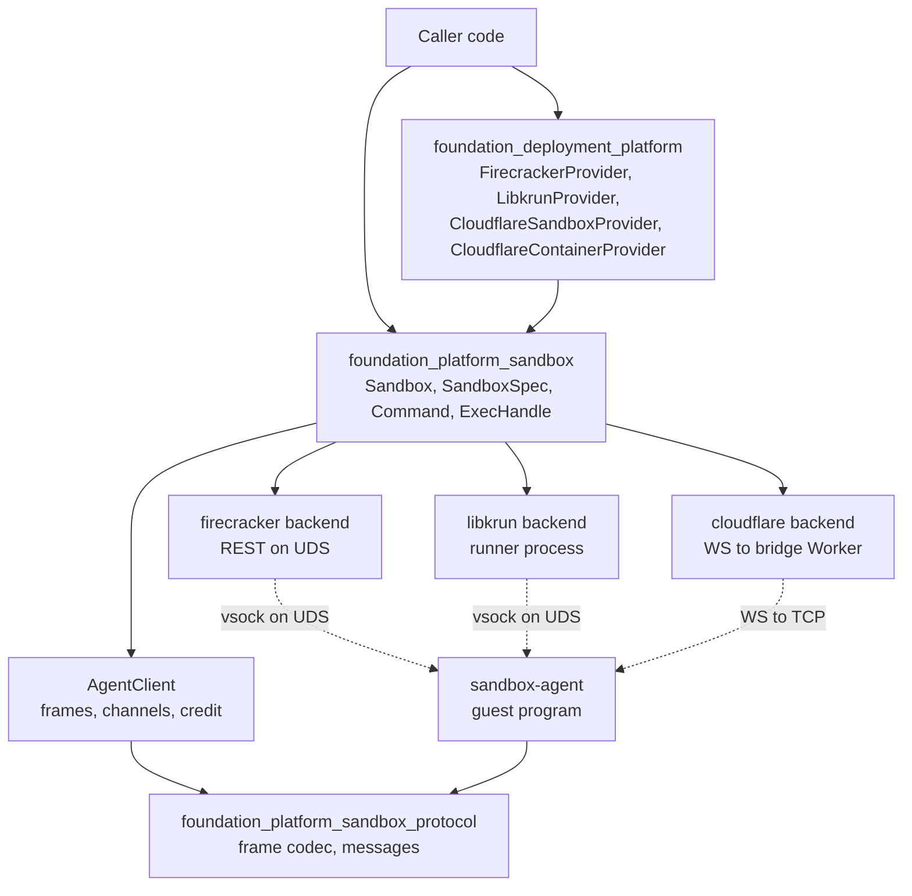
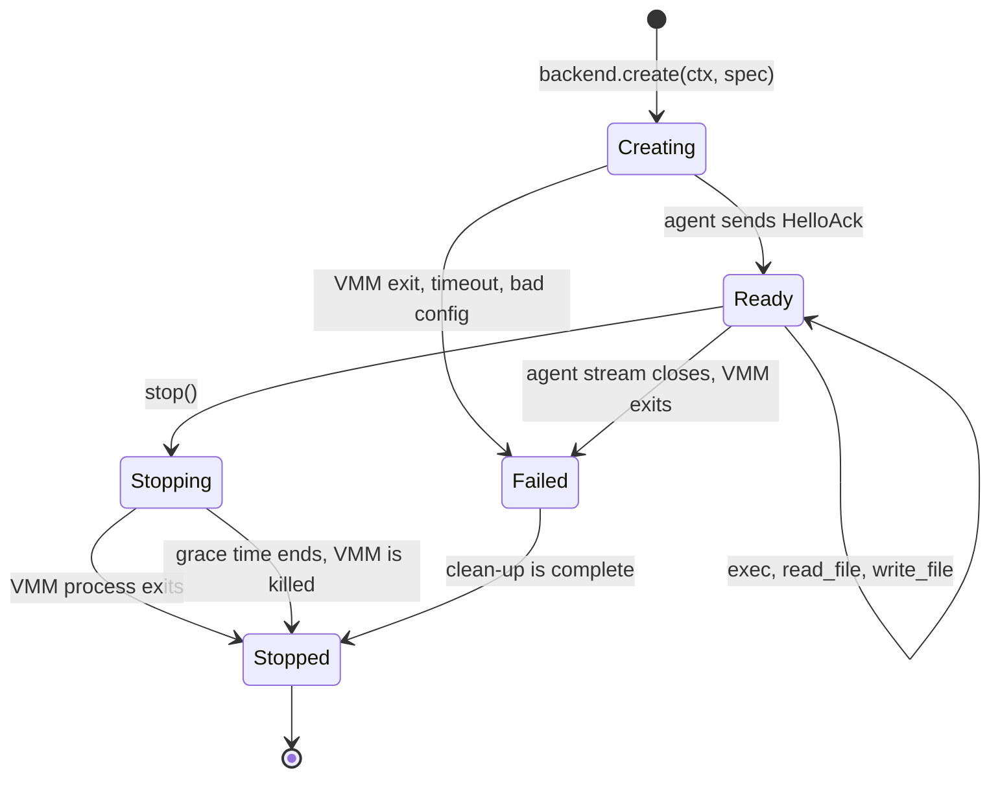
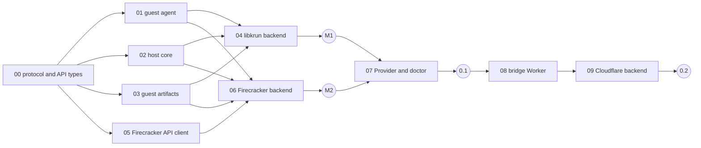

# Spec 77: Sandboxes (`foundation_platform_sandbox`)

_Written in ASD-STE100 Simplified Technical English (STE). Code and identifiers stay as they
are._

**Abbreviations in this file.** application programming interface (API); virtual machine
(VM); virtual machine monitor (VMM); Kernel-based Virtual Machine (KVM); Hypervisor.framework
(HVF); central processing unit (CPU); virtual CPU (vCPU); Unix domain socket (UDS);
Transparent Socket Impersonation (TSI); representational state transfer (REST); Hypertext
Transfer Protocol (HTTP); JavaScript Object Notation (JSON); process identifier (PID);
foreign function interface (FFI); Open Container Initiative (OCI); Durable Object (DO);
WebSocket (WS); Transmission Control Protocol (TCP); deterministic simulation testing (DST);
continuous integration (CI); pull request (PR); minimum viable product (MVP);
context identifier (CID); AeroSpace and Defence Industries Association of Europe (ASD), the
owner of the STE standard ASD-STE100.

## Glossary

| Term | Meaning |
|---|---|
| sandbox | An isolated Linux environment that runs commands for a caller. In this spec it is a microVM on the local host, or a container on Cloudflare. |
| microVM | A small VM with few devices and a fast start. Firecracker and libkrun make microVMs. |
| VMM | The host program that makes a VM and emulates its devices. Firecracker is a VMM program. libkrun is a VMM library. |
| host | The machine and the process that start the sandbox. |
| guest | The Linux system that runs inside the sandbox. |
| backend | The code that starts one kind of sandbox: `firecracker`, `libkrun` or `cloudflare`. |
| agent | Our small program, `sandbox-agent`, that runs in the guest. It starts commands and moves bytes for the host. |
| agent protocol | The frame format that the host and the agent use on one byte stream. |
| channel | One numbered conversation in the agent protocol. One command or one file transfer uses one channel. |
| runner | Our small host program, `sandbox-krun`. It loads libkrun and becomes the VM process. |
| vsock | A socket type for traffic between a VM and its host (`AF_VSOCK`). It needs no network device. |
| rootfs | The root file system of the guest. A directory (libkrun) or a disk image (Firecracker). |
| initramfs | A small archive that the kernel unpacks into memory and starts first. We put the agent in it for Firecracker. |
| run directory | One directory per sandbox on the host. It holds the sockets, the logs and the generated files. |
| bridge Worker | Our Cloudflare Worker. It starts a Cloudflare container and connects the host to the agent in it. |
| `Provider` | The trait in `foundation_deployment_platform/src/providers/mod.rs` that starts and stops a VM or a container. |
| `Ctx` | The shared context of spec 76. It carries the clock, the random number generator and typed entries. |

## 1. Problem

The platform can start Docker containers and QEMU or UTM VMs. It cannot start a small,
isolated sandbox in less than a second and run one command in it. Agent workloads need this:
they run code that the platform does not trust.

Four technologies give such a sandbox. Each has a different control model.

| Technology | Where it runs | How a caller controls it | What runs a command |
|---|---|---|---|
| Firecracker | Linux host with KVM | A REST API on a UDS. One `firecracker` process is one VM. | Nothing. The guest must have its own program for this. |
| libkrun | Linux with KVM, macOS on Apple silicon with HVF | A C library. `krun_start_enter` takes over the calling process. | Its built-in init runs one program, then the process exits. |
| Cloudflare Sandbox | Cloudflare network | A Worker with a DO calls `ctx.container.exec()`. No public REST API starts one. | The DO container API. |
| Cloudflare Containers | Cloudflare network | The same DO container API. The container runs a long service. | The image entry point. |

This spec gives the four one Rust API, and it makes each one a `Provider`.

## 2. Goals and limits

### 2.1 Goals

1. One async API to create a sandbox, run commands with streamed input and output, move
   files, and stop the sandbox.
2. Version 0.1: a caller starts a sandbox and runs a program in it on
   - Linux (x86_64 and aarch64) with Firecracker,
   - Linux (x86_64 and aarch64) with libkrun,
   - macOS (Apple silicon) with libkrun.
3. Version 0.2: the same API on Cloudflare Sandbox, and a service-style `Provider` for
   Cloudflare Containers.
4. Each backend implements `Provider` in `foundation_deployment_platform`.
5. Every design follows the root rules: async functions (rule 6), streamed bodies (rule 4),
   generated API types (rule 5), limits in configuration (rule 8), injected side effects
   (rule 11), tests in `tests/` (rule 7).

### 2.2 Not in version 0.1 or 0.2

These items are out of scope. They are not features of this spec. Each one becomes a GitHub
issue with the label `enhancement` when feature 07 lands.

- The Firecracker `jailer`, custom seccomp filters and cgroup limits for the VMM process.
- Guest network devices (tap, `passt`, `gvproxy`), port forwards and egress policy. Version
  0.1 has two network modes only (section 5.5).
- Snapshots, pause and resume.
- OCI image pull and layer unpack. Version 0.1 takes a rootfs directory, a rootfs image or
  an Alpine release archive (feature 03).
- Interactive terminals (pseudo terminal, window resize).
- The libkrun 2.0 API (section 4.2).
- Windows hosts.
- A Rust-native deploy of the bridge Worker. Version 0.2 uses `wrangler deploy`.

## 3. Architecture



_Caption: three backends start the guest in three ways; one agent and one protocol run the commands in all of them._

### 3.1 The main decision: one agent, one protocol, three transports

Firecracker has no command API. libkrun runs one program for each VM. Cloudflare has an
`exec()` call, but only inside a DO. If each backend used its own method, the public API
would have three sets of limits.

So each sandbox runs our agent in the guest. The host talks to the agent with one protocol.
The backends differ only in two things: how they start the guest, and which byte stream
carries the protocol.

| Backend | How the agent gets into the guest | Byte stream |
|---|---|---|
| Firecracker | We build an initramfs with the agent as `/init`. The user image does not change. | vsock. The guest connects to host CID 2, port 1024. Firecracker forwards that to the UDS `<uds_path>_1024`, where the host listens. |
| libkrun | `krun_fs_add_overlay_file` puts the agent in the root file system from memory. `krun_set_exec` starts it. The user directory does not change. | vsock. The guest connects to port 1024. `krun_add_vsock_port` forwards that to a UDS where the host listens. |
| Cloudflare | The container image contains the agent. Its entry point is the agent. | The agent listens on TCP port 1024 in the container. The bridge Worker pipes a WS to that port. |

The guest starts the connection on both local backends. The host listens on the UDS before
the VM starts. Thus the first accepted connection is also the signal that the guest is
ready. The host does not poll.

### 3.2 Crates and programs

| Path | Kind | Runs on | Purpose |
|---|---|---|---|
| `backends/foundation_platform_sandbox_protocol` | library | host and guest | Frame codec and message types. No I/O. No `foundation_*` dependency. |
| `backends/foundation_platform_sandbox` | library | host | Public API, `AgentClient`, the backends, guest artifacts, host checks. |
| `bin/sandbox_agent` | program `sandbox-agent` | guest (Linux, static musl) | The agent. Also PID 1 on Firecracker. |
| `bin/sandbox_krun` | program `sandbox-krun` | host | Loads libkrun, configures one VM, calls `krun_start_enter`. |
| `backends/foundation_deployment_platform` | library (existing) | host | New feature `sandbox`: the `Provider` implementations. |
| `infrastructure/sandbox_bridge` | Cloudflare Worker (TypeScript) | Cloudflare | Version 0.2. Starts containers and pipes the agent stream. |

Cargo features of `foundation_platform_sandbox`: `firecracker`, `libkrun`, `cloudflare`.
Default: `firecracker` and `libkrun`. A backend module compiles only on a target that can
run it (`firecracker`: Linux; `libkrun`: Linux and macOS). Shared code is in `src/shared/`
with no target gates (`.agents` rule: platform-agnostic code goes to `shared/`).

### 3.3 Sandbox life cycle



_Caption: a sandbox is `Ready` only after the agent answers; each failure path ends in `Stopped` with the run directory removed._

## 4. Upstream facts that shape the design

The research is in `learnings.md` with file and line references. This section gives the
facts that a reader must know.

### 4.1 Firecracker (commit `778a26c`, API version 1.19.0-dev)

- One `firecracker` process is one microVM. It needs read and write access to `/dev/kvm`.
  It supports Linux on x86_64 and aarch64 only.
- Control is a REST API (Swagger 2.0 file `src/firecracker/swagger/firecracker.yaml`) on
  the UDS given by `--api-sock`.
- Minimum start sequence: `PUT /machine-config`, `PUT /boot-source`, `PUT /drives/{id}`,
  `PUT /vsock`, then `PUT /actions` with `InstanceStart`.
- The guest needs an uncompressed kernel and a root file system image. Firecracker has no
  shared directory device.
- With an initramfs, no drive may have `is_root_device: true`. The init program cannot
  `pivot_root`; it must move the mount and `chroot` (`docs/initrd.md`).
- vsock: Firecracker maps guest ports to UDS paths. A guest connection to host port `P`
  goes to the UDS `<uds_path>_P`. A host connection goes to `<uds_path>` and starts with
  the text line `CONNECT P\n`.
- The serial console output goes to the standard output of the `firecracker` process.
- A guest `reboot` with the boot argument `reboot=k` stops the VM, and the process exits
  with code 0. Firecracker does not carry a guest exit code.
- The Firecracker CI kernel configs have vsock, initramfs, ext4, squashfs, overlayfs and
  tmpfs built in.

### 4.2 libkrun (stable branch `stable-1.19.x`, version 1.19.8)

- libkrun is a shared library. It uses KVM on Linux and HVF on macOS (Apple silicon). The
  guest kernel comes from a second library, `libkrunfw`.
- The 1.x C API is a set of `krun_*` functions on a context ID: `krun_create_ctx`,
  `krun_set_vm_config`, `krun_set_root`, `krun_set_exec`, `krun_start_enter`.
- `krun_start_enter` returns only on a configuration error. On success the VMM owns the
  process and calls `exit()` with the exit code of the guest program. **Thus libkrun must
  run in its own process.** This is why the runner exists.
- The root file system is a host directory, shared with virtio-fs. No disk image is
  necessary.
- `krun_set_exec` with `envp = NULL` copies the host environment into the guest. We always
  pass an explicit list.
- With no network device, libkrun adds a vsock device with TSI. TSI gives the guest the
  network of the host process. `krun_disable_implicit_vsock` and `krun_add_vsock(ctx, 0)`
  give a vsock device with no TSI.
- `krun_add_vsock_port(ctx, port, path)` forwards a guest connection on `port` to the host
  UDS `path`.
- `krun_fs_add_overlay_file` adds a file to a virtio-fs device from host memory. The memory
  must stay valid until the VM stops.
- On macOS the process that calls libkrun must be signed with the entitlement
  `com.apple.security.hypervisor`.
- **The `main` branch is libkrun 2.0 (`2.0.0-dev`).** Its API is different
  (`VmmBuilder`, `Payload`, `MmioDeviceManager`) and is not stable. Distributions and
  Homebrew ship 1.x. We target 1.x. Only `bin/sandbox_krun` calls libkrun, so a later move
  to 2.0 changes that program and nothing else.

### 4.3 Cloudflare (sandbox-sdk commit `61cac81`, package version 1.0.3)

- A Cloudflare sandbox is a DO and the container that the DO starts. The DO uses
  `this.ctx.container`: `start()`, `exec()`, `getTcpPort()`, `destroy()`.
- No public REST API starts a container for a caller. A caller must go through a Worker.
- Since version 1.0, `@cloudflare/sandbox` gives file helpers only. The DO class is
  application code. "Cloudflare Sandbox" and "Cloudflare Containers" are the same platform
  primitive with two usage styles.
- `wrangler dev` runs the Worker and its containers locally with Docker. Tests use it
  (specifications rule 3).

## 5. The public API

All functions that wait are `async fn` (root rule 6). A sync caller wraps them with
`foundation_core::valtron::block_on_future`. Feature 00 has the full signatures.

```rust
// Start
pub trait SandboxBackend: Send + Sync + 'static {
    fn id(&self) -> BackendId;
    fn probe(&self, ctx: &Ctx) -> HostReport;                       // no wait, no start
    fn create(&self, ctx: Ctx, spec: SandboxSpec) -> BoxFuture<'static, SandboxResult<Sandbox>>;
    fn create_with_progress(&self, ctx: Ctx, spec: SandboxSpec) -> CreateStream; // Stream<Sandbox, CreateProgress>
}

// Use
impl Sandbox {
    pub fn id(&self) -> &SandboxId;
    pub fn backend(&self) -> BackendId;
    pub fn state(&self) -> SandboxState;
    pub async fn exec(&self, command: Command) -> SandboxResult<ExecHandle>;   // streamed
    pub async fn run(&self, command: Command) -> SandboxResult<ExecOutput>;    // bounded capture
    pub async fn write_file(&self, path: &str, mode: u32, data: impl ByteStream) -> SandboxResult<u64>;
    pub async fn read_file(&self, path: &str) -> SandboxResult<FileStream>;
    pub async fn stop(&self) -> SandboxResult<ExitReport>;                      // graceful, then kill
    pub async fn kill(&self) -> SandboxResult<ExitReport>;                      // immediate
}
```

### 5.1 `SandboxSpec`

| Field | Type | Default | Notes |
|---|---|---|---|
| `rootfs` | `RootFs` | none (required) | `Directory(PathBuf)`, `Ext4Image(PathBuf)`, `SquashfsImage(PathBuf)`, `CloudflareImage(String)`. A backend rejects a kind that it cannot use. |
| `root_mode` | `RootMode` | `Overlay` | `Overlay`: the guest writes to a memory layer. `ReadOnly`: only `/tmp`, `/run` and the work directory are writable (tmpfs). The sandbox never changes the source rootfs. |
| `vcpus` | `u8` | 1 | Firecracker accepts 1 or an even number. |
| `memory_mib` | `u32` | 512 | |
| `network` | `NetworkMode` | `None` | Section 5.5. |
| `env` | `Vec<(String, String)>` | empty | Base environment of each command. The host environment is never copied. |
| `workdir` | `String` | `/workspace` | The agent creates it. |
| `mounts` | `Vec<HostMount>` | empty | Host directory to guest path, read-only flag. libkrun only in 0.1. |
| `kernel` | `Option<KernelSource>` | backend default | Firecracker needs one (feature 03 gives a default). libkrun uses `libkrunfw`. |
| `limits` | `SandboxLimits` | section 5.4 | |

### 5.2 `Command`, `ExecHandle`, `ExecOutput`

- `Command { argv: Vec<String>, env: Vec<(String, String)>, cwd: Option<String>, stdin: StdinMode, timeout: Option<Duration> }`.
  `argv[0]` is the program. No shell runs unless the caller asks for one (`sh -c`).
- `ExecHandle` gives: `stdin()` (an async byte sink, then `close()`), `events()` (an async
  stream of `ExecEvent::{Stdout(Bytes), Stderr(Bytes), Exit(ExitStatus)}`), `signal(i32)`
  and `wait()`.
- `ExitStatus { code: Option<i32>, signal: Option<i32> }`. Exactly one is `Some`.
- `run()` collects output up to `limits.max_captured_output` for each stream. `ExecOutput`
  has `stdout`, `stderr`, `status`, `stdout_truncated` and `stderr_truncated`. It is the
  only call that holds a body in memory, and the cap makes that safe (root rule 4).

### 5.3 Errors

`SandboxResult<T>` is `Result<T, ErrorTrace<SandboxError>>` (`foundation_errstacks`).
`SandboxError` is one enum with typed variants. The main groups:

| Group | Examples |
|---|---|
| Host set-up | `HostNotConfigured` (no `SandboxHost` in `Ctx`), `KvmUnavailable`, `HvfUnavailable`, `BinaryNotFound { name }`, `LibraryNotFound { name }`, `LibraryTooOld { symbol }`, `NotSigned` |
| Spec | `UnsupportedRootFs`, `UnsupportedNetwork`, `UnsupportedMount`, `InvalidSpec { field, reason }`, `SocketPathTooLong` |
| Start | `VmmExited { code, log_tail }`, `VmmApi { status, fault_message }`, `BootTimeout`, `AgentHandshake` |
| Use | `Protocol`, `AgentError { code, errno, message }`, `ChannelClosed`, `ExecTimeout`, `SandboxStopped` |
| Artifacts | `ArtifactHashMismatch`, `ArtifactUnsafePath`, `ArtifactTooLarge` |
| Cloudflare | `BridgeUnauthorized`, `Bridge { status, code, message }` |
| Choice | `NoBackend { reports }` |
| I/O | `Io { op, source }` |

Feature 00 defines every variant, so later features add no public API to the enum.

### 5.4 Limits (root rule 8)

All are fields of `SandboxLimits` with builder methods. No limit is a `const` in a code path.

| Field | Default | Source of the default |
|---|---|---|
| `boot_timeout` | 10 s | Firecracker reaches user space in about 125 ms; libkrun in less than 1 s. 10 s covers a slow CI host. |
| `shutdown_grace` | 5 s | Half of the Docker stop default (10 s). A microVM has less to stop. |
| `api_timeout` | 5 s | One Firecracker API call. They are local and synchronous. |
| `max_frame_payload` | 64 KiB | The pipe buffer size of Linux. One read gives at most one frame. |
| `channel_window` | 256 KiB | The default stream window of yamux. |
| `max_channels` | 128 | The default `SETTINGS_MAX_CONCURRENT_STREAMS` of nginx for HTTP/2. |
| `max_captured_output` | 1 MiB for each stream | The `client_max_body_size` default of nginx. |
| `max_error_message` | 64 KiB | The same as `BodyLimits::max_error_body` in this repository. |
| `output_drain_timeout` | 2 s | Time the agent waits for output after the program exits (feature 01). |

### 5.5 Network modes in 0.1

| Mode | Firecracker | libkrun | Cloudflare (0.2) |
|---|---|---|---|
| `None` (default) | No network device. The guest has only `lo`. | vsock with no TSI. The guest has only `lo`. | `enableInternet: false` |
| `Host` | `UnsupportedNetwork` (needs a tap device and root) | TSI with `KRUN_TSI_HIJACK_INET`. The guest uses the network of the runner process. | `enableInternet: true` |

### 5.6 Side effects (root rule 11)

The crate reads every side effect from the `Ctx`:

- time and timers: `ctx.clock()`;
- sandbox IDs and vsock CIDs: `ctx.rng()`;
- processes, sockets and the file system: one typed entry, `SandboxHost`, read with
  `ctx.get::<SandboxHost>()`.

`SandboxHost` holds three trait objects: `ProcessSpawner`, `StreamTransport` and `HostFs`.
Only a host entry point builds it (`SandboxHost::native()`). A missing entry gives
`SandboxError::HostNotConfigured`. There is no fall-back to the real system. Tests give an
in-memory `SandboxHost`, a `SimulatedClock` and a seeded `Ctx`, so a failed run replays from
its seed.

### 5.7 Valtron style

- I/O logic is native `async fn`.
- Each backend start sequence is one `#[task]` transition function on a state enum with a
  `Done` variant. It emits `TaskStatus::Pending(CreateProgress)` between steps and one
  `TaskStatus::Ready(result)`. `create()` runs it with `execute(..)` and awaits
  `into_ready_future()`. `create_with_progress()` returns the stream.
- The `AgentClient` reader is one long async task started with `execute(from_future(..))`.
  It parks on socket readiness. No loop spins on `Wait`.
- The `Provider` methods are sync by their trait. They wrap the async API with
  `block_on_future`. No other code blocks.

## 6. Features and order



_Caption: features 01, 02, 03 and 05 can run in parallel after feature 00; libkrun reaches the first working sandbox (M1) before Firecracker (M2)._

| # | Feature | Model | Done when |
|---|---|---|---|
| 00 | [Protocol and API types](features/00-protocol-and-api-types/feature.md) | sonnet | Both crates exist. The codec passes round-trip and limit tests. The public types compile. |
| 01 | [Guest agent](features/01-guest-agent/feature.md) | sonnet | `sandbox-agent` builds as a static musl program and passes its tests as a normal Linux process. |
| 02 | [Host core](features/02-host-core/feature.md) | opus | `AgentClient` and `AgentSandbox` run commands against a real agent process on a UDS, with no VM. |
| 03 | [Guest artifacts](features/03-guest-artifacts/feature.md) | sonnet | The crate fetches and caches a kernel and an Alpine rootfs, and builds the initramfs and an ext4 image. |
| 04 | [libkrun backend](features/04-libkrun-backend/feature.md) | sonnet | **M1.** `echo` runs in a libkrun microVM on Linux and on macOS. |
| 05 | [Firecracker API client](features/05-firecracker-api-client/feature.md) | sonnet | Generated types and request functions exist and pass tests against a mock UDS server. |
| 06 | [Firecracker backend](features/06-firecracker-backend/feature.md) | opus | **M2.** `echo` runs in a Firecracker microVM on Linux. |
| 07 | [Provider and doctor](features/07-provider-and-doctor/feature.md) | sonnet | **0.1.** `FirecrackerProvider` and `LibkrunProvider` implement `Provider`. An example runs a program. |
| 08 | [Cloudflare bridge Worker](features/08-cloudflare-bridge-worker/feature.md) | sonnet | The Worker runs in `wrangler dev`, starts a container and pipes the agent stream. |
| 09 | [Cloudflare backend](features/09-cloudflare-backend/feature.md) | sonnet | **0.2.** `echo` runs in a Cloudflare container through the same `Sandbox` API. |

### 6.1 Why libkrun is first

libkrun needs no kernel file and no disk image. A rootfs directory is enough. It also covers
macOS. So M1 proves the agent, the protocol and the host core with the least set-up.
Firecracker then adds the initramfs, the image and the REST client on top of proven parts.

### 6.2 The shortest path to 0.1

Features 00, 01, 02 and 04 give M1. Feature 03 has only its Alpine directory part on that
path. Each feature is one PR. No feature leaves a stub: a capability that a backend does not
have returns a typed `Unsupported*` error, and the capability table in `probe()` reports it.

## 7. Tests

| Level | Needs | What it proves | Where |
|---|---|---|---|
| Codec | nothing | Frames round-trip. Limits reject bad input. | `foundation_platform_sandbox_protocol/tests/` |
| Simulation (DST) | nothing | `AgentClient` logic with an in-memory transport, a `SimulatedClock` and a seeded `Ctx`. Covers credit, time-outs and stream loss. | `foundation_platform_sandbox/tests/` |
| Agent process | Linux | The real agent as a normal process on a UDS: exec, signals, files, drain. | `bin/sandbox_agent/tests/`, `foundation_platform_sandbox/tests/` |
| Mock VMM | nothing | The Firecracker start sequence against a mock REST server on a UDS. | `foundation_platform_sandbox/tests/` |
| Real microVM | KVM or HVF | The full path on each backend. | `foundation_platform_sandbox/tests/e2e_*.rs` |
| Cloudflare local | Docker, `wrangler` | The bridge and the agent in `wrangler dev`. | `foundation_platform_sandbox/tests/e2e_cloudflare.rs` |

A real microVM test checks the host first (`backend.probe()`). When the host has no KVM or
HVF, the test prints the reason and returns. It does not fail and it is not `#[ignore]`.
Section 9 asks the owner where these tests run in CI.

Each valtron test has the four attributes of the `rust-valtron-usage` skill
(`ntest::timeout`, `serial_test::serial`, `traced_test`, the pool guard).

## 8. Rules for every feature

- Read `learnings.md` first. It has the upstream file and line references.
- Tests go in `tests/` (root rule 7). One test must fail on the code before the feature.
- No `SystemTime::now()`, `Instant::now()`, `thread_rng()`, `std::process::Command::new` or
  `UnixListener::bind` outside `SandboxHost::native()` and the two programs in `bin/`.
- Time types are `foundation_compact::Instant` and `foundation_compact::SystemTime`
  (`.agents` reminder 14).
- Register each new crate in `ci/packages.toml`.
- Locally: `cargo fmt`, clippy with `--profile uat --no-deps`, and the tests of the changed
  crates (specifications rule 2).
- Update `progress.md` and `learnings.md` before the PR (root rule 10).
- Each bug or limit that a feature finds becomes a GitHub issue with a severity label (root
  rule 9).

## 9. Open questions for the owner

Each question has a recommendation. The features use the recommendation until the owner
gives a different answer.

| # | Question | Recommendation |
|---|---|---|
| Q1 | The request names `foundation_platform` for the `Provider` work. The `Provider` trait is in `foundation_deployment_platform`. `foundation_platform` is the desktop application shell. | Put the `Provider` implementations in `foundation_deployment_platform` (feature 07). |
| Q2 | libkrun 1.x (stable, packaged) or 2.0 (`main`, not stable)? | 1.x now. The runner isolates the choice. |
| Q3 | Should libkrun also have a "direct" mode with no agent (`krun_set_exec` runs the user program, one command for each VM)? It is the fastest path to a first demo, but it is a second code path with different limits. | No. One agent path on all backends. libkrun is still first to M1. |
| Q4 | The agent uses `std` threads and blocking I/O, not valtron. It must be a small static program that starts in milliseconds as PID 1. | Accept this exception to root rule 6 for `bin/sandbox_agent` only. |
| Q5 | How does a host program find `sandbox-agent` and `sandbox-krun`? | Configuration path first, then an environment variable, then the directory of the current program. A later issue covers embedding the agent with `include_bytes!`. |
| Q6 | Which CI runner has KVM for the real microVM tests? macOS runners cannot run HVF guests. | One Linux job on a runner with `/dev/kvm`. macOS libkrun is verified on a developer machine before each release, and `progress.md` records it. |
| Q7 | The bridge Worker: TypeScript or Rust (`workers-rs`)? The DO container API is new, and the Rust bindings may not have it. | TypeScript, less than 300 lines, with all logic in the Rust agent and client. |
| Q8 | `ResolvedPorts` has `ssh_port: u16` and `vnc_port: u16`. A sandbox has neither. The Docker provider already returns 0. | Return 0 in 0.1 and file a `severity: low` issue to make the two fields `Option<u16>`. |
| Q9 | The existing `start.md` workflow files are not in the newest spec (76). | Follow spec 76: `requirements.md`, `progress.md`, `learnings.md` and one `feature.md` for each feature. |
