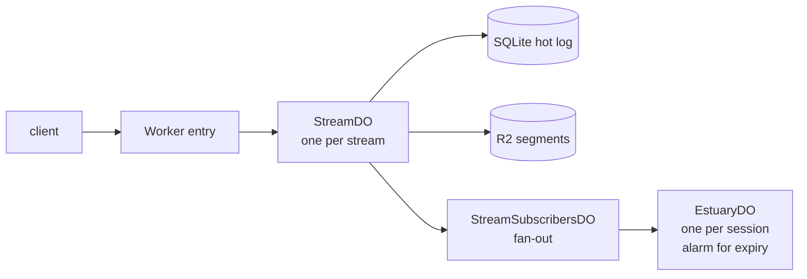

# Research: the cost techniques of Durable Streams on Cloudflare

_Written in ASD-STE100 Simplified Technical English (STE). Code and identifiers stay as they
are._

**Abbreviations in this file.** Durable Object (DO); Cloudflare Worker (Worker); Hypertext
Transfer Protocol (HTTP); Hypertext Transfer Protocol Secure (HTTPS); Content Delivery
Network (CDN); Analytics Engine (AE); Structured Query Language (SQL); Transport Layer
Security (TLS); remote procedure call (RPC); virtual private server (VPS); time to live
(TTL); AeroSpace and Defence Industries Association of Europe (ASD), the owner of the STE
standard ASD-STE100.

## 1. Purpose

This note records what the project `durable-streams-cloudflare` does to keep its Cloudflare
bill low. Feature 18 adopts two of its techniques. This note gives the fact and the
citation for each choice.

**Source.** `/Volumes/Outside/GitSources/src.Cloudflare/src.DurableObjects/durable-streams-cloudflare`,
read on 2026-11-27. All citations below are relative to that directory.

**Scope.** Read the documentation, the Worker configuration, the source of the server
package and the tests. This note does not copy code. It records what the code does and
whether the project measures the effect.

## 2. What the project is

It implements the Durable Streams protocol of Electric SQL. A client creates, appends to and
reads an append-only log. One DO for each stream is the only sequencer. The recent part of
the log is SQLite inside the DO. Old data rotates to R2 as immutable segments. A publish and
subscribe layer copies writes to a stream for each session.

_Caption: one DO for each stream holds the log; old data moves to R2; a second DO layer copies each write to the sessions._

## 3. The Cloudflare products it uses

| Product | What it does here | Citation |
|---|---|---|
| Durable Objects | `StreamDO` for each stream, `StreamSubscribersDO` for each source stream, `EstuaryDO` for each session. | `packages/server/wrangler.toml:6`, `packages/server/src/http/router.ts:303` |
| DO alarms | Expiry of a session. | `packages/server/src/http/v1/estuary/index.ts:33` |
| WebSockets with hibernation | The edge holds the client stream; the DO holds a hibernatable socket. | `packages/server/src/http/v1/streams/realtime/handlers.ts:636` |
| Workers Cache API | Lookup and store at the edge. | `packages/server/src/http/middleware/cache.ts:23`, `:79` |
| An external CDN and nginx | A cached response never reaches the Worker. | `README.md:136`, `:142` |
| R2 | Immutable cold segments. | `packages/server/wrangler.toml:25`, `.../streams/shared/rotate.ts:71` |
| KV | The `REGISTRY`: keys, origins, the public flag. | `packages/server/wrangler.toml:35`, `.../middleware/authentication.ts:49` |
| Queues | Fan-out when a stream has more than 200 subscribers. | `packages/server/wrangler.toml:41`, `.../estuary/stream-subscribers-do.ts:126` |
| Analytics Engine | One data point for each operation. | `packages/server/wrangler.toml:29`, `packages/server/src/metrics/index.ts:23` |
| D1, Workers AI | Not used. SQLite is DO storage. | no binding in `packages/server/wrangler.toml` |

## 4. The alarm API

The alarm is the Cloudflare DO alarm API. It is not a cron job and not a timer of the
Worker.

| Fact | Detail | Citation |
|---|---|---|
| Who sets it | `EstuaryDO.setExpiry` calls `this.ctx.storage.setAlarm(Date.now() + ttlSeconds * 1000)`. | `.../v1/estuary/index.ts:31`, `:33` |
| The value | One absolute time in milliseconds. It is not a delay object and not a rule. | the same line |
| One alarm for each DO | The storage holds one alarm. A second `setAlarm` replaces the pending one. | follows from the single timestamp |
| The handler | `async alarm()`: load the session, remove it from the subscriber DOs in batches of 20, delete the session stream, clear the local state. | `.../v1/estuary/index.ts:36`, `:44`, `:71`, `:78`, `:88` |
| Failure | The handler uses `Promise.allSettled` and logs a failure. It does not retry. | `.../v1/estuary/index.ts:48`, `:56` |
| The cost rule | A DO that waits for an alarm does not bill duration until the alarm fires. The work happens at the deadline, not in a poll loop. | the reason the project uses it, `docs/02-cost-analysis.md:28` |

**Why this matters for us.** Spec 77 feature 07 already uses the alarm for the idle
deadline. The DO has one alarm, so a second deadline must share it. Feature 18 sets the
alarm to the earlier of the idle deadline and the lifetime deadline.

## 5. The Analytics Engine

| Fact | Detail | Citation |
|---|---|---|
| The binding | `binding = "METRICS"`, `dataset = "durable_streams_metrics"`. | `packages/server/wrangler.toml:29`, `:30`, `:31` |
| The call | `env.METRICS.writeDataPoint({ blobs, doubles, indexes })`. | `packages/server/src/metrics/index.ts:15`, `:23` |
| The fields | blobs: stream, session, event type, error type. doubles: count, latency and others. indexes: the event category. | `packages/server/src/metrics/index.ts:6`, `:7`, `:8` |
| The read path | The admin pages call the AE SQL API: `POST /accounts/{id}/analytics_engine/sql`. | `packages/admin-core/src/lib/analytics.ts:13`, `:22`, `:24` |
| The price claim | The docs say that a write is free on the Workers Paid plan. | `docs/02-cost-analysis.md:145`, `:206` |
| A defect | The subscription page defaults to the dataset `subscriptions_metrics`. The Worker writes to `durable_streams_metrics`. | `packages/admin-subscription/src/lib/analytics.ts:37`, `packages/server/wrangler.toml:31` |

AE takes writes without a request of its own. It answers SQL questions over the data later.
It is not a billing report.

## 6. Why nginx and a CDN

| Fact | Detail | Citation |
|---|---|---|
| The Worker host | The Worker runs on `durable-streams.<subdomain>.workers.dev`. | `README.md:158` |
| The CDN rule | A Cloudflare CDN cannot name a `*.workers.dev` host as its origin. | `README.md:144`, `docs/02-cost-analysis.md:102` |
| The origin | A small nginx VPS forwards to the Worker over HTTPS. Cloudflare terminates TLS. | `packages/proxy/nginx.conf.template:2`, `:11`, `:29` |
| The nginx work | It sets the host and forwarding headers, turns off buffering and passes the stream headers. It does not cache and does not authenticate. | `README.md:151`, `packages/proxy/nginx.conf.template:12`, `:22` |
| The gain | A CDN hit costs no Worker request, no DO request and no bandwidth. | `README.md:142` |
| The price | About 16 ms and $6 for each month. | `docs/07-cdn-miss-investigation.md:177`, `README.md:151` |

The chain is: client, Cloudflare CDN, nginx VPS, Worker, DO. The CDN cannot start at the
Worker, so the nginx hop exists to give the CDN an origin that is not `workers.dev`.

## 7. Techniques and the evidence

| Technique | Mechanism | Evidence |
|---|---|---|
| One DO for each stream as the only writer; one `storage.batch` in the acknowledgement path | `getByName` routes a stream to one DO; one transaction commits the operation, the metadata and the producer state. | Code verified. The dollar figure is a model. |
| SSE bridge with hibernation | The edge holds the client; the DO holds a hibernatable WebSocket and sleeps between writes. | Code verified. The "100x" figure is a model. |
| Cache API lookup, ETag `304`, `X-Cache` header | A cached answer avoids a DO call. | A test asserts MISS then HIT. |
| Cache key with a reader key and a 20-second cursor cycle | The full URL is the key; a per-stream reader key stops the reuse of another reader's data. | A test asserts the rotation. |
| External CDN in front of nginx | A hit never reaches the Worker. | Measured hit rates: 98 to 99.6 percent. |
| Coalescing at the edge and in the DO | One in-flight answer for each key; a recent-read cache of 100 ms in the DO. | Unit tests verify one shared answer. |
| Long-poll stagger and a pre-write into the cache | The DO wakes the first waiter, spreads the rest, and writes the answer into the cache first. | Measured: 91 percent against 87 percent hit rate. |
| Compaction to R2 at 1,000 messages or 4 MB | A segment, its row and the delete of the hot rows are one batch. | A functional test only. |
| An alarm for TTL instead of a poll | The work happens at the deadline. | Code verified. |
| Queue fan-out above 200 subscribers | The fan-out leaves the request path. | A functional test only. |

**One correction.** R2 reads do not use range requests. The code fetches the whole object
and decodes it. `.../streams/read/path.ts:219`.

## 8. Are the savings measured?

No. Every dollar figure in `docs/02-cost-analysis.md` is an arithmetic model: an assumed
count times a unit price. No test, script or export in the repository computes a dollar
figure.

| Figure | Input assumptions | Citation |
|---|---|---|
| About $4,170 and $43 for each month (SSE against hibernation) | 1,000 connections, 24 hours, 128 MiB for each DO, $12.50 for each million gigabyte-seconds | `docs/02-cost-analysis.md:24`, `:28`, `:32`, `:34` |
| About $4.05 for each month for one DO | one DO, 128 MiB, 24 hours | `docs/02-cost-analysis.md:24`, `:25` |
| $1,950 for each month of Worker requests | 10,000 readers, one request each 4 seconds, 6.5 billion for each month, $0.30 for each million | `docs/02-cost-analysis.md:58`, `:59` |
| $87.60 and $9.75 of DO requests | 585 or 65 million requests, $0.15 for each million, 91 or 99 percent hit rate | `docs/02-cost-analysis.md:60`, `:61` |
| $11,700, $8,145, $92 and $18 | 10,000 readers, one write each second, 30 days, 79, 91 or 99 percent hit rate, a $6 server | `docs/02-cost-analysis.md:86`, `:90`, `:92`, `:94` |
| $32.50 of KV, $11.61 of R2, about $3 of fan-out | read and write counts times unit prices | `docs/02-cost-analysis.md:153`, `:162`, `:128` |

The hit rates in these models come from measurements: `docs/06-request-collapsing.md:242`
and `docs/07-cdn-miss-investigation.md:94`. The prices come from the Cloudflare list. The
totals do not come from a bill.

**Verdict.** The techniques are real and tested. The saving is a model, not a measurement.
Treat a percentage in the README as an estimate.

## 9. What we adopt, and what we do not

| Technique | Decision | Reason |
|---|---|---|
| One DO for each sandbox as the only writer | Already ours (feature 02, `SandboxIdPolicy::Fixed`). No change. | Our record lives in the DO. |
| One alarm for two deadlines | **Adopt** in feature 18. | The idle deadline uses the only alarm today. A lifetime limit must share it. |
| A bound on the wake time of a stream | **Adopt** in feature 18. | An open RPC stream is an open request; the DO stays billed. |
| Hibernation behind a WebSocket | Do not adopt now. | `SandboxService` is RPC over HTTP. Hibernation changes the protocol of every call. |
| Edge cache of `Probe` and `List` | Later feature. | `Probe` is a good fit: the answer is the same for each caller for a short time. `List` needs a short TTL and care with `NotFound`. |
| Coalescing of identical calls in one isolate | Later feature. | It needs the Worker cache layer first. |
| Analytics Engine for cost and use | Later feature. | It needs a decision on the dataset and the operator view. |
| A reader key in the URL | Not ours. | Our token is in the header; the answers are not public. |
| Compaction of the log to R2 | Not ours. | Our DO holds a record, not a log. |

Feature 18 holds the two adopted items. The others name their reason here.

## 10. Lessons

1. A DO has one alarm. A design with two deadlines must compute the earlier one.
2. A model is not a measurement. Write the input assumptions next to the number.
3. The edge cache helps a repeated read. It cannot help an `Exec` stream.
4. The CDN needs an origin that is not `workers.dev`. Our Worker has no CDN in front of it
   today. A CDN would need the same nginx hop, and a public host name.
5. Analytics Engine gives usage data without a request. It does not give the price.
