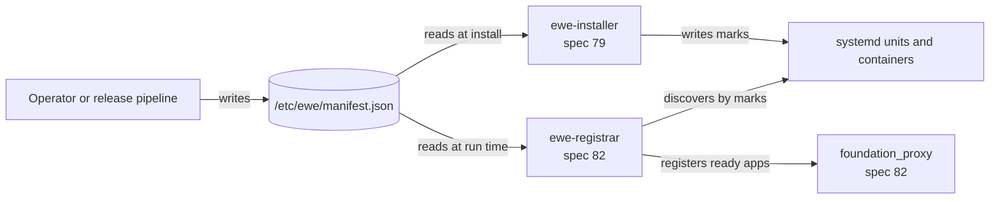

# Manifest Contract

_Written in ASD-STE100 Simplified Technical English (STE). Code and identifiers stay as they
are._

**Abbreviations in this file.** JavaScript Object Notation (JSON); uniform resource locator
(URL); Secure Hash Algorithm with 256 bits (SHA-256); Domain Name System (DNS); Hypertext
Transfer Protocol (HTTP); Transmission Control Protocol (TCP); remote procedure call (RPC);
identifier (ID); continuous integration (CI); Transport Layer Security (TLS); Debian package
manager (apt); AeroSpace and Defence Industries Association of Europe (ASD), the owner of the
STE standard ASD-STE100.

## Glossary

| Term | Meaning |
|---|---|
| Adapter | One implementation of a trait for one kind of thing. Example: the `github-release` source adapter. |
| Artifact | The local result of a source adapter: a file, an installed tool, or a container image. |
| Bootstrap script | A short shell script that holds the manifest, downloads the installer, checks it and runs it. Spec 79. |
| Container | A running copy of a container image, managed by the Docker engine. |
| Deploy target | How one entry runs on the host: a systemd unit, a container, or nothing. |
| Entry | One item of the manifest: one piece of software to install. |
| Install record | The installer's own file of what it installed. Spec 79. |
| Manifest | The JSON file that lists the entries. This specification owns its format. |
| Mark | A named value on a systemd unit or a container that tells the registrar which entry it is. |
| Probe | A startup, liveness or readiness check that the registrar runs against an app. Spec 82. |
| Registrar, sidecar | `ewe-registrar`. It reads the manifest, finds installed apps, probes them and reports to the proxy. Spec 82. |
| Source | Where one entry's software comes from: a GitHub release, a URL, cargo, apt, mise, or a container image. |
| systemd unit | A file that tells systemd, the Linux service manager, how to start, stop and restart one program. |

## 1. Purpose

The manifest is the only shared format in the serving system. It lists the software of one
machine. Two programs read it, and only two:

| Program | Spec | Reads |
|---|---|---|
| `ewe-installer` | 79 | `manifest_version`, `name`, `version`, `source`, `deploy` |
| `ewe-registrar` | 82 | `manifest_version`, `name`, `version`, `deploy.kind`, `proxy`, `probes` |

They parse the file independently, each with its own Rust types. There is **no shared Rust
crate**. This specification is the contract: field names, types, rules and examples. A change to
the contract changes this file first.



_The diagram shows one file, two readers, and the marks that let the registrar find what the installer started._

## 2. Story

**Success.** An operator writes one manifest for a host. The bootstrap script writes it to
`/etc/ewe/manifest.json`, downloads `ewe-installer`, checks its checksum and runs it. The
installer installs and starts every entry. Later, `ewe-registrar` reads the same file, finds the
started entries by their marks, probes them, and registers the ready ones with the proxy.

**Failure.** A manifest with a duplicate name, an unknown `kind`, a bad checksum or an
unsupported `manifest_version` stops before any download starts. Each reader reports the JSON
path of the fault. A manifest that the installer accepts but the registrar rejects is a contract
bug; the shared fixtures must catch it.

**Use cases:**

| User | Wants | Result |
|---|---|---|
| Operator | Write one file that describes a machine | One manifest, one install command |
| Release pipeline | Make one manifest for each host kind | A manifest per host kind, checked before release |
| Installer (79) | Install exactly the listed software | Entries applied in list order; a failure does not stop later entries unless a dependency needs it |
| Registrar (82) | Find what runs and where it listens | Entries discovered by marks; `proxy` and `probes` drive registration |

## 3. Bounded context

**Inside this specification:** the JSON format, the field rules, the meaning of each block, the
marks, the version rule, the canonical schema and the shared fixtures.

**Outside this specification:** how software is downloaded, installed, started, upgraded or
rolled back (79); how discovery, probing, metrics, registration and routing work (82); how
`foundation_proxy` routes a request (completed spec 63 and spec 82).

**Entities and their single owner:**

| Entity | Owner | Others |
|---|---|---|
| `Manifest`, `Entry`, `SourceSpec`, `DeploySpec` | this specification | 79 and 82 parse them; neither owns the format |
| `proxy` block (`ProxyBlock`, `RouteBlock`) | this specification (format); 82 (behaviour) | 79 stores it as an opaque value |
| `probes` block (`ProbesBlock`, `ProbeSpec`, `ProbeCheck`) | this specification (format); 82 (behaviour) | 79 stores it as an opaque value |
| Install record, lock, `Deployed` | 79 | 82 never reads them |
| Marks on units and containers | this specification | 79 writes them; 82 reads them |
| `BackendSpec`, registry, sessions | 82 | this specification does not know them |

**Words with one meaning:**

- **Entry**: one manifest item. Not "app", not "service", not "backend". Those words describe
  other things.
- **Source**: where the software comes from. **Deploy target**: how it runs. A source is not a
  deploy target.
- **Mark**: the installer's public label on a unit or container. **Install record**: the
  installer's private file. The registrar reads marks, never the install record.
- **Ready**: the registrar's probe state. The installer never decides readiness.

## 4. Rules

**R1. One versioned format.** The top level has `manifest_version` (integer). Version `1` is the
format in this file. A reader that sees a higher number stops with
`UnsupportedManifestVersion`. A reader must not guess.

**R2. Two readers, no shared crate.** The installer and the registrar each parse the manifest
with their own types. The JSON is the only contract.

**R3. List order is install order.** The installer applies entries in list order. An entry may
depend on an earlier entry (for example, a tool that a later entry runs). A manifest must not
rely on a later entry.

**R4. Names are unique and safe.** An entry `name` matches `[a-z0-9-]{1,63}` with no leading or
trailing `-` (the DNS label rule). Names are unique. The name becomes the systemd unit name
(`ewe-<name>.service`), the container name and the registrar's backend name.

**R5. Required blocks.** Each entry has `name`, `version`, `source` and `deploy`. `proxy` and
`probes` are optional.

**R6. Unknown fields are ignored; unknown kinds are errors.** A reader ignores a field it does
not know, so a newer writer can add fields that an older reader skips. A `kind` value that a
reader does not know is an error, because the reader cannot act on it.

**R7. No download before validation.** A reader validates the whole manifest before the
installer downloads or starts anything. The first fault stops the run and names its JSON path.

**R8. Integrity is part of the contract.** Every downloaded file carries a lowercase hex
SHA-256 in the manifest. A matching checksum is required before the file is used.

**R9. `proxy` and `probes` are opaque to the installer.** The installer keeps them as raw JSON
values and does not reject a change that only the registrar understands.

**R10. Marks are part of the contract.** The installer writes `EWE_ENTRY` and `EWE_VERSION` on a
systemd unit, and `dev.ewe.entry` and `dev.ewe.version` on a container. The registrar finds
entries by these marks.

**R11. Limits are configuration.** Each reader has a maximum manifest size and a parse timeout
on its own config type. The default maximum is 1 MiB. The default parse timeout is 5 seconds.
Both are documented on the config type.

**R12. No secrets in the manifest.** The manifest holds no password, token or private key. It
may name an environment variable or a file path, but it never holds the secret value. A
manifest is readable by every process on the host.

## 5. Format

### 5.1 Complete example

```json
{
  "manifest_version": 1,
  "entries": [
    {
      "name": "agent-rpc",
      "version": "0.4.0",
      "source": {
        "kind": "github-release",
        "repo": "ewe-studios/ewe_platform",
        "tag": "agent-rpc-v0.4.0",
        "assets": {
          "x86_64-unknown-linux-gnu": { "name": "agent-rpc-x86_64-linux", "sha256": "9f2c..." },
          "aarch64-unknown-linux-gnu": { "name": "agent-rpc-aarch64-linux", "sha256": "1ab4..." }
        }
      },
      "deploy": {
        "kind": "systemd",
        "args": ["serve", "--bind", "0.0.0.0:7443"],
        "env": { "RUST_LOG": "info" },
        "user": "ewe",
        "restart": "on-failure"
      },
      "proxy": {
        "service": "agents",
        "route": { "host": "agents.example.com", "path_prefix": "/" },
        "port": 7443,
        "protocol": "grpc"
      },
      "probes": {
        "startup":   { "kind": "tcp",  "port": 7443, "period_secs": 2,  "failure_threshold": 30 },
        "liveness":  { "kind": "grpc", "port": 7443, "period_secs": 10 },
        "readiness": { "kind": "http", "port": 7443, "path": "/healthz", "period_secs": 5 }
      }
    },
    {
      "name": "ripgrep",
      "version": "14.1.0",
      "source": { "kind": "cargo", "crate": "ripgrep", "program": "rg" },
      "deploy": { "kind": "none" }
    },
    {
      "name": "vector-db",
      "version": "1.9.0",
      "source": {
        "kind": "docker-image",
        "repository": "ghcr.io/example/vector-db",
        "tag": "1.9.0",
        "digest": "sha256:4f3c..."
      },
      "deploy": {
        "kind": "docker",
        "ports": [{ "host": 6333, "container": 6333, "protocol": "tcp" }],
        "env": { "LOG_LEVEL": "info" },
        "volumes": [{ "host": "/var/lib/vector-db", "container": "/data" }],
        "restart": "unless-stopped"
      }
    }
  ]
}
```

What the example shows. `agent-rpc` is a downloaded binary that runs as a systemd unit, and the
registrar will tell the proxy about it. `ripgrep` is a tool that cargo installs; nothing runs.
`vector-db` is an image that runs as a container; it has no `proxy` block, so no proxy route
points to it.

### 5.2 Top level

| Field | Type | Required | Rule | Example |
|---|---|---|---|---|
| `manifest_version` | integer | yes | Exactly `1` today. A higher value stops the reader. | `1` |
| `entries` | array of `Entry` | yes | May be empty. Names are unique. List order is install order. | see above |

### 5.3 `Entry`

| Field | Type | Required | Rule | Example |
|---|---|---|---|---|
| `name` | string | yes | `[a-z0-9-]{1,63}`, no leading or trailing `-`, unique. | `agent-rpc` |
| `version` | string | yes | The publisher's version text. Compare as text; do not sort. | `0.4.0` |
| `source` | object | yes | Section 5.4. | |
| `deploy` | object | yes | Section 5.5. | |
| `proxy` | object | no | Section 5.6. The installer does not read it. | |
| `probes` | object | no | Section 5.7. The installer does not read it. | |

### 5.4 `source`

`source.kind` picks the variant.

| `kind` | Fields | Gives | Integrity |
|---|---|---|---|
| `github-release` | `repo` (`owner/repo`), `tag`, `assets` (map from target triple to `{name, sha256}`) | A downloaded file | SHA-256 of the selected asset |
| `url` | `url` (HTTPS only), `sha256` | A downloaded file | SHA-256 |
| `cargo` | `crate`, `program` (optional; default is the crate name) | An installed tool | cargo `--locked` and crates.io checksums |
| `apt` | `package`, `program` (optional) | An installed tool | Signed apt repository metadata |
| `mise` | `tool`, `program` (optional) | An installed tool | mise checksums |
| `docker-image` | `repository`, `tag`, `digest` (optional) | A container image in the local store | The digest, if set; otherwise the pulled digest is recorded |

Rules:

- `github-release` selects `assets[<target-triple>]`. A missing target triple is an error.
- `url` accepts only `https://`.
- `sha256` and `digest` are lowercase hex. A SHA-256 is 64 hex characters.
- A tool source names `program` only when the installed program differs from the package name.
- `docker-image` may omit `digest`. The installer then records the digest that Docker reports
  after the pull.

### 5.5 `deploy`

`deploy.kind` picks the variant.

| `kind` | Fields | Defaults | Accepts |
|---|---|---|---|
| `systemd` | `args` (array of string), `env` (map), `user` (string), `restart` (`no`, `on-success`, `on-failure`, `always`) | `args=[]`, `env={}`, `user="ewe"`, `restart="on-failure"` | A file or a tool |
| `docker` | `ports` (array of `{host, container, protocol}` where protocol is `tcp` or `udp`), `env`, `volumes` (array of `{host, container}`), `restart` (`no`, `always`, `on-failure`, `unless-stopped`), `command` (array) | `ports=[]`, `env={}`, `volumes=[]`, `restart="unless-stopped"`, `command` = image command | An image |
| `none` | none | | A file, a tool or an image (pull only) |

Any other artifact and deploy pair is an `Incompatible` error before any download starts.

Port rules: `host` and `container` are 1 to 65535. A protocol is `tcp` or `udp`. A volume path
is absolute.

### 5.6 `proxy`

The registrar reads this block. The installer stores it.

| Field | Type | Required | Rule | Example |
|---|---|---|---|---|
| `service` | string | yes | The proxy service name. `[a-z0-9-]{1,63}`. | `agents` |
| `route` | object | yes | `{host, path_prefix?}`. | |
| `route.host` | string | yes | An exact DNS name or a wildcard `*.example.com`. | `agents.example.com` |
| `route.path_prefix` | string | no | Starts with `/`. Default `/`. | `/` |
| `port` | integer | yes | 1 to 65535. The port that the app listens on. | `7443` |
| `protocol` | string | yes | `http`, `https`, `connect`, `grpc` or `grpc-web`. | `grpc` |
| `weight` | integer | no | 1 to 1000. Default `1`. | `1` |

### 5.7 `probes`

The registrar reads this block. The installer stores it. The fields and defaults are the
Kubernetes probe fields.

| Field | Type | Default | Meaning |
|---|---|---|---|
| `startup` | `ProbeSpec` or absent | absent | The app is not checked for liveness or readiness until this passes. |
| `liveness` | `ProbeSpec` or absent | absent | A failure restarts the app (registrar policy, spec 82). |
| `readiness` | `ProbeSpec` or absent | absent | A failure removes the app from the proxy rotation. |
| `period_secs` | integer | `10` | Seconds between checks. Must be at least 1. |
| `timeout_secs` | integer | `1` | Seconds before one check fails. Must be at least 1. |
| `failure_threshold` | integer | `3` | Failures in a row that make the probe fail. Must be at least 1. |
| `success_threshold` | integer | `1` | Successes in a row that make the probe pass. Must be at least 1. |
| `initial_delay_secs` | integer | `0` | Seconds to wait after the app starts. |

`ProbeSpec.kind` picks the check:

| `kind` | Fields | Passes when |
|---|---|---|
| `http` | `port`, `path` (starts with `/`) | A `GET` returns a 2xx or 3xx status. |
| `tcp` | `port` | A TCP connect succeeds. |
| `grpc` | `port`, `service` (optional; empty means the whole server) | `grpc.health.v1.Health/Check` returns `SERVING`. |
| `exec` | `command` (array of string; never a shell string) | The command exits with code 0. Host mode only. |

### 5.8 Marks

The installer marks what it starts. The registrar finds entries by these marks, without reading
the installer's install record.

| Deploy kind | Mark | Example |
|---|---|---|
| systemd | `Environment=EWE_ENTRY=<name>` | `Environment=EWE_ENTRY=agent-rpc` |
| systemd | `Environment=EWE_VERSION=<version>` | `Environment=EWE_VERSION=0.4.0` |
| docker | label `dev.ewe.entry=<name>` | `dev.ewe.entry=agent-rpc` |
| docker | label `dev.ewe.version=<version>` | `dev.ewe.version=0.4.0` |

A mark that does not match the manifest entry is ignored by the registrar, with a warning. The
manifest stays the source of truth.

## 6. Validation

A reader validates in this order and stops at the first fault:

| # | Check | Error |
|---|---|---|
| V1 | The file is readable and at most `max_bytes`. | `Io`, `TooLarge` |
| V2 | The bytes are JSON. | `Json` |
| V3 | `manifest_version` is `1`. | `UnsupportedManifestVersion` |
| V4 | `entries` is an array; each entry has the required fields. | `Validation { path, message }` |
| V5 | Each name is valid and unique. | `Validation { path: "/entries/<i>/name" }` |
| V6 | Each `source.kind` and `deploy.kind` is known. | `UnknownKind { path, kind }` |
| V7 | The source fields follow section 5.4. | `Validation` |
| V8 | The deploy fields follow section 5.5. | `Validation` |
| V9 | The artifact and deploy target are compatible. | `Incompatible` (79) |
| V10 | Each `proxy` block follows section 5.6, if present. | `Validation` (82) |
| V11 | Each `probes` block follows section 5.7, if present. | `Validation` (82) |

A JSON path is always present in a validation error, for example
`/entries/2/probes/readiness/period_secs`.

## 7. Acceptance scenarios

1. **A complete manifest parses.** Given the example in section 5.1, when the installer and the
   registrar parse it, then both accept it and read the fields they own.
2. **A newer format stops both readers.** Given `manifest_version: 2`, when either reader parses
   it, then it returns `UnsupportedManifestVersion` and reads no entry.
3. **A duplicate name stops the run.** Given two entries named `agent-rpc`, when the installer
   parses it, then it returns a validation error at `/entries/1/name` and downloads nothing.
4. **An unknown kind stops the run.** Given `"source": {"kind": "snap"}`, when either reader
   parses it, then it returns `UnknownKind` at `/entries/0/source/kind`.
5. **Plain HTTP is rejected.** Given a `url` source with `http://`, when the installer parses
   it, then it returns a validation error at `/entries/0/source/url`.
6. **A bad checksum is rejected.** Given a `sha256` that is not 64 lowercase hex characters,
   when the installer parses it, then it returns a validation error and downloads nothing.
7. **Unknown fields are ignored.** Given an entry with `"future_field": true`, when either
   reader parses it, then it accepts the entry and ignores the field.
8. **The installer keeps the registrar's blocks.** Given an entry with `proxy` and `probes`,
   when the installer parses it, then the two values are unchanged in its `Entry`.
9. **Marks identify an entry.** Given an installed systemd unit with `EWE_ENTRY=agent-rpc`, when
   the registrar discovers units, then it maps the unit to the `agent-rpc` entry.
10. **An empty list is valid.** Given `"entries": []`, when either reader parses it, then it
    accepts the manifest and does nothing.

## 8. Tests

The canonical files live in this spec directory:

- `manifest.schema.json` — JSON Schema draft 2020-12. It encodes sections 5 and 6.
- `fixtures/valid/*.json` — manifests that both readers must accept.
- `fixtures/invalid/*.json` — one fault per file, named for the rule (`v3-version-2.json`,
  `v5-duplicate-name.json`, …).

| Scenario | Fixture | Oracle |
|---|---|---|
| 1 | `valid/complete.json` | Both parsers return the expected `Entry` values. |
| 2 | `invalid/v3-version-2.json` | `UnsupportedManifestVersion` |
| 3 | `invalid/v5-duplicate-name.json` | Error path `/entries/1/name` |
| 4 | `invalid/v6-unknown-kind.json` | `UnknownKind` at `/entries/0/source/kind` |
| 5 | `invalid/v7-http-url.json` | Error path `/entries/0/source/url` |
| 6 | `invalid/v7-bad-sha256.json` | Error path `/entries/0/source/sha256` |
| 7 | `valid/unknown-field.json` | Both parsers accept it. |
| 8 | `valid/complete.json` | `Entry.proxy` and `Entry.probes` equal the input values. |
| 9 | `valid/marks.json` | The registrar maps the marks to the entry. |
| 10 | `valid/empty.json` | Both parsers accept it; the installer runs zero entries. |

Each reader copies the fixtures it uses into its own `tests/fixtures/manifest/` directory. A CI
check compares each copy with the canonical file by SHA-256. A changed canonical file without a
changed copy fails the check; so does a changed copy without a changed canonical file.

## 9. Tasks

- [ ] **M1 — Write the schema.** Create `manifest.schema.json` from sections 5 and 6. It must
      reject each invalid fixture and accept each valid fixture.
- [ ] **M2 — Write the fixtures and examples.** Add the canonical valid and invalid fixtures,
      the marks fixture, and one example for each deploy kind (systemd, Docker, none).
- [ ] **M3 — Add the drift check.** Add `scripts/ci/manifest_contract.py`. It compares the
      SHA-256 of each consumer copy with the canonical file. Wire it into `ci.py plan` as a
      step. It fails with the path of the drifted file.
- [ ] **M4 — Record the consumer handshake.** Add a short section to the 79 and 82 feature
      files: which fixtures each reader copies, and the test that consumes them. This is a
      cross-reference only; the parser work belongs to those specs.

## 10. Verify

```bash
# Validate the schema itself and every fixture (Python, no network).
python3 -I scripts/ci/manifest_contract.py --check-schema

# Check that each consumer holds an identical copy.
python3 -I scripts/ci/manifest_contract.py --check-copies

# Validate every fixture against the schema (requires check-jsonschema).
check-jsonschema --schemafile specifications/78-manifest-contract/manifest.schema.json \
  specifications/78-manifest-contract/fixtures/valid/*.json
```

The invalid fixtures are checked by the consumer tests in 79 and 82; they must fail to parse.

## 11. Done when

- [ ] `manifest.schema.json` encodes every field, rule and default in section 5.
- [ ] Every valid fixture passes the schema and every invalid fixture fails it.
- [ ] Each invalid fixture names one rule and one JSON path.
- [ ] The drift check runs in CI and fails on a one-byte change in either copy.
- [ ] Specs 79 and 82 name the fixtures their readers copy.
- [ ] No field in this contract has an undocumented default.
- [ ] The manifest holds no secret value (R12).

## 12. Open questions

1. **Keep `manifest_version`?** Yes. Two programs built at different times read the file. Each
   must know when it cannot read it. The JSON Schema handles structure; the version handles
   semantics that a schema cannot express.
2. **Prune entries that leave the manifest?** The installer's open question. This specification
   does not decide it. The contract says only that an entry that leaves the manifest stops being
   installed; it does not say who removes its files.
3. **Linux only?** Version 1 targets Linux. The `systemd` and `apt` kinds are Linux-only. A
   future version may add an OS field. Do not add it now.

---

_Created: 2026-11-14_
_Structure: Simple specification (has_features: false)_
