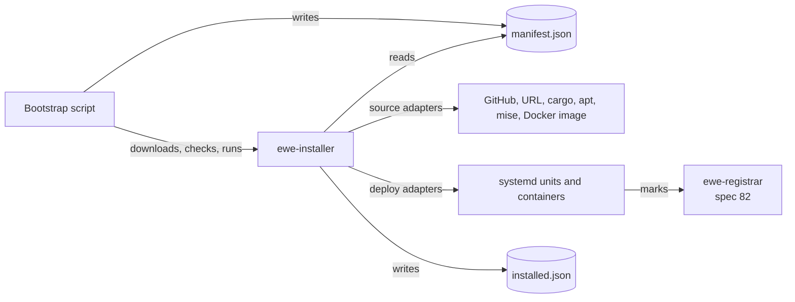
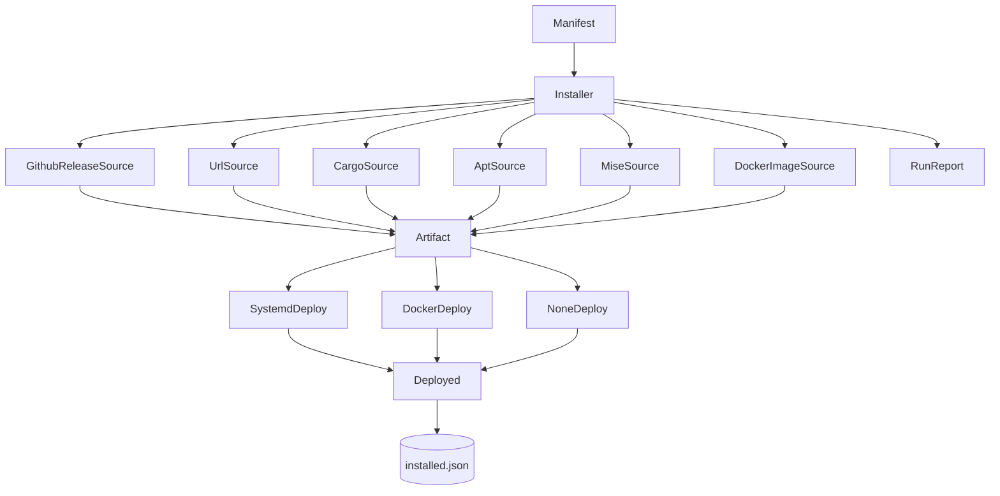

# Manifest Installer

_Written in ASD-STE100 Simplified Technical English (STE). Code and identifiers stay as they
are._

**Abbreviations in this file.** JavaScript Object Notation (JSON); uniform resource locator
(URL); Secure Hash Algorithm with 256 bits (SHA-256); command-line interface (CLI); operating
system (OS); identifier (ID); continuous integration and continuous delivery (CI/CD); remote
procedure call (RPC); input/output (I/O); Debian package manager (apt); AeroSpace and Defence
Industries Association of Europe (ASD), the owner of the STE standard ASD-STE100.

## Glossary

| Term | Meaning |
|---|---|
| Adapter | One implementation of a trait for one kind of thing. Example: the `systemd` deploy-target adapter. |
| Artifact | The local result of a source adapter: a file, an installed tool, or a container image. |
| Bootstrap script | A short shell script that holds the manifest, downloads the installer, checks it and runs it. |
| Deploy target | How one entry runs: a systemd unit, a container, or nothing. |
| Entry | One item of the manifest: one piece of software to install. |
| Install record | The installer's private file of what it installed, in `installed.json`. |
| Manifest | The JSON contract owned by spec 78. This spec parses it; it does not define it. |
| Mark | The `EWE_ENTRY`/`EWE_VERSION` environment values or Docker labels that the registrar reads. |
| Run report | One line for each entry with the outcome of the run. |

## 1. Purpose

`foundation_installer` puts software on a machine and starts it. It reads one manifest, resolves
each entry through a source adapter, and applies the result through a deploy-target adapter. It
records what it did, so a second run is safe and an upgrade can roll back.

This specification owns the installer only. The manifest format is spec 78. The registrar that
watches the started entries is spec 82. The agent RPC server that the installer may install is
spec 65.

_The diagram shows the installer's place: it reads the manifest, gets artifacts, starts them, and records the result._

## 2. Specification order

1. **Spec 78 must be approved first.** The installer parses the manifest with its own Rust
   types, but the field names, rules and fixtures come from 78.
2. **This specification runs before 82's last feature.** The registrar's end-to-end test needs
   the installer to install and mark a real entry.
3. **This specification is independent of 65.** The installer can install any manifest entry.
   `agent-rpc` is only one example entry.

## 3. Feature index

| # | Feature | Description | Depends on | Status |
|---|---|---|---|---|
| 00 | [Manifest Installer](./features/00-manifest-installer/feature.md) | Parse and validate the manifest; resolve sources (github-release, url, cargo, apt, mise, docker-image); apply systemd, Docker and none; install record, lock, upgrade and rollback; bootstrap script; `ewe-installer` CLI | Spec 78 | ⬜ Pending |

The feature keeps tasks T1 to T10 from the original spec 65 feature 02. The manifest schema
section moved to spec 78. The installer keeps its own parser and its own `Entry` types.

## 4. Requirements conversation summary

- **Manifest → script → installer.** The operator runs one small script. The script holds the
  manifest, downloads the installer, checks its checksum and runs it. `rustup` and `mise` use
  the same pattern.
- **Pluggable adapters.** Source adapters and deploy-target adapters are traits. A new source or
  deploy kind is one new implementation, not a change to the installer core.
- **Systemd and Docker only.** The installer never targets Cloudflare. Cloudflare deployment is
  `foundation_deployment_cloudflare` and spec 65.
- **Delegate Docker.** All Docker calls go through `foundation_deployment_docker` and its
  generated types. The installer builds no `docker` command string.
- **Idempotent and safe.** A second run changes nothing. An upgrade keeps the old version until
  the new one starts. A failed start leaves the old version in place.
- **Marks are public.** The registrar must find what the installer started without the install
  record. The marks are part of the manifest contract (78, section 5.8).

## 5. Architecture

The installer has three layers:

1. **Contract layer.** `Manifest`, `Entry`, `SourceSpec`, `DeploySpec` and `EntryName`, parsed
   from JSON. Its rules are spec 78. The installer owns its own copy of the types.
2. **Adapter layer.** `SourceAdapter` turns an entry into an `Artifact`. `DeployTargetAdapter`
   turns an artifact into a `Deployed`. Both are object-safe async traits.
3. **Run layer.** `Installer::plan` and `Installer::run` order the work, keep the install record
   and lock, and produce a `RunReport`.

_The diagram shows the two adapter families and the record that makes a second run safe._

**The install record and the lock.** The record is `<state_dir>/installed.json`. It holds, for
each entry, the version, the artifact, the deployed value and the time. The lock is
`<state_dir>/installer.lock`; one installer run holds it. A second run waits up to
`InstallerConfig::lock_timeout` and then fails with `Locked`.

**Upgrade and rollback.** For each entry, the installer resolves the new artifact, applies it
with the previous `Deployed` value, waits for the start, and only then stops the old one. If the
start fails, it re-applies the previous `Deployed` value and reports `RolledBack`. The order is
in the feature's "Lifecycle of one entry".

## 6. Success criteria (spec-wide)

- An operator runs the bootstrap script on a clean Linux host. It installs the installer, applies
  a manifest with one systemd entry and one Docker entry, and both run.
- A second run with the same manifest changes nothing and reports `Unchanged` for each entry.
- An upgrade to a new version of one entry replaces only that entry. A failed start keeps the old
  version running and reports the failure.
- The registrar finds every started entry by its marks (spec 82, end to end).
- The installer holds no global side effect. The HTTP client, command runner, Docker client,
  clock and state directory are injected through `InstallContext`.
- Every limit and timeout is a field on `InstallerConfig` with a documented default.

## 7. Out of scope

- **The manifest format.** Spec 78 owns it.
- **Cloudflare deployment.** `foundation_deployment_cloudflare` owns it.
- **Health and readiness.** The installer proves that a program *started*. The registrar proves
  that it is *healthy* (spec 82).
- **A package registry.** The installer reads manifests; it does not publish or sign them.
- **Windows and macOS services.** Version 1 targets systemd on Linux and Docker. A future spec
  may add launchd or Windows Services.

## 8. Implementation location

- `backends/foundation_installer/` — new crate. Library `src/lib.rs`; binary
  `src/bin/ewe-installer.rs` with a `[[bin]]` entry. No `src/main.rs`.
- `backends/foundation_installer/templates/systemd.service.j2` — rendered with
  `foundation_packager`.
- Reused, not modified: `foundation_packager`, `foundation_deployment_docker`,
  `foundation_netio` (`HttpClient`), `foundation_core` (valtron and `Ctx`).

## 9. Module references

- `backends/foundation_packager/` — minijinja/tinytemplate script generation.
- `backends/foundation_deployment_docker/` — pull/run/inspect/build with generated types.
- `backends/foundation_netio/src/shared/client/http_client.rs` — the `HttpClient` trait.
- `specifications/78-manifest-contract/requirements.md` — the JSON contract and fixtures.
- `specifications/completed/63-connectrpc-proxy/` — the proxy that the registrar feeds, for
  context only.

---

_Created: 2026-11-14_
_Structure: Feature-based (has_features: true)_
