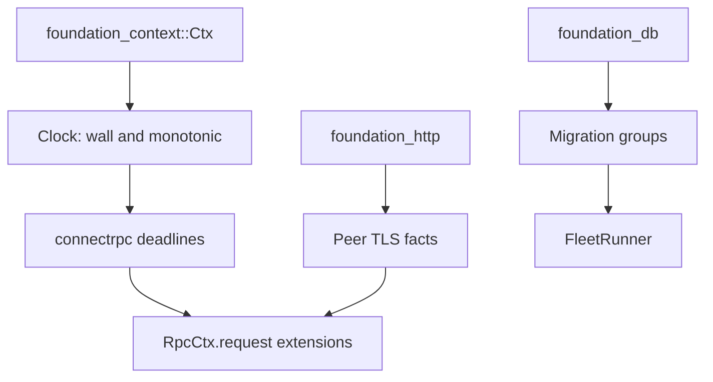

# Platform Prerequisites

_Written in ASD-STE100 Simplified Technical English (STE). Code and identifiers stay as they
are._

**Abbreviations in this file.** Transport Layer Security (TLS); remote procedure call (RPC);
database (DB); Structured Query Language (SQL); WebAssembly (wasm); Hypertext Transfer
Protocol (HTTP); AeroSpace and Defence Industries Association of Europe (ASD), the owner of the
STE standard ASD-STE100.

## Glossary

| Term | Meaning |
|---|---|
| `Ctx` | The context bundle from spec 76. It carries the clock, the configuration and the seeded RNG. |
| `RpcCtx` | The connectrpc request context from spec 76. It wraps a `foundation_context::Ctx` in its public `ctx` field. |
| Migration group | A named set of SQL migrations for one database. A shared group runs first; specific groups follow. |
| Transport fact | A value that the transport knows and the handler needs, for example the peer TLS certificate or the request extensions. |

## 1. Purpose

The agent RPC server (spec 83), the proxy (spec 82), the auth library (spec 81) and mutual TLS
(spec 87) all need the same two platform capabilities. They are not features of any one of
those specifications. This specification owns them, so all of them can depend on one plan.

| Feature | Gives | Used by |
|---|---|---|
| 00 Transport prerequisites | Request extensions keep their values through dispatch; the deadline clock comes from `Ctx`; foundation_http reports the peer TLS certificates | 86 (connection facts), 87 (mTLS), 82 (mTLS enrollment), 83 (hosts) |
| 01 Migration groups | Per-database migration groups and `FleetRunner` | 81 (auth tables), 82 (registry and trust tables), 77 (sandbox state) |

The side-effect bundle (`Env`) that this specification used to own is now
[spec 84](../84-context-injection/requirements.md). Spec 84 lands first, and this
specification builds on it.

## 2. Specification order

1. **Spec 76 is the base.** It already built `foundation_context::Ctx`, moved the clock and RNG
   into it, and renamed connectrpc's context to `RpcCtx`. Each feature here starts with a task
   that verifies what 76 landed on master and records only the remaining delta.
2. **Spec 84 lands before this specification.** It adds the `Env` entry to `Ctx` (timer,
   entropy, ids). Feature 00 reads the clock from `Ctx` and needs no `Env` field.
3. **Feature 00 and feature 01 are independent.** Either may run first. The numbering keeps the
   old task IDs stable.
4. **This specification unblocks 81, 82, 83 and 87.** The auth library needs the TLS peer facts
   and the migration groups. The proxy needs both. The agent RPC hosts need both. mTLS needs
   the peer facts.

**Do not repeat spec 76 or spec 84.** If a task in this spec is already done on master, mark it
done with the commit and write no code. A second context design is a defect.

## 3. Feature index

| # | Feature | Description | Depends on | Status |
|---|---|---|---|---|
| 00 | [Transport Prerequisites](./features/00-transport-prerequisites/feature.md) | connectrpc keeps request extensions and uses the `Ctx` clock for deadlines; foundation_http reports the TLS peer certificates | Spec 76, spec 84 | ⬜ Pending |
| 01 | [Migration Groups](./features/01-migration-groups/feature.md) | Migration groups per database from code or directories; `FleetRunner` | Spec 76 | ⬜ Pending |

The features keep tasks T3 and T4 (feature 00) and T25 (feature 01) from the original spec 83.

## 4. What spec 76 and spec 84 already did

| Done in 76 or 84 | Consequence here |
|---|---|
| `foundation_context::Ctx` exists with clock, config and a seeded RNG. | Feature 00 reads `ctx.clock()`; it does not add a second clock. |
| connectrpc's request context is `RpcCtx { ctx, request }`. | Feature 00 works on `RpcCtx`, never on the old `Ctx` name. |
| The `Env` bundle is in `Ctx` (spec 84). | No feature here adds a side-effect seam. |
| About 600 `dyn Clock` sites moved to the injected clock, including the proxy and connectrpc. | Feature 00 verifies each site it needs; it does not migrate them again. |
| The proxy already takes a `Ctx`. | Feature 00 and 82 use that path. |

## 5. Architecture

_The diagram shows the two seams: transport facts on the request, and grouped migrations._

## 6. Success criteria (spec-wide)

- A connectrpc handler and an HTTP handler can read the peer TLS certificate and the request
  extensions without a global.
- connectrpc deadlines follow the `Ctx` clock, not `Instant::now`.
- `foundation_db` runs a shared migration group before the specific groups, numbers each group
  from 1 with no gaps, and `FleetRunner` applies the plan to many databases.
- Every limit is a field on a config type with a documented default.

## 7. Out of scope

- **A second context type.** Spec 76 owns `Ctx`.
- **The side-effect bundle.** Spec 84 owns `Env`, the timer, the entropy source and the ID
  source.
- **The wasm fetch transport.** Spec 85 owns it.
- **The auth primitives and mTLS.** Spec 86 and spec 87 own them; this spec only exposes the
  peer facts that they read.
- **The proxy registry.** Spec 82 owns it.
- **TLS termination policy.** Spec 82 owns it; this spec only exposes the peer facts.

## 8. Implementation location

- `backends/foundation_connectrpc/` — request extensions, the `Ctx` deadline clock.
- `backends/foundation_http/` — TLS peer facts in `ConnectionContext`.
- `backends/foundation_db/` — migration groups and `FleetRunner`.

## 9. Module references

- `specifications/76-shared-context/requirements.md` — the context that this spec builds on.
- `specifications/84-context-injection/requirements.md` — the `Env` bundle that feature 00
  reads its clock next to.
- `backends/foundation_context/src/lib.rs` — `Ctx`, `Clock`, `CtxEntry`.
- `backends/foundation_connectrpc/src/shared/` — `RpcCtx`, handlers.
- `backends/foundation_netio/src/shared/context.rs` — `ConnectionContext`, `TlsInfo`.
- `backends/foundation_db/` — migrations and storage traits.
- `specifications/80-platform-prerequisites/features/01-migration-groups/migrations.md` — the
  full migration design, moved from spec 83.

---

_Created: 2026-11-14_
_Last revised: 2026-11-15 (feature 00 moved to spec 84; this spec keeps the transport facts and
the migration groups)._
_Structure: Feature-based (has_features: true)_
