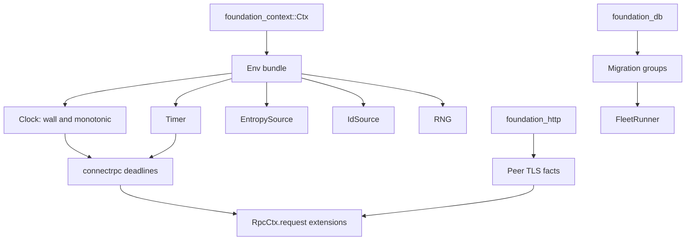

# Platform Prerequisites

_Written in ASD-STE100 Simplified Technical English (STE). Code and identifiers stay as they
are._

**Abbreviations in this file.** deterministic simulation testing (DST); random number generator
(RNG); identifier (ID); Transport Layer Security (TLS); remote procedure call (RPC); database
(DB); Structured Query Language (SQL); WebAssembly (wasm); Hypertext Transfer Protocol (HTTP);
AeroSpace and Defence Industries Association of Europe (ASD), the owner of the STE standard
ASD-STE100.

## Glossary

| Term | Meaning |
|---|---|
| `Ctx` | The context bundle from spec 76. It carries the clock, the configuration and the seeded RNG. |
| `Env` | The side-effect bundle that this spec adds: wall clock, monotonic clock, timer, entropy, ID source and RNG. It is one typed entry in `Ctx`. |
| `RpcCtx` | The connectrpc request context from spec 76. It wraps a `foundation_context::Ctx` in its public `ctx` field. |
| Migration group | A named set of SQL migrations for one database. A shared group runs first; specific groups follow. |
| Transport fact | A value that the transport knows and the handler needs, for example the peer TLS certificate or the request extensions. |

## 1. Purpose

The agent RPC server (spec 65) and the proxy (spec 82) both need the same three platform
capabilities. They are not agent-RPC features and they are not proxy features. This specification
owns them, so both can depend on one plan.

| Feature | Gives | Used by |
|---|---|---|
| 00 Env and side effects | One injected bundle for clock, timer, entropy, IDs and RNG; foundation_ai uses it | 81 (keys, secrets), 65 (agents, models), 82 (sessions, probes) |
| 01 Transport prerequisites | Request extensions and TLS peer facts on connectrpc and foundation_http | 65 (client auth), 82 (mTLS enrollment) |
| 02 Migration groups | Per-database migration groups and `FleetRunner` | 81 (auth tables), 82 (registry and trust tables) |

## 2. Specification order

1. **Spec 76 is the base.** It already built `foundation_context::Ctx`, moved the clock and RNG
   into it, and renamed connectrpc's context to `RpcCtx`. Each feature here starts with a task
   that verifies what 76 landed on master and records only the remaining delta.
2. **Feature 00 runs before feature 01.** Feature 01 uses the Env clock and the injected timer.
3. **Feature 02 is independent.** It can run in parallel with 00 and 01.
4. **This specification unblocks 81.** `foundation_auth` needs Env entropy, the TLS peer facts
   and the migration groups.
5. **This specification unblocks 65.** The agent RPC core needs Env and the transport facts.

**Do not repeat spec 76.** If a task in this spec is already done on master, mark it done with
the commit and write no code. A second context design is a defect.

## 3. Feature index

| # | Feature | Description | Depends on | Status |
|---|---|---|---|---|
| 00 | [Env and Side Effects](./features/00-env-and-side-effects/feature.md) | `Clock`, `EntropySource`, `IdSource`, `Timer`, the `Env` bundle in `Ctx`, the macro `env` argument, foundation_ai on Env | Spec 76 | ⬜ Pending |
| 01 | [Transport Prerequisites](./features/01-transport-prerequisites/feature.md) | connectrpc keeps request extensions and uses the Env clock; foundation_http reports TLS peer certificates | Feature 00 | ⬜ Pending |
| 02 | [Migration Groups](./features/02-migration-groups/feature.md) | Migration groups per database from code or directories; `FleetRunner` | Spec 76 | ⬜ Pending |

The features keep tasks T1, T2, T12 (00), T3, T4 (01) and T25 (02) from the original spec 65.

## 4. What spec 76 already did

| Done in 76 | Consequence here |
|---|---|
| `foundation_context::Ctx` exists with clock, config and a seeded RNG. | Feature 00 adds a typed `Env` entry; it does not add a second context type. |
| connectrpc's request context is `RpcCtx { ctx, request }`. | Feature 01 works on `RpcCtx`, never on the old `Ctx` name. |
| About 600 `dyn Clock` sites moved to the injected clock, including the proxy and connectrpc. | Feature 00 verifies each site it needs; it does not migrate them again. |
| The proxy already takes a `Ctx`. | Feature 00 and 82 use that path. |

## 5. Architecture

_The diagram shows the three seams: one Env entry, transport facts on the request, and grouped migrations._

## 6. Success criteria (spec-wide)

- There is one side-effect bundle. No core logic calls `SystemTime::now`, `Instant::now`,
  `thread_rng`, `getrandom` or an ID generator directly.
- A missing `Env` is a typed error. There is no silent fallback to a real global.
- A DST test can replace clock, timer, entropy and RNG from one seed and replay a run.
- A connectrpc handler and an HTTP handler can read the peer TLS certificate and the request
  extensions without a global.
- `foundation_db` runs a shared migration group before the specific groups, numbers each group
  from 1 with no gaps, and `FleetRunner` applies the plan to many databases.
- Every limit is a field on a config type with a documented default.

## 7. Out of scope

- **A second context type.** Spec 76 owns `Ctx`.
- **The auth secrets and keys.** Spec 81 owns them; this spec gives the entropy and the store
  seams.
- **The proxy registry.** Spec 82 owns it.
- **TLS termination policy.** Spec 82 owns it; this spec only exposes the peer facts.

## 8. Implementation location

- `backends/foundation_compact/` — entropy, time, IDs (existing; extend only if a seam is
  missing).
- `backends/foundation_core/` — valtron `Ctx` and the `#[valtron]` macro.
- `backends/foundation_connectrpc/` — request extensions, Env clock.
- `backends/foundation_http/` — TLS peer facts.
- `backends/foundation_db/` — migration groups and `FleetRunner`.

## 9. Module references

- `specifications/76-shared-context/requirements.md` — the context that this spec builds on.
- `backends/foundation_compact/src/{time,entropy,rng,ids}.rs` — the primitives.
- `backends/foundation_core/src/valtron/` — `Ctx`, `CtxEntry`.
- `backends/foundation_connectrpc/src/shared/` — `RpcCtx`, handlers.
- `backends/foundation_db/` — migrations and storage traits.
- `specifications/80-platform-prerequisites/features/00-env-and-side-effects/env.md` — the full
  Env design, moved from spec 65.
- `specifications/80-platform-prerequisites/features/02-migration-groups/migrations.md` — the
  full migration design, moved from spec 65.

---

_Created: 2026-11-14_
_Structure: Feature-based (has_features: true)_
