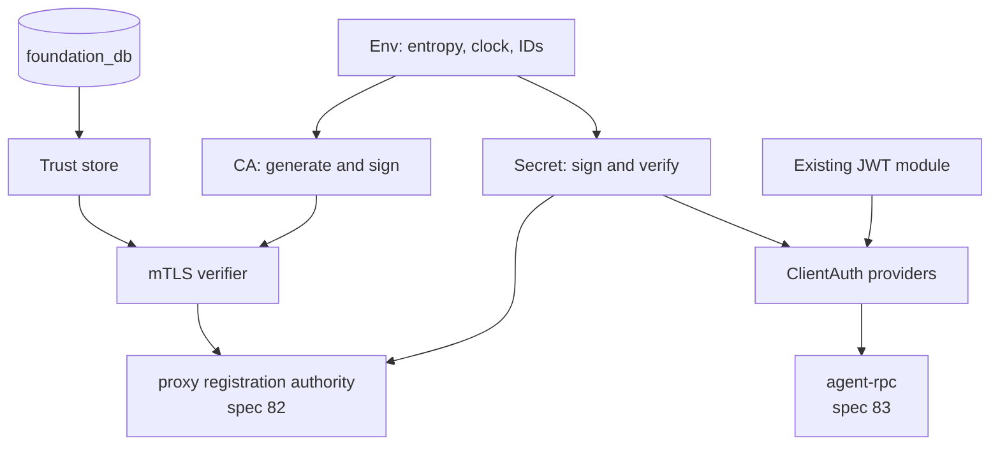

# Foundation Auth

_Written in ASD-STE100 Simplified Technical English (STE). Code and identifiers stay as they
are._

**Abbreviations in this file.** Transport Layer Security (TLS); mutual TLS (mTLS); certificate
signing request (CSR); certificate authority (CA); public key infrastructure (PKI); JavaScript
Object Notation (JSON); JavaScript Web Token (JWT); Open Authorization (OAuth); OpenID Connect
(OIDC); key encryption key (KEK); key management service (KMS); elliptic curve digital signature
algorithm (ECDSA); Privacy-Enhanced Mail (PEM); WebAssembly (wasm); trusted platform module
(TPM); identifier (ID); AeroSpace and Defence Industries Association of Europe (ASD), the owner
of the STE standard ASD-STE100.

## Glossary

| Term | Meaning |
|---|---|
| Signed secret | Base64url JSON `{v, alg, public_key, secret, valid_from, valid_until, signature}`. It is **not** a JWT. |
| Operator key file | A private key that the operator makes with `ssh-keygen` or `openssl` and gives to the process. |
| Trust store | The set of client identities that may connect. It is backed by SQL, a key-value store or memory. |
| `ClientAuth` | The provider trait that a server uses to check a client: signed secret, mTLS with a trust store, JWT, or plaintext for loopback. |
| CA store | The provider trait that loads, generates and persists the CA and the signing key. |

## 1. Purpose

The agent RPC server and the proxy have two independent auth links:

1. client ↔ agent-rpc: a signed secret, or mTLS on a direct connection,
2. sidecar → proxy registration authority: an enrollment token one time, then mTLS.

Both links need the same primitives: signed secrets, key loading, a CA, a trust store and mTLS
verifiers. The primitives live in `foundation_auth`, not in either server.

`foundation_auth` already holds the application auth modules: OAuth, OIDC, JWT, sessions and
identity providers (spec 48). This specification adds the **server credential** modules. It does
not replace the existing modules.

## 2. Specification order

1. **Spec 80 must land first.** The signed-secret code needs injected entropy and IDs; the CA and
   verifiers need the transport peer facts; the trust store needs the migration groups.
2. **This specification unblocks 82.** The proxy registration authority's enrollment and mTLS
   come from here.
3. **This specification unblocks 65.** The agent RPC core's `ClientAuth` comes from here.

## 3. Feature index

| # | Feature | Description | Depends on | Status |
|---|---|---|---|---|
| 00 | [Foundation Auth](./features/00-foundation-auth/feature.md) | Signed secrets v1/v2 and key loading; CA, CSR issuance and mTLS verifiers; trust store over SQL, key-value and memory; `ClientAuth` providers and interceptor | Spec 80 | ⬜ Pending |

The feature keeps tasks T5 and T7 to T11 from the original spec 83 feature 11. Key protection at
rest stays in spec 83 (feature 08), because it starts only after the agent RPC proof of concept
works.

## 4. What this library owns

| Module | Types | Consumer |
|---|---|---|
| Secret | `SigningKey`, `SigningKeyConfig`, `SignedSecret`, `BootstrapSecrets` | 65 (bootstrap), 82 (enrollment token) |
| Key files | `KeySource`, `PrivateKey`, PEM parsing, file permissions, redacted `Debug` | 65, 82 |
| CA | `CaStore`, `CertificateAuthority`, CSR validation, certificate issuance and renewal | 65, 82 |
| Trust | `TrustStore` (SQL, key-value, memory), `TrustedClient`, revocation | 65, 82 |
| mTLS | `ClientCertVerifier`, peer identity extraction | 65, 82 |
| Client auth | `ClientAuth`, `AuthInfo`, providers (signed secret, mTLS, JWT, plaintext), interceptor | 65 |

## 5. Architecture

_The diagram shows one library with two consumers and five modules._

**Two auth links, one library.** The client link and the sidecar link use different providers.
They share the key, secret and certificate code. A provider is chosen by configuration; a handler
sees only `AuthInfo`.

**No global crypto randomness.** Key generation and signing take entropy from `Env`. `ring`'s
sealed random source is not used for keys that DST must replay. Certificates are signed through
a `RemoteKeyPair` with RFC 6979 nonces where the algorithm allows it.

## 6. Success criteria (spec-wide)

- A server issues a signed secret with a time window, a client verifies it with only the public
  key, and a bad signature, a key mismatch or a time outside the window is rejected.
- A CA generates, persists and reloads its key and certificate through a `CaStore`. An operator
  key file is accepted and a corrupt file is an error, never overwritten.
- An mTLS verifier accepts a certificate from the CA and refuses one that is revoked, expired or
  absent from the trust store.
- The trust store works over SQL (Turso/SQLite), a key-value store and memory, through one
  trait.
- A server uses a `ClientAuth` provider without knowing the wire format. The handler sees only
  `AuthInfo`.
- No secret, private key or token appears in `Debug` or `Display` output.
- No secret is hard-coded and no key is read from a global. `Env` and the config provide both.

## 7. Out of scope

- **Key protection at rest.** Spec 83 feature 08 owns the keystore, KEK sources, WebCrypto and
  remote KMS. This library accepts operator key files.
- **The proxy's routing policy.** Spec 82 owns it.
- **Application login.** The existing OAuth, OIDC, JWT and session modules keep their behaviour.
- **Postgres storage.** `foundation_db` has no Postgres backend. The SQL is portable except for
  `?` placeholders; a later spec decides it.

## 8. Implementation location

- `backends/foundation_auth/src/secret/` — signed secrets and key loading.
- `backends/foundation_auth/src/pki/` — CA and certificate issuance.
- `backends/foundation_auth/src/trust/` — trust store.
- `backends/foundation_auth/src/mtls/` — verifiers.
- `backends/foundation_auth/src/client_auth/` — providers and interceptor.
- Existing modules (`oauth`, `oidc`, `jwt`, `session`, `idp`) stay where they are.

## 9. Module references

- `specifications/81-foundation-auth/features/00-foundation-auth/auth.md` — the full design,
  moved from spec 83 feature 11.
- `backends/foundation_auth/src/lib.rs` — the existing public surface.
- `specifications/80-platform-prerequisites/features/00-env-and-side-effects/env.md` — entropy
  and ID injection.
- `specifications/80-platform-prerequisites/features/01-transport-prerequisites/feature.md` —
  TLS peer facts.
- `specifications/80-platform-prerequisites/features/02-migration-groups/feature.md` — the
  trust-store tables.

---

_Created: 2026-11-14_
_Structure: Feature-based (has_features: true)_
