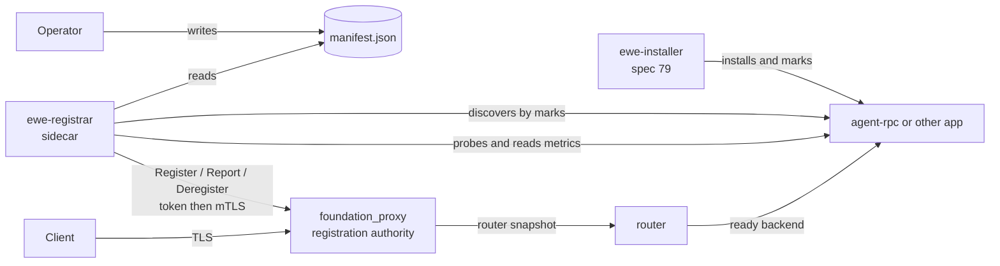
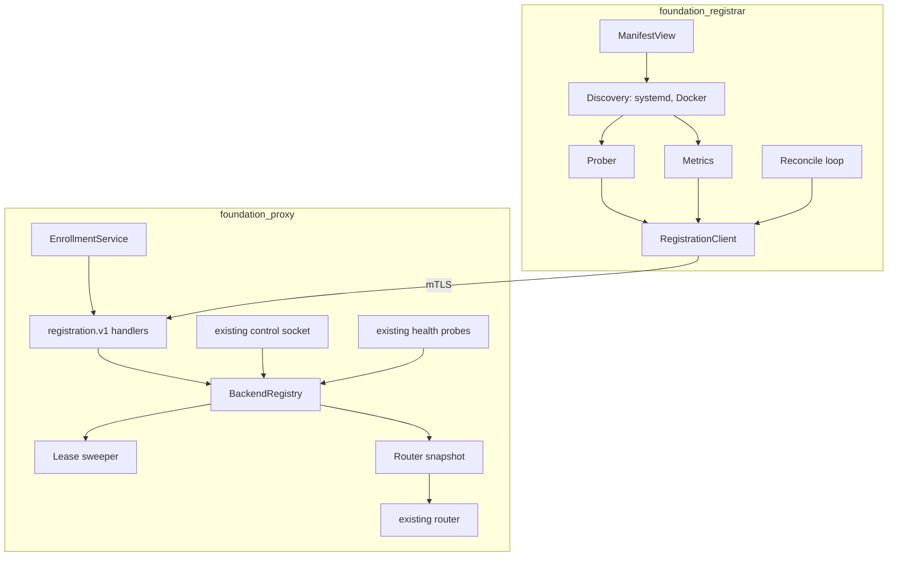

# Proxy Registration and Registrar

_Written in ASD-STE100 Simplified Technical English (STE). Code and identifiers stay as they
are._

**Abbreviations in this file.** Transport Layer Security (TLS); mutual TLS (mTLS); certificate
signing request (CSR); certificate authority (CA); remote procedure call (RPC); JavaScript Object
Notation (JSON); Hypertext Transfer Protocol (HTTP); Hypertext Transfer Protocol version 2 (H2);
Transmission Control Protocol (TCP); Unix domain socket (Unix socket); central processing unit
(CPU); server-side request forgery (SSRF); Kubernetes (K8s); control group version 2 (cgroup v2);
identifier (ID); AeroSpace and Defence Industries Association of Europe (ASD), the owner of the
STE standard ASD-STE100.

## Glossary

| Term | Meaning |
|---|---|
| Proxy | `foundation_proxy`. It ends client TLS and forwards a request to one backend. |
| Registration authority | The part of the proxy that enrolls sidecars and accepts their reports. |
| Sidecar, registrar | `ewe-registrar` (feature 01). It runs beside the apps, discovers them, probes them and reports to the proxy. |
| Backend | A network address that the proxy forwards requests to, for example one agent-rpc. |
| Lease | The time for which one report keeps a backend live. A missed report lets the lease expire. |
| Generation | A number that goes up each time a backend's route changes. The router uses it to discard an old snapshot. |
| Rotation | The rule that removes a backend from new requests without closing its live connections. |
| Discovery | Finding an installed entry by its mark: a systemd unit or a Docker container. |
| Probe | A startup, liveness or readiness check with Kubernetes semantics. |
| Ready | The probe state that lets the proxy send new requests to the backend. |

## 1. Purpose

The proxy must route only to backends that are installed, running and ready. It must not learn
this from a fixed config file that an operator edits by hand. A small sidecar runs beside the
apps, reads the manifest, discovers what runs, probes it, reads its metrics, and reports to the
proxy over an authenticated link.

This specification owns both ends of that link:

1. **The proxy registration authority** — enrollment, the registration protocol, the backend
   registry, leases, the rotation rule and the router swap.
2. **The registrar sidecar** — discovery, probes, metrics, the registration client and the
   reconcile loop.

It builds on completed spec 63 (the ConnectRPC proxy). It does not re-open spec 63.

_The diagram shows the sidecar reading the manifest, watching the app, and reporting to the proxy, which forwards only to ready backends._

## 2. Specification order

1. **Spec 63 is complete.** The proxy's listener, router, health probes, control socket, state
   store and per-endpoint protocol selection already exist. This spec extends them.
2. **Spec 78 must land first.** The sidecar reads the manifest's `proxy` and `probes` blocks,
   whose format 78 owns.
3. **Spec 81 must land first.** Enrollment, signed secrets, the CA and the mTLS verifiers come
   from `foundation_auth`.
4. **Feature 00 runs before feature 01.** The sidecar needs the registration protocol and the
   registry to report to.
5. **Feature 01's end-to-end task needs spec 79.** Discovery reads the marks that the installer
   writes. The sidecar can be built and tested against a fake registration server before the
   installer exists; only the final end-to-end test needs it.
6. **This specification unblocks nothing.** It is the last piece of the operator path; spec 65's
   RPC server can run without it.

## 3. Feature index

| # | Feature | Description | Depends on | Status |
|---|---|---|---|---|
| 00 | [Proxy Registration](./features/00-proxy-registration/feature.md) | The `ewe.proxy.registration.v1` contract; enrollment token → mTLS or Unix socket; `BackendRegistry`, sessions, generations and leases; the rotation rule and the router snapshot swap; the address policy; control-socket commands | Spec 78, spec 81 | ⬜ Pending |
| 01 | [Registrar Sidecar](./features/01-registrar-sidecar/feature.md) | `ManifestView`; discovery by marks; Kubernetes-style startup, liveness and readiness probes; metrics from cgroup v2 and Docker stats; the registration client and the reconcile loop; `ewe-registrar` | Feature 00; end to end also spec 79 | ⬜ Pending |

The features keep tasks T1 to T11 (feature 00) and T1 to T10 (feature 01) from the original
spec 65 features 03 and 04.

## 4. Requirements conversation summary

- **The sidecar is a deployment-time choice, not an architecture change.** One sidecar per
  bare-metal host; in Docker it rides in the container. Kubernetes uses its own probes; the
  sidecar's Kubernetes-style probes are the portable design.
- **The proxy ends client TLS.** The sidecar never takes part in client TLS. It authenticates
  only on its link to the registration authority, because a registration changes where client
  traffic goes.
- **The sidecar's credential is one enrollment token, then mTLS.** On the same machine, a Unix
  socket with file permissions is the alternative.
- **The manifest is read by the sidecar, not by the proxy.** The proxy knows only the
  registration protocol.
- **Health has Kubernetes semantics.** A startup probe gates liveness and readiness; a liveness
  failure is a failure state; a readiness failure removes the backend from rotation but keeps it
  alive.
- **A rotation must not drop live connections.** A backend that leaves gets no new requests and
  is closed only when its leases and connections are done.
- **The registrar does not guess.** A metric that the platform cannot provide is left out.

## 5. Architecture

_The diagram shows the two crates and the existing proxy parts that the new code extends._

**The rotation rule.** A backend is in the new-request set only when all of these are true:

1. its registration is `Live` (the lease is valid),
2. its probe state is `READY`,
3. the operator's control state is `Active` (not `Drained` or `Paused`),
4. the proxy's own probe of the backend passes.

A backend that fails one condition gets no new requests. Its open connections finish, up to
`RegistrationConfig::connection_drain_timeout`.

**The router swap.** The registry builds a new immutable `RouterSnapshot` and swaps it in one
atomic step. A request reads one snapshot for its whole life. A generation number lets the
router discard a snapshot that an old report built. No request sees a half-built table.

**Two independent auth links.** The proxy checks the *sidecar* certificate. The app checks its
*client* credential (spec 65 or its own). The proxy does not read the client credential. The
sidecar does not read the client credential either.

## 6. Success criteria (spec-wide)

- The sidecar enrolls once with a token, gets a certificate, and renews it before expiry.
- The proxy accepts `Register`, `Report` and `Deregister` only over mTLS or the Unix socket.
- A ready backend receives traffic. A not-ready, stale or drained backend receives none.
- A missed report lets the lease expire; the backend leaves the rotation; a later report brings
  it back. No operator action is needed.
- A restart of the proxy, the sidecar or the app converges to the correct table.
- A rotation closes no live connection before its drain timeout.
- An address outside the allowed networks or hosts is refused (SSRF and traffic theft).
- A metric that the platform cannot provide is absent, never a zero or a guess.
- The proxy's existing control socket gains `issue-token`, `revoke` and `registration list`
  without a second control channel.

## 7. Out of scope

- **Client TLS policy and certificates.** The proxy's existing TLS and ACME code owns them.
- **The app's own client auth.** Spec 65 owns it.
- **Cloudflare D1 replication, region routing and Durable Object sharding.** The owner will
  discuss these first; the notes are in spec 65 `resources/`.
- **Cross-org proxy federation.** One proxy has one registration trust domain.
- **Postgres.** The proxy's state store is unchanged.

## 8. Implementation location

- `backends/foundation_proxy/` — extended: `registration/` module, `BackendRegistry`, the
  registration listener, the router snapshot, the control commands.
- `backends/foundation_registrar/` — new crate. Library `src/lib.rs`; binary
  `src/bin/ewe-registrar.rs` with a `[[bin]]` entry. No `src/main.rs`.
- `proto/ewe/proxy/registration/v1/` — the registration contract, with generated types.
- Reused, not modified: `foundation_connectrpc`, `foundation_auth` (spec 81),
  `foundation_db`, `foundation_deployment_docker` (for discovery).

## 9. Module references

- `backends/foundation_proxy/src/{config,router,runtime,health,control,persistence,tls}.rs` —
  the existing parts that the registration authority extends.
- `specifications/completed/63-connectrpc-proxy/` — the proxy that this spec builds on.
- `specifications/78-manifest-contract/requirements.md` — the `proxy` and `probes` blocks.
- `specifications/81-foundation-auth/` — enrollment, CA, trust store and mTLS.
- `specifications/65-agent-rpc-serving-system/` — the app that the end-to-end test installs.

---

_Created: 2026-11-14_
_Structure: Feature-based (has_features: true)_
