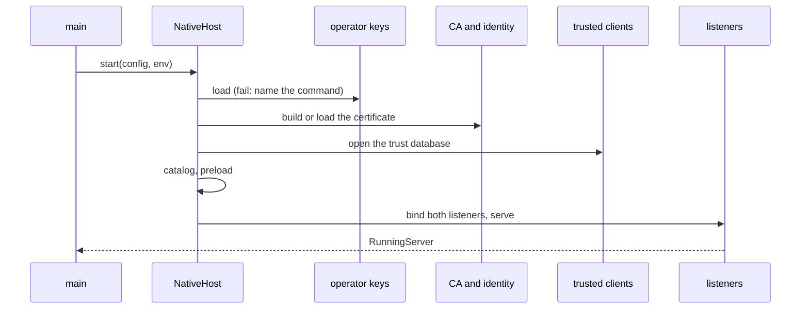

# Native Host and Simulation Tests

_Split out of feature 07 on 2026-10-27 (owner direction: each feature is focused on one
thing). Written in ASD-STE100 Simplified Technical English (STE). Code and identifiers stay
as they are._

**Abbreviations in this file.** remote procedure call (RPC); Artificial Intelligence (AI);
Transport Layer Security (TLS); mutual TLS (mTLS); Certificate Authority (CA); certificate
signing request (CSR); deterministic simulation testing (DST); pseudo-random number generator
(PRNG); Hypertext Transfer Protocol (HTTP); Cross-Origin Resource Sharing (CORS); continuous
integration (CI); AeroSpace and Defence Industries Association of Europe (ASD), the owner of
the STE standard ASD-STE100.

The design files of this feature are in this directory. The shared architecture, glossary and
owner decisions are in [`agent-rpc-architecture.md`](../../agent-rpc-architecture.md). Task
IDs keep their old numbers, so references such as "task T17" stay valid. The
[glossary](../../agent-rpc-architecture.md#2-glossary) explains each term.

## 1. What this feature does

The native program: `#[valtron] async fn main`, configuration, TLS and mTLS listeners,
operator key paths, and local models. Also the simulation harness (`SimRuntime`,
`MemNetwork`, `Faulty*` stores, `TestWorld`) that runs the whole client-to-instance flow from
one seed. **When this feature is done, the agent-rpc proof of concept works end to end on a
native machine.**

Part of the agent-rpc proof of concept.

## 2. What to read

| Design file | Sections |
|---|---|
| [hosts.md](./hosts.md) | sections 1 to 4, 7, 8 and 9 (native host, native client) |
| [deterministic-simulation-testing.md](../../../completed/84-context-injection/deterministic-simulation-testing.md) | the harness and its parts |
| [agent-rpc-architecture.md](../../agent-rpc-architecture.md) | architecture (section 3), owner decisions (section 11) |
| [agent-rpc-architecture.md](../../agent-rpc-architecture.md) | section 13: the workflow and the rules to check before each push |

## 3. Bounded context

**Inside this feature:** the native host modules, the native client move, the operator keys
and the two listeners, the local model catalog, the simulation runtime, the in-memory network
and the scripted model.

**Outside:** the core (feature 03); the Worker host and the web client (feature 05); the
Cloudflare host (feature 06); authorization of a call (`foundation_agent_rpc/src/auth.rs`,
feature 03).

## 4. Rules

### 4.1 Invariants

| # | Invariant |
|---|---|
| I1 | The host never makes a key. A missing operator key stops the start, and the error names the command that makes the key. |
| I2 | `NativeSecurity::InsecurePlaintext` refuses a non-loopback `bind` before it binds any address. |
| I3 | The client certificate check in the TLS handshake reads the in-memory trust index only. It does no I/O. |
| I4 | Every limit and timeout is a field of `NativeHostConfig` with a documented default. |
| I5 | No code on any path reads a global clock, a global random source or a global identifier source. All of them come from the `Env` of the task. |
| I6 | A DST test prints its seed. The same seed gives the same trace, twice in a row, on the same machine. |
| I7 | A revocation takes effect on the next call of an open keep-alive connection. |

## 5. Technical breakdown

### 5.1 Files

| File | Content |
|---|---|
| `backends/foundation_agent_rpc/src/host/mod.rs` | The host module; the shared host types. |
| `.../src/host/native/mod.rs` | `NativeHost::start`: the steps of section 4.2 of `hosts.md`, in that order. |
| `.../src/host/native/config.rs` | `NativeHostConfig`, `NativeSecurity`, their defaults (section 4.1 of `hosts.md`). |
| `.../src/host/native/security.rs` | `load_operator_keys`, `certificate_authority`, `server_identity`, `NativeSecurityParts`; the `ssh-keygen` and `openssl` command in each error. |
| `.../src/host/native/listener.rs` | `serve`: two listeners, the two TLS configurations, one serve thread for each, shutdown. |
| `.../src/host/native/client.rs` | The native client of today, moved; `BootstrapAccess::Enroll` and `::Bearer`. |
| `.../src/host/native/catalog.rs` | `LocalCatalog` and `BackgroundLoader`; a load runs on `run_background_job`. |
| `backends/foundation_core/src/valtron/sim.rs` | `SimRuntime` behind a `testing` feature: one thread, one `SimClock`, one `SeededEntropy`, a fixed task order. |
| `backends/foundation_connectrpc/src/testing/mod.rs` | `MemNetwork` and `MemTransport` behind a `testing` feature: client and server in one process, no socket. |
| `backends/foundation_db/src/testing/mod.rs` | `Faulty*` wrappers behind a `testing` feature: a failure injected at a named step. |
| `backends/foundation_agent_rpc_dst/src/{lib,catalog,world}.rs` | `ScriptedCatalog` and `TestWorld` in their own package (`publish = false`), so they build without the multi-threaded pool. |

### 5.2 The start order

The steps are the list in section 4.2 of `hosts.md`. Each step awaits its storage or its
file, and each part gets the `Env`. The order matters:



_Caption: the host builds each part after the part it needs; the listeners start last._

### 5.3 The listeners

Two listeners, as the table in section 4.3 of `hosts.md` shows. The agent listener requires a
client certificate; the enrollment listener does not. Each runs on its own serve thread, and
each connection becomes a valtron task. `HttpServer` runs the dispatch, and after the
handshake task T4 copies the peer certificate into `ConnectionContext::tls`.

### 5.4 The simulation parts

The harness is its own package, `foundation_agent_rpc_dst`. The crate `foundation_agent_rpc`
enables `foundation_core/multi` through its own `multi` feature, which is in `default`. A
package that turns `default-features` off gets the single-threaded engine and `SimRuntime`
(issue #904).

One seed sets the clock, the entropy, the identifier source and the task order. The parts are
the table in section 3 of the DST design file. A test uses `SimRuntime::start(seed, start)` and
`TestWorld`, and drives the flow of section 5 of that file.

DST does not run TLS, a real model, or a real Cloudflare Worker (section 9 of the DST file).
The native end-to-end tests cover those.

## 6. Tasks

| Task | Stages | Done when |
|---|---|---|
| T17 | `config` and `security` with their tests; `catalog`; `NativeHost::start` and `listener`; the client move; the four native tests of section 9 of `hosts.md` | The native end-to-end and revocation tests pass over real sockets. |
| T18 | `SimRuntime`; `MemNetwork`; `Faulty*`; `ScriptedCatalog` and `TestWorld`; the first DST tests | The DST tests pass for 32 fixed seeds, twice in a row, with identical traces. |

## 7. Tests

All tests are modules of each crate's `tests/` directory (root rule 7).

| Test | Crate and file | What it proves |
|---|---|---|
| Native end to end | `foundation_agent_rpc/tests/native_e2e_tests.rs` | Enroll, mTLS, create, stream a turn, destroy, over real sockets. |
| Revocation on a live connection | `foundation_agent_rpc/tests/native_revocation_tests.rs` | After `revoke_client`, the next call on the same connection fails with `UNAUTHENTICATED` (I7). |
| Peer certificate reported | `foundation_http/tests/tls_peer_info_tests.rs` | `ConnectionContext::tls` holds the client certificate after the handshake. |
| Shutdown | `foundation_agent_rpc/tests/native_shutdown_tests.rs` | A running turn gets `TurnFailed("server shutting down")` after `shutdown_grace`; sessions end. |
| Insecure guard | `foundation_agent_rpc/tests/native_config_tests.rs` | `InsecurePlaintext` with a non-loopback address fails before any bind (I2). |
| Missing key | the same | A missing operator key names the command that makes it (I1). |
| DST flow | `foundation_agent_rpc_dst/tests/dst_tests.rs` | Create, enroll, one turn, destroy, all in memory, from one seed. |
| DST determinism | the same | For 32 fixed seeds, two runs give identical traces. |
| Injected failure | the same | A `Faulty` store fails at each named step; the call gives its typed error. |
| Feature gates | `ci/packages.toml` | `foundation_agent_rpc`: `""` and `"gguf"`. `foundation_agent_rpc_dst` on Linux, macOS and Windows. |

## 8. Verify

```bash
cargo fmt --all --check
cargo clippy -p foundation_agent_rpc --all-targets --profile uat --no-deps -- -D warnings
cargo test -p foundation_agent_rpc --profile uat native_
cargo test -p foundation_agent_rpc_dst --profile uat dst_
cargo test -p foundation_core --features testing --profile uat sim
cargo test -p foundation_connectrpc --features testing --profile uat mem_
cargo test -p foundation_db --features testing --profile uat faulty
```

The native end-to-end tests need TCP and a file system; they run on Linux and macOS. The DST
tests run on every target, because they open no socket and read no clock.

## 9. Done when

The native end-to-end and revocation tests pass. The DST tests pass for 32 fixed seeds,
twice in a row with identical traces. `progress.md` and `learnings.md` record both.

## 10. Pull requests

One PR (was PR group F).
