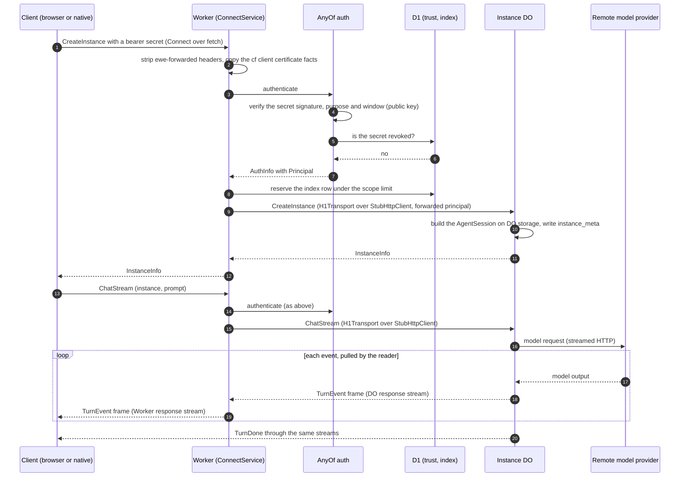
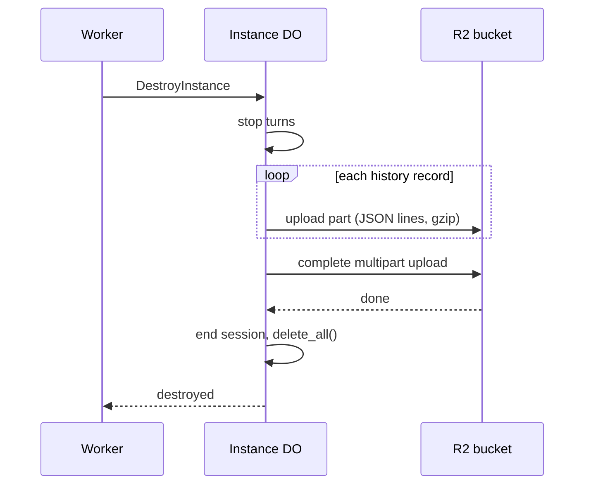

# The Worker host and the web client


_Part of [feature 05](./feature.md); the shared architecture is [agent-rpc-architecture.md](../../agent-rpc-architecture.md). Written in ASD-STE100 Simplified Technical English (STE).
Code and identifiers stay as they are._

**Abbreviations in this file.** remote procedure call (RPC); Transmission Control Protocol
(TCP); Transport Layer Security (TLS); mutual TLS (mTLS), where both sides show a
certificate; Hypertext Transfer Protocol (HTTP); Durable Object (DO); WebAssembly (wasm);
JavaScript (JS); application programming interface (API); uniform resource locator (URL);
Cross-Origin Resource Sharing (CORS), the browser rule for calls to another origin;
identifier (ID); Structured Query Language (SQL); key-value store (KV); Certificate Authority
(CA); certificate signing request (CSR); Secure Hash Algorithm with 256 bits (SHA-256);
deterministic simulation testing (DST); input/output (I/O); continuous integration (CI);
central processing unit (CPU); graphics processing unit (GPU); Compute Unified Device
Architecture (CUDA); Generative Pre-trained Transformer (GPT); GPT-Generated Unified Format
(GGUF); Internet Protocol (IP); Domain Name System (DNS); kibibyte (KiB), 1,024 bytes;
mebibyte (MiB), 1,048,576 bytes; key encryption key (KEK); JavaScript Object Notation (JSON); Privacy-Enhanced Mail (PEM), a
text form of keys and certificates;
AeroSpace and Defence Industries Association of Europe (ASD), the owner of the STE standard
ASD-STE100. gRPC is the name of a Google RPC protocol over HTTP/2. gRPC-Web is its variant for
browsers. Connect is an RPC protocol that works over HTTP/1.1 and HTTP/2. D1 and R2 are
names of Cloudflare products (a SQL database and an object store). Miniflare and wrangler are
Cloudflare tools that run a Worker on a local machine. The
[glossary in feature.md](../../agent-rpc-architecture.md#2-glossary) explains each term.

_Split out of hosts.md (now in [feature 04](../04-native-host-and-dst/hosts.md)) on 2026-10-27. Sections 5 and 6 keep their numbers, so references stay valid. Sections 1 to 3 of [hosts.md](../04-native-host-and-dst/hosts.md) (what each host gives the core, Cargo features and `cfg` gates) apply here too._

## 5. The Worker host

### 5.1 The parts and their bindings

A Worker host has four Cloudflare parts:

| Part | Binding name | Use |
|---|---|---|
| The Worker | — | The public endpoint. It checks the caller, keeps the instance index and forwards calls to the DO. |
| The Durable Object class `AgentInstance` | `AGENT_INSTANCES` | One DO for each instance. It holds the session ([registry-and-models.md](../03-agent-rpc-core/registry-and-models.md), section 4). |
| A D1 database | `AGENT_RPC_DB` | The trust store and the instance index. |
| A KV namespace (optional) | `AGENT_RPC_KEYS` | The public keys that verify bearer secrets. Operators change keys with no redeploy. |

```toml
# examples/cf-agent-rpc/wrangler.toml (task T21)
name = "cf-agent-rpc"
main = "build/worker/shim.mjs"
compatibility_date = "2025-09-01"

[build]
command = "worker-build --release"

[vars]
AGENT_RPC_PUBLIC_URL = "https://agents.example.com/rpc"
AGENT_RPC_MODELS = '[{"name":"llama-3.1-8b","provider":"workers-ai","model_id":"@cf/meta/llama-3.1-8b-instruct","api_key_secret":"WORKERS_AI_API_TOKEN"}]'
AGENT_RPC_SECRET_PUBLIC_KEYS = '[{"kid":"k1","alg":"ed25519","public_key":"<base64url>"}]'
AGENT_RPC_CORS_ORIGINS = "https://app.example.com"

[[durable_objects.bindings]]
name = "AGENT_INSTANCES"
class_name = "AgentInstance"

[[migrations]]
tag = "v1"
new_sqlite_classes = ["AgentInstance"]

[[d1_databases]]
binding = "AGENT_RPC_DB"
database_name = "agent-rpc"
database_id = "<id>"

# Secrets (never in this file): npx wrangler secret put WORKERS_AI_API_TOKEN
#                                npx wrangler secret put CLOUDFLARE_ACCOUNT_ID
```

What the code does: it declares the Worker, the DO class with SQLite storage
(`new_sqlite_classes`), the D1 database and the configuration variables. API keys are
Worker secrets, as in `examples/cf-agent-loop`. The configuration names the secret, never the
key.

### 5.2 Configuration

```rust
// foundation_agent_rpc/src/host/worker/config.rs
#[derive(Debug, Clone)]
pub struct WorkerHostConfig {
    /// The public base URL. It is the audience of bearer secrets and the
    /// `url` of the bootstrap payload. Var `AGENT_RPC_PUBLIC_URL`.
    pub public_url: String,
    /// Remote models. Var `AGENT_RPC_MODELS` (JSON list of `ApiModelConfig`).
    pub models: Vec<ApiModelConfig>,
    /// Default `PerOwner`: a Worker serves unrelated clients.
    pub registry: RegistryConfig,
    pub turns: TurnLimits,
    pub trust: TrustConfig,               // TrustConfig::worker_default()
    pub cors: CorsConfig,
    /// Accept Cloudflare mTLS (`request.cf.tlsClientAuth`). Default true.
    /// It does nothing until the zone has mTLS rules.
    pub cloudflare_mtls: bool,
    /// Destroy an instance after this long with no turn. Default `None`.
    pub instance_idle_ttl: Option<Duration>,
    /// Largest request body that the Worker accepts. Default 4 MiB: the
    /// gRPC default maximum receive message size.
    pub max_request_bytes: usize,
    /// Chunks queued in one response before the handler waits. Default 4: the
    /// pipe depth of `ClientOptions` today.
    pub response_queue: usize,
    /// Largest response header block. Default 32 KiB: nginx's default
    /// `large_client_header_buffers` is four buffers of 8 KiB.
    pub max_header_bytes: usize,
    /// `Some`: this Worker serves `BootstrapService` (Enroll, RefreshAccess)
    /// on its own origin, so browsers and other clients can enroll with a
    /// client key (auth.md section 9.1). The payload private key comes from
    /// the Worker secret named here (PEM text or base64 PEM, auth.md 4.5).
    /// `None` (default): verify-only; only operator-issued access secrets work.
    pub enrollment: Option<WorkerEnrollment>,
}

#[derive(Debug, Clone)]
pub struct WorkerEnrollment {
    /// The name of the Worker secret that holds the payload private key.
    /// Default `AGENT_RPC_SIGNING_KEY`. Set it with
    /// `wrangler secret put AGENT_RPC_SIGNING_KEY < bootstrap-signing-key.pem`.
    pub signing_key_secret: String,
    pub enroll: EnrollConfig,
}

impl WorkerHostConfig {
    /// Read the vars of the Worker.
    ///
    /// # Errors
    /// `AgentRpcError::Config` names the bad or missing var.
    pub fn from_bindings(bindings: &worker::Env) -> AgentRpcResult<Self> { todo!("T21") }
}

/// The limits of one served call. The `ConnectService` adapter reads them
/// from the `Ctx` (section 5.3).
#[derive(Debug, Clone)]
pub struct ServeLimits {
    /// Chunks queued in the response before the handler waits.
    pub response_queue: usize,
    /// Largest response header block.
    pub max_header_bytes: usize,
    /// Largest request body that the bridge reads.
    pub max_request_bytes: usize,
}

impl From<&WorkerHostConfig> for ServeLimits {
    fn from(config: &WorkerHostConfig) -> Self {
        Self {
            response_queue: config.response_queue,
            max_header_bytes: config.max_header_bytes,
            max_request_bytes: config.max_request_bytes,
        }
    }
}
```

What the code does: it reads every setting from Worker vars. A bad var stops the first
request with a `Config` error that names the var. No secret is in this struct.

### 5.3 The `fetch` entry

The Worker serves through `foundation_http`, which owns the isolate singleton, the router, the
middleware and the Cloudflare bridge. This feature supplies one `CfServe` handler, the Connect
adapter of §5.4, and registers it on the service path.

```rust
// foundation_agent_rpc/src/host/worker/entry.rs
pub struct WorkerHost {
    env: Env,
    ctx: Ctx,
    config: WorkerHostConfig,
    /// `foundation_http::wasm::CfHttpApp`, that is `HttpApp<Arc<dyn CfServe>>`.
    app: CfHttpApp,
}

impl WorkerHost {
    /// Build the host once per isolate.
    pub async fn new(env: Env, bindings: &worker::Env) -> AgentRpcResult<Self> {
        let config = WorkerHostConfig::from_bindings(bindings)?;
        let ctx = Ctx::host();                                        // spec 84 section 5
        let d1: Arc<D1Database> = Arc::new(bindings.d1("AGENT_RPC_DB")?.into());
        let trust_store = SqlTrustStore::new(D1WasmStorage::new(Arc::clone(&d1), "agent_rpc"));
        let trust = TrustedClients::open(Arc::new(trust_store), env.clone(), config.trust.clone())
            .await
            .map_err(trust_error)?;
        let verifier = security::access_verifier(bindings, &config, &env).await?;   // AGENT_RPC_SECRET_PUBLIC_KEYS
        let mut providers: Vec<Arc<dyn ClientAuth>> = Vec::new();
        if config.cloudflare_mtls {
            providers.push(Arc::new(CfMtlsAuth::new(Arc::clone(&trust))));
        }
        providers.push(Arc::new(SignedSecretAuth::new(verifier, trust, AccessPolicy::default())));
        // One platform-neutral client. On wasm `build()` gives `FetchHttpClient`.
        let http: DynNetClient = HttpClientBuilder::new().build();
        // The same model list as the DOs. Building it makes no network call.
        let catalog: Arc<dyn ModelCatalog> =
            Arc::new(RemoteCatalog::from_config(&config.models, &|name| secret(bindings, name), http)?);
        let registry = Arc::new(DurableObjectRegistry::new(
            bindings.durable_object("AGENT_INSTANCES")?,
            D1WasmStorage::new(d1, "agent_rpc"),
            Arc::clone(&catalog),
            config.registry.clone(),
        ));
        let core = AgentRpcCore::builder(env.clone())
            .catalog(catalog)
            .registry(registry)
            .turn_limits(config.turns.clone())
            .scope_policy(config.registry.scope_policy)
            .host_info(HostInfo::worker(&config))
            .build()?;
        let router = core.router(Arc::new(AnyOf(providers)));
        // The service travels in the `Ctx`: a route factory gets `&Ctx` and nothing else.
        ctx.store(Arc::new(AgentRpcService::new(
            router.into_handler(),
            ServeLimits::from(&config),
        )));
        let mut app = CfHttpApp::new_cf();
        app.route_any_cf::<ConnectService>("/ewe.agent.v1.AgentService/:method");
        if config.enrollment.is_some() {
            app.route_any_cf::<BootstrapConnect>("/ewe.auth.v1.BootstrapService/:method");
        }
        Ok(Self { env, ctx, config, app })
    }

    /// Serve one request from the internet.
    pub async fn fetch(&self, req: worker::Request) -> worker::Result<worker::Response> {
        if req.method() == worker::Method::Options {
            return cors::preflight(&req, &self.config.cors);               // section 6.5
        }
        // `new Request(req, init)` with a filtered copy of the headers. The body
        // moves to the new request: nothing copies or tees it.
        let web_req = without_forwarded_headers(req.inner())?;            // proto.md section 7
        // The bridge reads the body as a stream (spec 85 T4), bounded by the config.
        let mut incoming = request_from_cf(&web_req, self.config.max_request_bytes)?;
        if let Some(tls) = req.cf().and_then(|cf| cf.tls_client_auth()) {
            incoming.extensions = with_tls_client_auth(incoming.extensions,
                CfTlsClientAuth::from_worker(&tls));
        }
        let response = self.app.dispatch_cf(self.ctx.clone(), incoming).await.map_err(js_error)?;
        Ok(cors::decorate(worker::Response::from(response), &self.config.cors))
    }
}
```

What the code does:

1. `new` builds the trust store on D1, the bearer-secret verifier and the auth providers. It builds the remote catalog and the core with the DO registry. The Worker catalog only checks model requests and fills the index. The DO runs the model.
2. It stores the Connect handler and its limits in the `Ctx`. A route factory of `foundation_http` receives only `&Ctx`, so the `Ctx` is where one request's service is found.
3. It builds one `CfHttpApp` and registers the two service paths. The route pattern `/:method` matches every Connect method of the service.
4. `fetch` answers a CORS preflight at once.
5. It removes every incoming `ewe-forwarded-*` header, so a caller cannot claim an identity. The headers of an incoming request cannot change in a Worker. So it makes a new request from the old one with a filtered header list. The body moves to the new request. `Request.clone()` is not used, because it tees the body, and an unread branch of a tee keeps every chunk in memory.
6. It copies the Cloudflare client-certificate facts into the request extensions, so `CfMtlsAuth` can read them.
7. It gives the request to `dispatch_cf` and adds the CORS headers to the response.

`CfTlsClientAuth::from_worker` copies the fields of `worker::TlsClientAuth`
(`cert_presented`, `cert_verified`, `cert_fingerprint_sha256`, `cert_subject_dn`,
`cert_not_after`, `cert_serial`). It lives in the Worker host, because `foundation_auth`
does not depend on the `worker` crate.

The thin Worker entry is in `examples/cf-agent-rpc/src/lib.rs` ([env.md](../../../84-context-injection/env.md),
section 7.2). It builds `Env::system()` and the engine once per isolate. It then runs
`with_ctx(root_ctx(), host.fetch(req))` for each request.

### 5.4 The Connect adapter: a `CfServe` handler

`foundation_http` owns the serving stack: `HttpApp<Arc<dyn CfServe>>`, its router and
middleware, `CfConn`, the Cloudflare bridge and `CfHttpAppSingleton`. This feature adds only
the adapter between that stack and the connectrpc router.

```rust
// foundation_agent_rpc/src/host/worker/serve.rs
/// The Connect service of the Worker.
pub struct ConnectService;

impl CfServeFactory for ConnectService {
    fn create(_ctx: &Ctx) -> Self {
        Self
    }
}

#[async_trait::async_trait(?Send)]
impl CfServe for ConnectService {
    async fn serve_cf(
        &self,
        ctx: Ctx,
        req: SimpleIncomingRequest,
        conn: &mut CfConn,
    ) -> CfConnectionResult {
        let Some(service) = ctx.get::<Arc<AgentRpcService>>() else {
            conn.set_status(500);                     // the Ctx lost its service entry
            return CfConnectionResult::Ok;
        };
        // The sink is spec 85's: one `ResponseSink` over `CfConn`, shared by every
        // wasm consumer.
        let mut sink = ConnectSink::new(conn, service.limits.clone());
        match service.handler.dispatch_to(&ctx, &req, &mut sink).await {
            Ok(()) => CfConnectionResult::Ok,
            Err(error) => {
                sink.fail(&error);                    // a Connect error frame with its status
                CfConnectionResult::Ok
            }
        }
    }
}
```

`ConnectSink` is spec 85's `ResponseSink` (`whole`, `open`, `chunk`, `finish`) over the
`CfConn` of `foundation_http`. `open` writes the status and the headers of the head. Each
`chunk` writes one frame. `finish` closes the body. The body behind it is a bounded pushable
stream, so a slow client pauses the handler and memory stays flat.

| Step | Owner |
|---|---|
| `CfConn` with a streaming body, `into_response` over `streaming_response_with` | Spec 85 (T3, T4) |
| The streaming request body of the bridge, and `request_from_cf` | Spec 85 (T4) |
| `ConnectSink` (the `ResponseSink` over `CfConn`) | Spec 85 (T4) |
| The `ResponseSink` trait and `dispatch_to` | `foundation_connectrpc`, unchanged |
| `ConnectService` and its registration on the service path | This feature (T19) |

The Worker serves Connect and gRPC-Web. It does not serve gRPC: gRPC needs HTTP/2 trailers,
and the fetch API cannot send them. gRPC-Web puts its trailers in the body, so it works.

### 5.5 The Worker calls a Durable Object

The Worker holds one `DynNetClient` over the stub: `StubHttpClient` (spec 85 section 4.5),
built from `env.durable_object(binding)` and the instance name. `H1Transport::new(Arc::new(
stub))` is the transport, and the generated client uses it as it uses any other transport.

```rust
// foundation_agent_rpc/src/host/worker/do_client.rs
fn instance_client(env: &worker::Env, name: &str, limits: &ServeLimits) -> AgentRpcResult<AgentClient<H1Transport>> {
    let stub = StubHttpClient::new(env, "AGENT_INSTANCES", name)?;
    let transport = H1Transport::new(Arc::new(stub)).with_limits(limits.transport.clone());
    Ok(AgentClient::new(transport))
}
```

| Item | Owner |
|---|---|
| `StubHttpClient` (a `NetClient` over `worker::Stub`) | Spec 85 (T5) |
| The Worker code that builds the stub client and its transport for one instance | This feature (T21) |
| The forwarded identity headers | This feature; it adds them to the request before the call |

### 5.6 Inside the Durable Object

The DO serves the normal `AgentService` for its one instance
([registry-and-models.md](../03-agent-rpc-core/registry-and-models.md), section 4.4).

```rust
// examples/cf-agent-rpc/src/lib.rs (task T21): the thin DO type.
#[durable_object]
pub struct AgentInstance {
    inner: AgentInstanceObject,
}

impl DurableObject for AgentInstance {
    fn new(state: State, bindings: worker::Env) -> Self {
        Self { inner: AgentInstanceObject::new(state, bindings) }
    }

    async fn fetch(&self, req: Request) -> worker::Result<Response> {
        // The JS runtime polls this future, so give it the engine root context.
        with_ctx(root_ctx(), self.inner.fetch(req)).await
    }

    async fn alarm(&self) -> worker::Result<Response> {
        with_ctx(root_ctx(), self.inner.alarm()).await          // instance_idle_ttl
    }
}
```

What the code does: the macro type only forwards to `AgentInstanceObject`. That type holds
the logic, so the logic is in the library and its tests, not in the example.

On its first request, `AgentInstanceObject` builds its parts:

1. `Env::system()` and the single-threaded engine, once per DO isolate.
2. `DoSqlStore` over `state.storage().sql()` (task T20).
3. `DoStores`: a `SessionStores` that opens `SqlDocumentStore<DoSqlStore>` and `KvMemoryStore<DoSqlStore>` for the session.
4. `RemoteCatalog::from_config` over `FetchHttpClient`.
5. `LocalInstanceRegistry<DoStores>` with `max_instances = 1`.
6. A core with `ForwardedPrincipalAuth`. The DO serves the usual `AgentService` (§5.6).

A DO handles one request at a time on one thread. Its requests interleave at each `.await`.
So the busy flag of the one-turn rule is still needed, and it cannot race.

### 5.7 Valtron on a Worker

- A Worker has one thread. The engine is the single-threaded valtron engine: `single::initialize_pool_with(SingleConfig { seed_for_rng, env: Some(env) })` (task T2). It is initialized once per isolate.
- JS drives the work. The runtime polls the `fetch` future and each `ReadableStream` pull. There is no thread to block, so no code blocks. `block_on_future` is never called on wasm.
- Each future that JS polls runs inside `with_ctx(root_ctx(), …)`. So `Env::current()` and `valtron::current_ctx()` work in handlers and in the agent loop.
- Types that hold JS objects (`worker::Stub`, `worker::State`, the D1 binding) are `!Send`. They are wrapped in `SendWrapper`, as `foundation_db` does today. This is sound only on single-threaded wasm.

### 5.8 One call from start to end

This diagram shows one client on a Worker host: it creates an instance and streams one chat
turn. The Worker checks the caller, keeps the index in D1 and forwards to the instance DO.



### 5.9 Where state lives and what is awaited

| State | Where it lives | Awaited operations |
|---|---|---|
| Bearer-secret public keys | the var `AGENT_RPC_SECRET_PUBLIC_KEYS`, or KV `AGENT_RPC_KEYS` | one KV read per isolate start (cached), none per call |
| Trusted clients, revocations, secret uses | D1 `AGENT_RPC_DB` | a revocation read per call; a use-count write only when a limit applies |
| Instance index | D1 `agent_rpc_instances` | `create`, `destroy`, `list`, `get`, `count` |
| Session, history, memory | the instance DO and its SQLite storage | every `AgentSession` store call inside the DO |
| Model access | the remote provider; the API key is a Worker secret | the streamed model request |
| Turn events | nowhere: pull-based streams end to end | each read by the client |

A Worker isolate keeps no instance state. Any isolate can serve any call, because the index
is in D1 and the session is in its DO.

### 5.10 KV and R2

- **KV** is not used for keys in the proof of concept: the public keys are the var `AGENT_RPC_SECRET_PUBLIC_KEYS` ([auth.md](../../../81-foundation-auth/features/00-foundation-auth/auth.md) section 4.5). Keys in KV come with the key store of [feature 08](../08-key-protection-at-rest/feature.md). KV never holds the trust store, because it has no atomic write.
- **R2** holds the archive of each destroyed instance (owner decision 5). Section 5.12 describes it.

### 5.11 Model provider API keys

An **API key** here is the secret that a remote model provider (OpenAI, OpenRouter, Anthropic,
Workers AI) gives to its customers. The Worker sends it with each model request. Anyone with the
key can use the account and spend its money. So it is a secret, like a private key.

Owner decision 6: API keys are **Worker secrets** or **Secrets Store secrets**. They are never in
`wrangler.toml`, never in a var, never in D1 or KV, and never in a log.

How it works:

1. The operator stores the key: `npx wrangler secret put OPENAI_API_KEY` for one Worker, or adds it
   to the account's Secrets Store when several Workers share one key.
2. `AGENT_RPC_MODELS` names the secret for each model, never the key:
   `{"name":"gpt-4o","provider":"openai","model_id":"gpt-4o","api_key_secret":"OPENAI_API_KEY"}`.
3. At isolate start, `WorkerHost::new` reads each named secret one time:

```rust
// foundation_agent_rpc/src/host/worker/secrets.rs (task T21)
/// Where one secret lives on the Worker.
#[derive(Debug, Clone, PartialEq, Eq, serde::Deserialize)]
#[serde(tag = "kind", rename_all = "snake_case")]
pub enum SecretRef {
    /// A per-Worker secret (`wrangler secret put <name>`).
    WorkerSecret { name: String },
    /// An account-level Secrets Store binding. Read with `get()`.
    SecretsStore { binding: String },
}

/// Read every API key that the model list names. A missing secret stops
/// the start with an error that names the secret, never a value.
pub async fn read_api_keys(
    bindings: &worker::Env,
    models: &[ApiModelConfig],
) -> AgentRpcResult<HashMap<String, Zeroizing<String>>> { todo!("T21") }
```

What the code does: `SecretRef` says where a key lives. `read_api_keys` reads each one, keeps it
in a `Zeroizing` string, and fails with the secret's name if one is missing. `api_key_secret` in
`ApiModelConfig` accepts a plain name (a Worker secret, as today) or a `SecretRef` object.

4. `RemoteCatalog::from_config` gets the keys through its `secrets` function and builds each
   provider client. The key stays in the provider client and goes only into the
   `Authorization` header of the model request.

The native host uses the same `SecretRef` idea with an environment variable or a secret file (a
path in configuration, mode 0600). More native sources, such as systemd credentials, come with
[feature 08](../08-key-protection-at-rest/key-protection.md).

Rotation: put the new value with the same secret name and redeploy. Cloudflare starts new isolates
with the new value. Revoke the old key at the provider after the deploy.

### 5.12 History archive in R2

Owner decision 5: `DestroyInstance` **archives** the instance history to R2, then deletes the DO
storage.

```toml
# examples/cf-agent-rpc/wrangler.toml (changed, task T26)
[[r2_buckets]]
binding = "AGENT_RPC_ARCHIVE"
bucket_name = "agent-rpc-archive"
```

Steps inside the instance DO, when it gets `DestroyInstance`:

1. Stop new turns. Abort a running turn.
2. Stream the history out of DO storage, one record at a time, as JavaScript Object Notation (JSON)
   lines, compressed with gzip, into an R2 multipart upload. No step holds the whole history in
   memory (`CLAUDE.md` rule 4).
3. The object key is `archives/<scope hash>/<instance name>/<destroyed at, UTC>.jsonl.gz`.
   Metadata on the object: the instance spec, the session ID, the record count, the SHA-256 of the
   content.
4. When R2 confirms the upload, end the session and call `storage.delete_all()`.
5. If the upload fails, the DO keeps its storage and the call fails with `UNAVAILABLE`. A retry
   starts again at step 1. No history is lost.



_The diagram shows the archive step. The DO deletes its storage only after R2 confirms the
archive._

Security: R2 encrypts every object at rest. The proof of concept adds no encryption of its own.
Envelope encryption of each archive object (its own data key, wrapped by a KEK) is task K4 of
[feature 08](../08-key-protection-at-rest/feature.md).

Configuration (`WorkerHostConfig::archive`):

| Field | Default | Why |
|---|---|---|
| `enabled` | `true` when the `AGENT_RPC_ARCHIVE` binding exists | owner decision 5 |
| `part_size` | 8 MiB | above the R2 minimum part size of 5 MiB, and the default part size of the AWS command-line tool |

Keep or delete archives with R2 lifecycle rules (for example, delete after 90 days). The native
host has the same step with any `foundation_db` blob store (a directory or R2 over its REST API).

## 6. The web client

### 6.1 What it is

The web client is Rust code that runs as wasm in a browser page. It calls a Worker host, or a
native host with `accept_access_secrets`. It uses Connect (or gRPC-Web) over the browser
`fetch`. It shows a bearer secret on each call, because a browser page cannot choose a client
certificate.

### 6.2 The browser transport

The browser uses the same `H1Transport` as every other caller:
`H1Transport::default()`, whose `HttpClientBuilder::build()` gives `FetchHttpClient` on wasm
(spec 85 section 1). `FetchHttpClient` implements `NetClient`, so the transport, the streams
and the error mapping are the ones of the native path.

| Item | Owner |
|---|---|
| The streaming response body of the wasm client | Spec 85 (T1) |
| `WebClient` and its calls | This feature (T22) |

The request body streams on both targets: `SendSafeBody::Stream` becomes a JS `ReadableStream`
through `valtron::js_stream`. The response body streams after spec 85 T1. A dropped call drops
the reader, and the reader cancels the fetch.

### 6.3 The client API

A browser client enrolls with the payload, as every other client can (auth.md section 9.1). It
makes a client key with WebCrypto, enrolls, checks the server proof, and then sends a short
access secret on each call. It refreshes the access secret with its key before it expires.

```rust
// foundation_agent_rpc/src/client/web.rs (cfg(target_family = "wasm"), feature "web-client", task T22)
pub struct WebClient {
    agent: AgentServiceClient,
    bootstrap: BootstrapServiceClient,
    /// The client key and the current access secret.
    session: Arc<WebSession>,
}

/// Where a page keeps its enrolled identity between visits. The default,
/// `IndexedDbCredentials`, stores the non-extractable WebCrypto key and the
/// client_id in IndexedDB, so a page reload does not enroll again.
#[async_trait::async_trait(?Send)]
pub trait WebCredentialStore {
    async fn load(&self, url: &str) -> AgentRpcResult<Option<WebIdentity>>;
    async fn save(&self, url: &str, identity: &WebIdentity) -> AgentRpcResult<()>;
}

impl WebClient {
    /// Enroll with a payload whose token purpose is `Enroll`:
    /// 1. decode; check the token signature, window and `aud == url`;
    /// 2. make a non-extractable key (`crypto.subtle.generateKey`, Ed25519,
    ///    or P-256 where the browser has no Ed25519) and a nonce;
    /// 3. call `Enroll` with `client_key` and the nonce;
    /// 4. check `server_proof` with the payload public key;
    /// 5. save the identity; keep the access secret in memory.
    ///
    /// # Errors
    /// `Codec` for a bad payload; `Config` for a payload that a browser
    /// cannot use (section 6.4); `Unauthenticated` for a used, revoked or
    /// expired token, or a server proof that does not verify.
    pub async fn enroll(payload: &str, client_name: &str, store: &dyn WebCredentialStore) -> AgentRpcResult<Self> { todo!("T22") }

    /// Use an identity that `enroll` saved: call `RefreshAccess` for a new
    /// access secret, signed with the stored key.
    pub async fn resume(url: &str, store: &dyn WebCredentialStore) -> AgentRpcResult<Option<Self>> { todo!("T22") }

    /// Use a payload whose token purpose is `Access` (operator-issued bearer):
    /// no enrollment, the token is the bearer secret until it expires.
    pub fn from_access_payload(payload: &str) -> AgentRpcResult<Self> { todo!("T22") }

    pub async fn capabilities(&self) -> AgentRpcResult<pb::GetCapabilitiesResponse> { todo!("T22") }
    pub async fn create_instance(&self, spec: InstanceSpec) -> AgentRpcResult<InstanceInfo> { todo!("T22") }
    pub async fn destroy_instance(&self, name: &str) -> AgentRpcResult<()> { todo!("T22") }

    /// One turn as a stream of events. Dropping the stream cancels the call.
    pub fn chat_stream(&self, instance: &str, prompt: &str) -> TurnEventStream { todo!("T22") }
}
```

What the code does: every call goes through `H1Transport` with
`Authorization: Bearer <access secret>`. `WebSession` refreshes the access secret when less than
a fifth of its window is left, and once more after an `UNAUTHENTICATED` reply, before it gives
the error to the page.

The example `examples/agent-rpc-web` (task T22) exports `WebClient` to JS with
`wasm-bindgen`. A page can then call it from JS.

### 6.4 Payload rules in a browser

| Payload | Browser client behavior |
|---|---|
| `BootstrapAccess::Enroll` (token purpose `Enroll`) | **Accept.** Enroll with a client key (section 6.3). The server proof, not a pinned channel, proves the server. |
| `BootstrapAccess::Bearer` (token purpose `Access`) | Accept. The token is the bearer secret. |
| `TlsTrust::SystemRoots` | Accept. The browser checks the certificate. |
| `TlsTrust::PinnedSha256` | Refuse with `Config` ("this host has a certificate that only a pin trusts; a browser cannot open TLS to it; serve the host with a public certificate or behind the proxy"). This is a TLS limit of browsers, not an enrollment limit: the browser refuses the TLS connection before any call. |
| `TlsTrust::Plaintext` | Accept. `decode` allows it only for a loopback `url`, for development (proto.md section 6.3). |
| `auth_modes` without `signed-secret` | Refuse with `Config`. The host does not accept access secrets. |

### 6.5 CORS on the server

A page on `https://app.example.com` that calls `https://agents.example.com` needs CORS
answers. The Worker host and the native host (with `accept_access_secrets`) give them.

```rust
// foundation_agent_rpc/src/core/cors.rs (all targets)
#[derive(Debug, Clone, PartialEq, Eq)]
pub struct CorsConfig {
    /// Exact origins. Default empty: no CORS headers, so browsers on other
    /// origins cannot call. Never "*" together with credentials.
    pub allowed_origins: Vec<String>,
    /// Default: the list of `connectrpc.com/cors` plus `Authorization`:
    /// Content-Type, Connect-Protocol-Version, Connect-Timeout-Ms,
    /// Grpc-Timeout, X-Grpc-Web, X-User-Agent, Authorization.
    pub allowed_headers: Vec<String>,
    /// Default: Grpc-Status, Grpc-Message, Grpc-Status-Details-Bin.
    pub exposed_headers: Vec<String>,
    /// Default 7200 s: the value in the CORS guide of Connect
    /// (connect-go), which is also the largest value Chromium accepts.
    pub max_age: Duration,
}
```

What the code does: it holds the CORS answer. The preflight (`OPTIONS`) answer allows `POST`
and `GET` (Connect uses `GET` for idempotent unary calls), the allowed headers and the max
age. Every response for an allowed origin gets `Access-Control-Allow-Origin`, `Vary: Origin`
and the exposed headers. A request from another origin gets no CORS headers, so the browser
blocks the page from the response.

### 6.6 Valtron in a browser

- The page starts the single-threaded engine once, with `Env::system()`. The browser event loop drives it, as on a Worker.
- Client calls are `async fn`s. JS awaits them through `wasm-bindgen-futures`. The engine root context wraps each call with `with_ctx`.
- Nothing blocks. The browser main thread must never block.

### 6.7 One call from start to end

This diagram shows a browser page that enrolls with a Worker host and then streams a turn.

```mermaid
sequenceDiagram
    autonumber
    participant U as Page (JS)
    participant B as WebClient (wasm)
    participant F as H1Transport
    participant W as Worker host
    U->>B: WebClient.enroll (payload, client name)
    B->>B: decode; check token signature, window, aud = url; make key and nonce
    B->>F: Enroll (token, client key, nonce)
    F->>W: CORS preflight (OPTIONS), then POST
    W-->>F: client_id, access secret, server proof
    F-->>B: EnrollResponse
    B->>B: check server proof with the payload public key; save identity
    U->>B: create_instance (name, kind API)
    B->>F: unary call with the bearer header (access secret)
    F->>W: POST
    W-->>F: InstanceInfo
    F-->>B: InstanceInfo
    U->>B: chat_stream (instance, prompt)
    B->>F: server-stream call
    F->>W: POST
    loop each event, pulled by the page
        W-->>F: TurnEvent frame (response body stream)
        F-->>B: TurnEvent
        B-->>U: event for the page
    end
    U->>B: drop the stream (the user stops)
    B->>F: cancel the body reader
    F->>W: the runtime cancels the response, the DO aborts the turn
```

## 9. Tests

All tests go in each crate's `tests/` directory (CLAUDE.md rule 7).

| Test | Crate and file | What it proves |
|---|---|---|
| `ConnectService` | `foundation_agent_rpc/tests/wasm/worker_serve_tests.rs` (`wasm-bindgen-test`, Node) | Unary, server stream, error status, deadline, a body over the limit, and cancel: dropping the response drops the handler. The test builds a `CfHttpApp` and dispatches a `web_sys::Request` into it. |
| Browser client | `foundation_connectrpc/tests/wasm/h1_transport_tests.rs` | A `H1Transport` over a test `NetClient`, against a `ConnectService` in the same test. |
| Worker host | `foundation_toolings/tests/cf_examples.rs`, case `cf-agent-rpc` (Miniflare, as for the other `examples/cf-*`) | Bearer auth, a revoked secret, CORS preflight, create, stream, list, destroy; a forged `ewe-forwarded-principal` header has no effect; a DO restart keeps the history. |
| Cloudflare mTLS | the same case, with a fake `request.cf.tlsClientAuth` (Miniflare lets a test set `cf`) | `CfMtlsAuth` accepts a registered fingerprint and refuses `FAILED:…`. |
| Web client | `foundation_agent_rpc/tests/wasm/web_client_tests.rs` (`wasm-bindgen-test`, headless browser in CI) | The payload rules of section 6.4; a full turn against a Miniflare Worker. |
