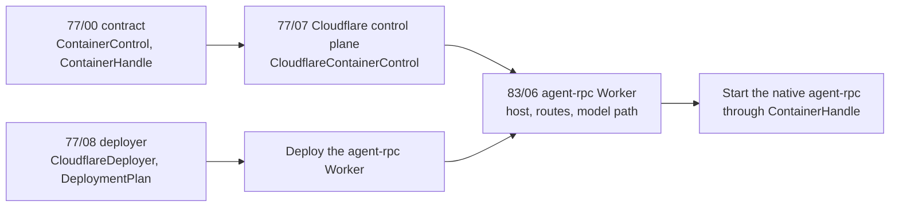
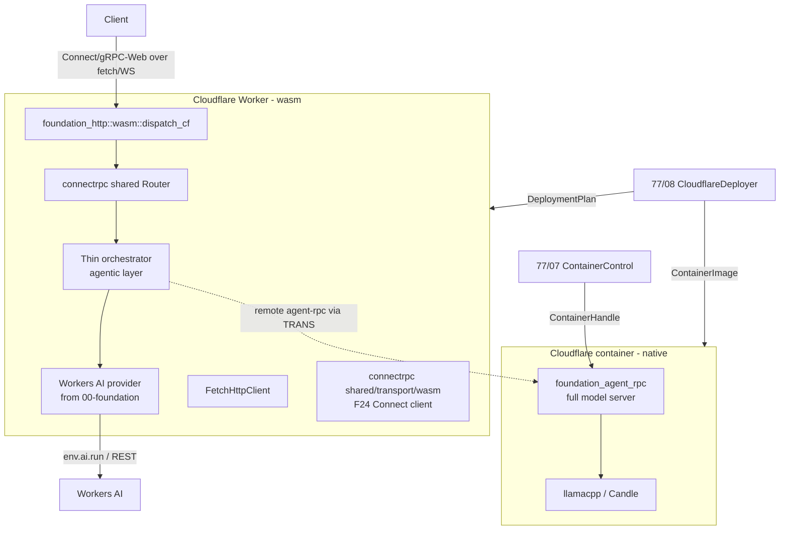
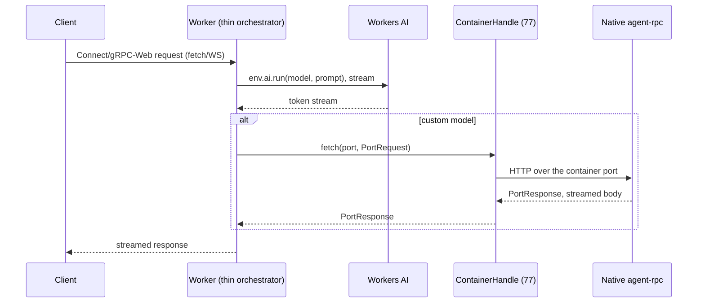

# Cloudflare Host

_Status note (2026-11-14): pending. The feature is renamed from "Cloudflare Deployment" to
"Cloudflare Host". Spec 77 owns Cloudflare container control and Cloudflare deployment. This
feature builds the agent-rpc Worker on those surfaces. It does not own a deployer and it does
not own a container API. The text is in ASD-STE100 Simplified Technical English (STE). Code
and identifiers stay as they are._

**Abbreviations in this file.** WebAssembly (wasm); Cloudflare (CF); remote procedure call
(RPC); Transport Layer Security (TLS); mutual TLS (mTLS); Hypertext Transfer Protocol (HTTP);
HTTP version 2 (H2); WebSocket (WS); Representational State Transfer (REST); application
programming interface (API); continuous integration and continuous delivery (CI/CD); foreign
function interface (FFI); Durable Object (DO); AeroSpace and Defence Industries Association of
Europe (ASD), the owner of the STE standard ASD-STE100.

## Glossary

| Term | Meaning |
|---|---|
| Worker | A Cloudflare Worker: a wasm program that answers HTTP `fetch` events. One thread, about 128 MB of memory. |
| Thin orchestrator | The agent layer on a Worker, with remote models only. Feature 05 calls it the Worker host. |
| Durable Object | A Cloudflare object with an identity and its own storage. One DO instance runs one agent instance. |
| Containers | The Cloudflare product that runs a normal Linux container. The full native agent-rpc runs there. |
| Workers AI | Cloudflare's hosted model service. |
| F24 fetch transport | The `foundation_connectrpc` client transport over `fetch`. Feature 07 names it `FetchTransport`. |
| `dispatch_cf` | The `foundation_http` function that hands a Worker `fetch` event to a router. |
| `ContainerHandle` | The spec 77 type that talks to one live container: fetch a port, exec a command, signal, wait, stop, destroy. |
| `ContainerControl` | The spec 77 factory that starts and gets a `ContainerHandle`. |
| `CloudflareDeployer` | The spec 77 trait that applies a `DeploymentPlan`. Two adapters implement it: the Rust one and the `wrangler` one. |

## Overview

agent-rpc targets Cloudflare in **two shapes**. This feature builds the agent-rpc part of each
shape. The runtime substrate of each shape is a spec 77 surface.

1. **Cloudflare Workers: a thin wasm agent orchestrator.** The local model backends
   (llamacpp, Candle) stay infeasible on Workers and remain `not(target_family = "wasm")`
   gated. The agentic layer and the Workers AI provider (from `00-foundation`) run on the
   Worker. Feature 05 serves them through `foundation_http::wasm::dispatch_cf` and
   `foundation_connectrpc::shared::Router`.

2. **Cloudflare container: the full native model-server agent-rpc.** A long-running Linux
   container has enough memory and CPU for `foundation_agent_rpc` and llama.cpp CPU
   inference. This is the `01-agent-rpc` binary in a container image, **not** wasm.

### What this feature does not own

- **The installer.** `foundation_installer` does not know about Cloudflare. Its deploy targets
  are systemd and Docker only.
- **Cloudflare deployment.** Spec 77 feature 08 owns it. `foundation_deployment_cloudflare`
  holds `CloudflareDeployer`, `DeploymentPlan`, `FoundationCloudflareDeployer` and
  `WranglerCloudflareDeployer`. This feature builds its own `DeploymentPlan` and calls the
  same deployer.
- **Container control.** Spec 77 feature 07 owns `ContainerControl` and `ContainerHandle` on
  Cloudflare. Spec 77 feature 10 owns them on Docker. This feature uses the handle to start
  the agent-rpc server and to send it commands.

## Dependency on spec 77



_Wait for spec 77 features 07 and 08 before this feature starts._

| This feature needs | From spec 77 | Use here |
|---|---|---|
| A live container handle | `ContainerControl::start`, `ContainerHandle` | Start the native agent-rpc container and observe it. |
| A port request | `ContainerHandle::fetch` | Send Connect requests to the native server inside the container. |
| A command | `ContainerHandle::exec`, `signal`, `stop`, `destroy` | Control the native server lifecycle. |
| A deploy | `CloudflareDeployer::deploy` with a `DeploymentPlan` | Deploy the agent-rpc Worker with its DO class, bindings, secrets and container. |
| An image | `ContainerImage` in `DeploymentPlan` | Set the image tag of the native agent-rpc. |

The agent-rpc plan is not the sandbox plan. It names its own Worker, its own DO class and its
own bindings. Both plans go to the same deployer, so both paths (Rust and `wrangler`) stay
available for both Workers.

## Language Stack

### Languages for This Feature

| Language | Purpose | Skill Location |
|----------|---------|----------------|
| Rust | thin orchestrator cdylib, F24 fetch transport, agent-rpc callers of the spec 77 handles | `.agents/skills/rust-clean-code/skill.md` |

### Pre-Implementation Checklist

- [ ] Read `.agents/skills/rust-clean-code/skill.md`.
- [ ] Read `.agents/skills/rust-valtron-usage/skill.md` (the Worker is single-threaded; the
      native container keeps the threaded pool).
- [ ] Read `../../../77-foundation-platform-sandbox/features/00-contract/feature.md` section
      6.13 (container control) and `../../../77-foundation-platform-sandbox/features/08-cloudflare-worker/feature.md`
      section 6.8 (deployment plan and adapters).
- [ ] Read `../00-foundation/feature.md` (the wasm readiness this consumes) and
      `../01-agent-rpc/feature.md` (the model server that is deployed).
- [ ] Confirm `.agents/AGENTS.md`: stream bodies, use generated types, async all the way
      down (the Worker edge is `fetch`-based, with no raw sockets).

---

## Requirements

1. **Thin wasm orchestrator build target in `foundation_agent_rpc`.**
   - A `wasm` feature and a `crate-type = ["cdylib"]` target produce the Worker entry: the
     agentic layer and the Workers AI provider, served through
     `foundation_http::wasm::dispatch_cf` and `foundation_connectrpc::shared::Router`
     (Connect and gRPC-Web over fetch and WebSocket; **no H2 trailers**, so gRPC `grpc-status`
     stays unavailable, as spec 83 records).
   - The native full model-server build does not change.

2. **Worker-as-client fetch transport (the remote agent-rpc variant).**
   - Implement `foundation_connectrpc::shared::transport::wasm` so the thin orchestrator can
     act as a Connect **client** to a remote native agent-rpc. Use it when a custom model is
     necessary instead of Workers AI.

3. **The agent-rpc container through the spec 77 handle.**
   - Build a `ContainerSpec` for the native agent-rpc image. Start it with
     `ContainerControl::start`.
   - Send a Connect request to the native server with `ContainerHandle::fetch`. The response
     body is a stream.
   - Read `ContainerCapabilities` before a call. If `exec` is false, do not send an `exec`
     request.

4. **The agent-rpc Worker through the spec 77 deployer.**
   - Build the agent-rpc `DeploymentPlan`: the Worker entry, the agent instance DO class, its
     binding and migration, the routes, the secrets and the container deployment.
   - Call `CloudflareDeployer::deploy`. Do not write a `wrangler.toml` in the repository and
     do not run `npx wrangler` from this feature. The spec 77 `WranglerCloudflareDeployer`
     covers the manual path.

5. **Everything streamed, everything typed.**
   - A Workers AI stream is a `Stream`. No code reads a whole response into memory. The Worker
     uses generated request and response types, not hand-written JSON.

---

## Architecture (COMPREHENSIVE)

### Technical Approach

- **Two artifacts, one agentic core.** The agentic layer (`foundation_ai::agentic`) is the
  shared brain. It compiles to wasm for the Worker and to native code for the container. Only
  the model backend differs: Workers AI or a remote agent-rpc on the Worker; llamacpp or
  Candle in the container.
- **Fetch-native edge.** A Worker's only I/O is `fetch` and WebSocket. `00-foundation`
  already wired `FetchHttpClient` (behind `wasm-fetch`) and
  `foundation_http::wasm::{serve_cf, dispatch_cf}`. This feature adds the agent-rpc entry
  point and the Connect client transport on top.
- **Deployment is one plan, applied by spec 77.** `ewe_deployables::cloudflare` and
  `foundation_deployment_cloudflare` hold the deployer. This feature supplies the plan.
- **The container is a handle.** This feature never calls the Cloudflare container API
  directly. It holds a `ContainerHandle` and calls it.

### Component Structure



_The diagram shows the two Cloudflare shapes and the two spec 77 surfaces that support them._

### Changes required in existing crates

| # | Crate | Change | Why (verified) | Task |
|---|-------|--------|----------------|------|
| 1 | `foundation_agent_rpc` | Add the `wasm` feature and the cdylib target for the thin orchestrator | New build target | 05 T21 |
| 2 | `foundation_http` | None (use the existing code) | `wasm::{serve_cf, dispatch_cf}` already exist | 05 T21 |
| 3 | `foundation_connectrpc` | Implement `shared/transport/wasm.rs` (the F24 fetch transport) | A capabilities stub (`shared/transport/wasm.rs:1-5`) | 05 T19 |
| 4 | `foundation_netio` | None (use the existing code) | `FetchHttpClient` and `HttpClientBuilder` already exist (wired by `00-foundation`) | 05 T19 |
| 5 | `foundation_deployment_cloudflare` | **None.** Call the spec 77 deployer. | The deployer and the plan are in spec 77 feature 08 | T6 |
| 6 | `foundation_platform_sandbox` | **None.** Call the spec 77 handle. | `ContainerControl` and `ContainerHandle` are in spec 77 feature 00 | T6 |

### Component Details

1. **Thin orchestrator** (`foundation_agent_rpc`, `wasm` feature)
   - **Purpose**: the Worker entry: the agentic layer and the Workers AI provider, with no
     local model, served as Connect and gRPC-Web over `dispatch_cf`.
   - **Interfaces**: a `#[cfg(target_family = "wasm")]` entry that wires the
     `foundation_connectrpc::shared::Router` into `dispatch_cf`.

2. **Connect fetch transport** (`foundation_connectrpc::shared::transport::wasm`)
   - **Purpose**: a `Transport` implementation over `FetchHttpClient`. It lets the thin
     orchestrator act as a Connect client to a remote native agent-rpc.

3. **Agent-rpc container** (spec 77 `ContainerControl` and `ContainerHandle`)
   - **Purpose**: start the native agent-rpc image, then send Connect requests to it.
   - **Interfaces**: `ContainerSpec`, `ContainerHandle::fetch`, `ContainerHandle::exec`,
     `ContainerHandle::stop`.
   - **Image**: `agent-slave` is PID 1, and the slave starts the native agent-rpc server.
     So the container has the same shape as on a Docker host (spec 77 feature 10), and
     `exec` is available.

4. **Agent-rpc deployment plan** (spec 77 `DeploymentPlan` and `CloudflareDeployer`)
   - **Purpose**: declare the agent-rpc Worker and its container, then deploy it.
   - **Interfaces**: `DeploymentPlan`, `ContainerDeployment`, `ContainerImage`,
     `CloudflareDeployer::deploy`.

### Data Flow



_The diagram shows one streamed answer through the Worker, from Workers AI or from the native server._

1. The client sends a Connect or gRPC-Web request to the Worker over fetch or WebSocket. There
   is no H2.
2. The thin orchestrator calls Workers AI with the agentic-layer prompt. It calls the native
   agent-rpc through the F24 transport when the request names a custom model.
3. Tokens stream back through the Worker to the client. No step buffers them.

### Interface Definitions

**Public APIs (Rust, proposed):**

```rust
// foundation_agent_rpc: thin orchestrator entry
#[cfg(target_family = "wasm")]
pub fn wasm_worker_entry(env: Env) -> CfServe; // wires Router into dispatch_cf

// foundation_connectrpc: F24 fetch transport
pub struct WasmFetchTransport { /* FetchHttpClient + endpoint */ }
impl Transport for WasmFetchTransport { /* Connect client over fetch */ }

// foundation_agent_rpc: the agent-rpc container, through the spec 77 handle
pub struct AgentContainer { pub handle: ContainerHandle }

impl AgentContainer {
    pub async fn start(control: Arc<dyn ContainerControl>, ctx: Ctx, image: String)
        -> SandboxResult<Self>;
    pub async fn call(&self, port: u16, request: PortRequest)
        -> SandboxResult<PortResponse>;
    pub async fn stop(&self, grace: Duration) -> SandboxResult<SubstrateExit>;
}

// foundation_agent_rpc: the agent-rpc deployment plan
pub fn agent_rpc_plan(config: &AgentRpcConfig) -> DeploymentPlan;
```

### Error Handling Strategy

- Use `ProviderError` for Workers AI (auth, model not found, stream aborted). Map it to a
  Connect status. Never use a bare string.
- A Worker error becomes a `dispatch_cf` HTTP or Connect response, never a panic. A panic in a
  Worker is a 500 with no detail, so convert every error to a typed error.
- A spec 77 call returns `SandboxError`. Map `UnsupportedCapability` to a Connect
  `FailedPrecondition` status. Map `NotFound` to `NotFound`.

### Security Considerations

- Workers AI auth uses the Worker's bound secrets. Never put a token in the bundle.
- Cloudflare ends TLS in front of a Worker, so a Worker cannot run agent-rpc's own mTLS.
  Client auth on a Worker is a signed secret sent as a bearer credential, or Cloudflare's own
  mTLS (`request.cf.tlsClientAuth`), through the `ClientAuth` providers of spec 81 feature 00
  ([auth.md](../../../81-foundation-auth/features/00-foundation-auth/auth.md) section 8).
- Container credentials are never in the container image. The `DeploymentPlan` holds a
  `SecretRef` only, and the deployer sets the value (spec 77 feature 08, invariant I12).
- The internal container service of spec 77 feature 07 sits behind the Worker secret. This
  feature never opens a second container service.

### Performance Considerations

- The Worker CPU and memory budget is the hard limit. There is no local model and there are
  no threads. The orchestrator only orchestrates. Streaming keeps memory flat.
- The container carries the real inference load (llama.cpp on CPU), so the Worker stays a
  thin front.
- One DO per agent instance. The DO holds the `ContainerHandle` for its own container.

### Trade-offs and Decisions

| Decision | Rationale | Alternatives Considered |
|----------|-----------|------------------------|
| Thin orchestrator on Workers, model remote | Workers cannot run local large language models (verified) | Port llama.cpp to wasm (rejected: C FFI, threads and 128 MB make it impossible) |
| Full model server in a Cloudflare container | Native code, real memory and CPU | Run inference on Workers (rejected: above) |
| Workers AI as the default model provider | Serverless GPU, no local model | Self-host a model in a container (kept as an alternative through F24) |
| Deployment comes from spec 77 | One plan, one deployer, two adapters, one set of rules | A second deployer in agent-rpc (rejected: it duplicates spec 77 and it drifts) |
| Container control comes from spec 77 | One handle type for Cloudflare and Docker, one set of capability rules | A direct Cloudflare container API in agent-rpc (rejected: it hides capabilities and repeats the DO logic) |

---

## Implementation

### Files to Create/Modify

- `backends/foundation_agent_rpc/Cargo.toml` and `src/wasm.rs`: the thin orchestrator cdylib
  entry.
- `backends/foundation_connectrpc/src/shared/transport/wasm.rs`: implement F24.
- `backends/foundation_agent_rpc/src/cloudflare/container.rs`: `AgentContainer` over the spec
  77 handle.
- `backends/foundation_agent_rpc/src/cloudflare/plan.rs`: `agent_rpc_plan`.
- `backends/foundation_agent_rpc/tests/wasm_orchestrator_tests.rs`,
  `backends/foundation_agent_rpc/tests/cloudflare_plan_tests.rs`,
  `backends/foundation_agent_rpc/tests/agent_container_tests.rs`.

This feature adds no file to `foundation_deployment_cloudflare`. Spec 77 owns that crate.

## Tasks

- [ ] **T4: end to end, thin orchestrator on Workers.** Stream a Workers AI answer over
      Connect and gRPC-Web (miniflare locally, then Cloudflare). This task is built on feature
      05 T21. The red test is the whole chain.
- [ ] **T5: end to end, remote agent-rpc over F24.** The thin orchestrator calls a remote
      native agent-rpc as a Connect client. This task is built on feature 05 T19. The red test
      is the full round-trip.
- [ ] **T6: end to end, native agent-rpc in a Cloudflare container.** Deploy the agent-rpc
      Worker with the spec 77 deployer. Start the native server with the spec 77 handle. The
      containerized model server round-trips its model path.

T1 and T2 were replaced by feature 05 T21 and T19. T3 moved to spec 77 feature 08.

## Testing

### Test Cases

1. **Thin orchestrator serves Connect over `dispatch_cf`**
   - Given: the wasm orchestrator wired to a shared `Router`
   - When: a Connect unary request is dispatched
   - Then: a typed response round-trips, and gRPC-Web also works (no H2 trailers)

2. **Remote agent-rpc through F24**
   - Given: the fetch transport is implemented
   - When: the orchestrator calls a remote native agent-rpc
   - Then: the Connect client round-trips over `FetchHttpClient`

3. **Agent-rpc plan**
   - Given: an `AgentRpcConfig`
   - When: `agent_rpc_plan` builds the plan
   - Then: the plan names the agent instance DO class, one container deployment, a
     `SecretRef` for each secret, and no secret value

4. **Agent container through the handle**
   - Given: a fake `ContainerControl` that returns a handle
   - When: `AgentContainer::start` and `AgentContainer::call` run
   - Then: the request reaches `ContainerHandle::fetch` and the response body streams

5. **No exec capability**
   - Given: a handle with `capabilities().exec == false`
   - When: the caller asks for an exec
   - Then: the result is `UnsupportedCapability { capability: "exec" }`, and no exec call
     reaches the container

6. **End to end (Worker with Workers AI, and remote agent-rpc)**
   - Given: a deployed Worker and a model source
   - When: a client streams a chat
   - Then: tokens arrive unbuffered over Connect or gRPC-Web

### Test files

- `backends/foundation_agent_rpc/tests/wasm_orchestrator_tests.rs`
- `backends/foundation_agent_rpc/tests/cloudflare_plan_tests.rs`
- `backends/foundation_agent_rpc/tests/agent_container_tests.rs`

### Local run commands

```bash
rustup target add wasm32-unknown-unknown   # one time
cargo check --target wasm32-unknown-unknown -p foundation_agent_rpc --features wasm
cargo test -p foundation_agent_rpc --test wasm_orchestrator_tests --profile uat
cargo test -p foundation_agent_rpc --test cloudflare_plan_tests --profile uat
cargo test -p foundation_agent_rpc --test agent_container_tests --profile uat
```

## Success Criteria

- [ ] All 3 tasks completed, each with one red-to-green test
- [ ] The thin orchestrator serves Connect and gRPC-Web on a Worker and streams a Workers AI
      answer, or a remote agent-rpc answer
- [ ] The F24 fetch transport lets the orchestrator act as a Connect client
- [ ] The full model-server agent-rpc runs in a Cloudflare container, started and controlled
      through the spec 77 handle
- [ ] The agent-rpc Worker deploys through the spec 77 `CloudflareDeployer`
- [ ] No installer involvement in Cloudflare deployment
- [ ] No TODO, FIXME or stub, streamed bodies, typed calls, no ignored `Result`

## Relation to feature 05

Feature 05 designs the Worker host in full
([worker-and-web.md](../05-worker-host-and-web-client/worker-and-web.md) section 5). To keep
one design, the tasks map like this:

| Task here | State | Where it is now |
|---|---|---|
| T1: thin orchestrator build target (`src/wasm.rs`, `wasm_worker_entry`) | **Replaced** | Feature 05 T21: `host/worker/*` with `FetchServe` and one Durable Object per instance. |
| T2: Connect fetch transport (`WasmFetchTransport`) | **Replaced** | Feature 05 T19: `FetchTransport` and `FetchServe` in `foundation_connectrpc/src/wasm/`. |
| T3: Sandboxes and Containers in `foundation_deployment_cloudflare` | **Moved** | Spec 77 feature 08: `CloudflareDeployer`, `DeploymentPlan` and the two adapters. |
| T4: end to end on Workers with Workers AI | **Stays here**, built on feature 05 T21 | The `cf-agent-rpc` example of feature 05 is its base. |
| T5: end to end, Worker to a remote native agent-rpc | **Stays here**, built on feature 05 T19 | |
| T6: end to end, native agent-rpc in a Cloudflare container | **Stays here**, on the spec 77 handle and deployer | |

So `depends_on` of this feature is 00, 01, 05, 07 and 77.

### Lifecycle of the native container (T6)

| Phase | What happens | Spec 77 call |
|---|---|---|
| Deploy | The plan names the container image and the container settings. The deployer builds or pulls the image, updates the container app and promotes the Worker version. | `CloudflareDeployer::deploy` |
| Start | The DO starts its container. The native agent-rpc starts as on any machine (feature 04, hosts.md section 4). | `ContainerControl::start`, then `ContainerHandle::info` |
| Command | The DO sends a Connect request to the native server port. | `ContainerHandle::fetch` |
| Update | Deploy a new image tag. Open question 1 covers how traffic moves. | `CloudflareDeployer::deploy` |
| Stop | The DO stops the container with a grace period. The native host shuts down with its `shutdown_grace`. | `ContainerHandle::stop` |

## Open questions

1. **How traffic moves to a new container version.** Cloudflare's container rollout settings
   decide this. The plan must express them before T6. **Recommendation:** add a rollout field
   to `ContainerDeployment` in spec 77 feature 08, and write the steps here before building.
2. **Secrets for the container** (model keys, the operator key files of spec 81 feature 00).
   They must come from the deployment surface, never from the image. **Recommendation:** use
   the same secret source as the Worker (owner decision 6 in
   `agent-rpc-architecture.md`), passed as a `SecretRef` and set as container environment at
   deploy.

---

_Created: 2026-10-19_
