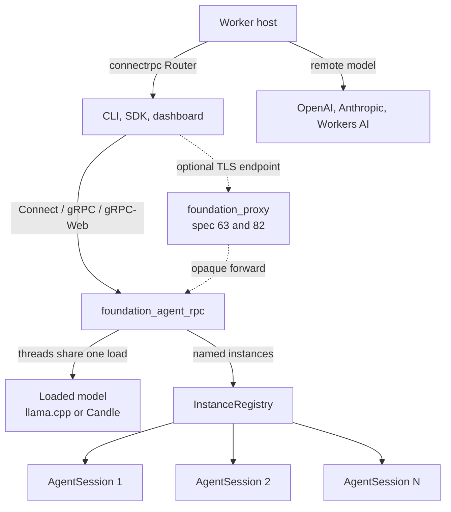
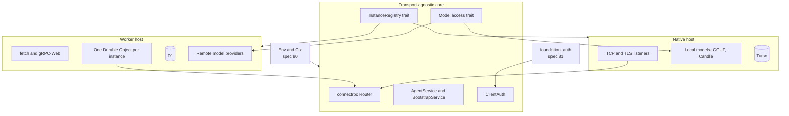

# Agent RPC

_Written in ASD-STE100 Simplified Technical English (STE) from 2026-10-26. Older paragraphs are
being changed to STE feature by feature. Code and identifiers stay as they are._

**Abbreviations in this file.** remote procedure call (RPC); Transport Layer Security (TLS);
mutual TLS (mTLS); WebAssembly (wasm); Cloudflare (CF); JavaScript Object Notation (JSON);
Hypertext Transfer Protocol (HTTP); Quick Response code (QR code); command-line interface (CLI);
software development kit (SDK); continuous integration and continuous delivery (CI/CD);
GPT-Generated Unified Format (GGUF); Hypertext Transfer Protocol version 2 (H2); input/output
(I/O); identifier (ID); random number generator (RNG); central processing unit (CPU); AeroSpace
and Defence Industries Association of Europe (ASD), the owner of the STE standard ASD-STE100.

## Glossary

| Term | Meaning |
|---|---|
| agent-rpc | The model server of this specification (`foundation_agent_rpc`). It loads a model one time and serves many named agent instances. |
| Instance | Lightweight logical state over one loaded model: an `AgentSession`, a memory store and a provider config. |
| Model handle | The shared, `Send + Sync` handle to a loaded model. It is loaded once and cloned to every instance. |
| Host | The program-specific part that gives the agent RPC core its network, storage and models: native, Worker or simulation. |
| Bootstrap payload | The text (or QR code) that gives a client an address, the TLS trust data and a signed secret. |
| Signed secret | The credential of `foundation_auth::secret`: signed JSON with a time window. It is not a JSON Web Token. |
| Worker | A Cloudflare Worker: a wasm program that answers HTTP `fetch` events. |
| Durable Object | A Cloudflare object with one identity and serialized state, used for one instance on the edge. |

## 1. Purpose

A machine runs one long-lived `agent-rpc` server. It loads a model **once** and serves many
concurrent agent sessions over Connect, gRPC and gRPC-Web. The server owns its own client-facing
auth: a signed secret for bootstrap, then mTLS on a direct connection. It advertises that auth as
a base64 or QR payload.

The server has two hosts:

1. **Native** — TCP and TLS listeners, local models (llama.cpp GGUF or Candle), the full
   feature set. This is the first milestone.
2. **Cloudflare Worker** — a thin orchestrator on Workers, with remote model providers, and the
   full native server in a Cloudflare container. Spec 77 owns container control and deployment;
   this specification builds the agent-rpc Worker on those surfaces.

The server knows nothing of the manifest, the installer, the registrar or the proxy's routing.
Those are separate specifications. A client reaches the server directly or through the proxy,
which ends TLS and forwards opaquely (completed spec 63).

_The diagram shows the server, the one loaded model, the instances that share it, and the optional proxy in front._

## 2. What this specification owns

| Area | Owner | Not in this specification |
|---|---|---|
| The agent RPC service and `InstanceRegistry` | this specification | |
| The native host and the deterministic simulation host | this specification | |
| The Worker host, the Durable Object layout and the browser client | this specification | |
| The Cloudflare container: control, `ContainerHandle` and deployment | spec 77 | this specification builds the agent-rpc Worker on it |
| Key protection at rest | this specification (last feature) | |
| The `Env` bundle, transport facts and migration groups | spec 80 | shared with the proxy |
| Signed secrets, CA, trust store and mTLS verifiers | spec 81 | shared with the proxy |
| The manifest contract | spec 78 | read only by the installer and the registrar |
| Install, systemd, Docker and bootstrap | spec 79 | |
| Proxy registration authority and the registrar sidecar | spec 82 | |

The old spec 83 bundled the operator path with the server. The features moved as follows:

| Old feature | New home |
|---|---|
| 02 manifest installer | spec 78 (contract) and spec 79 (installer) |
| 03 proxy registration | spec 82 feature 00 |
| 04 registrar sidecar | spec 82 feature 01 |
| 08 env and side effects | spec 80 feature 00 |
| 09 transport prerequisites | spec 80 feature 01 |
| 10 migration groups | spec 80 feature 02 |
| 11 foundation auth | spec 81 feature 00 |

## 3. Specification order

1. **Spec 80 must land first.** The core takes its clock, timer, entropy, IDs and migrations from
   it.
2. **Spec 81 must land first.** The client auth providers and the bootstrap secret come from it.
3. **This specification is independent of 78, 79 and 82.** The server can run without the
   installer or the registrar. A deployment that uses them adds them in that order.
4. **Inside this specification:** 00, 01 and 02 are complete. 03 (core) runs before 04 (native
   host) and 05 (Worker host). 06 (Cloudflare host) runs after 05, and after spec 77 features 07
   (Cloudflare container control) and 08 (deployment). 08 (key protection) runs last.

## 4. Feature index

| # | Feature | Description | Dependencies | Status |
|---|---|---|---|---|
| 00 | [WASM and CF-Workers Readiness](./features/00-foundation/feature.md) | Make `foundation_ai` and its dependencies compile and run on `wasm32-unknown-unknown`; verify with miniflare and Cloudflare | None (extends completed spec 28) | 🔧 6/7 (T7 needs credentials) |
| 01 | [Agent RPC Model Server](./features/01-agent-rpc/feature.md) | Load-once, threaded-inference RPC server with named instances and client-facing secret → mTLS auth | None | ✅ Complete |
| 02 | [WASM Lazy Streaming](./features/02-wasm-async-streaming/feature.md) | Parking `into_future_stream`, lazy wasm `send_sse`, `SseProgress::Failed`; remove the wasm-unsafe blocking path | 00 | ✅ Complete |
| 03 | [Agent RPC Core](./features/03-agent-rpc-core/feature.md) | `agent.proto`, model catalog, `InstanceRegistry` trait, transport-agnostic service and enrollment handlers | 80, 81 | ⬜ Pending |
| 04 | [Native Host and DST](./features/04-native-host-and-dst/feature.md) | Native host (TCP/TLS, local models, Turso) and the deterministic simulation harness; the proof of concept works | 80, 81, 03 | ⬜ Pending |
| 05 | [Worker Host and Web Client](./features/05-worker-host-and-web-client/feature.md) | Workers, one Durable Object per instance, browser client, R2 history archive | 80, 03 | ⬜ Pending |
| 06 | [Cloudflare Host](./features/06-cloudflare/feature.md) | The agent-rpc Worker: end-to-end tests on Workers, the Workers AI path, and the native server in a Cloudflare container. Container control and deployment come from spec 77 | 00, 01, 05, 77 | ⬜ Pending |
| 07 | [Pluggable Agent RPC: landing](./features/07-pluggable-agent-rpc/feature.md) | Task T0 only: bring PR #126 onto master. The design is in `agent-rpc-architecture.md` | 01 | ✅ Landed (#126 on master) |
| 08 | [Key Protection at Rest](./features/08-key-protection-at-rest/feature.md) | Key store over `foundation_db`; private keys encrypted at rest (KEK sources, WebCrypto, remote KMS); passphrase key files; rotation by `kid` | 81, 04 | 📝 Todo (last) |

Status key: ⬜ Pending | 🔧 In progress | ✅ Complete or landed | 📝 Todo

## 5. Architecture

The shared design record for the pluggable server (layers, trait map, host table, request
lifecycles, owner decisions and open questions) is
[`agent-rpc-architecture.md`](./agent-rpc-architecture.md). The features in this specification
own the detailed design.

_The diagram shows one core with two hosts and the two shared specs that feed it._

### Auth model (one link, owned here)

| Channel | Parties | Auth | Owner |
|---|---|---|---|
| Client ↔ agent-rpc | CLI, SDK ↔ server | A signed secret as a bearer credential through the proxy; mTLS only on a direct connection | this specification |
| Client ↔ proxy | CLI, SDK ↔ proxy | TLS, ended by the proxy | spec 82 |
| Sidecar → proxy | registrar ↔ proxy | Enrollment token, then mTLS | spec 82 and spec 81 |

The proxy never checks the agent RPC client credential. The server never sees the registrar
certificate. These are independent links.

### Durable streams and the streaming operations

The [Durable Streams research note](../research/edge-data/durable-streams.md) and
[spec 71](../71-durable-streams-in-valtron) record a contract that applies to this
specification's streaming operations. The mechanism lives in valtron (spec 71); the features
here **consume** it once it exists.

| Operation | Durable Streams idea | Where it lands here |
|---|---|---|
| `chat` and turn streaming | A resumable, offset-addressable stream. The client stores the cursor and reconnects with no skip and no duplicate. | Feature 01's Connect/gRPC/gRPC-Web chat streams; the SSE tail of feature 02. |
| Tool outputs and progress events | Replay from an arbitrary offset; `Stream-Up-To-Date` vs `Stream-Closed` signal "more may come" vs "done". | The turn and progress event stream of an instance. |
| One conversation that branches | Fork: a new stream shares the prefix and owns only its tail. | A forked `AgentSession` is a fork of the turn log. |
| Retried RPC writes | An idempotent producer (`producer-id`, `epoch`, `seq`) with deduplicated acknowledgement. | Any retryable append to a turn log or an instance state feed. |
| Many watchers of one instance | Cursor-based collapsing: one upstream connection, a CDN absorbs the fan-out. | The relay and fan-out need in the edge-data research. |

These are inputs to the design, not new work in this specification. Spec 71 delivers the
`DurableStream` reader/writer and the `DurableStreamStore` trait; features 01 and 02 pick them up
when they are built.

## 6. Known issues

1. **Model shareability.** The load-once model depends on the loaded backend being
   `Send + Sync` and handable to many `AgentSession`s. Feature 01 verified it for Candle and
   llama.cpp. It is not an assumption.
2. **H2 trailers.** A gRPC client could not observe `grpc-status` until spec 63's T1 landed. It
   has landed; feature 01's gRPC tests assert the trailer.
3. **Cloudflare and wasm.** The full `foundation_ai` cannot compile to a Worker. The local model
   backends stay `not(target_family = "wasm")`-gated. Feature 00 is the readiness work; feature
   06 is the target. Feature 06 needs spec 77 for the container handle and the deployer.
4. **`foundation_arrow` wasm status.** Feature 00's T2 audit checks it. Do not assume it.
5. **One valtron pool serves all tests in a binary.** A test that holds workers (the gated
   streaming test) makes other tests wait. Use a call deadline that outlasts the other tests
   (#551).

## 7. Requirements conversation summary

- **agent-rpc is per machine, not per instance.** A process per instance would defeat memory
  sharing. The server loads a model once and runs many threaded inference sessions; instances are
  lightweight logical state.
- **The proxy and agent-rpc are not layered or coupled.** The proxy receives registrations and
  forwards. It does not know agent-rpc's client auth.
- **The server owns its client auth.** A secret token for bootstrap, then mTLS on a direct
  connection. It advertises the payload as base64 or a QR code.
- **Foundation first.** Make `foundation_ai` and its dependencies wasm-clean before the
  Cloudflare target.
- **One RPC surface on every host.** Traits make the core transport-agnostic: native, Worker and
  simulation. The owner's direction of 2026-10-22.
- **Two artifacts on Cloudflare.** A thin wasm orchestrator on Workers, and the full native
  server in a Cloudflare container. The container handle and the deployer come from spec 77.
  This specification builds the agent-rpc Worker on them.

## 8. Owner decisions

The detailed owner decisions 1 to 11 are in
[`agent-rpc-architecture.md`](./agent-rpc-architecture.md) section 11. The ones that shape this
specification:

1. Instance name scope: per caller on the Worker, shared on native.
2. Signed secrets: issue version 2 by default; accept version 1.
3. Private keys at rest: always encrypted on every host. Deferred to feature 08.
4. JWT client auth: ship `JwtAuth` behind a feature flag, never as the default.
5. `DestroyInstance`: archive to R2, then delete Durable Object storage.
6. Model provider API keys: Worker secrets or Secrets Store secrets only.
7. Postgres: not part of this specification.
8. No version field in `BootstrapPayload`; one `url` for every host.
9. Key setup for the proof of concept: operator-made key files. Key protection is feature 08.

## 9. Success criteria (spec-wide)

- `foundation_ai` and its AI dependencies compile clean to `wasm32-unknown-unknown`, and the
  miniflare and Cloudflare examples stream end to end — before the server is built.
- `agent-rpc` loads one model and serves multiple concurrent instances over Connect, gRPC and
  gRPC-Web on real loopback TCP, with unary and streaming chat.
- A client reaches an agent directly or through the proxy. On a direct connection, mTLS gates the
  router. Through the proxy, the signed secret gates the handler.
- The native host and the Worker host run the same core. The host supplies network, storage and
  models; the core does not know which host it is on.
- A deterministic simulation test replays a native run from one seed, with an injected clock,
  timer, entropy and RNG.
- The Cloudflare target runs the thin orchestrator on Workers and the full server in a
  Cloudflare container, started and controlled through the spec 77 `ContainerHandle` and
  deployed through the spec 77 `CloudflareDeployer`.
- No secret, private key or token appears in `Debug` or `Display` output.

## 10. Out of scope

- **The agentic and harness design of `foundation_ai`.** Only the minimum to make it wasm-clean
  and to expose a `Send + Sync` model handle.
- **The manifest, installer and registrar.** Specs 78, 79 and 82.
- **The shared `Env`, transport facts and migrations.** Spec 80.
- **The shared auth primitives.** Spec 81. This specification wires them.
- **Changes to `foundation_connectrpc`** beyond what spec 63 and spec 80 track. The server
  consumes the RPC engine.
- **Cloudflare container control and deployment.** Spec 77. This specification calls them.
- **Cloudflare deployment in the installer.** The installer's targets are systemd and Docker.
- **Porting local model backends to wasm.** Workers use Workers AI or a remote server.
- **gRPC-JSON transcoding or a REST façade.**
- **Cross-org or multi-tenant proxy federation.**

## 11. Implementation location

- `backends/foundation_agent_rpc/` — the core, the native host, the Worker host and the binaries.
- `backends/foundation_ai/` — modified only for wasm readiness (feature 00).
- `backends/foundation_connectrpc/` — used; the wasm fetch transport is feature 05.
- `backends/foundation_deployment_cloudflare/` — used through spec 77 feature 08; no change
  from feature 06.
- `backends/foundation_platform_sandbox/` — used through spec 77 feature 07; no change from
  feature 06.
- `backends/foundation_auth/` — used through spec 81.
- `proto/ewe/agent_rpc/v1/agent.proto` — the wire contract (feature 03).
- Crate layout rule: a library is `src/lib.rs`; each binary is `src/bin/<name>.rs` with a
  `[[bin]]` entry. No `src/main.rs`.

## 12. Module references

- `backends/foundation_netio/src/{network_client.rs,shared/client/http_client.rs,wasm/client/client.rs}`
  — the cross-platform HTTP seam (`DynNetClient`, `HttpClient`, `FetchHttpClient`).
- `backends/foundation_compact/` — time, entropy, RNG, IDs, crypto, `SendWrapper`.
- `backends/foundation_http/src/wasm/{serve_cf,dispatch_cf}.rs` — Worker serve and dispatch.
- `backends/foundation_toolings/src/harness/miniflare.rs` — the `Miniflare` test harness.
- `backends/foundation_connectrpc/` — Router, Client, handlers; the wasm transport stub.
- `backends/foundation_ai/src/harness/` — `RouterPreset`, `RouterMix`, `gguf_provider`,
  `candle_llama`, `into_agent_builder(_with_stores)`.
- `backends/foundation_ai/src/agentic/` — `AgentSession`, `AgentSessionBuilder`, `AgentConfig`,
  `AgentContext`, memory stores.
- `backends/foundation_deployment_cloudflare/` — Workers, API v4, `generated/ai`.
- `specifications/completed/28-cloudflare-workers-readiness/` — prior wasm readiness.
- `specifications/completed/63-connectrpc-proxy/` — the proxy and its per-endpoint protocol
  selection.
- `specifications/71-durable-streams-in-valtron/` — the durable stream mechanism.

---

_Created: 2026-10-19_
_Last updated: 2026-11-14 (split into specs 78 to 82; Cloudflare container control and
deployment moved to spec 77; this spec is now agent RPC only)_
_Structure: Feature-based (has_features: true, has_fundamentals: true)_
