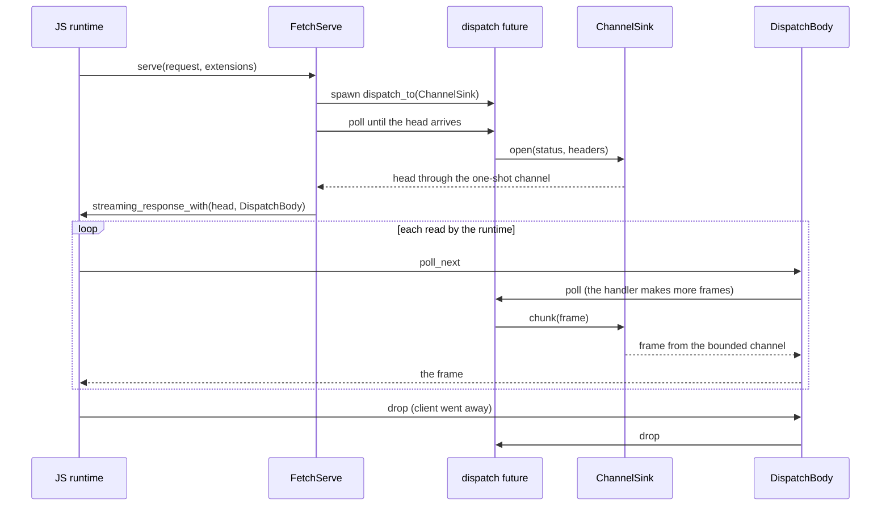

# Detailed design: the wasm fetch plumbing

_Part of [spec 85](./requirements.md). Written in ASD-STE100 Simplified Technical English
(STE). Code and identifiers stay as they are._

**Abbreviations in this file.** WebAssembly (wasm); Hypertext Transfer Protocol (HTTP);
Hypertext Transfer Protocol version 2 (HTTP/2); remote procedure call (RPC); Cloudflare Durable
Object (DO); JavaScript (JS); client-side JavaScript (CSJS); Cross-Origin Resource Sharing
(CORS); Hypertext Transfer Protocol Secure (HTTPS); AeroSpace and Defence Industries
Association of Europe (ASD), the owner of the STE standard ASD-STE100.

This file moves the design of spec 83 feature 05 sections 5.4, 5.5 and 6.2 into spec 85. The
owner rule: one specification owns the pump, and every consumer builds on it.

## 1. Why `Transport::open` is synchronous

`Transport::open` returns a `TransportStream` with four halves and starts no work. This shape
is right for fetch for one reason: the client must be able to write its request message before
the transport sends anything, and the transport must not block a single-threaded runtime.

| Phase | Who acts | What happens |
|---|---|---|
| `open` | client | The transport builds an exchange object and returns the four halves. No JS call happens. |
| The client writes `send_body` | client | The exchange collects the bytes. It fails at `max_request_bytes`. |
| The client closes `send_body` | client | The exchange knows the body is complete. |
| The first poll of `head` | runtime | The exchange builds a `web_sys::Request` and calls `Fetcher::fetch`. |
| `head` resolves | runtime | The status and the headers are published. |
| Each poll of `recv_body` | runtime | The exchange reads one chunk from the `ReadableStream`. |
| `trailers` | runtime | Closes empty and with no error. |

Nothing polls the exchange after a drop. The `ReadableStream` reader is cancelled in `Drop`.

## 2. `FetchExchange`

```rust
// foundation_connectrpc/src/wasm/fetch_transport.rs
struct FetchExchange<F: Fetcher> {
    fetcher: Rc<F>,
    request: RequestDescriptor,
    config: FetchTransportConfig,
    body: Rc<RefCell<Option<Vec<u8>>>>,       // the collected request body
    head: PipeSender<SimpleHeaders>,
    frames: PipeSender<Vec<u8>>,
    state: Rc<RefCell<ExchangeState>>,
}

enum ExchangeState {
    /// The client is still writing the request body.
    Collecting,
    /// The request is sent; the response head is awaited.
    Sent,
    /// The body streams.
    Streaming,
    /// The call ended with an error; the sink holds it.
    Failed(TransportError),
}
```

The exchange is `!Send`. It is wrapped in `SendWrapper` because `TransportStream` holds
`Arc<dyn SendBody>` and `BodyStream` values that must pass the `Send` bound of the trait. On
wasm there is one thread, so the wrapper is sound. `SendWrapper` asserts `Send` and `Sync`
through `unsafe impl` and checks nothing at run time: it has no `Drop` check. A value cannot
reach another thread here, because wasm has one thread. `FetchTransport` keeps one `Fetcher`
for all its calls, and that field is `SendWrapper<Rc<F>>` for the same reason: `Transport`
requires `Send + Sync`, and an `Rc` is neither.

## 3. `FetchServe` and the dispatch

`ConnectRpcHandler::dispatch_to` takes a sink and a `CallHooks` value. `FetchServe` supplies
both.



_The diagram shows that the handler runs only while the runtime reads the body._

The pieces:

| Type | Job |
|---|---|
| `ChannelSink` | Implements `ResponseSink`. `open` sends the head through a one-shot channel; `chunk` sends a frame into a bounded channel; `finish` closes the channel. A full channel returns `Pending`, so the handler pauses. |
| `drive_until_head` | Polls the dispatch future and the one-shot head receiver together. Returns the head or the error. |
| `DispatchBody` | A `Stream<Item = Result<Vec<u8>, TransportError>>`. Each poll polls the dispatch future first, then the frame receiver. When the dispatch future ends and the channel is empty, it ends. |
| `RequestBody` | A `Stream<Item = Result<Vec<u8>, TransportError>>` over the request `ReadableStream`, bounded by `max_request_bytes`. Its error is `RESOURCE_EXHAUSTED`. |

### 3.1 Changes outside `foundation_connectrpc`

| Crate | Change | Why |
|---|---|---|
| `foundation_netio` | `wasm::response::streaming_response_with(status, headers, body)` and `pull_readable_stream(body)`; `streaming_response` keeps its signature and calls them | `streaming_response` fixes status 200 and one content type. Connect needs the status and the headers of the handler. |
| `foundation_compact` | `impl<S: Stream> Stream for SendWrapper<S>` (adds a `futures-core` dependency) | `RequestBody` must be `Send`. A JS body stream is not. |
| `foundation_connectrpc` | `CallHooks::with_clock(&dyn Clock)`; dispatch reads the deadline from that clock | `dispatch.rs` today calls `std::time::Instant::now()`. That call panics on `wasm32-unknown-unknown`. Spec 84 supplies the clock. |

### 3.2 Request conversion

```rust
pub fn request_body(
    req: &web_sys::Request,
    extensions: Extensions,
    max_header_bytes: usize,
    max_body_bytes: usize,
) -> Result<(SimpleIncomingRequest, RequestBody), ServeError>;
```

It reads the method, the URL path and the headers into a `SimpleIncomingRequest`. The header
block is bounded by `max_header_bytes`. The body stays a stream. `extensions` carries the
per-call values that the host knows, for example the Cloudflare client-certificate facts (spec
83 feature 05 section 5.3) or the forwarded identity of a DO hop.

## 4. The DO stub

```rust
pub struct StubFetcher {
    stub: SendWrapper<worker::Stub>,
    headers: Vec<(String, String)>,
}

impl Fetcher for StubFetcher {
    fn fetch(&self, request: web_sys::Request) -> LocalBoxFuture<'static, Result<web_sys::Response, JsValue>> {
        let stub = self.stub.clone();
        let headers = self.headers.clone();
        Box::pin(async move {
            for (name, value) in &headers {
                request.headers().set(name, value)?;
            }
            let response = stub.fetch_with_request(worker::Request::from(request))
                .await
                .map_err(js_error)?;
            Ok(web_sys::Response::from(response))
        })
    }
}
```

`SendWrapper::clone` clones the `worker::Stub`, which is a JS handle. The header list is small
and copied into the future, so the future owns no borrow.

The DO response body is a `ReadableStream`, so turn events pass through with no buffering. Spec
83 feature 05 section 5.6 has the DO side.

## 5. The browser

`GlobalFetcher` calls the global `fetch`. In a browser page that is `window.fetch`; in a Worker
it is the Worker's `fetch`. One implementation covers both, because both are the global
function.

```rust
impl Fetcher for GlobalFetcher {
    fn fetch(&self, request: web_sys::Request) -> LocalBoxFuture<'static, Result<web_sys::Response, JsValue>> {
        Box::pin(async move {
            let promise = global_fetch(&request)?;
            Ok(JsFuture::from(promise).await?.unchecked_into())
        })
    }
}
```

A browser page cannot choose a client certificate, so the browser client shows a bearer secret
on each call (spec 86 supplies the `Secret` type; spec 83 feature 05 section 6.3 has the
client). A Worker-to-DO call adds no CORS header, because it is not a browser call.

## 6. Error mapping

| Source | `TransportError` | Notes |
|---|---|---|
| The request body is larger than `max_request_bytes` | `RESOURCE_EXHAUSTED` | Before the send. |
| `Fetcher::fetch` rejects | `Unavailable` with the JS error text | The text is cut to `max_error_message`. |
| The status is 4xx or 5xx | The Connect code of the body frame, when the body has one; else `Unavailable` | The error body is read up to `max_error_body_bytes`. |
| A header is not valid for a fetch request | `InvalidArgument` with the header name | Before the send. |
| The response body stream fails | `Unavailable` | After the head. |
| The call is a gRPC call | `Unimplemented` with the text "gRPC needs HTTP/2 trailers" | `FetchServe` only. |

## 7. Tests of this file

| Case | Test |
|---|---|
| The four phases of section 1 | `exchange_phases` |
| A drop cancels the reader | `drop_cancels_reader` |
| A full frame channel pauses the handler | `backpressure_pauses` |
| A header that fetch rejects | `invalid_header_refused` |
| The error body bound | `error_body_bounded` |
| A DO stub header is present | `stub_header_set` |
| The global fetch is used in a browser build | `global_fetcher_browser` |

All tests are in `backends/foundation_connectrpc/tests/wasm/` and run under Node.

---

_Created: 2026-11-15. Moved from spec 83 feature 05 (`worker-and-web.md` sections 5.4, 5.5 and
6.2) and adapted: no `ContextBag`, the clock and the timer come from `Ctx` (spec 84), and the
`Fetcher` header list replaces the hard-coded forwarded header._
