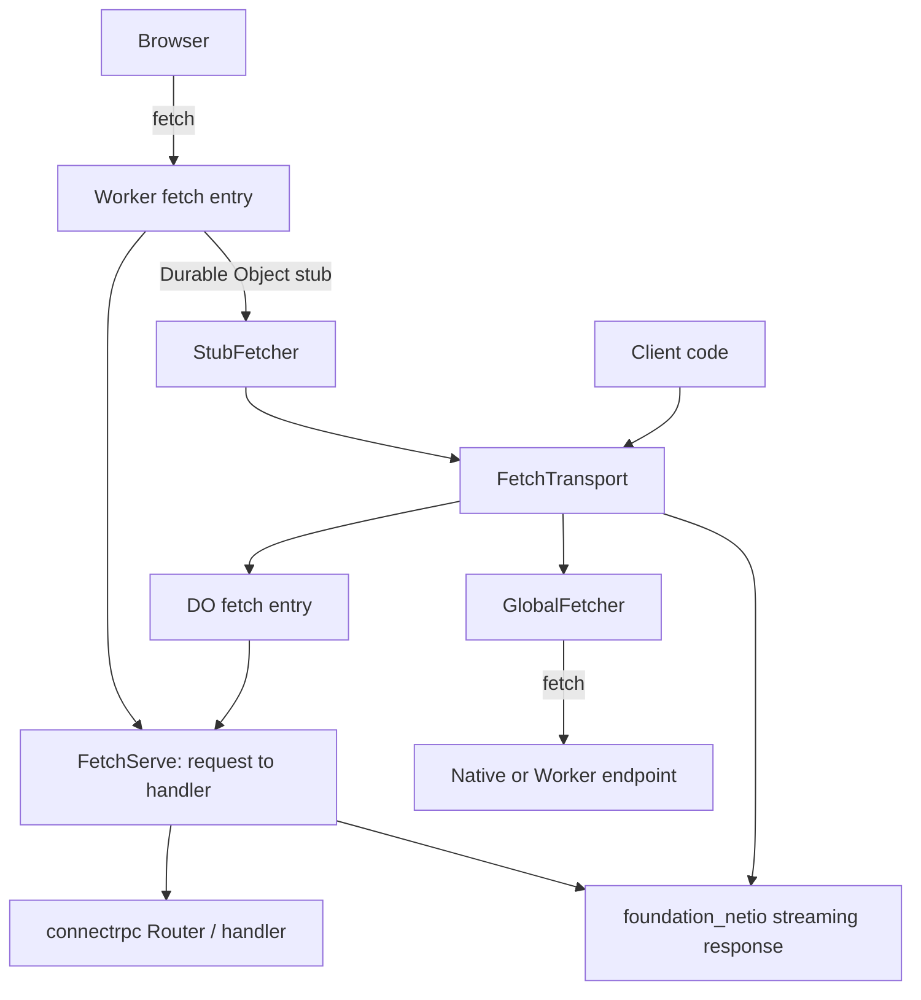

# Wasm Fetch Transport

_Written in ASD-STE100 Simplified Technical English (STE). Code and identifiers stay as they
are._

**Abbreviations in this file.** WebAssembly (wasm); Hypertext Transfer Protocol (HTTP);
Hypertext Transfer Protocol version 2 (HTTP/2); remote procedure call (RPC); Cloudflare
Durable Object (DO); JavaScript (JS); application programming interface (API); Cargo feature
(feature); client-side JavaScript (CSJS); Cross-Origin Resource Sharing (CORS); Domain Name
System (DNS); AeroSpace and Defence Industries Association of Europe (ASD), the owner of the
STE standard ASD-STE100.

## Glossary

| Term | Meaning |
|---|---|
| fetch | The JavaScript function `fetch(request) -> Promise<Response>`. A Worker, a browser page and a DO stub all give one. |
| `Fetcher` | The trait of this specification: one `fetch`. A browser, a Worker and a DO stub implement it. |
| `FetchTransport` | The connectrpc client `Transport` over a `Fetcher`. |
| `FetchServe` | The connectrpc server side: one `fetch` request in, one streaming response out. |
| `TransportStream` | The four halves of one call in connectrpc: the request body sink, the response head, the response body and the trailers (`shared/transport/base.rs`). |
| body pump | The task that copies chunks from a source stream to a sink stream with a bound. |
| capability | A property that a transport declares, for example request streaming. A call that needs an absent capability is refused before it is sent. |
| Durable Object stub | The handle that a Worker uses to send a request to one DO. |
| `SendWrapper` | The wrapper of `foundation_compact` that makes a single-threaded value look `Send` and `Sync`. It is sound on wasm, which has one thread, and it does not check the thread at run time. |

## 1. Purpose

Two specifications need the same wasm fetch code:

- **Spec 77 (sandbox platform).** Feature 07 needs a client transport to a Cloudflare DO and a
  body pump for the container port. Feature 08 needs the Worker `fetch` entry that serves
  `SandboxService`. Today it says: "It does not wait for it: the pump is about 80 lines."
- **Spec 83 (agent RPC).** Feature 05 task T19 builds `FetchServe` and `FetchTransport`, task
  T21 builds the DO stub transport, and feature 06 uses both for the agent-rpc Worker.

If each specification builds its own, the workspace gets two pumps, two request-body
collectors and two response builders, and they drift. The owner direction (2026-11-15): "then
lets create or move this into a spec to own this, so it gets done before either and then no one
is splitting work and they just build on top of that."

So this specification owns the code split out of spec 83 feature 05. Spec 77 features 07 and 08
and spec 83 features 05 and 06 use it and record the dependency. They do not write a pump, a
`Fetcher`, or a response builder.

## 2. What exists today

| Item | State on master |
|---|---|
| `Transport` trait | `foundation_connectrpc/src/shared/transport/base.rs:161`. `open` is synchronous and returns a `TransportStream` with four halves. |
| Native transports | `H1Transport` (`shared/transport/h1.rs:61`), `H2Transport` (`native/transport/h2.rs`), `H3Transport` (`native/transport/h3.rs`), `WsTransport` (`shared/transport/ws.rs:78`). |
| wasm transport | `shared/transport/wasm.rs` is a 23-line stub with `WASM_FETCH_CAPABILITIES` and no implementation. |
| `src/wasm/` module | Does not exist. |
| `worker` dependency | Not in `foundation_connectrpc/Cargo.toml`. |
| `FetchServe`, `FetchTransport`, `Fetcher`, `StubFetcher`, `DoStubTransport` | Do not exist anywhere in the workspace. |
| `foundation_netio` | Has `wasm::response::streaming_response` (status 200 and one content type only) and the HTTP exchange task. |
| Dispatch | `ConnectRpcHandler::dispatch_to` writes to a `ResponseSink` (`whole`, `open`, `chunk`, `finish`) and already streams on native hosts. |

## 3. Ownership

| Item | Owner |
|---|---|
| `Fetcher`, `GlobalFetcher` | This specification |
| `FetchTransport`, `FetchTransportConfig` | This specification |
| `FetchServe`, `FetchServeConfig` | This specification |
| The body pump, the request-body collector, the response stream builder | This specification |
| `StubFetcher`, `DoStubTransport` | This specification |
| The forwarded identity header (`ewe-forwarded-*`) | Spec 83 feature 05 (`proto.md` section 7). `StubFetcher` sets it through a small `HeaderWriter` the caller gives. |
| The services that are served | Spec 77 (sandbox), spec 83 (agent RPC) |
| The `DeadlineTimer` adapter and the injected clock | Spec 84 (section 5.1) |
| The `foundation_netio` response and body helpers | This specification, in the same change |

**Not in this specification:** the agent RPC router, the sandbox service, the DO layout, the
CORS policy of one host, and the application protocol of any caller.

## 4. Design



_The diagram shows one transport and one server on every fetch boundary: browser to Worker, Worker to DO, code to a remote host._

```rust
// foundation_connectrpc/src/wasm/mod.rs   (cfg(target_family = "wasm"))
mod fetch_serve;
mod fetch_transport;
mod stream;

pub use fetch_serve::{FetchServe, FetchServeConfig};
pub use fetch_transport::{FetchTransport, FetchTransportConfig, Fetcher, GlobalFetcher};
pub use stream::{body_stream, request_body, response_stream};

#[cfg(feature = "cloudflare")]
mod stub;
#[cfg(feature = "cloudflare")]
pub use stub::{DoStubTransport, StubFetcher};
```

The module is compiled only for `target_family = "wasm"`. The `worker` crate is needed only by
the `cloudflare` feature (`worker = "0.8"`), so a browser build does not pull it in. The core
types use `web_sys` and `wasm-bindgen`, which `foundation_netio` already uses on wasm.

### 4.1 `Fetcher`

```rust
/// Sends one request and returns a response promise.
///
/// A browser page, a Worker entry and a DO stub each give one. A test gives a stub.
pub trait Fetcher: 'static {
    /// The response, when the runtime answers.
    fn fetch(&self, request: web_sys::Request) -> LocalBoxFuture<'static, Result<web_sys::Response, JsValue>>;
}
```

`Fetcher` is neither `Send` nor `Sync`: a JS value cannot cross a thread, and wasm has one
thread. The transport wraps it in `foundation_compact::SendWrapper`, which asserts both bounds
and does not check the thread at run time. A build that enables the wasm `atomics` target
feature has neither assertion, so this crate does not support that build.

### 4.2 `FetchTransport`

```rust
/// The global `fetch` of a browser page or a Worker.
pub struct GlobalFetcher;

/// A client `Transport` over fetch. Fetch has no request streaming and no trailers, so it
/// supports unary and server-streaming calls.
pub struct FetchTransport<F: Fetcher> {
    fetcher: Rc<F>,
    config: FetchTransportConfig,
}

#[derive(Debug, Clone)]
pub struct FetchTransportConfig {
    /// The largest request body that the transport collects before it sends.
    /// Default 4 MiB: the gRPC default maximum send message size.
    pub max_request_bytes: usize,
    /// Response chunks that may wait for the reader.
    /// Default 4: the pipe depth of `ClientOptions` today.
    pub response_queue: usize,
    /// The largest single response chunk that the transport passes on. A larger chunk is
    /// split. Default 64 KiB: the read size of `wasm-streams`.
    pub max_chunk_bytes: usize,
}

impl FetchTransportConfig {
    #[must_use] pub fn with_max_request_bytes(self, bytes: usize) -> Self;
    #[must_use] pub fn with_response_queue(self, chunks: usize) -> Self;
    #[must_use] pub fn with_max_chunk_bytes(self, bytes: usize) -> Self;
}

impl<F: Fetcher> FetchTransport<F> {
    #[must_use]
    pub fn new(fetcher: F, config: FetchTransportConfig) -> Self;
}

impl<F: Fetcher> Transport for FetchTransport<F> {
    fn capabilities(&self) -> TransportCapabilities { WASM_FETCH_CAPABILITIES }
    fn open(&self, request: RequestDescriptor) -> Result<TransportStream, TransportError>;
}
```

`open` returns at once and starts no work. The work starts when the client polls the head:

1. The client writes the one request message into `send_body` and closes it. The transport
   collects the body, up to `max_request_bytes`. A larger body fails the call with
   `TransportError` `RESOURCE_EXHAUSTED` before it sends. This is the one allowed buffered
   body (root rule 4): fetch cannot stream a request body, and a Connect unary or
   server-streaming call has one small message.
2. The first poll of `head` builds a `web_sys::Request` and calls `Fetcher::fetch`. The
   response head is published from `status` and `headers`.
3. `recv_body` reads the response `ReadableStream` one chunk at a time through
   `wasm-streams`. It never reads the whole body.
4. `trailers` closes empty and with no error. Fetch has no trailers; a gRPC-Web call puts its
   trailers in the body and the Connect error is a body frame.
5. When the client drops the call, the transport cancels the reader and the response body is
   released. The server sees the client go away.

### 4.3 `FetchServe`

```rust
/// Serves Connect and gRPC-Web calls from a fetch event (a Worker or a DO).
pub struct FetchServe {
    handler: ConnectRpcHandler,
    config: FetchServeConfig,
    clock: Arc<dyn Clock>,
    timer: Arc<dyn Timer>,
}

#[derive(Debug, Clone)]
pub struct FetchServeConfig {
    /// The largest request body that `FetchServe` reads. Default 4 MiB: the gRPC
    /// default maximum receive message size. A larger body is refused with
    /// `RESOURCE_EXHAUSTED` before the handler runs.
    pub max_request_bytes: usize,
    /// Response chunks that may wait for the runtime. Default 4: the pipe depth
    /// of `ClientOptions` today. A full queue pauses the handler.
    pub response_queue: usize,
    /// The largest request header block. Default 32 KiB: the `max_headers` default of
    /// `FrameLimits`.
    pub max_header_bytes: usize,
}

impl FetchServeConfig {
    #[must_use] pub fn with_max_request_bytes(self, bytes: usize) -> Self;
    #[must_use] pub fn with_response_queue(self, chunks: usize) -> Self;
    #[must_use] pub fn with_max_header_bytes(self, bytes: usize) -> Self;
}

impl FetchServe {
    /// Builds the server. The clock and the timer come from `ctx` (spec 84).
    ///
    /// # Errors
    /// [`EnvError::Missing`](foundation_context::env::EnvError::Missing) when the
    /// context holds no `Env`. A deadline needs the injected timer.
    pub fn new(handler: ConnectRpcHandler, config: FetchServeConfig, ctx: Ctx)
        -> Result<Self, EnvError>;

    /// Serves one call. Returns when the response head is ready; the body streams after.
    ///
    /// # Errors
    /// A `JsValue` when the runtime cannot build the response.
    pub async fn serve(&self, req: web_sys::Request, extensions: Extensions)
        -> Result<web_sys::Response, JsValue>;
}
```

`serve` does this:

1. `request_body` copies the fetch request into a `SimpleIncomingRequest` with the given
   extensions. The body is a `RequestBody` stream over the request `ReadableStream`, bounded by
   `max_request_bytes`. Nothing reads the whole body first.
2. It creates a one-shot channel for the head and a bounded channel for the frames.
3. `drive_until_head` polls the dispatch future until the head arrives. A unary call usually
   ends here.
4. `DispatchBody` is a stream. Each poll first polls the dispatch future, then takes the next
   frame from the channel. So the handler runs only when the runtime asks for more body, and
   nothing builds up in memory. A full queue pauses the handler.
5. The response is built with `foundation_netio::wasm::response::streaming_response_with`
   (status, headers, streaming body). The server sets no CORS header; the host does (spec 77
   feature 08, spec 83 feature 05).
6. When the runtime cancels the `ReadableStream`, `DispatchBody` is dropped, which drops the
   dispatch future and the handler state. The handler sees the call end.

**What it serves.** Connect and gRPC-Web. It does not serve gRPC: gRPC needs HTTP/2 trailers
and the fetch API cannot send them. A caller that asks for gRPC gets `UNIMPLEMENTED` with the
text "gRPC needs HTTP/2 trailers".

### 4.4 The shared pump and builders

Spec 77 feature 07 has a container port that is not a `web_sys::Response`: it calls
`container.fetch(port, PortRequest)` and gets a `PortResponse`. It shares the pump and the
stream construction, not the `Fetcher`:

```rust
// foundation_connectrpc/src/wasm/stream.rs
/// Reads `send_body` to its end, up to `max` bytes, and returns the bytes.
///
/// # Errors
/// `RESOURCE_EXHAUSTED` when the body is larger than `max`; the error of the sink.
pub fn request_body(send_body: Arc<dyn SendBody>, max: usize)
    -> BoxFuture<'static, Result<Vec<u8>, TransportError>>;

/// A `TransportStream` from a response head and a streaming body.
///
/// It publishes the head and pumps `body` to `recv_body` with `response_queue` chunks in
/// flight, splitting a chunk larger than `max_chunk_bytes`. The pump is a task started with
/// `execute(from_future(..))`. `trailers` closes empty.
pub fn response_stream(
    status: u16,
    headers: SimpleHeaders,
    body: BoxByteSource,          // `futures::Stream<Item = Result<Vec<u8>, TransportError>>`
    config: &FetchTransportConfig,
) -> TransportStream;

/// A response body stream over a JS `ReadableStream`, one chunk for each read.
pub fn body_stream(stream: web_sys::ReadableStream, max_chunk_bytes: usize) -> BodyStream;
```

`response_stream` is the one implementation of "head, then stream". `FetchTransport` and the
container port both call it. Its pump holds at most `response_queue` chunks; a larger response
does not grow memory.

### 4.5 `StubFetcher` and `DoStubTransport`

```rust
/// The Worker side of a call to one Durable Object.
pub struct StubFetcher {
    stub: SendWrapper<worker::Stub>,
    /// Headers that every call carries, for example a forwarded identity.
    headers: Vec<(String, String)>,
}

impl StubFetcher {
    #[must_use]
    pub fn new(stub: worker::Stub) -> Self;
    /// Adds a header to every call. It replaces a header with the same name.
    #[must_use]
    pub fn with_header(self, name: impl Into<String>, value: impl Into<String>) -> Self;
}

impl Fetcher for StubFetcher { /* set the headers, call Stub::fetch_with_request */ }

/// The transport from a Worker to a Durable Object.
pub type DoStubTransport = FetchTransport<StubFetcher>;
```

`with_header` keeps the forwarded identity out of this specification: spec 83 feature 05
encodes `ewe-forwarded-principal`, and spec 77 feature 07 encodes its token header. Each host
adds its own header and this specification stays neutral.

## 5. Rules

1. **Stream the body. Never buffer it.** A request body is collected only because fetch cannot
   stream it, and only up to `max_request_bytes`. A response body is read one chunk at a time.
2. **Check the status before the body.** `fetch` resolves on the response head; the transport
   reads `status` and `headers` first. A non-2xx answer becomes a `TransportError`; the body
   is read only for the error message and only up to `max_error_body_bytes` (default 4 KiB).
3. **Every size and count is a config field with a documented default** (root rule 8). No
   `const` in the code path.
4. **Declare the capabilities truthfully.** Fetch has no request streaming, no full duplex, no
   HTTP/2 trailers and no multiplexing. `check_compatible` refuses a call that needs one,
   before it sends.
5. **One pump.** The body pump exists in `stream.rs`. No consumer writes a second one.
6. **The handler runs only when the runtime reads.** `DispatchBody` polls the dispatch future.
   A handler that builds a whole response before the first poll is a defect.
7. **Cancel means cancel.** A dropped response stream drops the dispatch future. The transport
   cancels the JS reader. No task keeps running after the caller goes.
8. **No `worker` type in a browser-to-Worker path.** The `cloudflare` feature is optional, so a
   browser build has no `worker` dependency.

## 6. Consumers and their tasks

| Consumer | Uses | Task that changes |
|---|---|---|
| Spec 77 feature 07 (`ContainerPortTransport`) | `response_stream`, `body_stream`, `request_body`, `FetchTransport` for the DO client | its own feature, after this specification lands |
| Spec 77 feature 08 (Worker entry) | `FetchServe`, `DoStubTransport` | its own feature |
| Spec 83 feature 05 (`WebClient`) | `FetchTransport`, `GlobalFetcher` | T22; T19 and T21 move here |
| Spec 83 feature 06 (agent-rpc Worker) | `FetchServe`, `WasmFetchTransport = FetchTransport<StubFetcher>` | its T4 and T5 |

Spec 83 feature 05 keeps tasks T20, T22 and its DO and store work. Its T19 (`FetchServe` and
`FetchTransport`) and the transport part of T21 (`DoStubTransport`) are tasks of this
specification now. Its `worker-and-web.md` sections 5.4, 5.5 and 6.2 become pointers to
[fetch.md](./fetch.md).

## 7. Acceptance scenarios

**S1 — A unary call over fetch.**
Given a `FetchServe` with one unary method and a `FetchTransport` over a stub `Fetcher` that
calls it, when the client sends one message, then the client gets one message, and the
response read no more than one chunk at a time.

**S2 — A server-streaming call.**
Given a handler that sends 1000 frames, when the client reads the body, then the transport
holds at most `response_queue` frames at any moment, and the last frame arrives.

**S3 — A request body that is too large.**
Given `max_request_bytes` = 1024, when a client sends 2048 bytes, then the call fails with
`RESOURCE_EXHAUSTED` before any fetch is sent.

**S4 — An error response.**
Given a server that answers 500 with a 1 MiB body, when the client calls, then the error
message holds at most `max_error_body_bytes`, and the rest of the body is not read.

**S5 — The client goes away.**
Given a streaming response with 10 000 frames, when the client drops the stream after 10,
then the dispatch future is dropped and the handler sees the call end.

**S6 — A capability that fetch lacks.**
Given a generated method with a streamed request, when the client calls it, then
`check_compatible` fails with the missing capability, and no fetch is sent.

**S7 — gRPC over fetch.**
Given a call with `Content-Type: application/grpc`, when it reaches `FetchServe`, then the
answer is `UNIMPLEMENTED` with the text "gRPC needs HTTP/2 trailers".

**S8 — The head before the body.**
Given a handler that sends the head and then waits for a long stream, when the runtime asks for
the head, then `serve` returns the response at once, and the body follows.

## 8. Tests

Tests are in `backends/foundation_connectrpc/tests/wasm/` and run under Node
(`wasm-bindgen-test`). A `StubFetcher` in the test crate is a small map from path to response,
so no network is needed.

| Law or scenario | Test | Oracle |
|---|---|---|
| S1 | `unary_round_trip` | identity |
| S2, rule 6 | `stream_bounded` (peak queue depth ≤ `response_queue`) | bound |
| S3 | `request_body_limit` | expected outcome |
| S4, rule 2 | `error_body_bounded` | bound |
| S5, rule 7 | `cancel_drops_dispatch` | stateful model |
| S6, rule 4 | `capability_refused` | expected outcome |
| S7 | `grpc_refused` (the exact code and text) | expected outcome |
| S8 | `head_before_body` | expected outcome |
| Rule 1 | `no_whole_body_read` (a reader that counts bytes held) | bound |
| Rule 5 | `one_pump` (the crate has one `pump` function; a source scan) | expected outcome |
| Config | `fetch_config_defaults` (the three defaults) | example |

## 9. Tasks

| Task | What | Main files | Done when |
|---|---|---|---|
| T1 | `Fetcher`, `GlobalFetcher`, `FetchTransport`, `FetchTransportConfig`; `request_body`, `response_stream`, `body_stream` | `foundation_connectrpc/src/wasm/{mod,fetch_transport,stream}.rs`; `Cargo.toml` (`wasm-bindgen`, `web-sys`, `wasm-streams`, optional `worker`) | `unary_round_trip`, `request_body_limit`, `stream_bounded` pass under Node |
| T2 | `FetchServe`, `FetchServeConfig`, `DispatchBody`, the channel sink | `foundation_connectrpc/src/wasm/fetch_serve.rs`; `foundation_netio/src/wasm/response.rs` (`streaming_response_with`, `pull_readable_stream`) | `head_before_body`, `cancel_drops_dispatch`, `grpc_refused` pass |
| T3 | `StubFetcher`, `DoStubTransport`, `with_header` | `foundation_connectrpc/src/wasm/stub.rs` | the DO stub test in `foundation_testing` passes |
| T4 | `impl Stream for SendWrapper<S>`; the `CallHooks::with_clock` deadline read | `foundation_compact/src/send_wrapper.rs`, `foundation_connectrpc/src/shared/router/dispatch.rs` | `deadline_uses_ctx_clock` passes; no `std::time::Instant::now` in dispatch |
| T5 | The test crate and the Node runner; the `ci/packages.toml` entry for the wasm tests | `foundation_connectrpc/tests/wasm/`, `ci/packages.toml` | the wasm test job is green on Linux, macOS and Windows |

Task T19 and the transport part of T21 of spec 83 feature 05 move here. Their numbers stay as
the spec 83 numbers in a cross-reference table, so a reader of that feature finds them.

## 10. Verify

```bash
# The native build must not change and must not gain a worker dependency.
cargo check -p foundation_connectrpc --profile uat
cargo tree -p foundation_connectrpc --target wasm32-unknown-unknown -e features | grep -c worker   # 0 without the cloudflare feature
# The wasm tests run under Node.
cargo test -p foundation_connectrpc --target wasm32-unknown-unknown --profile uat
# The three operating systems run the same crate (CI does this on a full run).
cargo test -p foundation_connectrpc --profile uat
```

## 11. Done when

- `foundation_connectrpc/src/wasm/` holds `FetchServe`, `FetchTransport`, `Fetcher`,
  `GlobalFetcher`, the pump and the builders.
- `StubFetcher` and `DoStubTransport` exist behind the `cloudflare` feature.
- Spec 77 feature 07 calls `response_stream` and has no pump of its own.
- Spec 77 feature 08 and spec 83 feature 06 serve through `FetchServe`.
- Spec 83 feature 05 records that T19 and the transport part of T21 moved here.
- The wasm tests pass under Node on Linux, macOS and Windows.
- `progress.md` and `LEARNINGS.md` are current.

## 12. Open questions

| # | Question | State |
|---|---|---|
| Q1 | `FetchServe` in `foundation_connectrpc` or in a new crate? | Closed (2026-11-15): `foundation_connectrpc`, module `wasm/`. The handler, the sink and the dispatch are there, and a second crate would need a re-export of all three. |
| Q2 | Bind `web_sys` types or keep generic? | Closed (2026-11-15): `web_sys::Request` and `web_sys::Response`. Every consumer (`worker` crate, browser) converts to and from these in one line, and a generic shape would need a wrapper trait with no second implementation. |
| Q3 | Is a `worker` dependency acceptable in `foundation_connectrpc`? | Closed (2026-11-15): yes, behind the optional `cloudflare` feature. A browser build and a native build do not see it. |
| Q4 | Does `FetchServe` set CORS headers? | Closed (2026-11-15): no. CORS is a policy of one host. Each Worker entry adds its own (spec 77 feature 08, spec 83 feature 05). |
| Q5 | Can `FetchServe` serve gRPC? | Closed (2026-11-15): no. The fetch API cannot send HTTP/2 trailers. Connect and gRPC-Web only. |

---

_Created: 2026-11-15_
_Structure: Single document (has_features: false), with [fetch.md](./fetch.md) as the detailed
design moved from spec 83 feature 05._
