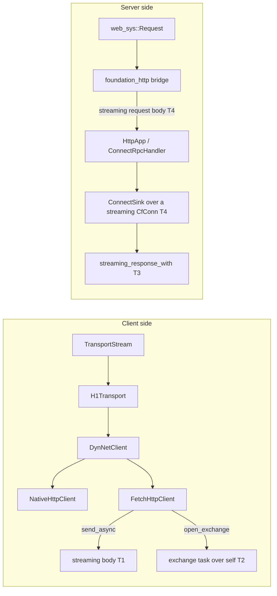

# Wasm HTTP Streaming

_Written in ASD-STE100 Simplified Technical English (STE). Code and identifiers stay as they
are._

**Abbreviations in this file.** WebAssembly (wasm); Hypertext Transfer Protocol (HTTP);
Hypertext Transfer Protocol version 2 (HTTP/2); remote procedure call (RPC); Cloudflare
Durable Object (DO); JavaScript (JS); application programming interface (API); AeroSpace
and Defence Industries Association of Europe (ASD), the owner of the STE standard ASD-STE100.

## Glossary

| Term | Meaning |
|---|---|
| platform-neutral | One type or trait that a native build and a wasm build both use. Its implementation differs; its shape does not. |
| `HttpClient` | The client trait of `foundation_netio`. One trait, one implementation for each target. |
| `DynNetClient` | `Arc<dyn NetClient>`, where `NetClient` is `HttpClient + WebSocketConnector`. The shared handle that code holds. |
| `TransportStream` | The four halves of one call in connectrpc: the request body sink, the response head, the response body and the trailers (`shared/transport/base.rs`). |
| sink | A trait object that receives the writes of one response. |

## 1. Purpose

The workspace already sends HTTP on native and on wasm through one abstraction:

- `foundation_netio::HttpClient` (`backends/foundation_netio/src/shared/client/http_client.rs:65`)
  is `Send + Sync`. `NativeHttpClient` implements it on native and `FetchHttpClient` implements
  it on wasm (`backends/foundation_netio/src/wasm/client/client.rs:113`).
- `DynNetClient = Arc<dyn NetClient>` (`backends/foundation_netio/src/network_client.rs:41`)
  is the handle that code holds. `HttpClientBuilder::build()` (`network_client.rs:83`) picks
  the implementation of the target. `FetchHttpClient` also implements `WebSocketConnector`
  (`websocket/wasm/http_client_connector.rs:23`), so a wasm handle is a full `NetClient`.
- `foundation_connectrpc::H1Transport`
  (`backends/foundation_connectrpc/src/shared/transport/h1.rs:61`) holds a `DynNetClient` and
  has no target gate. It already builds a **streaming** request body on both targets, through
  `pushable_request_body_with_readiness` and `SendSafeBody::Stream`. On wasm that body becomes a
  JS `ReadableStream` through `valtron::js_stream::iterator_to_readable_stream`
  (`foundation_netio/src/wasm/client/client.rs:395`,
  `foundation_core/src/valtron/executors/wasm/wasm_bindgen/js_stream.rs:225`).

So the client transport is not something to build. It exists, it is platform-neutral, and it
already streams the request.

Four small things are missing or wrong on the wasm side, and this specification owns them:

1. The wasm `HttpClient::send_async` reads the **whole response** body
   (`wasm/client/client.rs:334`). This breaks root rule 4 and forces every wasm RPC response
   into memory (issue #557).
2. `FetchHttpClient::open_exchange` ignores `self` and builds a fresh `FetchHttpClient`
   (`wasm/client/client.rs:166`). A caller that gives a `DynNetClient` of its own, such as one
   that reaches a DO stub, is silently bypassed (issue #559).
3. `foundation_netio::wasm::response::streaming_response` always answers status 200 and sets
   two headers (`backends/foundation_netio/src/wasm/response.rs:31`), so a Connect response
   with an error status cannot use it.
4. The inbound path of `foundation_http` reads the whole request body
   (`foundation_http/src/wasm/bridge/web.rs`, `req.text()`), so a served call cannot stream its
   request.

This specification also states the truth about capabilities. Earlier drafts said that fetch
cannot stream a request body and listed a new `FetchTransport`. That was wrong: the streaming
request path exists and works today, so `H1Transport` is correct to report
`request_streaming: true` on wasm, and `WASM_FETCH_CAPABILITIES`
(`shared/transport/wasm.rs:17`) is stale.

## 2. What exists today

| Item | State on master | Used by this specification |
|---|---|---|
| `HttpClient` trait | `shared/client/http_client.rs:65`, `Send + Sync`, eight methods | yes, unchanged |
| `DynNetClient` | `network_client.rs:41`; `HttpClientBuilder::build()` picks native or wasm | yes, unchanged |
| wasm client | `FetchHttpClient` (`wasm/client/client.rs:113`), and `WebSocketConnector` for it | yes: T1 changes the response body, T2 changes `open_exchange` |
| `H1Transport` | `shared/transport/h1.rs:61`, no target gate, streaming request body | yes, unchanged |
| request streaming on wasm | `SendSafeBody::Stream` → `iterator_to_readable_stream` (`wasm/client/client.rs:395`) | yes, unchanged |
| HTTP exchange | `HttpExchangeClientTask`, `HttpExchange::{Head, BodyChunk, Failed}` (`shared/client/request_task.rs`), `WasmHttpExchangeTask` (`wasm/client/tasks/http_exchange_task.rs`), `SendSafeBodyBytesIterator` (`shared/client/body_reader.rs`) | yes: T2 changes which client it uses |
| response builder | `streaming_response` and `sse_response` (`wasm/response.rs`) | yes: T3 adds a status and header parameter |
| serving stack | `foundation_http::wasm`: `HttpApp<Arc<dyn CfServe>>`, `HttpApp<Arc<dyn WebServe>>`, `dispatch_cf`, `dispatch_web` (`wasm/dispatch.rs`), `CfConn` (`wasm/cf_conn.rs`), `bridge/cf.rs`, `bridge/web.rs`, `WasmHttpAppSingleton`, `CfHttpAppSingleton` | yes: T4 reuses it |
| `ResponseSink` | `shared/router/dispatch.rs:375`: `whole`, `open`, `chunk`, `finish` | yes: T4 implements `ConnectSink` over `CfConn` |
| `ConnectRpcHandler::dispatch_to` | writes to a `ResponseSink` | yes, unchanged |

**Not built by this specification:** a `Fetcher` trait, a `FetchTransport`, a body pump, a
request-body collector, a `FetchServe`, a `StubFetcher` or a `DoStubTransport`. Each of those
is either an existing type above or a second copy of one.

## 3. Ownership

| Item | Owner |
|---|---|
| The streaming response body of the wasm client | This specification (T1) |
| `open_exchange` over the receiver client, and the capability constants | This specification (T2) |
| `streaming_response_with` in `foundation_netio::wasm::response` | This specification (T3) |
| `ConnectSink`: the connectrpc `ResponseSink` over a streaming `CfConn` | This specification (T4) |
| The `DynNetClient` over `worker::Stub` | This specification (T5), behind the `cloudflare` feature |
| The services that are served | Spec 77 (sandbox), spec 83 (agent RPC) |
| The CORS policy of a host | The host (spec 77 feature 08, spec 83 feature 05) |
| The `DeadlineTimer` adapter and the injected clock | Spec 84 (section 5.1) |
| `foundation_http`'s router, middleware, `CfConn`, `WebConn` and bridges | `foundation_http`; this specification changes only the request-body read of `bridge/web.rs` |

**Not in this specification:** the agent RPC router, the sandbox service, the DO layout, and
the application protocol of any caller.

## 4. The gaps



_The diagram shows that both sides already have one abstraction; this specification fixes the
four marked places inside it._

### 4.1 T1: stream the wasm response body

**The capability exists in this workspace already, on the SSE path.** `fetch_sse`
(`foundation_netio/src/wasm/client/client.rs:186`) takes `resp.body()` and gives it to
`WasmSseIterator`. The reader below it is `spawn_stream_reader`
(`foundation_netio/src/wasm/client/stream.rs:44`). It holds a
`ReadableStreamDefaultReader`, awaits `reader.read()`, and pushes each `Uint8Array` into a
`ConcurrentQueue`. A `WakeRegistry` fires on each push, so a valtron stream that waits is
polled again as soon as data arrives.
`JsReadableStreamIterator`
(`foundation_core/src/valtron/executors/wasm/wasm_bindgen/js_stream.rs:74`) is the generic
form of the same loop.

The web platform calls below it:

| Call | Type | What it gives |
|---|---|---|
| `Response::body()` | `Option<web_sys::ReadableStream>` | The body, or `None` for a 204, a 304 and a `HEAD` answer |
| `ReadableStream::get_reader()` | `ReadableStreamDefaultReader` | One reader per stream; a second `get_reader()` throws |
| `ReadableStreamDefaultReader::read()` | `Promise<{ done, value: Uint8Array }>` | One chunk per await; `done` marks the end |
| `ReadableStreamDefaultReader::cancel(reason)` | `Promise<()>` | Stops the transfer and releases the connection |
| `Response::body_used()` | `bool` | True after any read |

The `byob` mode (`ReadableStreamBYOBReader`) reads into a caller buffer and saves one copy.
It is part of the Streams standard, but `web-sys` 0.3 does not expose it in every browser
build. One `Uint8Array` copy per chunk is not the cost that matters here. This specification
does not use it.

So T1 is small: extract the reader that the SSE path has into one shared type, and use it
from `send_async`.

**Which `DynNetClient` methods stream on wasm today, and after T1:**

| `HttpClient` method | Today on wasm | After T1 |
|---|---|---|
| `send_async` | Reads the whole body with `resp.text()` | Streams the body from `resp.body()` |
| `send_sse_async` | Streams (`WasmSseIterator`) | Streams, over the shared reader |
| `send` | `Unsupported` on wasm: it would block the one thread | unchanged |
| `send_sse` | Streams (`LazySseIterator` → `WasmSseIterator`) | Streams, over the shared reader |
| `open_exchange` | Calls `send_async`, so it hands the whole body to `SendSafeBodyBytesIterator` | Streams, because `send_async` streams (T2 passes the right client) |

So the answer to "does the wasm `DynNetClient` stream an ordinary HTTP call?" is **no, not
yet**: one method out of five buffers, and it is the one that every ordinary call and every
RPC exchange uses. The request side already streams; only this response path does not.

```rust
// foundation_netio/src/wasm/client/stream.rs (extend the module that exists)

/// The bytes of one wasm response, read one chunk at a time.
///
/// The JS reader lives inside the spawned task, so this type holds only
/// `Arc` state. It is `Send` with no `unsafe impl` and no `SendWrapper`.
pub struct WasmByteStream {
    queue: Arc<ConcurrentQueue<Vec<u8>>>,
    done: Arc<AtomicBool>,
    error: Arc<Mutex<Option<String>>>,
    wake: Arc<WakeRegistry>,
    cancelled: Arc<AtomicBool>,
}

impl WasmByteStream {
    /// Read `stream`, with at most `chunks` queued ahead of the consumer,
    /// and stop after `max` bytes.
    pub fn new(stream: web_sys::ReadableStream, chunks: usize, max: Option<usize>) -> Self;

    /// The same bytes as `std::io::Read`, for the SSE parser.
    pub fn reader(&self) -> QueueReader;
}

impl Iterator for WasmByteStream {
    type Item = Result<Data, BoxedError>;
    // Ok(Data::Bytes)  one chunk
    // Ok(Data::Retry)  nothing queued yet; SendSafeBodyBytesIterator maps it to Stream::Wait
    // Err(..)          a read error, or a body over `max`
    // None             the stream is done and the queue is empty
}

impl Drop for WasmByteStream {
    /// Set `cancelled`, so the task calls `reader.cancel()` and closes the
    /// queue. A dropped response stops the transfer.
    fn drop(&mut self);
}
```

`fetch_and_read` then ends like this:

```rust
let body = match resp.body() {
    Some(stream) => SendSafeBody::Stream(Some(Box::new(WasmByteStream::new(
        stream,
        config.body_queue_chunks,
        config.max_body_size,
    )))),
    None => SendSafeBody::None,
};
```

`WasmSseIterator` changes to build its parser over `WasmByteStream::reader()`. The private
`spawn_stream_reader` then goes away, and both paths share one reader, one wake registry and
one set of limits.

`body_queue_chunks` is a new `ClientConfig` field: the number of chunks the reader may hold
ahead of the caller. Default 16. A browser chunk is 16 KiB to 64 KiB, so the bound is 256 KiB
to 1 MiB. Go `net/http` reads through a 4 KiB buffer; nginx defaults to
`proxy_buffers 8 4k`. The field stops an unbounded queue from growing behind a slow consumer.

Three consequences:

1. After T1, `H1Transport` streams on wasm with no change of its own, and the exchange of T2
   drains a stream instead of `SendSafeBody::Text`.
2. `send_async` on wasm returns after the head, not after the body. A caller that needs the
   whole body calls `try_collect_bytes`, which reads the stream to its end. That is correct
   for a small JSON answer that the caller parses next (root rule 4).
3. `max_body_size` becomes a real limit on wasm. It is documented (`shared/client/config.rs`)
   but the wasm path ignored it. The default stays `None`. A caller that sets it gets the
   error at the chunk that passes the limit.

### 4.2 T2: the exchange task uses the client it was called on

`FetchHttpClient::open_exchange` passes `self` to the exchange task. The task calls
`HttpClient::send_async` on that client, not on a newly built `FetchHttpClient`. So a caller
that holds a `DynNetClient` of its own, such as the DO stub client of T5 or a test client,
gets that client.

`WASM_FETCH_CAPABILITIES.request_streaming` becomes `true`, which matches the request path.
The other fields stay `false`: fetch has no full duplex, no HTTP/2 trailers and no
multiplexing.

### 4.3 T3: a response builder with a status and headers

```rust
// foundation_netio/src/wasm/response.rs
/// A response with the given status, headers and streaming body.
///
/// The body is pulled one chunk at a time. When the client cancels the
/// stream, the source is dropped. `streaming_response` becomes this
/// function with status 200.
///
/// # Errors
/// The `JsValue` error that the runtime raised while building the response.
pub fn streaming_response_with<S>(
    status: u16,
    headers: &SimpleHeaders,
    body: S,
) -> Result<web_sys::Response, JsValue>
where
    S: Stream<Item = Vec<u8>> + 'static;
```

The existing `streaming_response` and `sse_response` keep their signatures and call it.

### 4.4 T4: the serving adapter

A connectrpc service on a Worker or a page is served through `foundation_http`, which already
owns the routing, the middleware, the `CfConn` and `WebConn` connections and the two bridges.

Two pieces are missing:

1. **The inbound body streams.** `bridge/web.rs` and `bridge/cf.rs` build a
   `SimpleIncomingRequest` from the request `ReadableStream` (`req.body()`) as a
   `SendSafeBody::Stream`, bounded by a limit argument. They no longer call `req.text()`. The
   Cloudflare bridge function becomes public, because a `worker`-crate host builds the
   request itself:

   ```rust
   // foundation_http/src/wasm/bridge/cf.rs
   /// A `SimpleIncomingRequest` from a JS request, with the body as a stream.
   ///
   /// # Errors
   /// The `JsError` that the runtime raised while reading the request.
   pub fn request_from_cf(req: &web_sys::Request, max_request_bytes: usize)
       -> Result<SimpleIncomingRequest, JsError>;
   ```

2. **The sink streams.** `ConnectSink` in `foundation_connectrpc/src/wasm/sink.rs`
   implements the `ResponseSink` (`whole`, `open`, `chunk`, `finish`) over a `CfConn`. `open`
   writes the status and the headers of the head and starts the body stream, each `chunk`
   writes one frame, `finish` closes it, and `whole` builds a complete response.
   `foundation_connectrpc` already depends on `foundation_http` on wasm, so the sink lives
   there and every wasm consumer shares it.

The sink follows the pull rule of `streaming_response`: the handler is polled only when the
runtime asks for the next chunk. A full queue pauses the handler.

Two rules decide the hard cases here:

- **The pull parks; it does not spin.** `iterator_to_readable_stream`
  (`js_stream.rs:225`) calls the iterator once per pull. A body source that has no chunk yet
  answers `Data::Retry`, and a busy loop over `Retry` would freeze the one wasm thread. The
  sink registers a waker on the `WakeRegistry` of its queue and returns a promise that
  resolves on the next push. `streaming_response_with` does the same on the response side.
- **A task written for this is a `#[valtron::task]`.** If an implementation needs a task, for
  example to feed the queue from the handler, it is an `async fn` state transition
  (`async fn name(ctx: Ctx, state: State) -> Option<(State, TaskStatus<R, P>)>`), not a
  hand-written `impl TaskIterator`. The state is an enum with a terminal `Done` arm. The
  macro gives the same-named constructor: `name::new(state)`. This keeps the code short,
  testable and readable, and it is the functional form that valtron now prefers.

### 4.5 T5: `DynNetClient` over a Durable Object stub

```rust
// foundation_netio/src/cloudflare/stub_client.rs   (wasm + feature "cloudflare")
/// A `NetClient` that sends each request through one Durable Object stub.
pub struct StubHttpClient { /* SendWrapper<Rc<worker::Stub>> */ }

impl StubHttpClient {
    /// The stub for the DO with this name.
    ///
    /// # Errors
    /// The error that `worker::Env::durable_object` gives.
    pub fn new(env: &worker::Env, binding: &str, name: &str) -> Result<Self, JsValue>;

    /// Wrap a stub that the caller already resolved, such as one from
    /// `DurableObjectId::get_stub()`.
    pub fn from_stub(stub: worker::Stub) -> Self;
}

impl HttpClient for StubHttpClient { /* send_async: build the JS Request, stub.fetch_with_request */ }
impl WebSocketConnector for StubHttpClient { /* Unsupported: a stub has no WebSocket here */ }
```

So a Worker reaches its DO with `H1Transport::new(Arc::new(stub_client))`. There is no
`DoStubTransport` type, because `H1Transport` is the transport.

A `worker` dependency stays behind the optional `cloudflare` feature, so a browser build does
not see it.

## 5. Rules

1. **Stream the body. Never buffer it** (root rule 4). The wasm client streams a response body
   from `resp.body()`. The inbound bridge streams a request body from `req.body()`. The only
   collection is bounded by a config field, and it names the limit.
2. **Check the status before the body.** `send_async` reads `status` and `headers` first. A
   non-2xx answer keeps the body for the message, bounded by `max_body_size`.
3. **One client abstraction.** Every HTTP call goes through `HttpClient`. No new client trait,
   no second transport, no `Fetcher`. A platform difference lives in the implementation, never
   in the shape of a public type.
4. **The exchange uses its client.** `open_exchange` passes `self`. Never build a client
   inside a task.
5. **Every size and count is a config field with a documented default** (root rule 8). No
   `const` in the code path.
6. **Declare the capabilities truthfully.** Fetch has no full duplex, no HTTP/2 trailers and no
   multiplexing. It does stream a request body.
7. **Cancel means cancel.** A dropped response stream drops the source. The runtime cancels the
   JS reader. No task keeps running after the caller goes.
8. **A JavaScript value crosses a `Send` slot only inside `SendWrapper`.** The slots are
   `Transport` (which is `Send + Sync`), `HeadStream`, `BodyStream`, `SendBody` and a valtron
   task. The wrapper asserts `Send` and `Sync`, which is sound on single-threaded wasm, and it
   does not compile with the wasm `atomics` target feature. Do not write a second wrapper and
   do not use `unsafe impl Send`. A reader that keeps its JS handle inside the spawned task
   needs no wrapper at all: it holds `Arc` state only, as `WasmSseIterator` does today.
9. **A valtron task is a `#[valtron::task]` function** (owner rule 2026-11-15). Write it as an
   `async fn` state transition with an enum state and a terminal arm:
   `async fn pump(ctx: Ctx, state: State) -> Option<(State, TaskStatus<R, P>)>`, built with
   `pump::new(state)`. Do not write a new struct with an `impl TaskIterator`, and do not wrap
   one in a hand-rolled poll loop. The functional form has less noise, it is easier to test
   and to reason about, and it fits an async-first system. Read
   `.agents/skills/rust-valtron-usage/skill.md` before you write one.
10. **The reader owns the cancel.** A dropped body drops the reader, the reader calls
    `reader.cancel()`, and the handler that feeds it sees the call end.

## 6. Consumers and their tasks

| Consumer | Uses | What changes there |
|---|---|---|
| Spec 77 feature 07 | `H1Transport`, `StubHttpClient` for the DO client, `DynNetClient` for the container port | no pump of its own; `CloudflarePlatform` holds no HTTP client |
| Spec 77 feature 08 | `foundation_http`'s `HttpApp<Arc<dyn CfServe>>` and the connectrpc sink | serves through the existing stack |
| Spec 83 feature 05 (`WebClient`) | `H1Transport::default()` in a browser: `HttpClientBuilder::build()` gives `FetchHttpClient` | no `FetchTransport`, no `GlobalFetcher` |
| Spec 83 feature 06 (agent-rpc Worker) | `HttpApp` plus the connectrpc sink; `H1Transport::new(StubHttpClient)` for its DO calls | no `FetchServe`, no `StubFetcher` |

Spec 83 feature 05 tasks T19 and the transport part of T21 close with pointers here. Their
work is now T1 to T3 and T5 of this specification.

## 7. Acceptance scenarios

**S1 — A streaming response on wasm.** Given a `FetchHttpClient` and a response of 1000
chunks, when a caller reads `send_async`, then it gets the head first and one chunk per read,
and no step holds the whole body.

**S2 — The body limit.** Given `max_body_size` = 1024, when the response is 2048 bytes, then
the call fails with an `HttpClientError` that names the limit, and it reads no more than 1024
bytes.

**S3 — An RPC over the wasm client.** Given `H1Transport::new(fetch_client)` and 1000 frames,
when a client reads the body, then the transport holds at most its configured number of frames,
and the last frame arrives. `capabilities().request_streaming` is `true` and a streamed request
works.

**S4 — A custom client is used.** Given a `DynNetClient` that records each request, when
`H1Transport::new(client)` opens a call on wasm, then the recording client sees the request and
no global fetch happens.

**S5 — A served call.** Given a `web_sys::Request` with a large body, when the bridge builds the
`SimpleIncomingRequest`, then the body is a stream, and a handler that reads one chunk does not
read the rest.

**S6 — An error status.** Given a handler that answers 503 with a streaming body, when the sink
opens the response, then the `web_sys::Response` has status 503 and the body streams.

**S7 — The client goes away.** Given a streaming response of 10 000 frames, when the client
drops the stream after 10, then the source is dropped and the handler sees the call end.

## 8. Tests

Client tests are in `backends/foundation_netio/tests/wasm/`, transport tests in
`backends/foundation_connectrpc/tests/wasm/`, and both run under Node (`wasm-bindgen-test`). A
test client is a `NetClient` that answers from a map, so no network is needed.

| Rule or scenario | Test | Oracle |
|---|---|---|
| S1, rule 1 | `send_async_streams_body` | a reader that counts the bytes held |
| S1 | `sse_and_body_share_the_reader` | the SSE tests still pass, and one reader type serves both |
| Queue bound, rule 5 | `queue_is_bounded` | a slow consumer, and the peak queue depth against `body_queue_chunks` |
| S2 | `body_limit` | expected outcome |
| S3, rule 6 | `h1_streams_on_wasm` | identity, and the peak queue depth |
| S4, rule 4 | `custom_client_is_used` | stateful model |
| S5, rule 1 | `inbound_body_streams` | a reader that counts the bytes held |
| S6 | `error_status_streams` | expected outcome |
| S7, rule 7 | `cancel_drops_source` | stateful model |
| Capabilities | `capability_constants` | example |

## 9. Tasks

| Task | What | Main files | Done when |
|---|---|---|---|
| T1 | `WasmByteStream` (one reader for the SSE path and `send_async`), bounded by `body_queue_chunks` and `max_body_size` | `foundation_netio/src/wasm/client/stream.rs`, `src/wasm/client/client.rs`, `src/shared/client/config.rs` | `send_async_streams_body`, `body_limit`, `queue_is_bounded` and `cancel_drops_source` pass under Node; the SSE tests still pass; #557 closes |
| T2 | `open_exchange` passes `self`; the exchange task calls that client; `WASM_FETCH_CAPABILITIES` corrected | `foundation_netio/src/wasm/client/client.rs`, `src/wasm/client/tasks/http_exchange_task.rs`, `foundation_connectrpc/src/shared/transport/wasm.rs` | `custom_client_is_used` and `capability_constants` pass; #558 and #559 close |
| T3 | `streaming_response_with(status, headers, body)` | `foundation_netio/src/wasm/response.rs` | the two old functions call it; a native `cargo check` is clean |
| T4 | The streaming inbound body in both bridges, and `ConnectSink` over `CfConn` | `foundation_http/src/wasm/bridge/{web,cf}.rs`, `foundation_connectrpc/src/wasm/sink.rs` | `inbound_body_streams`, `error_status_streams` and `cancel_drops_source` pass |
| T5 | `StubHttpClient` as a `NetClient` over `worker::Stub` | `foundation_netio/src/cloudflare/stub_client.rs`, `Cargo.toml` (optional `worker`) | a DO stub call in `foundation_testing` passes; a browser build has no `worker` dependency |
| T6 | The test crates and the Node runner; the `ci/packages.toml` entry | `foundation_netio/tests/wasm/`, `foundation_connectrpc/tests/wasm/`, `ci/packages.toml` | the wasm test job is green on Linux, macOS and Windows |

## 10. Verify

```bash
# The native build must not change and must not gain a worker dependency.
cargo check -p foundation_netio --profile uat
cargo check -p foundation_connectrpc --profile uat
cargo tree -p foundation_netio --target wasm32-unknown-unknown -e features | grep -c worker   # 0 without the cloudflare feature
# The wasm tests run under Node.
cargo test -p foundation_netio --target wasm32-unknown-unknown --profile uat
cargo test -p foundation_connectrpc --target wasm32-unknown-unknown --profile uat
# The three operating systems run the same crate (CI does this on a full run).
cargo test -p foundation_netio --profile uat
```

## 11. Done when

- `FetchHttpClient::send_async` and `open_exchange` stream on wasm.
- `open_exchange` uses the client it was called on, and `WASM_FETCH_CAPABILITIES` is true for
  request streaming.
- `streaming_response_with` exists, and the old builders call it.
- `foundation_http`'s wasm bridges stream the request body, and `foundation_connectrpc` has a
  `ResponseSink` over a streaming response.
- `StubHttpClient` exists behind the `cloudflare` feature.
- No `Fetcher`, `FetchTransport`, `FetchServe`, `StubFetcher`, `DoStubTransport` or body pump
  exists in the workspace.
- The wasm tests pass under Node on Linux, macOS and Windows.
- `progress.md` and `LEARNINGS.md` are current.

## 12. Open questions

| # | Question | State |
|---|---|---|
| Q1 | Does a wasm RPC need a transport of its own? | Closed (2026-11-15): no. `H1Transport` over `DynNetClient` is the transport on both targets. The first draft added a `FetchTransport`; it duplicated `H1Transport`, and the code review removed it. |
| Q2 | Does fetch stream a request body? | Closed (2026-11-15): yes. `SendSafeBody::Stream` becomes a `ReadableStream` through `valtron::js_stream` (`wasm/client/client.rs:395`). The first draft collected the request body; that is not needed. |
| Q3 | Does the server side need a second serving stack? | Closed (2026-11-15): no. `foundation_http` owns the router, the middleware and the bridges. This specification adds the streaming request body and the streaming sink. |
| Q4 | Does the server set CORS? | Closed (2026-11-15): no. CORS is a policy of one host (spec 77 feature 08, spec 83 feature 05). |
| Q5 | Can it serve gRPC? | Closed (2026-11-15): no. Fetch cannot send HTTP/2 trailers. Connect and gRPC-Web only. |

---

_Created: 2026-11-15_
_Structure: Single document (has_features: false). Section 4 is the full design._
