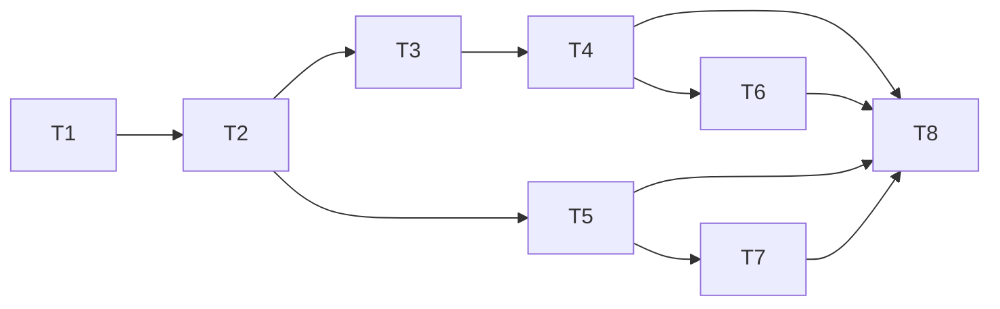

# Executors

_Status: **in progress** on branch `spec/88-executors`: T1 to T8 passed the review on
2026-11-16, and the owner lifted #586 into T9 on the same day; the first feature of spec 88. Written in ASD-STE100 Simplified Technical English (STE). Code and identifiers stay
as they are._

**Abbreviations in this file.** Chrome DevTools Protocol (CDP); continuous integration (CI);
operating system (OS); application programming interface (API); Chrome for Testing (CfT);
WebSocket (WS); JavaScript (JS); GitHub Actions (GHA); Simplified Technical English (STE).

## 1. Goal

Five wasm test executors report a pass or a fail that is true, and a pull request runs all of
them for the three layers:

| Executor | Host | State when this feature is done |
|---|---|---|
| `wasm-testbed deno` | embedded Deno | runs; gives its cases a local endpoint |
| `wasm-testbed browser` | headless Chromium | runs on Linux and macOS; gives its cases a local endpoint |
| `wasm-testbed test bindgen-deno` | Deno 2.9.7 | reports a failure; gives its cases a local endpoint |
| `wasm-testbed test bindgen-web` | headless Chromium | reports a failure; gives its cases a local endpoint |
| `wasm-testbed test bindgen-wrangler` | workerd | takes `--filter`; gives its cases a local endpoint |

The owner's direction on 2026-11-15: "our job is to build the proper infrastructure to cover
all the parts that is lacking", and "we can have full coverage on deno, wasm and browser
enhancing the crates and foundations as needed". This feature is that infrastructure.

## 2. Story

| ID | Actor | Trigger | Result |
|---|---|---|---|
| S1 | a contributor | runs `mise run test:wasm-testbed:browser` | the owned cases run in Chromium and the exit code is 0 only if all pass |
| S2 | a contributor on macOS | runs the same task | it works with the Chrome the OS ships, with no manual variable |
| S3 | a contributor | runs `test bindgen-deno` on a crate with one failing case | the command exits non-zero and names the failing case |
| S4 | a suite | fetches `__FWT_BASE_URL__ + "/echo"` | the host answers with the method, the headers and the body it sent |
| S5 | a contributor | runs `test bindgen-wrangler … --filter passes` | only the matching cases run |
| S6 | CI | a pull request touches a wasm suite | all five executors run, and the browser is not installed again |
| S7 | a contributor | runs a suite on a machine with no Chrome | one error names the paths searched and the task that installs one |
| S8 | a contributor | a case hangs | the run fails in bounded time and names the case |
| S9 | a maintainer | changes the testbed | a fixture with one failing case turns each bindgen runner red (R14) |

The failure stories are S3, S7 and S8. They have their own scenarios in section 5.

## 3. Bounded context

### 3.1 Inside

| Entity | Meaning | Owner (one writer) |
|---|---|---|
| `WasmTestbedError` and its variants | the typed failure of every runner | `foundation_testbed/src/wasm/error.rs` |
| `run_deno`, `run_web` | the owned runners and their preflight | `foundation_testbed/src/wasm/fwt_runner.rs` |
| `run_bindgen`, `run_bindgen_deno`, `run_bindgen_wrangler` | the wasm-bindgen runners and their verdict | `foundation_testbed/src/bin/wasm-testbed.rs`, `src/wasm/bindgen_runner.rs` |
| `build::run_with_tests` | which artifact is the test module | `foundation_testbed/src/wasm/build.rs` |
| the five JS templates | how a host loads the module and reports the result | `foundation_testbed/src/wasm/templates/` |
| `TestServer` and its routes | the local endpoint a suite calls | `foundation_testbed/src/wasm/server.rs` |
| `resolve_binary` | which browser binary to launch | `foundation_browser/src/supervisor.rs` |
| `RpcEngine` | one CDP/WS connection and its reader | `foundation_browser/src/jsonrpc/engine.rs` |
| the mise tasks | what a contributor types | `mise.toml`, `mise.wasm.toml` |
| the CI plan | which runners run, and when | `scripts/ci/ci.py`, `ci/packages.toml`, `.github/workflows/check.yaml` |

### 3.2 Outside

| Thing | Owner | This feature touches it? |
|---|---|---|
| the valtron suites | spec 88 feature 01 | no; it gives them a working executor |
| the http and connectrpc suites | features 02 and 03 | no |
| the streaming bodies and sinks | spec 85 | no |
| Deno, wasm-bindgen, wrangler, Chrome | their projects | only as pinned tools |
| the layer, OS and CI matrix rules | root `CLAUDE.md` rules 15 and 16 | no |

### 3.3 Verbs

| Verb | Kind | Effect |
|---|---|---|
| `preflight` | story verb | proves every tool the run needs exists, before the build |
| `stage` | story verb | writes the module, the runner and the host facts into a fresh directory |
| `run` | story verb | starts the host, runs the cases, returns an outcome |
| `report` | entity verb | writes one verdict from the cases, and only one |
| `resolve_binary` | entity verb | returns the browser path or a typed error |
| `attach_page` | entity verb | opens a page target and enables its domains |
| `dispatch` | entity verb | routes one incoming frame to a waiting call or a subscriber |
| `echo` | entity verb | answers a request with its own method, headers and body |

## 4. Rules

### 4.1 Law worksheet

```
Entity: a run outcome
Conserved value:    cases discovered == cases reported (passed + failed + ignored)
Bound:              every wait <= its configured limit; a run finishes
Inverse pairs:      none (a run has no undo); a re-run starts from fresh staging
Idempotent verbs:   stage (a fresh directory), the browser install task
Ordering pairs:     preflight before build; build before stage; stage before run
Monotone values:    none
Freeze points:      the verdict does not change after the last case
Links to other entities: the exit code, the printed summary and the CI step agree

Entity: a browser binary
Conserved value:    none
Bound:              the search list is finite and ordered
Inverse pairs:      none
Idempotent verbs:   the install task leaves an existing binary in place
Ordering pairs:     resolve before launch
Monotone values:    none
Freeze points:      the resolved path does not change during a run
Links to other entities: the error text names the same task that installs it

Entity: a CDP connection
Conserved value:    every request id gets exactly one answer or one typed failure
Bound:              every call has a deadline
Inverse pairs:      none
Idempotent verbs:   subscribe (a second subscription adds a receiver)
Ordering pairs:     subscribe before the action that fires the event
Monotone values:    none
Freeze points:      a closed connection fails every later call; it never answers
Links to other entities: a reader exit marks all pending calls failed
```

### 4.2 Invariants

- **I1.** A runner exits 0 if and only if every case it ran passed.
- **I2.** A runner prints the number of cases it discovered, and the numbers add up (4.1).
- **I3.** Every wait in a run has a configured limit with a documented default (rule 8).
- **I4.** The browser search order is `PRIMAL_TEST_CHROMIUM_BIN`, the cache path, the OS
  application paths, then the names on `PATH`. It is the same on every run.
- **I5.** A host that offers a local endpoint sets `globalThis.__FWT_BASE_URL__` before the
  first case runs, and the endpoint answers until the last case ends.
- **I6.** A CDP connection that closes fails every pending and later call with a typed error.
  It never leaves a caller to reach its own deadline.
- **I7.** The suite proves it can fail: a fixture with one failing case turns each bindgen
  runner red (R14).

### 4.3 Must have

- the `browser` subcommand in every mise task, with no `web` left;
- a browser install task that works on Linux and macOS, needs no `sudo`, and is idempotent;
- an `EchoHandler` route on every host that runs suites;
- a regression fixture crate with one failing case, and a CI step that asserts a non-zero exit
  from `test bindgen-deno` and `test bindgen-web`;
- the `--filter` flag on `test bindgen-wrangler`;
- a `wasm-tests` CI package that runs all five executors.

### 4.4 Must do

- read the verdict from `WasmBindgenTestContext::run` and from the last `test result:` line;
- fail the run when the two disagree;
- name the host, the case and the first unexpected value in a failure (R3);
- reject more than one candidate test artifact with a typed error that names both;
- close the test server and the browser on every path, including the error paths.

### 4.5 Must not

- must not keep the `setup:playwright` task, `integration/package.json` or any Playwright
  reference in a task or a CI file. `foundation_browser` speaks the Chrome DevTools
  Protocol (CDP) itself;
- must not install a browser when one already resolves;
- must not add a second copy of a timeout constant; read it from configuration;
- must not let a template print `test result: ok` without checking the verdict;
- must not add a `#[cfg(test)] mod tests` to a source file (root rule 7);
- must not add an AI attribution to a commit or a pull request (root rule 13).

## 5. Acceptance scenarios

```gherkin
Scenario: A failing wasm-bindgen case turns the Deno runner red
  Given the fixture crate with cases a_passes and b_fails
  When I run "wasm-testbed test bindgen-deno <fixture>"
  Then the command exits with a non-zero code
  And the output contains "FAILED" and "b_fails"

Scenario: A passing wasm-bindgen suite stays green
  Given the fixture crate with only a_passes
  When I run it through "test bindgen-deno"
  Then the command exits with code 0
  And the output ends with "test result: ok"

Scenario: The browser task runs the owned cases on macOS
  Given a macOS host with Google Chrome in /Applications
  When I run "mise run test:wasm-testbed:browser --filter passes"
  Then the browser starts, loads the harness, and reports "test result: ok"
  And no environment variable was set by hand

Scenario: A machine with no Chrome gets one actionable error
  Given a host where no search path holds a Chrome binary
  When I run any browser runner
  Then the command fails with "browser 'chromium' not found"
  And the message names "mise run test:browsers:chromium"

Scenario: The install task is idempotent
  Given a host where the cache path holds a Chrome binary
  When I run "mise run test:browsers:chromium"
  Then it prints the existing path and downloads nothing

Scenario: A suite fetches its own host
  Given a host that runs a suite
  When the suite fetches "__FWT_BASE_URL__/echo" with method POST and body "hello"
  Then the response status is 200
  And the response body repeats the method, the body and the request headers

Scenario: A wrangler run filters one case
  Given a crate with cases passes and fails
  When I run "test bindgen-wrangler <crate> --filter passes"
  Then only "passes" is in the worker's test list
  And the run is green

Scenario: A closed CDP connection fails the next call at once
  Given a page session whose debugger socket closed
  When the caller sends "Page.navigate"
  Then the call fails with "connection lost"
  And it does not wait for the call deadline
```

## 6. Technical breakdown

### 6.1 Tasks

| Task | What | Files | Done when |
|---|---|---|---|
| T1 | Rename the mise task and its subcommand; delete the Playwright task and its package file; make the install portable and idempotent | `mise.toml:145-153`, `mise.toml:166-177`, `mise.toml:1080-1090`, `mise.wasm.toml`, `backends/foundation_testbed/integration/package.json` (delete) | `mise run test:wasm-testbed:browser --filter passes` starts Chromium on Linux and macOS with no manual variable |
| T2 | Complete the binary search: cache path, macOS application paths, Windows local-app path; make the resolver public | `foundation_browser/src/supervisor.rs:201-220`, `src/cdp/launch.rs:28-45`, `src/lib.rs` | the resolution order is I4 and a unit test covers each branch |
| T3 | Replace the `node`/`npm`/`npx` preflight with a browser check; correct the doc comment | `foundation_testbed/src/wasm/fwt_runner.rs:183-201` | a missing browser fails before the wasm build, with the new error |
| T4 | Diagnose #569 and fix the page-session failure; move the timeouts to configuration (#573). A root cause that needs a larger fix stops T4 with a report | `foundation_browser/src/jsonrpc/engine.rs`, `src/cdp/backend.rs:36-45`, `src/cdp/mod.rs:29-57`, `foundation_testbed/src/wasm/browser.rs:38-55` | `foundation_browser/tests/smoke.rs` passes on macOS and Linux; the owned browser run passes |
| T5 | Read and enforce the wasm-bindgen verdict (#572) | `templates/bindgen-deno/run.js`, `templates/bindgen-web/run.js`, `bin/wasm-testbed.rs:255-311`, `src/wasm/bindgen_runner.rs:178-190` | the fixture exits non-zero through `bindgen-deno` and `bindgen-web` |
| T6 | Give every host a local endpoint and a base URL | `src/wasm/server.rs`, `src/wasm/fwt_runner.rs`, `templates/fwt/runner.mjs`, `templates/bindgen-deno/run.js`, `templates/bindgen-web/run.js`, `templates/bindgen-wrangler/worker.js` | a case on each host gets 200 from `__FWT_BASE_URL__/echo` |
| T7 | Add `--filter` to the wrangler runner; fail on more than one test artifact; fix the stale comments (#571, #574) | `bin/wasm-testbed.rs:174-195,313-380`, `src/wasm/build.rs:155-210`, `src/wasm/bindgen_runner.rs:1-14`, `integration/wasm_tests/Cargo.toml:1-4` | `--filter passes` runs one case; two candidate artifacts fail with both names |
| T8 | CI: the five runners in `wasm-tests`, the negative fixture, the macOS browser job, the cache, the timeout and env | `scripts/ci/ci.py:737-780`, `ci/packages.toml:661-678`, `.github/workflows/check.yaml` | one pull request runs all five; the macOS job runs the browser suite; a failing fixture turns CI red |
| T9 | Diagnose and fix the Chromium start trap of the `foundation_core` wasm-bindgen module (#586), so the `dual!` cases run in the web executor | `backends/foundation_core/tests/valtron/*` (only if a case is the cause), `backends/foundation_testbed/src/wasm/`, `backends/foundation_wasm/runtime/foundation-wasm.js` | `wasm-testbed test bindgen-web backends/foundation_core` prints `test result: ok`, and the `wasm-tests` web step names that module |

Order: T1 → T2 → T3 → T4 → T5 → T6 → T7 → T8. T5 and T6 are independent of T4. T8 is last
because it names the tasks the earlier tasks create.



_Figure 1: T1 and T2 come first because every run resolves a browser; T8 names what they build._

### 6.2 T1: the mise tasks

`mise.toml:1080-1090` runs `wasm-testbed -- web …`, and `cli.rs:53-55` names the subcommand
`Browser`. Commit `1c849ddc5` renamed it. Make these changes:

1. Rename the task `test:wasm-testbed:web` to `test:wasm-testbed:browser`, alias
   `test-wasm-testbed-browser`. Delete the old key; no document may keep the old name.
2. Replace `web` with `browser` in both run lines.
3. Delete `depends = ["setup:playwright"]`. The run uses our own CDP client
   (`fwt_runner.rs:206-220` calls `browser::run`), not Playwright.
4. Set `depends = ["test:browsers:chromium"]`.
5. Delete the task `setup:playwright` (`mise.toml:145-153`) and the file
   `backends/foundation_testbed/integration/package.json`. That file holds only the
   Playwright development dependency and a `setup:web` script. Nothing else reads it.
   The owner asked for this removal on 2026-11-16 (`progress.md`).
6. Search with `rg -i playwright mise.toml mise.wasm.toml backends/foundation_testbed scripts .github`.
   The search must find no task, no dependency and no install. A comment that records the
   removal may stay.

`mise.toml:166-177` is the install task. Replace it with a Bash task that:

1. prints the resolved path and exits 0 when `PRIMAL_TEST_CHROMIUM_BIN` names a file;
2. prints the cache path and exits 0 when `$HOME/.cache/foundation/chromium/chrome` exists;
3. downloads a pinned Chrome for Testing build into that cache path when neither holds a
   binary. Use `chrome-headless-shell` for `linux64`, `mac-arm64` and `mac-x64`; it is the
   binary this driver needs and it is about a third of the size;
4. downloads nothing twice: the download goes to a temporary directory and moves into place.

The pinned version is one line at the top of the task. It prints the version it installed. The
owner confirmed the download on 2026-11-16 (`progress.md`, Q2).

No `sudo`, no `/etc/os-release`. A Linux developer with a system Chromium already has it on
`PATH` (T2), so the task exits at step 0 or 1 for them.

### 6.3 T2: the binary search (I4)

`resolve_binary` (`supervisor.rs:201-220`) checks the env var and then bare names on `PATH`.
Change it to this order, returning the first executable:

1. `PRIMAL_TEST_CHROMIUM_BIN`.
2. `$FOUNDATION_CHROMIUM_DIR` when set, then `$HOME/.cache/foundation/chromium/chrome`
   (`%LOCALAPPDATA%\foundation\chromium\chrome.exe` on Windows).
3. the OS application paths:
   - macOS: `/Applications/Google Chrome.app/Contents/MacOS/Google Chrome`,
     `/Applications/Chromium.app/Contents/MacOS/Chromium`;
   - Windows: `%PROGRAMFILES%\Google\Chrome\Application\chrome.exe`.
4. the names of `Browser::binaries()` on `PATH`.

Keep the list and the order in one function so a test can assert it. Each candidate is a path
or a name; `is_file()` decides. Add a `resolve` function to the public API
(`foundation_browser::resolve_browser(&LaunchConfig) -> Result<PathBuf>`) so the testbed's
preflight uses the same order as the launcher. Bump `foundation_browser`'s version and every
consumer's requirement in the same change (owner rule on new public API).

Extend `BrowserError::BrowserNotInstalled` to carry the full list of paths searched, and print
them. S7 needs that.

### 6.4 T3: the owned browser preflight

`run_web` (`fwt_runner.rs:190-201`) requires `cargo`, `node`, `npm` and `npx`. The run is
pure Rust. Replace the last three with `resolve_browser(&LaunchConfig { browser: args.browser,
.. })`, mapped to `WasmTestbedError::MissingBrowser { searched: Vec<PathBuf> }`. Rewrite the
doc comment at `:183-188`, which still says Playwright.

`browser.rs:38-55` accepts only `Chrome`. Keep the gate and put the reason in the error text:
the Firefox `WebDriver` BiDi backend has no suite yet (spec 88 section 11).

### 6.5 T4: the page-session failure (#569)

Measured on 2026-11-15, Chrome 157.0.8103.51 on macOS 27.2:

```
wasm-testbed browser …                                → Page.navigate timed out after 30000ms
cargo test -p foundation_browser --features browser-tests --test smoke launch_navigate_eval_screenshot
                                                     → attach a page: Timeout { op: "Page.enable", after_ms: 30000 }
```

`Target.createTarget` and `Target.attachToTarget` answer; the first command that carries a
`sessionId` does not. Measure first, then change code:

1. Add a `tracing::debug!` for every frame the reader receives and every frame `call` sends,
   with the id, the method and the session. `PRIMAL_CDP_TRACE=1` sets the maximum level for
   `foundation_browser` in the testbed's subscriber, so a run prints the wire.
2. Run the smoke test with the trace on macOS and on Linux. Write the frame that answers
   `Page.enable` (or its absence) into #569 before the fix.

The reader (`engine.rs:70-100`) leaves its loop on `Some(Ok(Close))`, on any `Err` and on
`None`. When it leaves, nothing marks the engine closed, so every later call waits for its
own `call_timeout`. That is a defect whatever the root cause is, and it explains why the
first failure is a 30 s timeout rather than a typed error. Fix it:

- add `BrowserError::ConnectionLost` and an `AtomicBool` alive flag on `RpcEngine`;
- when the reader leaves, set the flag and fail every entry in `pending` with
  `ConnectionLost`;
- `call` checks the flag before it sends, and fails at once when it is clear (scenario 8);
- keep the last reader error in an `Arc<Mutex<Option<String>>>` and put it in the message.

Then settle the root cause from the trace. The candidates, in order of likelihood:

1. a read deadline equal to the call deadline (`engine.rs:54`, `read_timeout = 30 s`) — the
   socket read times out on an idle CDP connection between the `Page.enable` answer and the
   `Page.navigate` command, and the reader exits;
2. a frame the reader cannot parse, dropped at `engine.rs:104-108` as "non-JSON CDP frame";
3. a session-scoped response that arrives before `call` registers its waiting entry.

Candidate 1 is the leading one because both observed timeouts are exactly 30 s. Whatever the
trace shows, the fix is the reader contract above plus a read deadline that is larger than the
call deadline. Record the root cause in `LEARNINGS.md` and close #569 with it.

**Owner boundary (2026-11-16).** Trace as far as the evidence allows, and name the root cause.
Present the root cause when the fix is not small. T4 changes the reader contract and the read
deadline. T4 stops and reports when the root cause needs a change to the protocol layer, the
transport or the frame parser. T5 to T8 must not wait for an open protocol fix.

Move every hard-coded limit to configuration (#573): `read_timeout`, `idle_sleep` and
`navigate_timeout` on `RpcEngine`/`LaunchConfig`, and `module_settle`, `result_poll` on the
testbed's browser run. Each has a builder method and a doc comment that names the source of
its default.

Done when `cargo test -p foundation_browser --features browser-tests --test smoke` passes on
macOS and Linux, and the owned browser run reports `test result: ok` on both.

### 6.6 T5: the verdict (#572)

`WasmBindgenTestContext::run` resolves a boolean `passed`; the wrangler worker already uses it
(`templates/bindgen-wrangler/worker.js:29`). The other two templates ignore it and print
`test result: ok` unconditionally (`bindgen-deno/run.js:42-44`, `bindgen-web/run.js:9`).

1. `bindgen-deno/run.js`: `const passed = await cx.run(...)`, then
   `console.log(passed ? "test result: ok" : "test result: FAILED")`. Set the process exit code
   with `Deno.exit(passed ? 0 : 1)`.
2. `bindgen-web/run.js`: write `passed ? "test result: ok" : "test result: FAILED"` into
   `#output`. `bindgen_runner::run_bindgen` already decides on that text.
3. `run_bindgen_deno` (`wasm-testbed.rs:255-311`) reads the last `test result:` line and returns
   `WasmTestbedError::CaseFailures { failed: usize, output: String }` when it is not `ok`. The
   Deno exit code alone is not enough; wasm-bindgen-test prints the summary itself.
4. The runner must not print a second summary. If wasm-bindgen-test already printed
   `test result: …`, the template prints only the verdict line when it disagrees, and the
   runner fails on it.

The regression fixture is `backends/foundation_testbed/integration/bindgen_failing_case/`:
a standalone crate with two cases, `a_passes` and `b_fails`, pinned to
`wasm-bindgen = "=0.2.126"` and `wasm-bindgen-test = "=0.3.76"`. T8 runs it and asserts a
non-zero exit. It is the permanent proof of I1 and I7.

### 6.7 T6: a local endpoint per host

No suite can test a client transport without an endpoint (R5). Each host gets one. The
contract is one global and one route:

| Host | Endpoint | Base URL |
|---|---|---|
| owned Deno | `TestServer` with `/echo` and the staged files | `harness.json` → `__FWT_BASE_URL__` |
| owned browser | the same `TestServer` | `harness.json` → `__FWT_BASE_URL__` |
| `bindgen-deno` | `Deno.serve` on port 0 with `/echo` | `globalThis.__FWT_BASE_URL__` |
| `bindgen-web` | the testbed's `TestServer` with `/echo` | `location.origin` |
| `bindgen-wrangler` | the worker's own `/echo` route | `new URL(request.url).origin` |

`EchoHandler` (`src/wasm/server.rs`) implements `foundation_http`'s `Serve`. It answers 200 and
returns a JSON object: `method`, `path`, `headers`, `body` as base64, and `bytes` (the body
length). It rejects a body over `max_echo_body` (default 1 MiB, a `TestServer` config field)
with 413. It is a router on `HttpApp`: `/echo` to `EchoHandler`, `/*` to `StaticFileHandler`.

`start_serving` keeps its signature; add `start_serving_with_echo(dir: &Path, limits:
ServerLimits)` and let `start_serving` call it with defaults. `run_deno` starts it, writes
`harness.json` with `{"baseUrl": "http://127.0.0.1:<port>"}` next to `cases.json`, and shuts it
down after the harness report. `run_web` does the same before it serves.

`runner.mjs` loads `harness.json` next to `module.wasm` and sets
`globalThis.__FWT_BASE_URL__` before the first case. A case reads it with a registered host
function, the same way the existing cases read `Date.now()`
(`integration/wasm_tests/src/lib.rs:31-35`).

For `bindgen-deno`, `run.js` starts `Deno.serve({ port: 0 }, echo)` before `cx.run`, sets
`globalThis.__FWT_BASE_URL__`, and stops the server after. Deno 2.9.7 serves it with the same
`--allow-net` the task already passes.

For `bindgen-wrangler`, `worker.js` answers `/health` and `/echo` before it runs the tests, so a
test fetches the worker's own origin. workerd must permit a subrequest to the dev server's
own origin. Measure it first. If it refuses, declare the echo route as a second service binding
in the template's `wrangler.toml` and record which one works in `LEARNINGS.md`. Do not leave
the worker host without an endpoint: the connectrpc client cases (feature 03) need it.

### 6.8 T7: the wrangler filter and the artifact choice

`BindgenArgs` has `--filter` (`cli.rs:37-48`) and `wasm-testbed.rs:174-195` passes it only to
the Deno mode. Pass it to `run_bindgen_wrangler` and filter `tests` before
`write_bindgen_runjs_to`, so the worker's `TEST_NAMES` holds only the match (S5).

`build.rs:155-210` takes the first artifact that exports `__wbgt_`, then falls back to the
first matching file in `deps/`. When a crate has two test targets, the choice is whichever
cargo reports first. Collect every candidate instead, and when there is more than one, fail
with `WasmTestbedError::AmbiguousTestArtifact { candidates: Vec<PathBuf>, hint: String }`. The
hint names `[[test]]` and the one-target rule (R10).

Correct the two stale comments (#574): `bindgen_runner.rs:1-14` says the module is the
top-level `browser` subcommand; it serves `test bindgen-web`. `integration/wasm_tests/Cargo.toml`
says `wasm-testbed node`; the subcommand is `deno`.

### 6.9 T8: CI

`scripts/ci/ci.py:737-780` is the `wasm-tests` package. Add these runs in this order, so the
cheapest failure comes first:

| Step | Command |
|---|---|
| build | the existing checks, plus `cargo check --target wasm32-unknown-unknown` (lib only) for `foundation_http` and `foundation_connectrpc`, plus `cargo check --tests --target wasm32-unknown-unknown --manifest-path …` for each new standalone crate |
| test | `mise run test:wasm-testbed:deno` (existing) |
| test | `mise run test:wasm-bindgen:deno` (existing) |
| test | `mise run test:wasm-bindgen:core` — the valtron wasm-bindgen cases (#575) |
| test | `mise run test:wasm-testbed:wranger` (existing) |
| test | `mise run test:wasm-testbed:browser` — new |
| test | `mise run test:wasm-bindgen:web` — new |
| test | `mise run test:wasm-testbed:bindgen-fails` — the fixture from T5, inverted: the step passes when both runners fail |

`ci/packages.toml:661-678`: raise `timeout-minutes` from 90 to 120, keep `env = { MISE_ENV =
"wasm" }`, and add `PRIMAL_CDP_TRACE` only on a manual run.

A package-level `--tests` wasm check is not possible for `foundation_http`: its dev-dependency
`foundation_testing` pulls `socket2`, which has no wasm backend (#576). Use the lib check for
that crate and the `--tests` check for each standalone integration crate, which has its own
workspace and no inherited dev-dependencies.

`.github/workflows/check.yaml`: the `wasm-tests` matrix entry runs in the Linux image, which
already has Chrome (section 2.2). Add one step before the `test` step:

1. `actions/cache` on `~/.cache/foundation/chromium`, keyed by the pinned version in the task;
2. `mise run test:browsers:chromium`, which is a no-op when the image provides Chrome.

The macOS job (`macos-test`) runs the browser suite for the `wasm-tests` package (owner answer,
2026-11-16). A macOS runner ships Chrome in `/Applications`, so T2 makes it resolve with no
install and no cache. Add `macos-runs` or a dedicated step so `test:wasm-testbed:browser` runs
there; keep `macos-tests = "none"` for the rest of the package, and change its reason: the Deno
and wrangler runners stay Linux-only because `wrangler` and the pinned Deno are in the image.

The macOS and Windows jobs run on the full runs only (`.github/workflows/check.yaml:38-49`): a
push to `master` or `platform/release`, a pull request into or from `platform/release`, the
nightly schedule and a manual run. A normal pull request runs the Linux jobs only.

Windows stays out: no `wrangler` and no Deno in the Windows runner's tool set. Record the
reason (#-named in `ci/packages.toml`), as rule 15 requires.

### 6.10 T9: the Chromium start trap (#586)

**Measured.** `wasm-testbed test bindgen-web backends/foundation_core` printed
`RuntimeError: unreachable` while the module started. No case ran, so the page printed no
`test result` line (`LEARNINGS.md` entry 14). The same module ran 19 cases on Deno through
`test bindgen-deno`, so the case code is sound. Chrome for Testing 157.0.8103.51 traps inside
the wasm-bindgen start function.

**Cause and fix (2026-11-16).** The wasm-bindgen CLI writes `wasm.__wbindgen_start();` into
the web glue. In a test binary that start is libtest's `main`. The harness runs the plain
`#[test]` cases. `io::buffer_pool_tests::test_concurrent_access` calls `std::thread::spawn`,
which is not supported on wasm, and panics. The module aborts before the first
`#[wasm_bindgen_test]` case. The Deno runner already removed the call; the web runner did not.
`wasm::patch_bindgen_glue` now removes the call for web, deno and wrangler, and it keeps the
externref table setup. Measured after the fix: `test result: ok. 34 passed`.

**Where to look, in this order.**

1. **The generated glue.** wasm-bindgen 0.2.126's `__wbindgen_start` walks the heap, the
   descriptor table and the externref table. A glue file from another version traps at once.
2. **The page template.** `templates/bindgen-web/run.js` builds the import object. Check that
   it passes the imports the glue asks for, and that it awaits the async instantiate.
3. **A valtron start path.** The pool starts on the first `#[valtron_bindgen]` case. A panic
   inside a wasm re-entrant call also shows as `unreachable`.

**Method.** Set `PRIMAL_CDP_TRACE=1` and read the page console. `RuntimeError: unreachable`
alone does not name the function. A probe module with one `#[wasm_bindgen_test] fn ok() {}`
separates the two families: it traps as well for a glue or template defect, and it passes for
a valtron defect.

**Rules.**

- Every fix keeps the Deno run green (`test:wasm-bindgen:core`).
- A defect outside the owned paths becomes an issue with a severity; a high one is fixed here.
- The fix does not gate a case with `#[ignore]`. An ignored case is a false green.

**Done when.**

- `wasm-testbed test bindgen-web backends/foundation_core` prints `test result: ok` with the
  module's case count.
- The `wasm-tests` web step names `backends/foundation_core`; the fixture keeps the
  `bindgen-fails` step that proves a failure turns the run red.
- Issue #586 is closed with the cause in `LEARNINGS.md`.

**Verify.**

```bash
cargo run -p foundation_testbed --no-default-features --features wasm --profile uat \
  --bin wasm-testbed -- test bindgen-web backends/foundation_core \
  --features js-wasmbindgen,std --headless
MISE_ENV=wasm mise run test:wasm-bindgen:web
MISE_ENV=wasm mise run test:wasm-bindgen:core
MISE_ENV=wasm mise run test:wasm-testbed:bindgen-fails
```

### 6.11 Fault table

| Step that fails | What the runner does | What the contributor sees | What is left behind |
|---|---|---|---|
| preflight finds no browser | fails before the build | `browser 'chromium' not found` and the searched paths | nothing; no staging directory |
| the wasm build fails | fails | cargo's error | the build directory cargo keeps |
| staging finds no case | fails | `no __fwt_ cases` and the artifact path | the temporary directory is removed |
| the host starts and a case fails | runs the rest, then fails | the per-case lines and the summary | the staging directory is removed |
| the CDP connection closes | fails every pending call | `connection lost: <last reader error>` | the browser process is killed in the guard |
| a case hangs | the run's deadline fails it | the case name and the limit | the host is stopped by the guard |
| the echo route is missing | the case fails with 404 | `expected 200, got 404` and the URL | nothing |

## 7. Tests

| Law or scenario | Test | Oracle |
|---|---|---|
| I1, S3 | the fixture through `test bindgen-deno` and `test bindgen-web` | expected outcome (non-zero exit) |
| I1, S3 | the fixture through `deno` and `browser` | expected outcome |
| I2 | every runner prints `discovered N case(s)` and the summary adds up | example, one run per runner |
| I3 | a test sets each config field and asserts the error names that value | expected outcome |
| I4, S2 | `resolve_binary` unit test per branch, with a temporary directory | example |
| I4, S7 | no candidate exists, assert the message and the list | expected outcome |
| I5, S4 | one case per host fetches `/echo` with POST and a body | example (200, method, body) |
| I6, scenario 8 | `RpcEngine` against a closed socket: the next call fails fast | fault |
| I1, S5 | `--filter passes` on a two-case crate | example |
| T7 | two test targets in one crate fail with both names | expected outcome |
| T1, S2 | `test:wasm-testbed:browser` on macOS and Linux | example, the CI step is the oracle |

No property test is useful here: every law is about an exit code or a message. The fault table
gives the atomicity check: a failed run leaves either nothing or a named temporary directory.

## 8. Verify

```bash
# T1, T2
mise run test:browsers:chromium                      # prints the path, downloads once
mise run test:browsers:chromium                      # second run: no download

# T3, T4
cargo test -p foundation_browser --features browser-tests --test smoke
cargo run -p foundation_testbed --no-default-features --features wasm --profile uat \
  --bin wasm-testbed -- browser backends/foundation_testbed/integration/module \
  --filter passes --headless

# T5
cargo run -p foundation_testbed --features wasm --profile uat --bin wasm-testbed -- \
  test bindgen-deno backends/foundation_testbed/integration/bindgen_failing_case ; echo "exit=$?"
cargo run -p foundation_testbed --features wasm --profile uat --bin wasm-testbed -- \
  test bindgen-web backends/foundation_testbed/integration/bindgen_failing_case ; echo "exit=$?"

# T6
MISE_ENV=wasm mise run test:wasm-testbed:deno         # the owned host, with /echo
MISE_ENV=wasm mise run test:wasm-bindgen:deno         # the Deno host, with /echo
MISE_ENV=wasm mise run test:wasm-testbed:wrangler     # the worker host, with /echo

# T7
cargo run -p foundation_testbed --features wasm --profile uat --bin wasm-testbed -- \
  test bindgen-wrangler backends/foundation_db/integration/wasm_cf --filter wasm_cf

# T8
python3 scripts/ci/ci.py plan --package wasm-tests
python3 scripts/ci/ci.py run wasm-tests --step test   # Linux; the full run is on GitHub
cargo fmt --check -p foundation_testbed -p foundation_browser
cargo clippy -p foundation_testbed -p foundation_browser --all-targets -- -D warnings
```

You are on a Mac. Check the browser suite here with `mise run test:wasm-testbed:browser`. It
needs no Docker container. The Linux container (`scripts/ci/linux.sh`) checks Linux
compatibility only. The macOS and Windows jobs run in CI on the full runs (section 6.9), not
on a normal pull request.

## 9. Done when

- [ ] `mise run test:wasm-testbed:browser` runs on Linux and macOS, no task or document
      says `web`, and the `setup:playwright` task and `integration/package.json` are gone.
- [ ] A browser resolves from the cache, a macOS application path, or `PATH`, in that order,
      and a missing browser gives one actionable error.
- [ ] `foundation_browser/tests/smoke.rs` passes on macOS and Linux, and #569 is closed with
      the root cause in `LEARNINGS.md`.
- [ ] The fixture with `b_fails` exits non-zero through `test bindgen-deno` and
      `test bindgen-web`, and exits 0 with only `a_passes` (#572 closed).
- [ ] One case on each of the five hosts gets 200 from `__FWT_BASE_URL__/echo`.
- [ ] `--filter` works on `test bindgen-wrangler` (#571 closed), and two test artifacts fail
      with both names.
- [ ] `wasm-tests` in CI runs the five executors and the negative fixture; the `wasm-tests`
      package appears in the macOS job for the browser suite, with the reason recorded.
- [ ] Every hard-coded timeout is a configuration field with a documented default (#573).
- [ ] The stale comments are corrected (#574).
- [ ] `progress.md` and `LEARNINGS.md` name what landed and what is next.

---

_Created: 2026-11-15_
