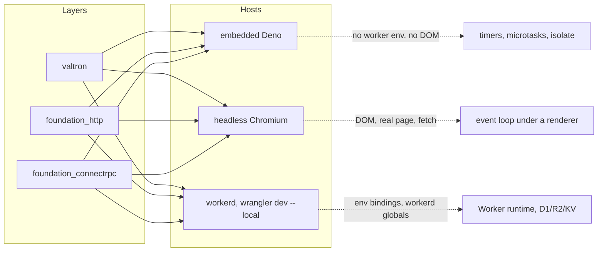
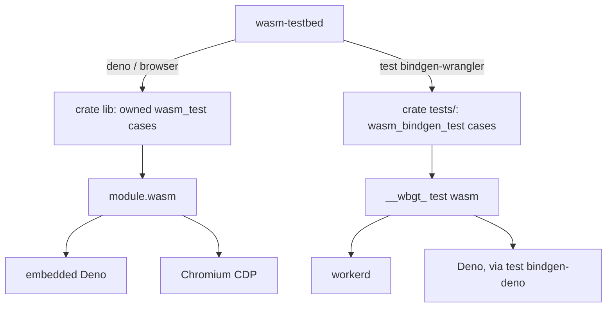

# Spec 88: Wasm Runtime Coverage

_This document uses ASD-STE100 Simplified Technical English (STE). It gives a glossary at the
top. A reader new to this codebase can follow it from start to end._

## Glossary

| Term | Meaning in this specification |
|---|---|
| owned harness | A test case marked `#[wasm_test]` or `#[valtron_wasm_test]`. The macro adds a `__fwt_<name>` export and a manifest line, and the testbed runner calls the export directly. There is no wasm-bindgen. |
| wasm-bindgen harness | A test case marked `#[wasm_bindgen_test]` or `#[valtron_bindgen]`. The macro adds a `__wbgt_<name>` export that wasm-bindgen's own `WasmBindgenTestContext` calls. |
| CDP | Chrome DevTools Protocol (CDP). The JSON-RPC control channel of a Chromium browser. |
| workerd | The Cloudflare Workers runtime. `wrangler dev --local` runs it on the local machine with local D1, R2 and KV. |
| DO | Durable Object (DO). A Cloudflare stateful object, reached through a stub. |
| oracle | The rule that decides if a test passed. An example, a bound, an expected outcome, a model or a fault. |
| host | One wasm runtime that executes tests: embedded Deno, headless Chromium, or workerd. |
| layer | One crate group under test: `valtron`, `foundation_http`, or `foundation_connectrpc`. |

## 1. Overview

We support wasm on three hosts. The three hosts behave differently: they have different
event loops, different error surfaces and different globals. Today we prove very little on
any of them.

`foundation_db` already runs seven contract tests on real D1, R2 and KV bindings under
`wrangler dev --local` (`backends/foundation_db/integration/wasm_cf/tests/wasm_cf.rs`). It
proves the pattern works. It does not cover valtron, `foundation_http` or
`foundation_connectrpc`. Those three carry the request path of the product, and none of them
has one executing wasm test.

This specification adds deep, contract-level runtime tests for the three layers on the three
hosts. It also repairs the one host that cannot run today: the browser.

## 2. What exists today, measured (2026-11-15)

### 2.1 The executors

The `wasm-testbed` binary (`backends/foundation_testbed/src/bin/wasm-testbed.rs`) has these
subcommands (`backends/foundation_testbed/src/wasm/cli.rs:47-64`):

| Command | Harness | Host | External tools | Wired today |
|---|---|---|---|---|
| `deno <crate>` | owned | embedded Deno (`deno_core`, in process), `wasm-embedded-js` feature | none | `mise.wasm.toml:18`, CI `ci.py:772` |
| `browser <crate>` | owned | headless Chromium through CDP | a Chromium binary | `mise.toml:1080` — **broken**, see 2.2 |
| `test bindgen-deno <crate>` | wasm-bindgen | Deno 2.9.7 | `deno`, `wasm-bindgen` | `mise.wasm.toml:29`, CI `ci.py:773` |
| `test bindgen-web <crate>` | wasm-bindgen | headless Chromium through CDP | a Chromium binary, `wasm-bindgen` | none |
| `test bindgen-wrangler <crate>` | wasm-bindgen | `wrangler dev --local` (workerd) | `wrangler` (or `npx wrangler@4.156.2`) | `mise.toml:1092`, CI `ci.py:777` |
| `test web`, `test deno`, `test wrangler` | custom user JS | as named | as named | none |
| `bindgen`, `emscripten`, `wasi`, `init` | as named | as named | as named | none |

The browser driver is `foundation_browser`, a pure-Rust CDP client. It is not Playwright and
it does not need node. It looks for a Chromium binary in this order
(`backends/foundation_browser/src/cdp/launch.rs:22-36`):

1. `PRIMAL_TEST_CHROMIUM_BIN`
2. `chromium`, `google-chrome`, `chromium-browser`, `chrome` on `PATH`

The testbed rejects every browser except Chrome
(`backends/foundation_testbed/src/wasm/browser.rs:40-44`), although `foundation_browser` also
has a Firefox `WebDriver` BiDi backend.

### 2.2 The browser host does not run

Three defects, each measured:

1. **The mise task names a subcommand that no longer exists.** It runs
   `wasm-testbed -- web …` (`mise.toml:1086`, `:1088`). The subcommand was renamed to
   `browser` in commit `1c849ddc5`, and `mise.toml` was not updated. The built binary agrees:
   `wasm-testbed web --help` answers `error: unrecognized subcommand 'web'`.
2. **The preflight demands tools the run does not use.** `run_web` requires `node`, `npm` and
   `npx` (`backends/foundation_testbed/src/wasm/fwt_runner.rs:190-201`), and its doc comment
   still says "Playwright" (`:185-188`). The run is pure-Rust CDP after the preflight.
3. **The install task installs a browser the driver never finds.** The task depends on
   `setup:playwright` (`mise.toml:1083`), which puts a Chromium build in the Playwright cache.
   The driver searches `PATH` and `PRIMAL_TEST_CHROMIUM_BIN`, not the Playwright cache. The
   task that installs a system Chromium is `test:browsers:chromium` (`mise.toml:166-177`), and
   it is Linux-only: it reads `/etc/os-release`, so it fails on macOS.

Two measured facts about the images:

- **The Linux CI image already ships Chrome.** `ci/platform-images/images/linux/Dockerfile:20`
  sets `ARG BROWSERS="chrome firefox"`, and `bin/pi-install-browsers` installs Google Chrome and
  links it as `chromium` and `chromium-browser` on `PATH`. The driver's `PATH` search finds it.
  CI pays nothing for a browser on Linux.
- **A macOS runner ships Chrome, but not on `PATH`.** It is at
  `/Applications/Google Chrome.app/Contents/MacOS/Google Chrome`. `resolve_binary`
  (`backends/foundation_browser/src/supervisor.rs:201-220`) checks `PRIMAL_TEST_CHROMIUM_BIN`
  and then bare names on `PATH`; it never checks the application path. This is why the macOS
  browser run needs `PRIMAL_TEST_CHROMIUM_BIN` set by hand today.

A fourth defect appears when the binary is corrected by hand. With
`PRIMAL_TEST_CHROMIUM_BIN` pointing at Google Chrome on macOS, the owned sample run
(`browser backends/foundation_testbed/integration/module --filter passes --headless`) builds,
discovers one case, starts the test server and launches Chrome. Then it fails after 30
seconds:

```
Error: Browser driver error: navigate http://localhost:19254/index.html:
operation 'Page.navigate' timed out after 30000ms
```

`Target.createTarget`, `Target.attachToTarget` and `Page.enable` on the page session all
succeed before this. `Page.navigate` receives no response. Feature 00 finds the cause. The
smoke suite `foundation_browser/tests/smoke.rs` (feature `browser-tests`) is the isolation
step: it drives the same CDP client against a `data:` URL.

The isolation step ran on 2026-11-15:

```
cargo test -p foundation_browser --features browser-tests --test smoke launch_navigate_eval_screenshot
→ attach a page: Timeout { op: "Page.enable", after_ms: 30000 }
```

Google Chrome 157.0.8103.51, macOS 27.2. So the fault is in `foundation_browser`, not in the
testbed. Browser-level commands (`Target.*`) answer; the first command on the page session does
not. #569 records it. That measurement is in the issue as a comment.

### 2.3 Which suites execute

| Crate | Test file | Form | Executed by |
|---|---|---|---|
| `foundation_core` (`integration/wasm_tests`) | `src/lib.rs` (18 cases) | owned | `test:wasm-testbed:deno`; browser task is broken |
| `foundation_core` | `tests/valtron/wasm_js_yield_integration.rs` | wasm-bindgen | `test bindgen-deno`, filter `wasm_js_yield_integration` |
| `foundation_core` | `tests/valtron/async_first_api.rs` (`dual!`) | wasm-bindgen (wasm half) | none: the bindgen filter excludes it (#575), although all 19 cases pass when run by hand |
| `foundation_netio` | `tests/wasm/` | wasm-bindgen | **compile only** (`ci.py:752-753`) |
| `foundation_wireguard` | `tests/wasm/` | wasm-bindgen | **compile only** (`ci.py:754-755`) |
| `foundation_db` (`integration/wasm_cf`) | `tests/wasm_cf.rs` (7 cases) | wasm-bindgen | `test bindgen-wrangler` |
| `foundation_testbed` (`integration/module`) | `src/lib.rs` | owned | `test:wasm-testbed:deno` |
| `foundation_http` | — | — | **no wasm test exists** |
| `foundation_connectrpc` | — | — | **no wasm test exists** |

Two facts make the gap larger than the table shows:

- `foundation_http`'s `wasm-bindgen-http` feature is named by no consumer and by no CI run
  (`backends/foundation_http/Cargo.toml:106`). The whole wasm bridge, the CF bridge, the
  response builders and the serve-writer path are never compiled in CI.
- `foundation_http`'s `wasm-test` feature is never enabled by a `runs` entry
  (`ci/packages.toml:429-445`), so three native test files that describe the wasm types report
  zero tests.

`#[valtron_wasm_test]` is defined (`foundation_macros/src/lib.rs:609`) and used by no test
file.

### 2.4 What the Cloudflare host gives us

The `wrangler` path is real, not a stub:

- Local D1, R2 and KV bindings, declared by the testbed's template
  (`backends/foundation_testbed/src/wasm/templates/bindgen-wrangler/wrangler.toml:10-24`).
- The worker hands the real `env` object to the wasm module as
  `globalThis.__CF_TEST_ENV__` (`templates/bindgen-wrangler/worker.js:6,11-14`).
- The worker answers the readiness probe at `/health` and returns `{"passed": bool}` with
  status 200 (`worker.js:8-10,28-35`); the runner requires `passed == true` and status < 400
  (`wasm-testbed.rs:368-377`).

The same host has four limits that the new suites must live with or change:

| Limit | Evidence |
|---|---|
| The template declares only `DB`, `BUCKET` and `KV`; there is no Durable Object binding and no `scheduled` handler | `templates/bindgen-wrangler/wrangler.toml:1-24`, `worker.js:5-36` |
| The `config_path` argument of `wrangler::run` is ignored, so a crate cannot supply its own configuration | `backends/foundation_testbed/src/wasm/wrangler.rs:245-251` |
| The runner deletes every file in `integrations/bindgen-wrangler/` before it writes the template output | `backends/foundation_testbed/src/wasm/wasm.rs:64-76` |
| One test target per crate: the runner takes the first artifact that exports `__wbgt_` | `backends/foundation_testbed/src/wasm/build.rs:159-174` |

### 2.5 The `foundation_db` precedent, and the six lessons

`backends/foundation_db/integration/wasm_cf/` is the working example. Its lessons become
rules in this specification:

| Lesson | Evidence | Rule |
|---|---|---|
| Each test is a contract cycle with one documented edge | `tests/wasm_cf.rs:57-84` (get/set/list/take/delete), `:122-163` (`i64::MAX`), `:206-241` (stale ETag) | R6 |
| A comment states the host fact the assertion depends on | `:206-212` ("workerd's local R2 binding enforces `onlyIf` but resolves the promise") | R7 |
| Durable state persists, so every key is unique per run | `:26-31` | R8 |
| The lib is test support; cases live in `tests/` | `src/lib.rs:21-54`, `tests/wasm_cf.rs` | R9 |
| One crate, one test target | `build.rs:159-174` | R10 |
| Standalone crate: own `[workspace]`, `cdylib` + `rlib`, pinned `wasm-bindgen` | `Cargo.toml:17-33` | R11 |

It does not test a DO stub, a `scheduled` handler, a second test target or a `--filter`. Those
stay out of this specification unless a feature names them.

### 2.6 Two runners that cannot fail

The wasm-bindgen runners discard the verdict of the suite, measured on 2026-11-15. A two-case
crate (`a_passes` passes, `b_fails` panics), pinned to `wasm-bindgen 0.2.126`, gives:

```
test result: FAILED. 1 passed; 1 failed; 0 ignored; 0 filtered out; finished in 0.02s

test result: ok
```

The command exits with code 0. The first line is wasm-bindgen-test's own summary. The second is
the template's unconditional line (`templates/bindgen-deno/run.js:42-44`), which the runner
trusts. `WasmBindgenTestContext::run` resolves a boolean `passed` and the wrangler template uses
it (`templates/bindgen-wrangler/worker.js:29`); the Deno and web templates ignore it. #572
records it, and feature 00 closes it.

### 2.7 Which harness can host which crate

The owned harness is not a free choice. The runner instantiates a module with one import module,
`abi` (`foundation_testbed/src/wasm/templates/fwt/runner.mjs:17-20`, `embedded_js.rs:180-200`).
A module that imports any wasm-bindgen glue cannot start on that runtime. Measured on 2026-11-15
with a probe crate that uses only the pure-Rust request and response types:

```
foundation_http (feature `wasm`) + foundation_netio (feature `wasm-fetch`)
→ 7 imports, all __wbindgen_* / __wbg___wbindgen_*
```

A crate that depends on `foundation_netio` with `wasm-fetch` is a wasm-bindgen crate on wasm
while that feature is on, whatever the test uses. `foundation_http` takes its request type from
`foundation_netio` (`foundation_http/src/wasm/serve_writer.rs:8`), and `foundation_connectrpc`
depends on both (`foundation_connectrpc/Cargo.toml:55-58`). Only `foundation_core` with
`js-foundation-wasm` stays free of wasm-bindgen (`foundation_core/Cargo.toml:113-115`).

The limit is the import, not the crate. The `abi` runtime is not a closed set of functions. The
runtime compiles a JavaScript function body and binds it to a handle
(`Operations::MakeFunction`, `foundation-wasm.js:1110,1202-1218`). A crate that depends on
`foundation_wasm` calls `abi::web::register_function("function(){ … }")` and gets a handle to
its own function. The existing owned wasm test crate registers a clock this way
(`foundation_core/integration/wasm_tests/src/lib.rs:28-34`). This adds no import, so a case can
supply any host function it needs.

Two ways remove the glue imports, and they differ:

1. **Register the function.** Use `register_function` for a host function that the case needs.
   The module stays glue-free. This covers a missing host primitive, not a wasm-bindgen crate.
2. **Build a module without the client.** The glue imports come from `foundation_netio`'s
   `wasm-fetch` feature. A crate feature that turns the feature on, kept on for the default wasm
   build and off for a second test package, builds a module with no fetch client. Measure its
   imports before you promise a case to the owned harness.

wasm-bindgen glue is different from a host function. Its imports are runtime intrinsics: heap
slots by index, memory-backed strings and throws, the `externref` table. Only the generated glue
provides them. A hand-written shim is a version-locked copy of the wasm-bindgen runtime and adds
no coverage (#577).

The harness per layer is therefore:

| Layer | owned harness (`#[wasm_test]`) | wasm-bindgen harness (`#[wasm_bindgen_test]`) |
|---|---|---|
| valtron | yes: Deno and browser | yes: Deno and wrangler |
| `foundation_http` | yes for the cases that need no transport, from a module built without `wasm-fetch` (owner decision, 2026-11-16) | yes: all three hosts, for the transport cases |
| `foundation_connectrpc` | the same | the same |

## 3. What each host proves

The three hosts are not interchangeable. Each one proves a fact the others cannot:



_Figure 1: each layer runs on each host; each host adds one runtime fact._

| Host | Adds | Cannot show |
|---|---|---|
| embedded Deno | an isolate with timers, promises and `fetch`; fastest; no external tool | DOM, worker bindings, a real browser event loop |
| headless Chromium | a real page, a DOM, a renderer event loop | worker bindings; `wrangler` globals |
| workerd | the Worker runtime and its `env` bindings | a DOM; a page |

## 4. Decisions (owner, 2026-11-15 and 2026-11-16)

| Decision | Answer | Consequence |
|---|---|---|
| D1: the browser executor | Fix it in this specification | Feature 00 repairs the mise task, the preflight, the install path, the macOS case and the CDP defect. It also deletes the `setup:playwright` task and `integration/package.json`, because `foundation_browser` supplies the CDP client (owner decision, 2026-11-16) |
| D2: test form | Owned `#[wasm_test]`/`#[valtron_wasm_test]` where the crate can run without wasm-bindgen; the wasm-bindgen harness where it cannot; wrangler is wasm-bindgen only; both harnesses run where a crate allows it (owner, 2026-11-16) | Decision 031 stays the default. Section 2.7 measures the glue imports. The owner then asked for both harnesses where a crate allows it. `foundation_core` uses the owned harness on Deno and the browser, and the wasm-bindgen harness on Deno and wrangler. Features 02 and 03 add a crate feature that gates `foundation_netio`'s `wasm-fetch`. The default wasm build keeps that feature on. A second test package turns it off, measures its imports, and runs its pure-Rust cases on the owned harness on Deno and Chromium. A transport case stays on the wasm-bindgen harness on all three hosts. A case that still imports glue stays there too, with the reason recorded. This is not #577: #577 ports the fetch client to the `abi` contract |
| D3: CI cadence | All three hosts on every pull request, and the Chromium cost is paid once, not per run | The Linux image already installs Chrome, and a macOS runner ships it in `/Applications` (section 2.2). Feature 00 makes the driver find both, so the cache holds a browser only when a runner has none; the task downloads one into the cache directory and the workflow caches that directory. Rule 16 still holds |

## 5. Architecture

One crate per layer holds both forms:



_Figure 2: the owned cases live in the crate lib because the runner builds a `cdylib`; the
wasm-bindgen cases live in `tests/` and run on the wrangler and Deno bindgen paths._

Only `foundation_core` takes both paths. `foundation_http` and `foundation_connectrpc` take the
right-hand path only, because their module imports wasm-bindgen glue (section 2.7). Their
`tests/` case files run on all three bindgen runners: `test bindgen-deno`, `test bindgen-web`
and `test bindgen-wrangler`.

Why the owned cases sit in the lib: `stage` calls `build::run_for_target`, which builds the
package lib (`backends/foundation_testbed/src/wasm/fwt_runner.rs:66-72`). A case in `tests/`
compiles into a libtest binary, not into the `cdylib`, so the runner cannot see its `__fwt_`
export. This is a harness constraint, not a style choice. Rule R9 records it.

## 6. Rules for every feature in this specification

- **R1: no fake host.** A test uses the real runtime. No test replaces `fetch`, `Request`,
  `Response` or `Deno.serve` with a stub, unless the feature names the stub and says why.
- **R2: a test names its oracle.** Each case says how it decides pass or fail: an example, a
  bound, an expected outcome, a model or a fault.
- **R3: a failing case names its host.** A failure message includes the host, the case and
  the first unexpected value.
- **R4: bounded time.** Every case finishes or fails. A server uses port 0. A loop has a
  deadline. A hung case fails the suite; it does not hang it.
- **R5: no case depends on the network.** The test starts its own server, or uses the host's
  local bindings.
- **R6: contract depth.** A case covers a full cycle, not one call, and at least one edge.
- **R7: host facts are written down.** A citation or a measured fact in a comment explains
  every assertion that depends on host behaviour.
- **R8: unique state.** A case prefixes every key, table and collection with a value that is
  unique to the run.
- **R9: tests in `tests/`, except the owned cases.** An owned case sits beside the case it
  tests in the crate lib, because the cdylib needs the export (see section 5). Every
  wasm-bindgen case sits in `tests/`.
- **R10: one test target per bindgen crate.** A second `tests/*.rs` file is silently not run.
- **R11: standalone crate.** An integration crate has its own `[workspace]`, `crate-type =
  ["cdylib", "rlib"]`, a pinned `wasm-bindgen` and its own `cargo fmt --check` step.
- **R12: `--filter`.** A suite must be runnable case by case. The owned runners take
  `--filter` (`fwt_runner.rs:73-75`); the wrangler runner does not, so feature 00 adds it.
- **R13: no new public API for tests only.** Both layers are already reachable
  (`foundation_connectrpc/src/shared/router/dispatch.rs:375` is `pub`). If a case needs a
  private item, make it public and say why (root rule 7).
- **R14: a suite proves it can fail.** Before a suite is called done, one deliberate break in
  the layer turns one named case red on each host that runs it. The feature records the break,
  the case and the red output. A suite that cannot fail is not a suite (see section 2.6).
- **R15: the owned module imports only `abi`.** A case that runs under the owned harness must
  come from a crate whose wasm module imports nothing else (section 2.7). Any other crate uses
  the wasm-bindgen harness.

## 7. Feature index

| Feature | Owns | Order |
|---|---|---|
| 00-executors | The browser host: mise task, preflight, Chromium discovery and install, the CDP navigate defect, the bindgen verdict defect, `--filter` for wrangler, a local endpoint per host, the GitHub cache and the CI step | First; every other feature needs it |
| 01-valtron-runtime | Deep valtron cases: owned on Deno and browser over `foundation_core/integration/wasm_tests`; wasm-bindgen on Deno, Chromium and wrangler over the existing `foundation_core/tests/` target (#575) | After 00 |
| 02-http-runtime | Deep `foundation_http` cases on all three hosts through the wasm-bindgen harness, in a new integration crate; the pure-Rust wasm module cases run natively with `wasm-test` (#570) | After 00 |
| 03-connectrpc-runtime | Deep `foundation_connectrpc` cases on all three hosts through the wasm-bindgen harness, in a new integration crate, plus the `/connect` route on the testbed server so `H1Transport` reaches a real endpoint | After 00 |

Features 01, 02 and 03 are independent. They write different crates and can run in parallel.
00 and 03 both write `foundation_testbed/src/wasm/server.rs`: 00 first (the `/echo` route),
then 03 (the `/connect` route).

## 8. Context map

| Entity | Owner | Notes |
|---|---|---|
| `wasm-testbed` behaviour (subcommands, preflight, staging) | 00-executors | `foundation_testbed` |
| the testbed's `TestServer` routes | 00-executors (the `/echo` route and the base URL), then 03-connectrpc-runtime (the `/connect` route) | `foundation_testbed/src/wasm/server.rs`; 03 writes it after 00 merges |
| `foundation_browser` CDP client | 00-executors | `foundation_browser` |
| CI and mise wiring | 00-executors | `mise.toml`, `mise.wasm.toml`, `scripts/ci/ci.py`, `ci/packages.toml`, `.github/workflows/` |
| `foundation_core/integration/wasm_tests` | 01-valtron-runtime | the owned crate already exists; the feature adds owned cases |
| `foundation_core/tests/` (`mod` target) | 01-valtron-runtime | the wasm-bindgen twin already exists there (`tests/valtron/`); the feature adds cases and runs it on Deno and wrangler |
| `foundation_http/integration/wasm/` | 02-http-runtime | new crate, wasm-bindgen cases only |
| `foundation_connectrpc/integration/wasm/` | 03-connectrpc-runtime | new crate, wasm-bindgen cases only |
| Streaming bodies and the connectrpc sink | spec 85 | not this specification: spec 85 tests its own new paths |

## 9. Issues this survey found

These are filed under root rule 9 before feature 00 starts:

| Issue | Severity | Problem |
|---|---|---|
| #566 | high | `mise run test:wasm-testbed:web` calls the removed `web` subcommand; the browser host never runs |
| #567 | medium | `run_web` preflights `node`/`npm`/`npx` for a pure-Rust CDP run |
| #568 | medium | the browser install path installs Playwright's Chromium, which the driver does not search; `test:browsers:chromium` fails on macOS |
| #569 | high | `Page.navigate` receives no response from a macOS Chrome, so `wasm-testbed browser` fails after 30 s |
| #570 | medium | `foundation_http`'s `wasm-bindgen-http` and `wasm-test` features are named by no CI run, so the wasm bridge and three test files never compile or report |
| #571 | low | `test bindgen-wrangler` has no `--filter`, and the `config_path` argument of `wrangler::run` is ignored |
| #572 | high | `test bindgen-deno` and `test bindgen-web` report success when a case fails (measured, section 2.6) |
| #573 | low | `foundation_browser` and the testbed hard-code their timeouts (rule 8) |
| #574 | low | stale runner names in testbed comments (`bindgen_runner.rs` says `browser`, `wasm_tests` says `node`) |
| #575 | medium | `foundation_core`'s 19 `dual!` wasm-bindgen cases pass on Deno, but no CI step runs them |
| #576 | low | `foundation_testing` pulls `socket2`, so a package-level `--tests` wasm32 check fails for `foundation_http`; the lib check is the only form |
| #577 | low | the owned wasm harness supplies only `abi`, so a crate that imports wasm-bindgen glue cannot use it; a port of `foundation_netio`'s fetch client to the owned ABI would remove the limit |

## 10. Success criteria

- A pull request runs all three hosts for the three layers, and the Chromium install comes
  from the GitHub cache on every run after the first.
- `mise run test:wasm-testbed:browser` runs the owned suites in Chromium on Linux CI and on
  macOS, with `PRIMAL_TEST_CHROMIUM_BIN` or a system Chromium.
- Five runners report a failure: `deno`, `browser`, `test bindgen-deno`, `test bindgen-web`
  and `test bindgen-wrangler`. A crate with one deliberate failing case exits non-zero through
  each of them.
- `mise run test:wasm-bindgen:core` runs the 19 `dual!` cases, and the wrangler host runs them
  too (#575).
- Each layer has a suite that fails when the layer breaks. A deliberate break in each layer
  turns one named case red on each host; the feature tests record the break and the case (R14).
- Every case in section 7 of features 01, 02 and 03 passes on its named hosts.
- `cargo check --tests --target wasm32-unknown-unknown` covers every new crate in CI.
- The wasm gate names two forms, because one cannot be a `--tests` check (section 9, #576):
  a lib check for `foundation_http` and `foundation_connectrpc`, and a `--tests` check for each
  standalone integration crate.

## 11. Out of scope

- The streaming response body, the exchange client and the connectrpc sink that spec 85 adds.
  Spec 85 tests those on the paths it creates.
- `foundation_netio`'s and `foundation_wireguard`'s compile-only suites (issue #563, spec 85
  task T6).
- A Firefox run. `foundation_browser` has a BiDi backend, but the testbed refuses every
  browser except Chrome (`browser.rs:40-44`). This is a later feature.
- Durable Object stubs and `scheduled` handlers under `wrangler`. They need a testbed template
  change; this specification files it and does not take it.
- The wasm-bindgen JS suites (`foundation_wasm`, `foundation_wasm_ui`,
  `foundation_ui_components`). They are `node --test` suites that no task runs.
- A port of `foundation_netio`'s wasm fetch client to the owned ABI, which #577 proposes. It is
  a product change: a second request and response implementation, with headers, abort and the
  websocket path. It adds no host coverage, because the wasm-bindgen harness already runs the
  same crates on the same three hosts (section 2.7).

---

_Created: 2026-11-15_
</content>
