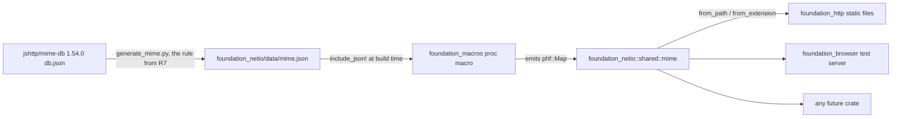

# Requirements: Spec 89, MIME Types

_Status: **approved 2026-11-16; implemented in feature 01**. Written in ASD-STE100
Simplified Technical English (STE). Code and identifiers do not change._

## Glossary

| Term | Meaning in this document |
|---|---|
| media type (MIME type) | The `type/subtype` label of a file, for example `text/html`. MIME is Multipurpose Internet Mail Extensions. |
| extension | The last suffix of a file name, without the dot, for example `html` in `page.html`. |
| perfect hash function (phf) | A compile-time hash table with no collisions. A lookup takes one step. |
| Internet Assigned Numbers Authority (IANA) | The registry that owns the standard media type list. |
| Cloudflare and the other hosts | Not used in this document. |
| continuous integration (CI) | The GitHub checks that run the tests. |

## 1. The problem

One hand-written table decides the media type of a served file. It holds 15 rows and lives in
`backends/foundation_http/src/native/handlers/static_file.rs:36-58`. It missed `.mjs`, so
Chrome refused the module script (issue #578). The owner's review of that fix (2026-11-16)
asks for a different design:

- store the full media type data in a JSON or YAML file;
- read that file at compile time with a new macro in `foundation_macros`;
- build the map in the compiled binary, with no run-time parse;
- keep one media type handler in `foundation_netio`, and let every crate use it.

## 2. Measured facts (2026-11-16)

| Fact | Evidence |
|---|---|
| The only extension map in product code has 15 rows and a default | `static_file.rs:36-58`; the default is `application/octet-stream` |
| It missed `.mjs`; the review added one row | commit `27ed28a81`, issue #578 |
| `foundation_macros` builds embedded asset media types with `new_mime_guess::MimeGuess::from_path` | `embedders.rs:5`, 14 call sites |
| The browser test server writes its own JavaScript type | `foundation_browser/src/test/server.rs:231` |
| `foundation_netio` has no media type module | `backends/foundation_netio/src/shared/mod.rs` |
| The standard database `mime-db` 1.54.0 holds 2,522 media types | downloaded 2026-11-16 from `jshttp/mime-db`; counted 2026-11-16 |
| Those types give 1,239 extensions | counted with the generator rule in feature 01 section 6.4 |
| 48 extensions carry two or more candidate types | counted with the same rule |
| `.mjs` is `text/javascript` from IANA | `mime-db` entry `text/javascript` |
| `.js` is both `application/javascript` (Apache) and `text/javascript` (IANA) | `mime-db` entries for both |
| The workspace has `serde_json` 1 and no `phf` | root `Cargo.toml` |
| `foundation_nostd` has no re-export for a hash map | `backends/foundation_nostd/src/lib.rs` |
| `phf` 0.14.0 is `no_std` without its `std` feature | `phf/src/lib.rs:82` `#![cfg_attr(not(feature = "std"), no_std)]`; `phf_shared` and `siphasher` match |
| `phf_codegen` 0.14.0 sets the emitted crate path | `phf_path`; the default is `::phf` |

## 3. What the owner asked for

The owner's words (2026-11-16), shortened:

- "you should have just added a json or yaml file we include_str or better yet add a macro in
  foundation_macros that does an include_json, include_yaml";
- the macro must "generate a hashmap in compile time and include that directly in compiled
  code";
- the media type logic then lives "in foundation_netio which everything else can use";
- the data comes from a full public source if Rust has no standard library for it, or "we wish
  to augment it".

## 4. Goals

| Goal | Test |
|---|---|
| G1 | One media type function serves every crate. No crate keeps its own extension map. |
| G2 | The map exists in the binary. No file is opened and no JSON is parsed at run time. |
| G3 | The module builds for native and for `wasm32` targets, because `foundation_netio` builds on both. |
| G4 | The data is a data file, not Rust code. A person updates the file, not a match arm. |
| G5 | The data source and its version are recorded, and a change to them is reviewable in one diff. |

## 5. Rules

- **R1.** One table. `foundation_netio::shared::mime` owns it. A crate that needs a media type
  calls it and does not repeat the data.
- **R2.** The map is built at compile time. The data file is read by a proc macro, not by
  `include_str!` and a run-time parse.
- **R3.** The module returns `Option<&'static str>`. It does not choose an HTTP fallback. The
  caller decides between `application/octet-stream` and an error (rule: one meaning per
  component).
- **R4.** The lookup is exact on the extension, without the dot and without case. `from_path`
  reads the last extension only.
- **R5.** The vendored file records its source, its version and the selection rule in
  `backends/foundation_netio/data/README.md`. A script regenerates it. No hand edit.
- **R6.** The table holds a bare media type. It never holds a parameter such as `charset`. A
  caller that needs one appends it.
- **R7.** Ambiguity is resolved by a written rule, not by file order. The rule prefers the IANA
  entry, then the unlisted-source entry, then the alphabetically first type. A small reviewed
  override list corrects a known bad result: `mp4` and `mpg4` map to `video/mp4` (issue #593).

## 6. Decisions

| Decision | Choice | Why | Alternative rejected |
|---|---|---|---|
| D1: where the table lives | `foundation_netio::shared::mime` | Every crate already depends on `foundation_netio`, and the shared modules build on wasm | A module in `foundation_http` would leave other hosts without it |
| D2: the data format | JSON | The workspace already has `serde_json`, and mime-db publishes JSON | Yet Another Markup Language (YAML) is supported by the second macro but adds a parser for no gain here |
| D3: the compile-time type | `phf::Map<&'static str, &'static str>` | A true compile-time hash map; one lookup step; no allocation | A sorted slice with binary search is cheaper to build but is not a hash map; a generated `match` cannot be a value |
| D4: the data source | mime-db 1.54.0, vendored | It is the database behind `mime_guess` and several web servers; it is public and versioned | The `new_mime_guess` crate at run time adds a dependency and gives no control over the data |
| D5: the macro path | `include_json!("path")`, relative to `CARGO_MANIFEST_DIR` | Stable and simple to document | A path relative to the source file needs an unstable span interface |

## 7. The shape

Figure 1: the data flows from mime-db to one compiled map, and every crate reads that map.

## 8. Out of scope

- Content-Type parsing and negotiation in `foundation_netio`. The module maps a name to a type.
- Compression policy. `foundation_http`'s compression list stays a configuration field (header
  `Content-Encoding` handling is separate).
- Replacing `new_mime_guess` in the embedders. A test proves the two tables agree instead
  (feature 01, T6).
- The `.ts` case. mime-db gives `video/mp2t` from IANA. The override list exists for a project
  that serves TypeScript, but this spec sets no override.
- Nested JSON or YAML in the macro. Version 1 maps a string to a string.

## 9. Questions for the owner

| Question | Default if the owner says nothing |
|---|---|
| Q1: Is a new spec (89) the right home, or should this be a feature of spec 88? | Spec 89, its own branch, one pull request |
| Q2: May `foundation_netio` and `foundation_nostd` depend on `phf` 0.14? | Yes; `foundation_nostd` re-exports it, and no other crate adds it directly |
| Q3: May `foundation_macros` depend on `phf_codegen` 0.14 and `serde_yaml_ng` 0.10? | Yes |
| Q4: Does `from_extension` return `None` for an unknown name, or `application/octet-stream`? | `None`; the caller picks the fallback (R3) |
