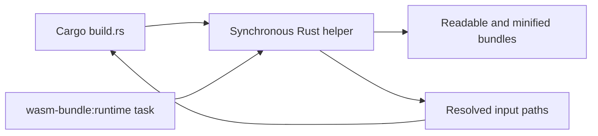

# Feature 1. Generate readable and minified JavaScript bundles

The owner approves implementation. The approved design assigns the exported runtime task set to `foundation_wasm_ui`.

## Glossary

A bundle contains an entry script and its imported modules in one file.
A minified bundle uses a compact representation of the same program.
A transitive input is a file that another imported module loads.

## Shared build library

The existing `platform_demo/build.rs` delegates generation to `foundation_platform::codegen`.
Extract reusable build and code generation functions for our packages. Cargo build scripts and existing tasks call these functions directly.
Give the host build library an optional JavaScript module in `foundation_codegen`.
Use synchronous Rust calls to resolve modules, bundle, and emit both outputs.
Expose the imported file paths so Cargo can watch the complete input graph.
Keep the build layer independent of the task runner, Tokio, and other asynchronous runtimes.
The package task and Cargo build scripts call the same function. A build script never starts another Cargo build.

The current browser entry imports three modules in order:

1. `backends/foundation_wasm/runtime/foundation-wasm.js`
2. `backends/foundation_wasm_ui/runtimes/foundation-ui-bootstrap.js`
3. `backends/foundation_wasm_ui/runtimes/platform-scheme-interceptor.js`

Preserve the classic script format, initialization order, browser globals, language target, and legal notices.
Generate `foundation-ui-runtime.js` and `foundation-ui-runtime.min.js` from the same module graph.
The caller chooses its output directory and handles packaging or verification.
Cargo callers write outputs to `OUT_DIR` and emit `cargo:rerun-if-changed` for each resolved input.
Keep application-specific Rust code generators with their existing owners.
Verify both scripts in a browser. Change a transitive input and verify a Cargo rebuild.
Compare both outputs across two checkout paths.
Verify build and normal dependency graphs with default crate features disabled for the JavaScript tools.

A dependency probe resolves `swc_bundler` 59.0.0, `swc_ecma_codegen` 34.0.0, and `swc_ecma_minifier` 65.0.0.
Its all-target normal and build graph contains no Tokio or asynchronous executor.
Headless Chrome loads each generated script. WebAssembly and the server event stream produce the same 312-byte frame.

## Callers

Both callers use the same resolver, generator, and output names.

1. Expose the helper from `foundation_codegen` behind an optional host build feature.
2. Define and publicly export the runtime task set in `foundation_wasm_ui`, which owns the JavaScript assets.
   Keep runtime entry paths, task arguments, and check behavior in that package.
   Import and register its task set in `platform`. Other executables can register the same set.
   Preserve the existing build and plan commands and their aliases.
3. Make the task generate both files. Make `--check` compare both files without modifying either.
4. Use a Cargo build script to generate both bundles under `OUT_DIR`. Emit change tracking for each resolved input.
5. Preserve the existing `bundle.js` distribution alias and its minified contents when packaging the runtime.
6. Switch the browser bundle workflow checks and retire `scripts/ui_web/bundle.sh` after verification.

## Verification

Run the task twice. Verify identical bytes for each output across two independent checkout paths.
Check both outputs in a browser using the existing runtime fixture.
Change each output separately. Verify that check mode fails and preserves the changed file.
Change a transitive input. Verify that Cargo rebuilds both artifacts.
Verify that the browser target excludes host bundling dependencies.
Register the exported task set in a test runner and verify its name and arguments.
Run the same task through the platform executable.
Record the resolved dependencies, test commands, browser results, and changed callers.

## Current verification records

The todo server embeds both Cargo outputs. It serves them at `/foundation-ui-runtime.js` and `/foundation-ui-runtime.min.js`.
The package task and the platform task use the same exported task set.
The all-target build graph excludes asynchronous executors. The browser target excludes the JavaScript build tools.

| Check | Result |
|---|---|
| Two independent checkout paths | Both files match byte for byte. |
| Nonwriting check | Each separate edit fails the check. Both file timestamps stay unchanged. |
| Legal notices | Both scripts retain block and line license notices. |
| Initialization order | Both scripts execute two side-effect imports in the declared order. |
| Browser parity | Both compiled Chrome smoke tests pass. Both scripts produce identical WebAssembly and server-sent event output. |
| Compact distribution | The current compact script has 275,965 bytes. The readable script has 590,242 bytes. |
| Cargo transitive rebuild | The Todo build script regenerates both scripts after a vocabulary edit. Both files contain the new code. |
| Rust tests | The code generator passes 74 tests. The browser build tools pass 11 tests. |
