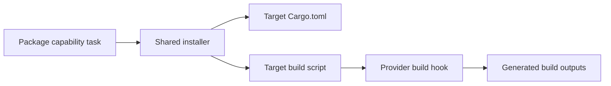

# Feature 2. Install a capability in a Cargo build script

Status: Approved.

## Terms

A build hook is a Rust function that Cargo runs through a package build script.
A provider is the package that supplies the hook function and its required build dependencies.

## User flow

A capability task calls a reusable installer with a target package and a provider declaration.
The provider supplies its stable name, Rust call, dependency specification, and required features.
The installer configures the package once. Cargo calls the installed hook on subsequent builds.
The provider owns code generation and input tracking.

The installation task edits project files. The build hook produces outputs during a later Cargo build.

## Implementation contract

1. Provide the installation operation through a reusable Rust library and an importable task set.
2. Let existing runners register the task. Use the proposed name `build:install-hook`.
3. Accept a target package manifest and a registered capability name. Resolve paths from that manifest.
4. Honor a custom `package.build` path. Report an explicitly disabled build script before changing either file.
5. Create the default `build.rs` when the package has no build script. Create a valid main function.
6. For existing scripts, parse the Rust syntax and preserve comments, attributes, return types, existing operations, and user formatting.
7. Compose multiple capabilities in deterministic order. Preserve the execution order of existing application code.
8. Detect an existing equivalent call, including the platform demo's manually written call. Repeated installation must produce identical files.
9. Merge the required build dependency and features into the manifest. Honor workspace and renamed dependencies.
10. Report incompatible dependency declarations or ambiguous entry points with file context. Prepare both edits before writing either file.
11. Preserve concurrent user edits. Recover consistently if the second write fails or an interrupted installation runs again.
12. Support `--check` to report missing or conflicting setup without writing. Keep installation outside Cargo's build execution.

## Initial providers and verification

Use platform code generation as the first fixture. Its hook is `foundation_platform::codegen::generate_platform_code()`.
Use Feature 1 as the second provider once its Cargo helper exists. Call the helper directly during the build.
Test a new package, the existing platform demo shape, and a fallible main with another generator.
Test custom build paths, renamed dependencies, comments, early returns, two hooks, repeat installation, conflicts, and write failure.
Run Cargo on temporary consumer packages. Verify generated files and reruns after an input change.
Verify the original setup and user code still run. Use the existing platform runner to test task registration.
