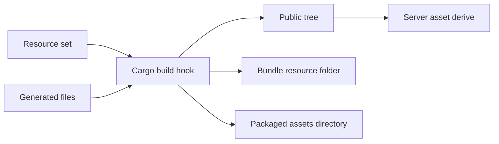

# Feature 3. Package application resources

Status: Implemented for generated applications and Todo. Existing-package installation awaits Feature 2 approval.

## Terms

A resource is a file that the application reads by a stable relative name.
A resource set lists files, directories, generated outputs, and the targets that use them.
A staging directory holds generated packaging inputs. Each target owns its staging directory.

## Existing design

The platform demo calls one function from its Cargo build script.
The old generator discovers sibling applications, builds browser modules, and writes public files and generated Rust modules.
The generated mobile asset type accepts a root from the host session.
The session checks for a development public directory and otherwise uses its packaged root.
Keep the stable logical names and the single build hook.
Use explicit resource inputs and return errors for failed reads, writes, and packaging steps.

## Proposed interface

Store application declarations in a package-relative `resources.toml`. Build providers can also supply generated inputs by logical name.
Use the Feature 2 installer to add the hook to existing applications. Include it in new application templates.
The proposed Cargo build script call is `foundation_resources::build::stage_from_cargo()?`.
The package declares resources once. Target adapters supply packaging destinations and runtime readers.
Expose a host resource service through the application context. Open a resource by name and return a readable stream or a typed error.
Keep the build helper synchronous. Inject the host reader for runtime tests.

## Shared runtime interface

Use one asynchronous operation on all three hosts: `resources.open(name).await`.
Return a resource with a byte stream. Keep read failures visible after the stream opens.
A logical name is a validated relative path such as `art/train.png`.
The host entry point installs the reader in the application context. Application code uses the same call on every host.
The browser reader resolves names against the configured public base address and checks the response status before streaming.
The Apple reader resolves names inside the installed resource bundle. The Android reader uses the application asset manager.
Report invalid names, missing resources, missing host configuration, and read failures through typed errors.
Use an injected reader for shared tests. Run the same lookup and error cases against each host adapter.

Each output preserves the same resource name.

| Target | Build destination | Consumer |
|---|---|---|
| Web development | Sibling public directory for the server executable | Static handler reads files from disk. |
| Web release | Staged public tree before macro expansion | The server asset derive embeds the tree. |
| Apple mobile | Generated folder registered once in the application target resource build phase | The host opens the name in the application bundle. |
| Android | Generated asset directory registered once in the application variant | The host opens the name with the Android asset manager. |

For example, declare `art/train.png` once. Serve it at `/art/train.png` on the web.
Open `art/train.png` through the native resource service on both phones.
Allow target restrictions for files such as the browser bootstrap module.

## Build contract

1. Resolve inputs against the declaring package or a registered generator output.
2. Reject missing inputs, duplicate names, path escapes, and conflicting names on case-insensitive platforms.
3. Track declared directories, files, generator outputs, and relevant environment values for Cargo rebuilds.
4. Let the Cargo build hook invoke required cross-target producers before staging. Reuse those producers in framework tasks.
5. Register target-specific packaging inputs through the template or installer. Define build ordering for ordinary Xcode and Gradle builds.
6. Isolate concurrent builds by application, output target, and profile. Share a complete staged tree only after successful production.
7. Remove stale managed files after a rename or deletion. Preserve all user-owned files.
8. Package Apple simulator and device resources once per application. Keep Android resources independent of native processor variants.
9. Surface build errors with the resource name and destination. Never publish a partial resource set.

## Verification

1. Generate one application with a shared resource, a browser-only resource, and one generated resource.
2. Build through Cargo, Xcode, and Gradle with no manual file copy or project edit.
3. Fetch the shared resource from the web server. Read it from an installed Apple and Android application. Compare the bytes.
4. Inspect both mobile packages for the expected logical paths and the absence of browser-only files.
5. Move the development executable and its public tree. Edit a staged file and verify the next request reads it.
6. Run the release server alone outside the checkout. Fetch the embedded file using the same address.
7. Change, rename, and delete source files. Verify incremental rebuilds, stale file removal, and recovery after a failed build.
8. Run concurrent mobile builds and verify package contents. Test custom target directories and profiles.
9. Use the Todo application as the first consumer under Specification 69 Feature 27.

## Generated browser module handoff

The resource manifest is a build input. The producer declares the generated file and its stable logical name.
For Todo, the browser target produces the module. The JavaScript bundler produces scripts.
The server build hook calls the resource stager after both producers finish.
Stage the Todo module under the web target as `public/module.wasm`. Track the generated artifact for subsequent builds.
Use the same staged bytes for development file serving and release embedding.
The runtime asset handler resolves `/module.wasm` without reading the manifest or searching Cargo directories.
See [Todo packaging checks](../../../69-foundation-ui-v2/features/27-single-todo-package/feature.md#proposed-revision-build-the-deployable-todo-directory).

Expose one public packaging hook for application build scripts. It composes asset producers and the stager for the active target.
Keep application-specific service generation explicit. Providers own Cargo input tracking and conditional writes.

## Consumer contract for the packaging hook

The framework supplies a public Rust function with documented arguments and defaults.
The caller supplies application inputs that differ from those defaults. Resolve package-relative inputs inside the framework.
Accept existing resource declarations without requiring the caller to list their files again.
Return build failures to Cargo with the input name and failed operation.
Verify the contract with an external consumer. Its build script invokes the public hook and propagates its result.
Require the same consumer script to package development and release assets through the supported build entry points.

The hook builds missing application, Connect browser transport, and resource artifacts on demand.
Providers isolate cross-target Cargo outputs and suppress server packaging when compiling the browser target.
External consumers need no shell script, prepared browser directory, or separate task invocation before Cargo builds the server.

Stage only the selected application `bundle.js` as public JavaScript. Keep intermediate runtime and binding scripts outside the public and embedded resource trees.
