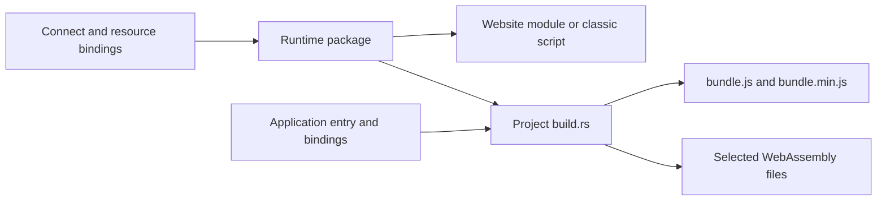
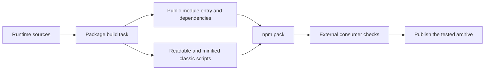

# Feature 4. Publish the browser runtime as a JavaScript package

The owner approves this feature on 2026-11-24. The design uses one source tree for module imports and classic scripts.

## Glossary

| Term | Meaning |
|---|---|
| User interface (UI) | The controls and views that an application displays. |
| ECMAScript module | A JavaScript file that declares imports and exports. |
| Classic script | JavaScript that a browser runs through a regular script element. |
| npm | The public JavaScript package registry and its command-line tool. |
| Tarball | The compressed package archive that npm installs. |
| Integrity digest | A checksum that identifies the exact bytes of a tarball. |

## Consumer contract

A developer installs the proposed package `@ewe-studios/foundation-wasm-ui` and imports its public entry from an application bundler.
Confirm control of the npm scope before the first publication.
Use `.js` for modules and declare `"type": "module"` in the package manifest.
The explicit manifest gives Node.js the module format and preserves existing source filenames. [Node.js package formats](https://nodejs.org/api/packages.html#packagejson-and-file-extensions)

```js
import { WasmLoader, createApp, registerFrameApp } from "@ewe-studios/foundation-wasm-ui";
```

A developer can also copy one classic script from the installed package and load it directly in a browser.

```html
<script src="./bundle.js"></script>
```

| Published file | Contract |
|---|---|
| `index.js` | Root module with documented named exports. All imports resolve inside the installed package. |
| `bundle.js` | Readable, self-contained classic script for development. |
| `bundle.min.js` | Minified classic script with the same behavior for deployment. |
| `package.json`, readme, license | Package identity, public entries, instructions, and distribution terms. |

Expose both script filenames through package subpath exports.
Each classic file installs the existing runtime globals, including `FoundationUiBootstrap` and `FoundationWasmRuntime`.
A consumer supplies its application WebAssembly files and generated application bindings.
Feature 1 also supports building the final application bundle with those inputs.

## Proposed amendment for browser services and project bundles

A companion is a WebAssembly module that supplies a browser service.
Connect supplies the network sender. The resource service opens named assets as streams.



Both website entry formats use the same service implementations as a generated application.

1. Export public factories for the Connect sender and the resource service from the package entry.
2. Expose the same factories through the documented classic script namespace.
3. Include the matching generated bindings and companion binaries in the package archive.
4. Accept an explicit asset base address and a separate Connect endpoint.
5. Resolve default asset addresses relative to the deployed package script or module.
6. Initialize each selected service on demand. Permit another attempt after initialization fails.
7. Preserve streamed resource reads and the sender's exchange and close operations.
8. Use the project's public Rust build helper from its `build.rs`.
9. Stage project sources, selected package modules, and generated bindings in the private build directory.
10. Build both public files from the same application entry and inputs.
11. Write readable JavaScript to `bundle.js` and minified JavaScript to `bundle.min.js` in every profile.
12. Stage each required WebAssembly binary under its documented public asset path.
13. Load one script per page. Use `bundle.js` for development and `bundle.min.js` for deployment.
14. Keep Todo routes and application setup in Todo. Replace its service adapters with the public factories.

Install the packed archive in an external website fixture.
Test the module entry and each classic script from a directory below the website root.
Send a Connect request and read a named resource through each entry.
Build a project with both services. Test each project script in a fresh browser page.
Record the script requests, binary requests, and results for each page.
Verify one JavaScript request per classic page, including after both services start.

## Build and release



The release job publishes the archive that passes the consumer checks.

1. Put the package manifest and public entry under `backends/foundation_wasm_ui`. Use its runtime modules as the source.
2. Include the required `foundation_wasm` runtime from its existing source during packaging. Preserve relative imports inside the archive.
3. Keep initialization order, browser registrations, license notices, and existing public runtime names.
4. Reuse the Feature 1 Rust bundler for both classic files. Export the package task through the existing platform task runner.
5. Preserve existing Cargo consumers and their release artifact paths. Keep the readable and compact choices explicit in the new package.
6. Derive the package version from the tagged `foundation_wasm_ui` crate. Validate the manifest version before packing.
7. Publish one public npm version for each new `foundation_wasm_ui-v<version>` release, including releases with unchanged JavaScript.
8. Invoke publication from the successful crate release workflow. Repository-token tag pushes do not start a second workflow automatically.
9. Allow an explicit retry for a tagged revision. Build from that revision and serialize publication for that package version.
10. Supply the registry token only to the publication step. Follow the credential rules below.
11. Compare the local archive integrity with the registry on retry. Accept a matching version and fail on different bytes.
12. Record the tag, commit, npm version, and archive integrity. Keep release credentials out of builds and test jobs.

## Publication credentials

1. Use the nonempty `NPM_TOKEN` value from the process environment first.
2. If that value is absent or empty, read the literal `NPM_TOKEN` assignment from `~/.userenv`.
3. Accept an optional `export` prefix and matching outer quotes. Ignore unrelated assignments.
4. Treat the file as text. Never execute commands or expand shell expressions from the file.
5. If both sources lack a usable token, stop publication. Report the missing variable by name.
6. Pass the token only to the registry client during publication. Keep it out of command arguments.
7. Exclude credentials and file contents from logs, errors, archives, generated files, and version control.

## Acceptance checks

- Use dummy tokens to test environment precedence, file fallback, and missing credentials.
- Include a shell command in a test file. Verify that the command never runs.
- Check output, errors, command arguments, and package contents for the dummy tokens.

- From two clean checkouts of one tag, build and pack the package. Compare archive digests and inspect the npm file list.
- Install the archive outside the repository. Bundle a consumer that imports the three public functions and boots a browser view.
- Load each classic script separately in a clean browser page. Verify startup, action dispatch, and a rendered update.
- Check browser requests. Each classic runtime loads from one JavaScript file. Application WebAssembly requests may follow.
- Compare observable behavior across the module entry and both classic scripts. Verify that the minified file is smaller.
- Run the existing Cargo runtime and application bundle checks after the source move.
- Exercise a release retry against a registry fixture. Cover a missing version, a matching archive, and a conflicting archive.
- Verify publication from a new crate release and installation of its exact public version before closing this feature.
