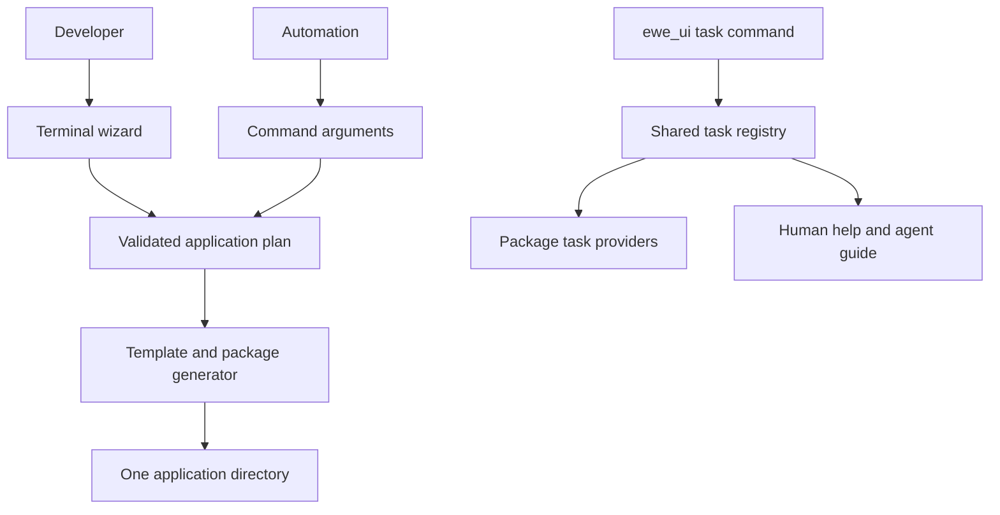
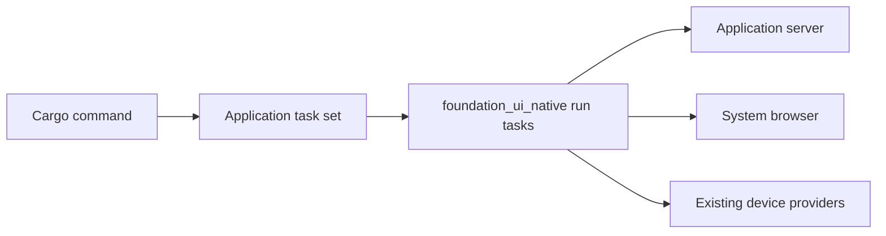
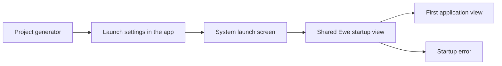

# Feature 5. Create and manage applications with ewe_ui

The owner approves this design for implementation, including Rust task providers and the rules for embedded scripts.

## Terms

| Term | Meaning |
|---|---|
| User interface (UI) | The controls and views that a person uses. |
| Command-line interface (CLI) | The commands and arguments that a program accepts. |
| Terminal user interface (TUI) | An interactive screen in a terminal. |
| Large language model (LLM) | A model that can use the command guide to operate the tool. |
| Task provider | A package that exports named operations to the shared task runner. |
| Target | A platform selected for an application. |
| Host mode | The existing mobile template choice between a server connection and on-device operation. |

## User story and command contract

A developer installs the Rust crate `ewe_ui`. Its executable has the same name.
Running `ewe_ui new` opens a short wizard. It asks for the application name and the desired targets.
One command creates one project with any nonempty combination of Web, Android, and iOS.
Desktop appears as an unavailable future target. Keyboard input cannot select it.

```text
Application name   FieldNotes

Targets
  [x] Web
  [ ] Android
  [x] iOS
  [ ] Desktop   Unavailable

Space toggles a target. Enter continues. Escape cancels.
```

This screen shows the proposed selection controls.

1. Use the native terminal interface from `foundation_repl`, which AnswerMe uses for interactive sessions.
2. Reuse its terminal setup, input handling, theme, and cleanup. Add reusable form controls there if needed.
3. Keep focus visible. Show selection with text. Support keyboard navigation, cancellation, and terminal resizing.
4. Validate the name against every selected template. Preserve valid entries when the developer corrects a field.
5. Ask for the mobile application identifier when Android or iOS is selected. Use the existing mobile identifier rules.
6. Offer the existing mobile host modes. Default to the server mode. Show only questions relevant to the selected targets.
7. Show the destination and selected targets before generation. On cancellation, restore the terminal and leave the destination intact.

### Noninteractive use

The same generator accepts complete arguments and runs without a terminal. Repeated target flags form one selection.

```sh
ewe_ui new --name FieldNotes --target web --output .
ewe_ui new --name FieldNotes --target android --target ios --app-id com.example.fieldnotes --host server --output .
ewe_ui task list
ewe_ui task run native:build-ios --help
ewe_ui help
ewe_ui help --llm
```

The output option names the parent directory. Both examples create a directory named `FieldNotes`.
Complete arguments bypass the wizard. In a noninteractive session, missing input produces an error naming the required flag.
Reject an empty selection, an unknown target, or `--target desktop` before writing files.
Return a failure status for invalid input and provider failures. An explicit cancellation reports cancellation separately from successful generation.

## Ownership and execution



Both input paths produce the same plan and dispatch the same provider operations.

- Add the workspace crate at `bin/ewe_ui`. It owns the UI command tree, target selection, generation plan, and help.
- Use `foundation_tasks` for dispatch. Register the UI task sets for web builds, native builds, resources, bindings, tests, and release operations.
- Expose every supported UI operation through this command. Keep repository-wide infrastructure commands with their current owners.
- Extract reusable generation code from `bin/platform/src/generate` into an importable provider. Both executables call the same implementation.
- Keep the current platform generator and native task names working during migration. Update UI documentation and starters to use `ewe_ui`.
- Native and web packages own their build operations. The CLI composes them and propagates their results.
- Keep reusable Apple packaging in the native provider. Give Todo-specific inputs and preparation to the example tooling.
- Migrate Todo preparation, bridge synchronization, and device tests to the Todo package. Keep compatibility aliases in repository tooling during migration.
- The installed CLI carries its templates. Generation works outside this repository without Xcode or the Android development tools.
- Building a selected native target can require its platform tools. Help identifies those prerequisites on each command.

### Shared operations and package-specific tasks

| Owner | Responsibilities |
|---|---|
| `ewe_ui` | Select the application, load its declared targets, validate arguments, and dispatch the requested operation. |
| Framework provider libraries | Build, stage, sign, install, launch, and query devices using typed project and target arguments. Export the same operations to other task runners. |
| Application manifest and generated project | Supply the package identity, Rust library, project paths, schemes, native modules, launch component, and resources. |
| Optional application task library | Compose shared operations for a package-specific workflow. Own example data, screen assertions, and test scenarios. |

A normal generated application gets the shared commands automatically. Its template supplies application metadata.
For a custom workflow, the template can add a small Rust task package under `tools/tasks/`.
That package exports a `foundation_tasks::TaskSet`. Its thin runner registers that set using the existing task library.
Declare the local task package in the application manifest. Make its commands accessible through `ewe_ui task list` and `ewe_ui task run`.
The CLI invokes the declared local runner through Cargo with structured arguments. It preserves the task result and cancellation.
Use an application namespace for custom commands. Reject names that conflict with shared commands.
The agent guide includes the selected project's declared custom commands and their arguments.

For example, a shared Android launch operation accepts a device identifier, application identifier, and launch component.
The generated project supplies those values for its own app. A Todo test can call that operation and then check the Todo count.
A different task runner can call the same Rust operation directly.

Move Todo and starter screen tests, seed data, example paths, and application identifiers out of the generic native task set.
Move reusable logic from repository scripts into callable providers. Keep package-specific test logic with the owning application.
Providers may invoke Cargo, the project's Gradle wrapper, Xcode, and device tools through the task process interface.
An installed framework command must work with the generated application and its declared dependencies outside the framework checkout.

### Proposed shared application run tasks

The application registers the tasks from `foundation_ui_native` in its own task set.
The application supplies its server entry point, address, resource location, and supported targets.
The provider owns the task names, argument checks, device selection, browser launch, and process handling.
The application can add its own tasks beside these commands.

| Command from the application directory | Expected result |
|---|---|
| `cargo run` | Run the default application operation. Todo serves its web application. |
| `cargo run task serve` | Run the application server in this terminal. Print the browser address after the listener binds. |
| `cargo run task web` | Open the configured server address in the default browser. Reuse the server that the developer starts with `serve`. |
| `cargo run task android` | Select an Android device. Build, install, and open the application through the existing native provider. |
| `cargo run task ios` | Select an Apple device on a supported host. Build, install, and open the application through the existing native provider. |
| `cargo run task desktop` | Expose this command only when the application declares a supported desktop target and a launch provider. |



The application declares its capabilities once. Each command uses that declaration.

Register the shared commands in the same `TaskSet` as the example commands.
Use `TaskRunner` to dispatch both sets of names. Reject duplicate names during registration.
Reuse the device selection and launch functions in `foundation_ui_native::tasks::project`.
Use `foundation_ui_project` for application metadata. Keep the installed `ewe_ui` executable outside the application dependency graph.
Use the existing server entry point directly. A server task must never start the default Cargo command recursively.
The web task opens the published address, including its port and subpath. It leaves the foreground server under user control.

1. Use the existing task registry and the native build, install, and device operations. Keep application code in the application.
2. Preserve existing Todo address and database arguments. Support explicit device selection when several devices are available.
3. Run the server in the foreground. Forward cancellation, stream output, report bind failures, and preserve the exit status.
4. Pass paths and addresses as separate process arguments. Use the host browser launcher on Linux, macOS, and Windows.
5. Report missing platform tools and unsupported targets before starting a build. Keep mobile tool dependencies out of the browser application.
6. Exercise the public commands in Todo and a second application. Include an installed generator consumer outside the repository.
7. Check paths with spaces, occupied ports, ambiguous device names, browser launch failures, and cancellation.
8. Run portable task tests on Linux, macOS, and Windows. Check Apple launch behavior on macOS.

The proposed change requires owner approval before implementation.

### Implement task operations in Rust

Write task logic directly in reusable Rust functions. This includes file staging, argument validation, device selection, process supervision, and test assertions.
When a platform supplies an external tool, invoke that tool directly from Rust through the task process interface.
For example, a Rust task can call the Android device bridge, read its output, and check the result.
A requirement for Xcode, Gradle, or a device tool does not require a shell wrapper.

During migration, inspect each existing Python or shell script. Replace it with Rust when Rust can perform the operation.
Keep a script only when the execution environment requires it and no supported Rust path performs the operation.
Record the specific requirement beside the owning task. An existing script or a shorter implementation does not establish that requirement.
Test the Rust replacement against the original behavior, including errors, cancellation, and cleanup. Then retire the old script and its callers.

### Embed required task scripts with their owner

Keep each script beside the Rust task that uses it, under `tasks/scripts/`.
This rule applies to framework providers, repository examples, and task packages from generated projects.
For example, native build helpers belong under `foundation_ui_native/src/tasks/scripts/`. A Todo test helper belongs with Todo's tasks.
A generated package imports shared providers. Its template supplies only its custom task code and scripts.

Use the repository's `EmbedDirectoryAs` derive for script directories. Apply `#[always_embed]` for both development and release binaries.
Use `include_str!` for a single standalone text script. Use the directory derive when a script has variants or companion files.

```rust
#[derive(foundation_macros::EmbedDirectoryAs)]
#[source = "$CURRENT_CRATE/src/tasks/scripts"]
#[always_embed]
struct TaskScripts;
```

1. Embed every supported platform variant in the task binary. Include the directory in the published crate.
2. Select a script by operation and execution platform. An Android build on macOS uses the macOS host variant.
3. For a script that runs inside a device, select its variant using the device platform.
4. Use a shared script where the operation declares one portable implementation. Report unsupported combinations before starting a process.
5. Run the embedded bytes through the task process interface. Pass arguments separately and preserve the script's exit status.
6. If the interpreter needs a file, stage the script and its companion files together in a task-owned temporary directory.
7. Preserve relative paths between companion files. Clean up on success, failure, and cancellation.
8. Track script edits, additions, and removals as build inputs. Installed commands resolve scripts from the binary.

### Output and failure handling

Use one application root with target directories `web/`, `android/`, and `ios/` for the selected targets.
Generate common application code and resource declarations once. Each selected host references that shared application.
Preserve the existing web packaging hook and mobile template semantics. An on-device mobile host links the generated Rust core.
Keep application-specific generation choices in the plan. The templating system owns file rendering and substitutions.

Generate into a temporary directory beside the requested destination. Publish the complete directory after every selected provider succeeds.
Reject an existing destination without modifying it. Concurrent attempts for the same destination can produce only one successful project.
Report the failing target, operation, and path. Remove only the temporary files owned by the failed invocation.

## Build and run a generated application

The generated manifests record the selected targets, package names, compatible framework versions, and resource inputs.
Reuse the Feature 4 npm runtime and the Features 1 and 3 packaging providers.
Cargo resolves Rust crates. The web provider resolves the matching npm runtime and its integrity from the application lockfile.
Templates include the package manifests and lock inputs needed for the first build outside the repository.

The generated `build.rs` calls the public packaging hook and any declared service generator.
The hook resolves missing browser inputs, compiles WebAssembly, generates bindings, and stages resources.
Track manifest, lockfile, source, and tool changes. Reuse verified dependencies on later builds and support a populated offline cache.
Report missing dependencies with their package names and versions. Do not silently select a newer runtime.
Use separate target directories for nested builds. A browser library build cannot start the outer packaging hook again.

The command provider coordinates Gradle, Xcode, device installation, and launch.
Cargo can run a build script during a dependency check. Starting an emulator therefore requires an explicit command.

| Proposed command | Result |
|---|---|
| `ewe_ui build --target web` | Produce the application binaries, readable `bundle.js`, and minified `bundle.min.js`. The development page selects `bundle.js`. |
| `ewe_ui build --target web --release` | Produce both scripts from the same project inputs. The deployment page selects `bundle.min.js`. |
| `ewe_ui build --target android` | Build the Rust libraries and Kotlin bindings for the selected architectures. Stage them in their owning Gradle modules and assemble the application. |
| `ewe_ui build --target ios` | Build the selected Rust slices and Swift bindings. Assemble the native framework, resolve Swift packages, and build the Xcode application. |
| `ewe_ui devices list --target android` | List available Android devices and emulators with their identifiers and states. |
| `ewe_ui devices start --target android --device <id>` | Start the selected Android emulator and wait for it to accept an installation. |
| `ewe_ui devices start --target ios --device <id>` | Boot the selected iOS simulator and wait for readiness. The corresponding list command shows available simulators. |
| `ewe_ui run --target android --device <id>` | Build, install, and launch the application on that device. The corresponding iOS command uses the selected simulator. |

On Android, associate each native library with its owning package, build variant, and application binary interface (ABI).
The Android library package contains its own framework libraries. The application module contains its application-specific libraries.
Register each generated native library directory with Gradle. Verify the final archive contains each required library once under `lib/<abi>/`.
Package a reusable Android library as an Android Archive (AAR). Build a debug Android application package (APK) for emulator installation.
Use the configured release variant for an Android App Bundle (AAB). Report missing signing settings when the requested artifact requires signing.

On iOS, separate device and simulator slices. The application target links its generated framework through the declared package or project.
Use application metadata to select the Rust package, library target, bindings, product, and scheme.
Todo paths and example-specific product names belong in Todo's declaration.
Both the command and the native project build use the same preparation provider.
Build output identifies the artifact path, target, profile, and architecture.
Device commands report an ambiguous selection, missing system image, failed installation, or launch failure with the device identifier.

#### Proposed browser output amendment

The generated project calls the public Rust build hook from its build script.
The hook uses the selected application sources, framework services, and generated bindings for both outputs.
Reserve `bundle.js` and `bundle.min.js` as public files in every profile.
Reject a resource or binary that claims either path, including a directory below either file.
A failed build preserves the last successful resource tree.
Keep the configured application binary and selected companion binaries at explicit relative paths.

Build a generated project in development and release modes. Mount each output below a website subdirectory.
Open each script in a fresh page. Verify one JavaScript request and a successful first view for each page.
Test manifest collisions and configured module path collisions for both filenames.


### Shared mobile startup

The owner approves the shared startup design and editable project assets on 2026-11-25.

The operating system displays the launch screen before application code draws the first view.
The platform library owns common startup controls. The application supplies branding, its first view, and its startup operation.



Both local and server hosts follow this sequence.

- Android supplies a launch theme through the Ewe Android library. The generated manifest selects it.
- The generated activity calls `installSplashScreen()` before `super.onCreate()`. It then displays the Ewe Compose host.
- The Android theme uses the application icon and a configurable background. It selects the application theme after launch.
- On iOS, the generator supplies a launch screen property list and a catalog with the named image and colors.
- The iOS catalog fits the launch image in a 144-point square. It keeps the aspect ratio and transparency.
- The iOS entry imports `EweUI` for the shared SwiftUI startup view.
- Each host displays progress while the application starts. It displays an actionable error when startup fails.
- Local hosts open the first view without a server address or a network connection.
- Android server builds permit local Hypertext Transfer Protocol (HTTP) to the emulator address `10.0.2.2` only.
- The iOS server debug build declares an HTTP exception for `127.0.0.1`. Other addresses use the platform transport rules.
- Generate an application with its own name and icon. Launch it in both host modes on each platform.
- Check a cold start in light and dark mode. Verify the transition to content and the startup error view.

#### Editable launch files

The generator places the following defaults in the project root for Android and iOS applications.

| File | Purpose |
|---|---|
| `public/icon.png` | A square, opaque launcher icon in Portable Network Graphics (PNG) format. |
| `public/splash.png` | A centered launch image. Transparent pixels reveal the launch background. |
| `public/launch-theme.toml` | Light and dark background colors in Tom's Obvious Minimal Language (TOML). |

```toml
[background]
light = "#F8FAFC"
dark = "#101820"
```

1. Replace either image under its original filename. Edit the theme file to change the background.
2. The application build script calls the shared native resource helper.
3. The helper tracks all three inputs and compiles them into resources for the selected platform.
4. Report the input path for an unreadable image, an invalid color, or an invalid theme file.
5. Preserve the developer's source files during builds. Write generated resources in the build directory.
6. Android uses the launch theme before Compose starts. iOS uses the named colors and image before SwiftUI starts.
7. Build each platform with the defaults. Replace all three files and rebuild without cleaning.
8. Inspect the installed launcher icon and capture the cold start in light and dark modes.

#### iOS simulator evidence

The operating system shows the launch artwork in [light mode](design/ios-server-splash-light.png) and [dark mode](design/ios-server-splash-dark.png).
The generated server app shows [connection progress](design/ios-server-progress-light.png) before the first view.
The server supplies the first view in [light mode](design/ios-server-content-light.png) and [dark mode](design/ios-server-content-dark.png).
A malformed address shows the [startup error and recovery action](design/ios-server-invalid.png). The action opens the [first server view](design/ios-server-recovered.png).
The on-device application starts without a server. Its [counter reaches one](design/ios-on-device-incremented.png) after one tap.

#### Android emulator evidence

The operating system shows the launch artwork in [light mode](design/android-server-splash-light.png) and [dark mode](design/android-server-splash-dark.png).
A malformed address shows the [startup error](design/android-server-invalid.png).
Select **Use default server** to open the [first server view](design/android-server-recovered.png).

## Human help and agent guide

`ewe_ui help` and `--help` explain application creation first. Show supported targets, a quick start, and common build and test commands.
Each subcommand gives its purpose, examples, prerequisites, defaults, and destination. Group tasks by the work a developer wants to do.

`ewe_ui help --llm` writes a complete plain-text guide to standard output. It works in a pipe without opening the wizard.
Generate the command inventory from the same parser and provider registry used for dispatch.
Attach explanatory text to each command definition. Document every command path, alias, option, allowed value, default, and required input.
Include platform restrictions, filesystem changes, external publication effects, failure statuses, and recovery instructions.
Give complete noninteractive examples for web, each mobile target, and a combined project. Keep output order stable and omit terminal color codes.

## Acceptance

1. Test all seven supported target combinations. Verify the requested directories, shared code, resource references, and absence of unselected targets.
2. Drive the wizard with keyboard input. Check validation, correction, disabled Desktop, confirmation, resize, cancellation, and terminal restoration.
3. Generate the same project through the wizard and complete arguments. Compare both output trees.
4. Verify missing noninteractive input fails promptly. Test invalid identifiers, existing destinations, concurrent generation, and a failing second provider.
5. Install the packaged executable into a clean directory. Generate an application outside the checkout from the embedded templates.
6. Run the generated web build and open its starter view. Build and launch the generated Android and iOS starters on their supported hosts.
7. Build a combined project from its root. Verify each selected host uses the same application identity and shared resources.
8. Compare the agent guide with the registered command tree. A missing command or option fails verification.
9. Run documented examples using local fixtures. Verify human help starts with a usable creation example.
10. Run existing generator and native Todo tests after task migration. Verify that bridge synchronization and package preparation retain their behavior.
11. Build from a fresh dependency cache. Verify automatic resolution of Rust crates and the matching JavaScript package.
12. Repeat with a populated offline cache. Change a lockfile or source input and verify the correct outputs rebuild.
13. Inspect the Android library, application package, and release bundle for each requested architecture and owning module.
14. Inspect Apple framework slices and bindings. Launch the generated app on an iOS simulator and an Android emulator.
15. Test device selection, startup failure, and cancellation. Verify a plain Cargo check never starts a device.

16. Generate two applications with different identifiers. Build and launch each using the same framework providers.
17. Run shared commands outside the checkout with repository helper scripts unavailable.
18. Register one custom test task in one application. Verify that only this application lists and runs it.
19. Call the same typed launch operation from the shared command and a package-specific task.
20. Check the generic native task sources for Todo identifiers, example paths, and repository test-script calls.

21. Install development and release task binaries outside the checkout. Run embedded helpers with the original script directories unavailable.
22. Test platform selection for a shared provider, an example task, and a generated project's custom task.
23. Verify companion-file lookup, unsupported platforms, error propagation, and cleanup after cancellation.
24. Add, edit, and remove a script. Rebuild and verify the embedded directory matches the packaged inputs.

## Source locations

- [AnswerMe terminal integration](../../../../apps/answerme-agent/src/main.rs) and [shared terminal crate](../../../../backends/foundation_repl/src/lib.rs).
- [Current project generator](../../../../backends/foundation_ui_project/src/application.rs) and [mobile template generation](../../../../backends/foundation_ui_project/src/mobile.rs).
- [Native task registry](../../../../backends/foundation_ui_native/src/tasks/mod.rs) and [Todo Apple package preparation](../../../../examples/ui_todo/tools/tasks/src/todo.rs).
