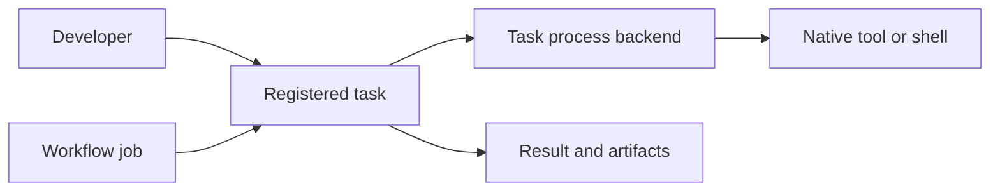

# Task migration inventory

| Owner | Current callers | Task entry |
|---|---|---|
| Native package | `scripts/ui_native/build-android.sh`, `build-ios.sh`, and native release preparation | `native:build-android`, `native:build-ios` |
| Native bindings | `generate-bindings.sh`, `sync-android.sh`, and `sync-ios.sh` | `native:bindings:generate`, `native:bindings:sync-android`, `native:bindings:sync-ios` |
| Native examples | Todo build and test scripts under `scripts/ui_native` | `native:todo:prepare-ios`, `native:todo:test-ios`, `native:todo:test-android` |
| Native release | Native release workflow, package release guide, and scripts under `scripts/ui_native/release` | `native:release:prepare`, `native:release:verify`, `native:release:publish` |
| Starter applications | Apple and Android independent application checks under `scripts/ui_native/release` | `native:release:test-ios-starter`, `native:release:test-android-starter` |
| Wire package | `scripts/ui_wire` and its repository automation callers | Wire task set |
| Toolchain | `scripts/toolchain` and mise setup and check entries | Toolchain task set |
| Continuous integration | `scripts/ci`, `ci/packages.toml`, and workflow entry points under `.github/workflows` | Build and verification task sets |

The central `platform` executable and the package's `native-task` executable register the same native task set.
Existing workflow script paths identify callers that still need migration.

## Task ownership for builds and deployments

The owner requests complete migration. The owner approves implementation, including a dedicated foundation_ci package.
A registered Rust task owns each build and deployment operation from validation through cleanup.
A task can invoke native tools or use a native shell where the platform requires one.
Starting a repository script from a task still leaves the operation outside the task.
Move shared operations into the owning Rust task library.
Implement each operation directly in Rust when possible. Invoke platform tools directly through the task process interface.
Retain a helper script only when the execution environment requires it and no supported Rust path exists. Document that requirement.
Keep required helper scripts under the owning task’s `tasks/scripts/` directory and embed them in its binary.
Select the embedded implementation for the platform that executes it. Remove the old checkout-relative invocation.
Keep workflow triggers, permissions, scheduling, and secret bindings in workflow configuration.

Developers and workflow jobs call the same task for each operation.

### Continuous integration package

Create `foundation_ci` as a Rust package with a command executable and registered tasks.
Keep its bootstrap independent of the main platform executable and the build products it tests.
Read package policy from `ci/packages.toml`. Preserve the existing matrix output for GitHub Actions.
Use the task process backend for Cargo, native tools, and required shell commands.
GitHub Actions installs the host prerequisites and starts the executable.
Local callers use the same commands. Verify the Python and Rust outputs before switching callers.

### Execution order

1. Trace every repository-owned caller from workflows, composite actions, Make, mise, package commands, containers, examples, and installation guides.
2. Record its existing arguments, environment, outputs, exit codes, platform, cleanup, and downstream consumers.
3. Establish a clean checkout bootstrap using Cargo or a verified task executable for the target host.
4. Test startup before generated bindings, images, or the products under construction exist. Break any bootstrap dependency cycle.
5. Finish native builds, bindings, archive creation, staging, signing, release verification, starter checks, and publication.
6. Migrate wire generation, web modules, generated services, and build prerequisites.
7. Migrate tool installation, image construction, virtual machines, guest provisioning, and deployment operations reachable from the build graph.
8. Migrate continuous integration planning, package selection, platform gates, packaging, publication, and release recovery.
9. Switch all callers and documentation. Remove old launchers and references from tracked source and generated templates.
10. Inspect installed commands from outside the checkout. Verify every command that promises installed use.

### Verification

- Compare old and new build outputs on identical inputs. Check executable names, archives, generated sources, and dependency locks.
- Test Linux, macOS, and Windows operations on their platforms. Preserve affected-package selection and concurrency limits.
- Exercise cancellation, child cleanup, bounded streaming output, failure status, and private input through the existing process backend.
- Test publication against temporary local registries. Check signature validation, checksums, receipts, retries, and recovery after interruption.
- Test clean startup, installation, and execution with retired scripts absent.
- Add a regression check for first-party build or deployment entry points that bypass the task system.
- Keep third-party tool internals under their upstream owner's control. Call test programs directly where tasks own their build and execution.
- Record evidence for each migrated caller. Mark unfinished paths explicitly until all callers pass.

### Reusable JavaScript build

[Feature 1](features/01-shared-javascript-build/feature.md) specifies the shared library, Cargo caller, and runtime task.

### Approved build groups in package policy

A build group selects checks that span independent Cargo projects. The owner approves this design for implementation.
Declare each group in a separate `[groups.<name>]` table in `ci/packages.toml`.

| Group | Owned directory | Recipe | Cargo members built by the recipe |
|---|---|---|---|
| `examples` | `examples` | `example-applications` | `answerme-agent` |
| `wasm-tests` | `backends/foundation_core/integration/wasm_tests` | `wasm-runtime-tests` | None |

Each table declares `directory`, `recipe`, and `build-members`. The recipe selects a typed Rust operation.
Cargo metadata supplies the names, directories, dependencies, and tool requirements of actual workspace packages.
Each group inherits tool requirements from its listed Cargo members.
The directory assigns changed files to the deepest matching package or group.
An inherited tool requirement does not add an affected-package dependency.
The existing `[packages.<name>]` tables continue to control platform runs, time limits, and opt-outs.

Reject duplicate package or directory ownership, unknown recipes, missing Cargo members, absolute directories, and directories outside the checkout.
Compare both group plans and affected-file reasons with the current planner.
Test renamed groups, empty member lists, invalid references, platform opt-outs, and nested Cargo package ownership.

### Verified caller changes on 2026-11-24

| Owner | Registered command or package | Verified callers and results |
|---|---|---|
| Cloudflare | Account commands, D1 and R2 operations, local service control, and six integration test commands | Tests verify credentials, pagination, worker ownership, and cleanup. The real local service passed 29 storage and file system tests. |
| Linux host setup | `toolchain:install-testbed`, `toolchain:install-quickemu`, and `images:download-macos` | Seven mise commands call these tasks. Local command fixtures check package selection, arguments, and failure status. |
| Build hooks | `build:install-hook` | An independent Cargo package installs each provider. A repeat check preserves its files. |
| Application assets | `foundation_codegen`, `foundation_resources`, and `foundation_wasm_ui` | Todo and an external application build in both profiles. Chromium loads one script from the moved Todo release. |
| Native applications | `native-task` and the native task set | The release workflow calls Rust. Local tests check archives, tag conflicts, staging, and signing. |
| Wire generation | `wire-generate`, `wire-check`, and `wire-bundle` | The workflow and mise use the same generator. Four language outputs and the browser file match. |
| Host tools | `toolchain-check`, `toolchain-wire`, and Android and Apple proof tasks | A real Android package and a Swift library build. The test fixtures check repeat runs and failures. |
| Workspace verification | `foundation-ci` | GitHub Actions, Make, and mise use the planner. It checks package archives, lockfiles, package selection, and release retries. |
| Virtual machine host | `images:vm-up` and `images:vm-down` | Nushell forwards host options. A Docker fixture verifies both commands, storage, and loopback ports. |
| Guest readiness | `images:vm-wait` | An isolated SSH service verified login, a missing marker, and a completed marker. Fixtures check replacement and failed provisioning. |
| Guest diagnostics | `images:vm-logs` | A real loopback service returned a log. Disconnection preserved the previous file and returned status 255. |
| Guest runner status | `images:vm-runner-alive` and `images:vm-wait-runner` | Both Nushell commands preserve connection failures. Tests check running, finished, and timeout cases. |
| Container execution | `linux`, `link-submodules`, and virtual machine host checks | Local Linux containers exercise command failure, cleanup, and console access. Git fixtures verify baked source selection. |
| Image planning | `image-prepare`, `image-settings`, `image-exists`, and `image-promote` | Seven plans match the previous hashes. A local Docker substitute checks missing images, retry, failure, and tags. |

The standalone command registers the workspace build, check, format, audit, documentation, and publication tasks.
Make and mise dispatch those operations to the same task set.

### Remaining caller changes

1. Verify the CUDA archive and the complete release package selection. The default Linux image built a real plugin archive and verified it with protoc.
2. Verify release installation on a clean hosted runner. Local tests cover cached release tools, new tags, and partial dispatch failures.
3. Supply a verified first-stage tool for fresh guests. A new guest starts without Cargo or a repository checkout.
4. Migrate virtual machine operations and guest provisioning. The image builder and Linux image smoke checks now use the Rust task runner.
5. Migrate the remaining generators and supported legacy WebAssembly builds. Issue #792 tracks the fixture decision. Issue #794 tracks the Google Cloud input format.
6. Select the supported manual publication packages. Issue #793 tracks the retired package names. Verify guest tests on supported hosts.

The owner approves Feature 4. Its public release requires a tagged crate and registry credentials. Specification 91 owns deferred native Windows resource tests.
