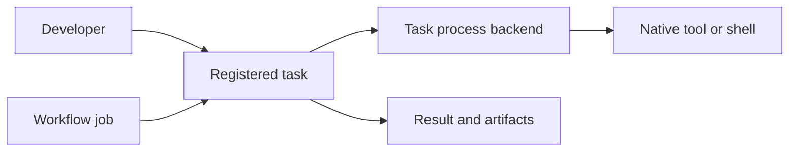

# Task migration inventory

| Owner | Current callers | Task entry |
|---|---|---|
| Native package | `scripts/ui_native/build-android.sh`, `build-ios.sh`, and native release preparation | `native:build-android`, `native:build-ios` |
| Native bindings | `generate-bindings.sh`, `sync-android.sh`, and `sync-ios.sh` | `native:bindings:generate`, `native:bindings:sync-android`, `native:bindings:sync-ios` |
| Native examples | Todo build and test scripts under `scripts/ui_native` | `native:todo:prepare-ios`, `native:todo:test-ios`, `native:todo:test-android` |
| Native release | Native release workflow, package release guide, and scripts under `scripts/ui_native/release` | `native:release:prepare`, `native:release:verify`, `native:release:publish` |
| Starter applications | Apple and Android independent application checks under `scripts/ui_native/release` | `native:release:test-ios-starter`, `native:release:test-android-starter` |
| Wire package | `scripts/ui_wire` and its repository automation callers | Wire task set |
| Toolchain | `scripts/toolchain` and mise setup and check entries | Toolchain task set |
| Continuous integration | `scripts/ci`, `ci/packages.toml`, and workflow entry points under `.github/workflows` | Build and verification task sets |

The central `platform` executable and the package's `native-task` executable register the same native task set.
Existing workflow script paths identify callers that still need migration.

## Task ownership for builds and deployments

The owner requests complete migration. The owner approves implementation, including a dedicated foundation_ci package.
A registered Rust task owns each build and deployment operation from validation through cleanup.
A task can invoke native tools or use a native shell where the platform requires one.
Starting a repository script from a task still leaves the operation outside the task.
Move that logic into the owning task and remove the obsolete script.
Keep workflow triggers, permissions, scheduling, and secret bindings in workflow configuration.

Developers and workflow jobs call the same task for each operation.

### Continuous integration package

Create `foundation_ci` as a Rust package with a command executable and registered tasks.
Keep its bootstrap independent of the main platform executable and the build products it tests.
Read package policy from `ci/packages.toml`. Preserve the existing matrix output for GitHub Actions.
Use the task process backend for Cargo, native tools, and required shell commands.
GitHub Actions installs the host prerequisites and starts the executable.
Local callers use the same commands. Verify the Python and Rust outputs before switching callers.

### Execution order

1. Trace every repository-owned caller from workflows, composite actions, Make, mise, package commands, containers, examples, and installation guides.
2. Record its existing arguments, environment, outputs, exit codes, platform, cleanup, and downstream consumers.
3. Establish a clean checkout bootstrap using Cargo or a verified task executable for the target host.
4. Test startup before generated bindings, images, or the products under construction exist. Break any bootstrap dependency cycle.
5. Finish native builds, bindings, archive creation, staging, signing, release verification, starter checks, and publication.
6. Migrate wire generation, web modules, generated services, and build prerequisites.
7. Migrate tool installation, image construction, virtual machines, guest provisioning, and deployment operations reachable from the build graph.
8. Migrate continuous integration planning, package selection, platform gates, packaging, publication, and release recovery.
9. Switch all callers and documentation. Remove old launchers and references from tracked source and generated templates.
10. Inspect installed commands from outside the checkout. Verify every command that promises installed use.

### Verification

- Compare old and new build outputs on identical inputs. Check executable names, archives, generated sources, and dependency locks.
- Test Linux, macOS, and Windows operations on their platforms. Preserve affected-package selection and concurrency limits.
- Exercise cancellation, child cleanup, bounded streaming output, failure status, and private input through the existing process backend.
- Test publication against temporary local registries. Check signature validation, checksums, receipts, retries, and recovery after interruption.
- Test clean startup, installation, and execution with retired scripts absent.
- Add a regression check for first-party build or deployment entry points that bypass the task system.
- Keep third-party tool internals under their upstream owner's control. Call test programs directly where tasks own their build and execution.
- Record evidence for each migrated caller. Mark unfinished paths explicitly until all callers pass.

### Reusable JavaScript build

[Feature 1](features/01-shared-javascript-build/feature.md) specifies the shared library, Cargo caller, and runtime task.

### Approved build groups in package policy

A build group selects checks that span independent Cargo projects. The owner approves this design for implementation.
Declare each group in a separate `[groups.<name>]` table in `ci/packages.toml`.

| Group | Owned directory | Recipe | Cargo members built by the recipe |
|---|---|---|---|
| `examples` | `examples` | `example-applications` | `answerme-agent` |
| `wasm-tests` | `backends/foundation_core/integration/wasm_tests` | `wasm-runtime-tests` | None |

Each table declares `directory`, `recipe`, and `build-members`. The recipe selects a typed Rust operation.
Cargo metadata supplies the names, directories, dependencies, and tool requirements of actual workspace packages.
Each group inherits tool requirements from its listed Cargo members.
The directory assigns changed files to the deepest matching package or group.
An inherited tool requirement does not add an affected-package dependency.
The existing `[packages.<name>]` tables continue to control platform runs, time limits, and opt-outs.

Reject duplicate package or directory ownership, unknown recipes, missing Cargo members, absolute directories, and directories outside the checkout.
Compare both group plans and affected-file reasons with the current planner.
Test renamed groups, empty member lists, invalid references, platform opt-outs, and nested Cargo package ownership.
