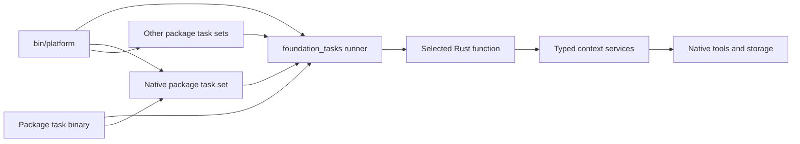
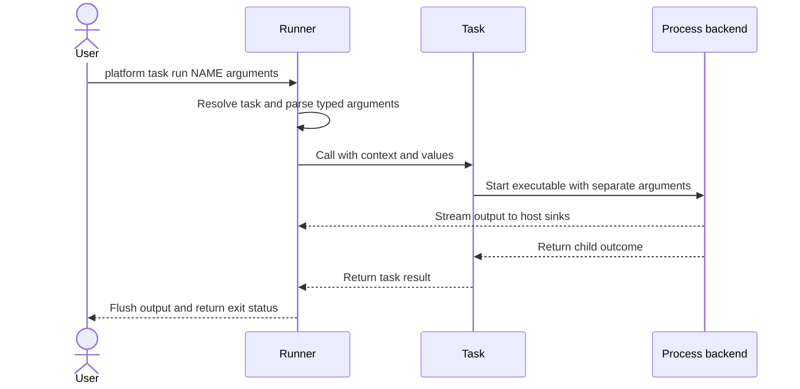

# Specification 90. Foundation tasks

**The owner approved this design and authorized implementation on 2026-11-22.**

## Glossary

| Term | Meaning |
|---|---|
| Task | A named Rust function that performs one operation. |
| Task set | A collection of task definitions that a package exports together. |
| Runner | The object that lists tasks, checks arguments, and calls a selected function. |
| Namespace | A prefix that identifies the package owning a task. |
| Context | The application services available to a task during one command invocation. |
| Valtron | The repository runtime that drives asynchronous Rust functions. |
| Command-line interface (CLI) | The commands, arguments, and results that a terminal user sees. |
| User interface (UI) | The controls and information that an application presents to its user. |
| Continuous integration (CI) | The service that builds the repository and runs its checks. |
| Digest | A value calculated from the bytes of an artifact to check its identity. |
| Candidate | A named set of release files and their recorded digests. |
| American Standard Code for Information Interchange (ASCII) | A character set that includes English letters and digits. |
| Operating system (OS) | The software that starts programs and manages their resources. |

## Goal and stories

A maintainer runs `platform task ls` at the repository root to find the supported operations.
A package author adds an ordinary Rust module with a typed task function.
The package exports its task set from its library.
The central executable imports that library and registers the set.
A package executable can register the same set and supply its own services.
A release engineer can prepare, verify, and publish a candidate with separate commands.
A failed child command identifies the task and preserves its exit status.

The first migration covers native tasks. The revised completion criteria cover all repository build and deployment operations.
This specification defines one implementation plan. Review the command contract and migration stages together.

## Existing code

The deployment package exposes a clap command tree and a dispatcher. Its standalone executable initializes Valtron and calls both functions.
The new runner generalizes this arrangement. [Command tree](../../backends/foundation_deployment_platform/src/cli/mod.rs) · [Executable](../../backends/foundation_deployment_platform/src/bin/testbed.rs)

The Android build installs two processor targets and can also build the todo application libraries.
The Apple build checks its archive contents and calculates a Swift package checksum. [Android build](../../scripts/ui_native/build-android.sh) · [Apple build](../../scripts/ui_native/build-ios.sh)

Release preparation checks the source revision, builds both packages, and stages their files.
Publication checks digests, release tags, and a Maven Central deployment receipt. [Preparation](../../scripts/ui_native/release/prepare.sh) · [Publication](../../scripts/ui_native/release/publish.py)

## Architecture



Both executables use the package's exported functions and register their own selection of task sets.

| Owner | Responsibility |
|---|---|
| `backends/foundation_tasks` | Define the runner, task sets, parser adapters, errors, and injected process interface. |
| `backends/foundation_macros` | Expand the entry attribute. Follow the existing Valtron entry macro conventions. |
| `bin/platform` | Supply all repository commands from package `ewe_platform`. Select the package sets and host services. |
| Each participating package | Own task functions, arguments, help text, platform checks, and tests. Export task sets through its library. |
| Each package executable | Select the task sets and context values available to that executable. |
| Release task code | Own signing, candidate validation, remote state checks, and publication order. |

The library has no dependency on the central executable or a package that supplies tasks.
Use an optional developer-tool dependency for native package task modules. Production mobile builds exclude that dependency.
The central executable is `platform`. Give each additional package executable a unique Cargo target name.

## Existing platform command paths

Every enabled command in the current entry point becomes a registered task. A direct path and its generic name select one definition.
The same definition supplies its arguments, defaults, help, validation, handler, and exit behavior.
Reuse package logic and replace the existing top-level dispatch match. [Current entry point](../../bin/platform/src/main.rs)

| Existing path after `platform` | Registered task name | Existing owner |
|---|---|---|
| `generate` | `generate` | Platform project templates |
| `local` | `local` | Platform development server |
| `tcp_capture` | `tcp-capture` | Platform traffic capture |
| `gen_model_descriptors` | `gen-model-descriptors` | Platform model definitions |
| `gen_api generate`, `gen_api analyze` | `codegen:generate`, `codegen:analyze` | `foundation_codegentools` |
| `schema` | `codegen:schema` | `foundation_codegentools` |
| `wasm_bins list`, `wasm_bins generate` | `wasm-bins:list`, `wasm-bins:generate` | `foundation_wasm` |
| `wasm-bundle build`, `wasm-bundle plan` | `wasm-bundle:build`, `wasm-bundle:plan` | `foundation_wasm_ui` |

Keep existing positional arguments, flag spellings, short flags, defaults, nested help, output formats, and cancellation behavior.
The `local` task runs until the service exits or receives cancellation.
A package executable such as `testbed` can expose its existing command paths through its own registry.
A daemon keeps its process lifecycle when a task controls it.
The current entry disables `watchful`, `sandbox`, and `sandbox_app`.
A future sandbox set can choose `sandbox:start`. This migration covers the enabled commands.

Cargo currently builds `ewe_platform`. The parser displays `platform`.
The Makefile names `--bin ewe_platform`. The release workflow collects executable names from Cargo metadata.
Keep package `ewe_platform` and set its Cargo `default-run` to `ewe_platform`.
Add the `platform` binary target at `src/main.rs`.
The compatibility target `ewe_platform` includes that same entry source from a thin file.
Both installed names and `cargo run -p ewe_platform -- …` reach the same registry.
Verify both names after Cargo installation and release archive extraction.
[Package manifest](../../bin/platform/Cargo.toml) · [Makefile](../../Makefile) · [Release packaging](../../.github/workflows/release.yaml)

## User commands

```console
$ platform generate -t ios-app -p demo --app-id org.example.demo
$ platform task run generate -t ios-app -p demo --app-id org.example.demo
$ platform task ls
generate                   Generate a project from a template
native:build-android       Build the Android native libraries
native:release:prepare     Build and stage a release candidate
native:release:publish     Publish a verified release candidate
native:release:verify      Verify a staged release candidate

$ platform task run native:build-android --with-todo
$ platform task run native:release:prepare --config release/native-ui.toml --output dist/native-ui
$ platform task run native:release:verify --candidate dist/native-ui --templates both
$ platform task run native:release:publish --candidate dist/native-ui --resume
$ platform task run native:build-android --help
```

Each generation example creates the same project. Run them in separate empty directories when comparing outputs.
The listing above shows selected entries. Sort the complete list by fully qualified name.
`platform task --help` describes the runner. `platform task run NAME --help` shows the selected package's arguments.
Both help commands and `platform task ls` can run on any supported host without release credentials or mobile tools.
Parse arguments before reading task resources or starting children.
Use clap argument types for paths, numbers, flags, and required values.
Preserve OS argument boundaries, including spaces and non-Unicode paths where the OS supports them.
A task that forwards arbitrary arguments must declare a trailing argument list. The caller supplies it after `--`.

Use lowercase letters from the American Standard Code for Information Interchange (ASCII), digits, and single hyphens within name segments. Each segment starts with a letter.
Separate segments with a colon. Reject empty segments and leading, trailing, or repeated hyphens.
A set can declare its namespace. An unscoped set registers each supplied name directly.
Direct command paths preserve underscores and existing spellings. Reserve the top-level `task` group for the runner.
Reject duplicate direct paths and conflicting leaf or group paths during registration.
Within the `native` namespace, `release:verify` becomes `native:release:verify`.
Validate the entire set before adding it. Report both owners when names collide. A failed registration changes no entries.

## Rust authoring contract

The following Rust excerpts specify proposed interfaces. The package owns its platform operations.

**Central executable, `bin/platform/src/main.rs`**

```rust
use foundation_tasks::{task, TaskResult, TaskRunner};
use foundation_ui_native::tasks as native_tasks;

mod generate;
mod local;
mod models;
mod platform_tasks;
mod tcp_capture;

#[task]
async fn main(mut runner: TaskRunner) -> TaskResult {
    runner.context().store(native_tasks::NativeBuildEnv::from_workspace());
    runner.register(platform_tasks::set()?)?;
    runner.register(foundation_codegentools::tasks::set()?)?;
    runner.register(foundation_wasm::tasks::set()?)?;
    runner.register(foundation_wasm_ui::tasks::set()?)?;
    runner.register(native_tasks::set()?)?;
    runner.run().await
}
```

**Unscoped set, `bin/platform/src/platform_tasks.rs`**

```rust
use foundation_tasks::{TaskError, TaskSet};

pub fn set() -> Result<TaskSet, TaskError> {
    let mut set = TaskSet::new("ewe_platform");
    set.add("generate", "Generate a project from a template", crate::generate::task)?;
    set.expose("generate", &["generate"])?;
    set.add("local", "Run the local development server", crate::local::task)?;
    set.expose("local", &["local"])?;
    set.add("tcp-capture", "Capture traffic", crate::tcp_capture::task)?;
    set.expose("tcp-capture", &["tcp_capture"])?;
    set.add("gen-model-descriptors", "Generate model descriptors", crate::models::task)?;
    set.expose("gen-model-descriptors", &["gen_model_descriptors"])?;
    Ok(set)
}
```

The host declares the task modules in its crate root.
A scoped set exposes a direct path the same way.
For example, the code generation set declares namespace `codegen` and calls `set.expose("generate", &["gen_api", "generate"])?`.
Both `platform gen_api generate` and `platform task run codegen:generate` call its registered function.

Additional package sets enter through ordinary imports and explicit calls to `register`.
The central executable defines the repository command surface. It requires no runtime search for binaries or Rust files.

The native library exports `pub mod tasks;` under its developer-tool feature.

**Package library, `backends/foundation_ui_native/src/tasks/mod.rs`**

```rust
use foundation_tasks::{TaskError, TaskSet};

mod build_android;
mod release_prepare;
mod release_publish;
mod release_verify;

pub fn set() -> Result<TaskSet, TaskError> {
    let mut set = TaskSet::new("foundation_ui_native").with_namespace("native");
    set.add("build-android", "Build the Android native libraries", build_android::task)?;
    set.add("release:prepare", "Build and stage a release candidate", release_prepare::task)?;
    set.add("release:publish", "Publish a verified release candidate", release_publish::task)?;
    set.add("release:verify", "Verify a staged release candidate", release_verify::task)?;
    Ok(set)
}
```

**One task file, `src/tasks/build_android.rs`**

```rust
use clap::Args;
use foundation_tasks::{TaskContext, TaskResult};

#[derive(Args)]
pub(super) struct BuildAndroid {
    #[arg(long)]
    with_todo: bool,
}

pub(super) async fn task(ctx: TaskContext, args: BuildAndroid) -> TaskResult {
    let env = ctx.require::<crate::tasks::NativeBuildEnv>()?;
    env.build_android(&ctx, args.with_todo).await
}
```

`NativeBuildEnv` is the proposed package service for Android build settings and operations.
Both executable hosts install it in their context before dispatch.
Construction records configuration. The selected task resolves required tools and reads files during execution.
The package host can replace the service with a different configuration. A test can use a fake process backend.

**Optional standalone package executable, `src/bin/native-task.rs`**

```rust
use foundation_tasks::{task, TaskResult, TaskRunner};
use foundation_ui_native::tasks;

#[task]
async fn main(mut runner: TaskRunner) -> TaskResult {
    runner.context().store(tasks::NativeBuildEnv::from_workspace());
    runner.register(tasks::set()?)?;
    runner.run().await
}
```

The same task can now run as `native-task task run native:build-android --with-todo`.
Registration selects availability. The task body receives the host context from the executable that calls it.

**Core signatures**

```rust
pub type TaskResult = Result<(), TaskError>;

impl TaskSet {
    pub fn new(owner: &'static str) -> Self;
    pub fn with_namespace(self, namespace: &'static str) -> Self;
    pub fn expose(&mut self, name: &'static str, path: &[&'static str]) -> TaskResult;

    pub fn add<A, F, Fut>(
        &mut self, name: &'static str, summary: &'static str, handler: F,
    ) -> Result<(), TaskError>
    where
        A: clap::Args + Send + 'static,
        F: Fn(TaskContext, A) -> Fut + Send + Sync + 'static,
        Fut: std::future::Future<Output = TaskResult> + Send + 'static;
}

impl TaskRunner {
    pub fn new(root: foundation_context::Ctx, argv: Vec<std::ffi::OsString>) -> Self;
    pub fn context(&self) -> &foundation_context::Ctx;
    pub fn register(&mut self, set: TaskSet) -> TaskResult;
    pub async fn run(self) -> TaskResult;
}

impl TaskContext {
    pub fn require<T: Send + Sync + 'static>(&self) -> Result<std::sync::Arc<T>, TaskError>;
    pub async fn exec(&self, command: ProcessCommand) -> Result<(), TaskError>;
}
```

Each entry uses `A::augment_args` for help and parsing. Its adapter calls `A::from_arg_matches` before invoking the task.
Store the adapter and its help definition together. This keeps execution and help consistent.
`TaskRunner::new` accepts the executable name as the first argument.
Tests and embedding applications can provide a context and argument vector directly.

### Entry attribute

`#[task]` accepts an async entry with one owned `TaskRunner` parameter and a `TaskResult` return type.
The attribute emits a native Rust `main` and moves the author's body into a private async function.
The generated boundary creates one host context, installs real process and output services, and initializes Valtron once.
It reads process arguments with `args_os` and passes the initialized runner to the author's function.
It drives that future with `block_on_future`. It keeps the pool guard until the future and output flush finish.
The boundary returns `std::process::ExitCode`. It prints each diagnostic once.

An application that already owns Valtron can construct `TaskRunner` directly inside its existing async entry.
It supplies the same context to the runner and Valtron. Only the outer host creates a process context and pool.
The existing executor accepts an explicit root context. [Valtron initialization](../../backends/foundation_core/src/valtron/executors/sendables.rs)

### Optional directory discovery

Explicit registration is the default. A package can also generate its local set from a directory at compile time.
The shorthand `#[tasks("./tasks")]` accepts the same entry signature as `#[task]`.
Its string literal names a directory relative to that executable's source file.
For `src/bin/native-task/main.rs`, the path resolves to `src/bin/native-task/tasks/`.
The package declares a namespace with `#[tasks("./tasks", namespace = "native")]` or exports unscoped names.
The generated entry registers this local set before executing the author's body. The body can then register exported sets.

Each task file contains one visible async function named `task`, with the signature shown above.
Use its first documentation paragraph as the summary. Use its Rust filename as the leaf name.
For example, `build_android.rs` registers `build-android`. Subdirectories add name segments.
Provide `pub(super)` visibility for the function and its argument type. Support `pub` visibility too.
Treat helper modules as ordinary library modules outside the task directory.
Reject invalid names, missing summaries, wrong signatures, duplicate names, and links that escape the package root.

A package using discovery calls a build helper from its Cargo build script.

```rust
fn main() {
    foundation_tasks::build::task_dir("native-task", "src/bin/native-task/main.rs", "./tasks")
        .expect("valid native task directory");
}
```

Declare the helper as a build dependency. One call associates a binary target, source file, and task directory.
The helper sorts entries by relative path and writes a Rust module index under Cargo's output directory.
Use a distinct index per binary target. Emit directory and file dependencies with `cargo:rerun-if-changed`.
The attribute includes that index and checks the directory literal against the helper input.
An absent index explains how to add the build helper.
Adding, renaming, editing, and removing a task must each take effect on the next ordinary Cargo build.
Explicitly registered package sets need no build script.

## Process execution and failure

The host installs `TaskEnv` as a typed context entry. It contains process and output interfaces.
Package services use injected storage, release transport, timers, and secrets where their tasks require them.
`require` returns a typed missing-service error. Package commands can add typed services through `Ctx::store`.
Reuse the context's clock and entropy backends for timeouts and temporary names.

`ProcessCommand` holds an executable path, separate OS arguments, working directory, and explicit environment changes.
Use direct process invocation. The production backend starts the external tool once.
Drain standard output and standard error concurrently into separate sinks. Await both drains and the child outcome.
A slow sink applies backpressure. Bound intermediate buffers through runner configuration.
Expose `ProcessConfig::with_chunk_bytes` and document its default from Rust's buffered reader size.
Capture short diagnostic excerpts only under a configured size limit. Never collect an entire build log in memory.
Stream archives into files or upload bodies. Check each child exit status and each sink write result.
On cancellation or sink failure, stop the owned child and reap it. Report the original failure and any cleanup failure.
Use platform process groups or Windows job objects when a task owns a child tree.
The process adapter separates secret values from diagnostic text. Release tasks supply secrets through private inputs.



A task invocation dispatches one selected task and waits for its owned resources.

| Condition | Observable result | State after return |
|---|---|---|
| List or help | Status 0 and deterministic text on standard output | No task or child starts. |
| Unknown task or invalid arguments | Status 2 and relevant usage on standard error | No task starts. |
| Duplicate registration | Status 1 with both owners and the conflicting name | The registry keeps its earlier entries. |
| Missing service or tool | Status 1 with task name and missing requirement | The failed operation starts no child. |
| Child exits with a nonzero code | Preserve codes from 1 through 255. Report the original number for other values and return 1. | The runner reaps the child. |
| User cancellation | Status 130 after cleanup | The runner closes its streams and reaps its child tree. |
| Child terminates by signal | Report the signal. Return 128 plus its number if representable, or 1 otherwise. | The runner reaps the child. |
| Task, output, or cleanup error | Status 1 with source error and task name | The task reports any retained release receipt. |

## Repository migration

[Feature 2](features/02-install-build-hooks/feature.md) defines the approved task that installs Cargo build hooks.

[Feature 1](features/01-shared-javascript-build/feature.md) defines the reusable JavaScript build helper and its two callers.

[Feature 4](features/04-browser-runtime-package/feature.md) defines the public npm package and its release checks.

The [task ownership plan](migration.md) specifies the remaining work and acceptance checks.

1. Inventory callers in scripts, mise tasks, package scripts, documentation, and CI workflows.
2. Give each operation a package owner, task name, typed arguments, output contract, and platform requirements.
3. Port native UI operations first. Use Rust for orchestration and keep external tools for their specialized operations.
4. Compare the old and new entry points against the same temporary workspace and candidate inputs.
5. Switch every caller after equivalent results. Remove the old orchestration scripts in the same migration.
6. Apply the same procedure to the remaining repository scripts. Record each caller before retiring its launcher.

| Current inputs | Proposed task names in `native` | Behavior to preserve |
|---|---|---|
| `build-android.sh`, `build-ios.sh` | `build-android`, `build-ios` | Build the declared targets. Honor `--with-todo` on Android. Verify the Apple archive slices and checksum. |
| `generate-bindings.sh`, `sync-*.sh`, `swift_metadata.py` | `bindings:generate`, `bindings:sync-android`, `bindings:sync-ios` | Match generated sources and the existing check modes. Keep metadata operations inside their owning task. |
| Todo preparation and test scripts | `todo:prepare-ios`, `todo:test-ios`, `todo:test-android` | Preserve the visible count checks and temporary device cleanup. |
| `stage_release.py`, release preparation, signing, and verification | `release:prepare`, `release:verify` | Validate the source revision, candidate files, signatures, and digests. Keep preparation local. |
| Release starter scripts and seed helper | `release:test-ios-starter`, `release:test-android-starter` | Preserve local candidate and published package resolution modes. |
| Release publication scripts | `release:publish` | Resume the same candidate. Preserve draft release, Maven receipt, validation, and Swift tag semantics. |

Use staging directories for incomplete local artifacts. Promote only complete outputs.
Honor the existing clean-checkout and source revision checks for release preparation.
A publish task checks configuration, signatures, digests, source revision, and existing tags before remote writes.
Keep the release timeout and poll interval configurable. Preserve the existing defaults of 1,800 seconds and 15 seconds.
A retry must match the candidate and the remote receipt. Reject conflicting digests or tag revisions.
After an ambiguous upload response, reconcile remote state before another upload. Report unresolved state for operator inspection.
Serialize publication for a given release version through the existing release workflow and a local candidate lock where appropriate.
Run publication tests against a fake registry. Reserve real publication for the existing release entry point and its credentials.
A help command, a list command, and a verification task can never trigger publication.

## Acceptance and verification

| Given | When | Then |
|---|---|---|
| Each existing command path has a fixture | Run both direct and generic forms | Both call the same handler with identical parsed values, output, and status. |
| A second set claims a direct path or the reserved task group | Register it | Registration reports the conflict and preserves the current registry. |
| Two packages export sets | The central executable lists tasks | The list shows both namespaces in lexical order. No task setup runs. |
| A package and repository import the same set | Both executables run the same task | They parse identical arguments and call the same package function. |
| A host installs a test service | A task requests the service | The task receives that instance. Missing configuration returns a typed error. |
| A directory contains two task files | Cargo builds the binary after an addition, rename, and removal | Each list reflects exactly the current files. |
| Two files normalize to one name | The package builds or registers the set | Discovery or registration fails before any task executes. |
| A path contains spaces or shell characters | A test task starts a child | The child receives exactly one argument for that path. |
| A child fills both output pipes | A slow sink drains both | Output remains ordered within each stream. Memory stays within the configured buffer bounds. |
| A child exits with status 7 | The runner waits for completion | The process returns 7 and identifies the task. |
| The caller cancels a running child tree | The host returns from cancellation | No owned descendant remains. The result reports cancellation. |
| A verified candidate already has a matching receipt | Publication resumes against a fake registry | The task completes remaining steps with one deployment. |
| A remote digest differs | Publication resumes | The task reports a conflict and preserves remote bytes. |
| An output closes or a required program is absent | A platform task runs | The runner reports the original cause and completes applicable cleanup. |

Place Rust tests in each crate's `tests/` directory.
Test command discovery, argument parsing, child exit status, and cancellation on Linux, macOS, and Windows.
Use a Rust child fixture on all three systems. Run native Apple output checks on macOS.
Run Android package checks on hosts with the required Android tools and emulator access.
Declare platform test prerequisites in `ci/packages.toml`. Use the existing CI scheduling rules.

Run these commands after implementation.

```sh
cargo test -p foundation_tasks --profile uat
cargo test -p foundation_macros --profile uat
cargo test -p foundation_ui_native --features tasks --profile uat
cargo test -p ewe_platform --profile uat
cargo run -p ewe_platform -- task ls
cargo run -p ewe_platform --bin platform -- task run native:build-android --help
cargo run -p ewe_platform --bin ewe_platform -- generate --help
```

[Specification 91](../91-windows-resource-staging/requirements.md) owns native Windows execution of the resource staging suite for Feature 3.

## Implementation checklist

- [ ] Implement the registry, process backend, and entry attribute. Move every enabled platform command to its registered task.
- [ ] Implement directory discovery and verify incremental builds, diagnostics, and platform execution.
- [ ] Port native UI tasks, verify release parity, and inventory the remaining repository migrations with owners.

Approval covers the design and checklist. Review each release migration against its existing callers and acceptance tests.
