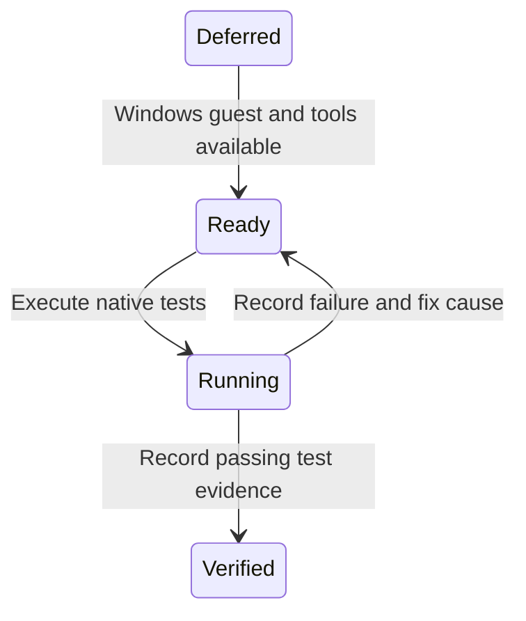

# Specification 91. Verify resource staging on Windows

## Glossary

| Term | Meaning |
|---|---|
| Virtual machine (VM) | A computer that runs a guest operating system. |
| Staging | The build step that copies declared resources into their packaging directories. |
| Fixture | A temporary Cargo package that a test builds to check staging. |
| User acceptance testing (UAT) profile | The repository build profile named `uat`. |
| Continuous integration (CI) | The service that builds and tests repository changes. |

## Scope and restart condition

A maintainer builds an application with a renamed icon. The staged directory must contain the new icon and preserve user files.
This specification owns native Windows verification of the [Specification 90 resource contract](../90-foundation-tasks/features/03-platform-resource-manager/feature.md).
Specification 90 retains the product requirements. The project currently has no Windows VM available for this run.

Resume when a maintainer has access to a working Windows VM with these prerequisites:

- A checkout of the revision under test on a writable Windows volume.
- A writable guest-local temporary directory for the staging tests and Cargo fixture.
- PowerShell, Git, the repository Rust toolchain, and a working native Windows C compiler and linker.
- Access to Cargo dependencies, including dependencies for the fixture's offline build.

The [Windows build profile](../../testbed.toml) identifies the existing guest configuration.
[Specification 20](../completed/20-foundation-testbed/features/11-windows-vm-setup/feature.md) owns guest setup.
This verification uses an available guest and the existing [CI package feature set](../../ci/packages.toml).



A native test run supplies the evidence for completion.

## Run in the Windows guest

From the repository root, record the Windows version, commit, compiler host, and Cargo version.

```powershell
[System.Environment]::OSVersion.VersionString
git rev-parse HEAD
rustc -vV
cargo -V
```

Use a native Windows compiler host and its default target. Run the package command without a test filter.
The outer build loads the staging dependencies before the fixture starts its offline build.

```powershell
cargo test --locked -p foundation_resources --profile uat --features build,server
if ($LASTEXITCODE -ne 0) { exit $LASTEXITCODE }
```

## Expected native tests

| Suite | Test | What it checks |
|---|---|---|
| [Staging](../../backends/foundation_resources/tests/staging.rs) | `stage_selects_inputs_and_preserves_the_previous_complete_set_on_failure` | Select target inputs, reject case conflicts, preserve the last good tree, and remove renamed files. |
| Staging | `shared_destinations_serialize_and_invalid_names_fail` | Serialize concurrent writers and reject invalid names, including Windows reserved names. |
| Staging | `empty_managed_directories_disappear_and_nested_user_files_survive` | Delete empty managed directories and preserve user files. |
| Staging | `a_stage_cannot_copy_its_own_output` | Reject an output directory inside its source. |
| Staging | `unchanged_publication_keeps_existing_file_times_and_restores_missing_files` | Preserve timestamps on unchanged files and restore missing managed files. |
| [Cargo hook](../../backends/foundation_resources/tests/cargo_hook.rs) | `cargo_tracks_directories_and_recovers_the_public_tree_after_failed_production` | Build the fixture with a custom profile and target directory. Check rename, deletion, failure recovery, and target payload selection. |
| [Runtime](../../backends/foundation_resources/tests/runtime.rs) | `host_context_streams_the_named_file_in_bounded_chunks` | Read the selected resource in bounded chunks. |
| Runtime | `a_read_failure_remains_visible_after_open` | Return an error when a later read fails. |

The staging suite also defines `a_reader_sees_complete_versions_during_directory_replacement` for Apple, Linux, and Android.
That test covers atomic directory exchange on those platforms. Its platform condition explains the different suite counts.

## Completion

- [ ] Record a passing native Windows run in [progress](progress.md).

Include the guest version, commit, compiler host, Cargo version, exact command, exit status, and test output.
The current Windows suite includes five staging tests, one Cargo hook test, and two runtime tests.
Each named test must pass. The full package command must exit successfully.
Record failures and the affected test names. Keep this item open until a native rerun passes.
