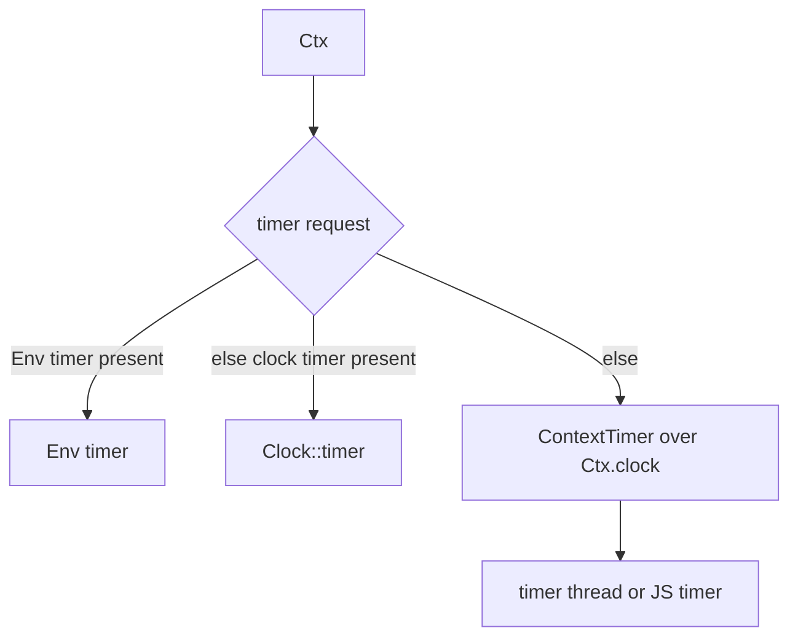

# Feature: Context-derived async timer

_Written in ASD-STE100 Simplified Technical English (STE). Code and identifiers stay as they
are._

**Abbreviations in this file.** Application programming interface (API); Cloudflare Workers
(Workers); JavaScript (JS); WebAssembly 32-bit (wasm32); deterministic simulation testing (DST).

## 1. Goal

`Ctx` owns the clock. It must also give the async timer, derived from that clock. No host
supplies a timer. `Ctx::timer()` never fails.

A custom timer stays possible. An `Env` timer is an override. A clock may provide its own timer.
The default is a wrapper over the context clock.

**User story.** As a crate author, I call `ctx.timer()` and get a working timer, with no host
setup and no feature flag.

**BDD scenarios.**

- Given a context with no `Env`, when code calls `ctx.timer().sleep_for(d)`, then it waits on the
  context clock.
- Given a simulated clock, when a test advances it, then a parked `sleep_until` completes with no
  real wait.
- Given an `Env` timer, when code calls `ctx.timer()`, then the engine returns the `Env` timer.
- Given a clock that provides a timer, when `Ctx` builds its timer, then it uses the clock timer.
- Given a dropped sleep, when the timer fires, then no stale entry remains.

## 2. Requirements

1. **One API.** `Ctx::timer() -> Arc<dyn Timer>`. It takes no argument and returns no error.
2. **Derived default.** With no override, `Ctx` returns a `ContextTimer` over `ctx.clock()`.
3. **Override.** An `Env` timer wins over the default. A later `Env` install also wins.
4. **Clock hook.** `Clock` gains `fn timer(&self) -> Option<Arc<dyn Timer>>` with a default
   `None`. A clock that returns one wins over the default.
5. **Move down.** The native timer thread moves from `foundation_core::valtron::timer` to
   `foundation_context::timer`. No logic change.
6. **Compatibility.** `foundation_core::valtron::timer` re-exports the moved items. Every
   existing path keeps working.
7. **Simulated advance.** `SimulatedClock::advance` and `advance_wall` notify the timer through
   one public function.
8. **No cycle.** The timer holds the clock, never the `Ctx`. A sleep future may hold a `Ctx`.
9. **wasm.** `Ctx::timer()` returns the `Env` timer when a host installs one. A JS default timer
   is a separate task; until it lands, a wasm context without an `Env` timer is a typed error
   from a `try_timer()` companion, never a silent hang.
10. **Call sites.** New code calls `ctx.timer()`. The event stream `send_bounded` switches to it
    and closes #1090.
11. **Tests.** Both resolution paths, a simulated advance, a dropped sleep and a clock-provided
    timer have tests.
12. **No behavior change.** Timer deadlines, wakers and the thread's wait stay identical.

## 3. Design



```rust
impl Ctx {
    /// The timer for this context.
    #[must_use]
    pub fn timer(&self) -> Arc<dyn Timer>;
}

pub struct ContextTimer;

impl Timer for ContextTimer {
    fn sleep_until(&self, ctx: Ctx, deadline: Instant) -> TimerFuture {
        Box::pin(crate::timer::sleep_until(deadline, &ctx))
    }
}
```

| Item | Now | After |
|---|---|---|
| Timer thread and `Sleep` | `foundation_core/src/valtron/timer.rs` | `foundation_context/src/timer.rs` |
| `nudge` | crate-private in valtron | public `notify_clock_advanced` |
| `Ctx` timer | none | derived, cached `Arc` |
| `Env` timer | required | optional override |
| valtron timer | owner | re-export |

## 4. Tasks

- [x] **T1 — move the native timer.** Move the thread, `Sleep`, `TimerCall` and `call_at` down.
      Keep the public names. Re-export from valtron. Tests: the existing timer tests pass
      unchanged.
- [x] **T2 — `Ctx::timer()`.** Add the cached default, the `Env` override and the
      `Clock::timer()` hook. Tests: `ctx_timer_defaults_to_the_clock`,
      `env_timer_overrides_the_default`, `clock_timer_wins_over_the_default`.
- [x] **T3 — advance notification.** Rename `nudge` to a public
      `notify_clock_advanced`. `SimulatedClock::advance` and `advance_wall` call it. Test:
      `advancing_the_clock_wakes_a_ctx_timer_sleep`.
- [x] **T4 — call sites.** Switch `foundation_event_stream::send_bounded` and
      `foundation_agent_rpc::turn` to `ctx.timer()`. Close #1090. Tests: the existing suites
      pass.
- [x] **T5 — wasm guard.** Return the `Env` timer on wasm; add `try_timer()` for a typed error
      when none is installed. Test: `wasm_without_env_timer_is_a_typed_error`.
- [ ] **T6 — JS default (follow-up).** Add a JS `setTimeout` default for a wasm context with no
      `Env`. Until then, GitHub issue #1093 records the gap, at severity medium.

## 5. Verify commands

```bash
cargo test --profile uat -p foundation_context
cargo test --profile uat -p foundation_core --features test-clock
cargo test --profile uat -p foundation_event_stream
cargo test --profile uat -p foundation_agent_rpc
cargo clippy --profile uat -p foundation_context --all-targets --no-deps -- -D warnings
cargo clippy --profile uat -p foundation_core --all-targets --no-deps -- -D warnings
cargo check --profile uat --target wasm32-unknown-unknown -p foundation_context
```

## 6. Success criteria

- [x] `ctx.timer()` works with no `Env` on native.
- [x] A simulated advance wakes a derived timer sleep.
- [x] An `Env` timer overrides the default; a clock timer overrides the default.
- [x] `foundation_core::valtron::timer` paths still compile and behave the same.
- [x] #1090 closes.
- [x] No new behavior in the timer thread; the existing tests pass unchanged.
