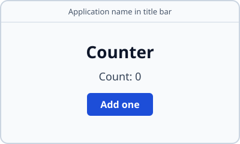
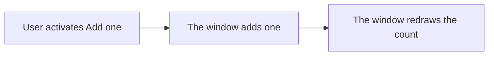
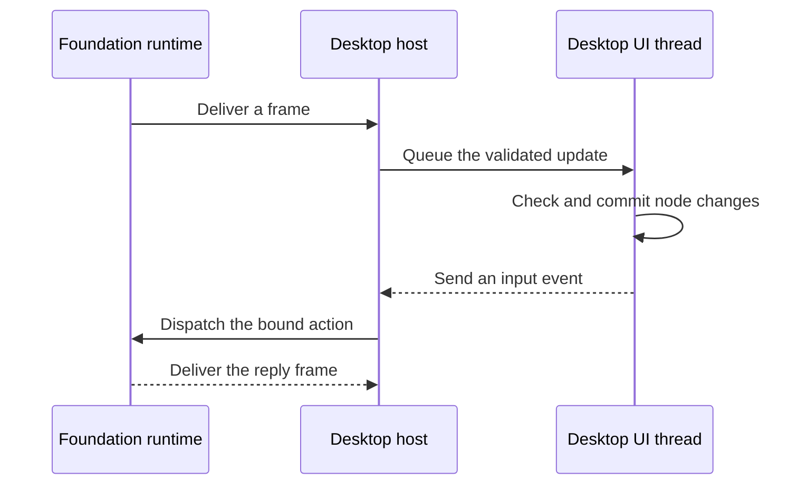
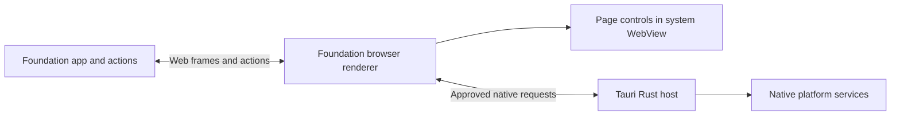

# Evaluate the Foundation UI desktop backend

## Goal

Use Tauri with the Foundation browser renderer for the first product desktop path.
Use direct upstream Zed GPUI for the second desktop path. Require platform evidence before starting a Native mount prototype.

| Term | Meaning |
| --- | --- |
| Accessibility bridge | Code that sends control roles, names, states and actions to the operating system. |
| AccessKit | A library that carries accessibility data to platform services. |
| Base | The unstyled control behavior and infrastructure in `gpui-base`. |
| Kit | Longbridge GPUI Kit and its selectable layers. |
| Input method editor (IME) | An operating system service that composes text from input. |
| Continuous integration (CI) | The service that builds and tests repository changes. |
| Desktop session | A real or virtual login that can open and interact with windows. |
| WebView | An operating system browser control that runs web content inside an application window. |
| WebAssembly (Wasm) | A portable binary format that a browser or a separate runtime can execute. |
| Inter-process communication (IPC) | Messages between the WebView and the Rust host. |
| Content Security Policy (CSP) | Rules that restrict the content and scripts a document can load or run. |
| Root | The top-level Foundation view in a desktop window. |

## Story

| Story | Actor | Trigger | Result |
| --- | --- | --- | --- |
| S1 | Owner | Selects a candidate after Specification 69 closes | A single renderer enters the prototype with a known scope and estimate. |
| S2 | Application user | Opens the desktop example and uses its controls | The same named views and actions work on each target. |
| S3 | Maintainer | Finds a required platform or release failure | The decision records the failed check and the fallback for owner review. |
| S4 | Maintainer | Runs the upstream GPUI counter after approval | The window displays and updates the counter. |

## Bounded context

| Entity | Owner | Operation |
| --- | --- | --- |
| Renderer decision and gate evidence | Specification 92 | Compare, validate and record results. |
| Window, focus, paint and input callbacks | Selected platform renderer | Open, update and close a native window. |
| Node tree, names and binding state | Foundation desktop host | Apply validated operations and resolve input to a binding. |
| Frame format, negotiation and actions | Foundation UI runtime and wire crates | Validate, negotiate and dispatch. |
| Mobile renderers and WebView control | Specification 69 | Continue under their approved plans. |
| Counter state | The standalone GPUI example window | Start at zero and increment on click. |
| Existing desktop WebView shell | Specification 52 | Supply Tauri window, route, asset and capability services for the web-backed option. |

## Rules

- I1. The Foundation model owns node identity, action binding and signed state.
- I2. The renderer applies updates on its UI thread in the order of their accepted frames.
- I3. The host negotiates only a desktop contract it can apply and reports unsupported operations as errors.
- I4. The desktop renderer dependency and platform libraries remain in the desktop build.
- I5. The owner approves a refreshed plan after Specification 69 closes and before Native mount prototype code starts.
- I6. The host removes focus, subscriptions and callbacks when the owning window closes.
- I7. For a Web mount, the Rust host grants native capabilities only to the approved local application context.
- I8. The upstream GPUI example builds in its own Cargo workspace from pinned sources.
- I9. Each window owns its counter. Closing and opening the example starts at zero.

The update operation preserves names and parent links across a rejected frame. Closing a window removes its sender and drops later work for that window. Foundation owns each binding through the life of its node. A different incarnation receives its own render identity.

## Acceptance scenarios

| Scenario | Given | When | Then |
| --- | --- | --- | --- |
| A1. Update a named view | The example has a named list and an active window | A valid frame inserts a row and changes its text | The expected row and text appear in the same list once. |
| A2. Use an action | A text field and button have bindings | The user composes text and presses the button | The action receives the committed value and the reply updates the receiving view. |
| A3. Reject an invalid update | The window has a valid tree | A frame names a missing parent | The host returns a typed error and preserves the previous tree. |
| A4. Close while work waits | A window owns a pending reply | The user closes it before the reply arrives | The host drops the late update and the event loop stays responsive. |
| A5. Block candidate adoption | The release package cannot start in a required desktop session | The maintainer records the failure | The gate stays open and the owner receives the failed case and fallback. |
| A6. Observe accessibility | A dialog has a title, an input and a close button | A keyboard and screen reader user opens and closes it | The user hears the control names, can reach each control and returns to the opening control. |
| A7. Install the web-backed host offline | A clean target has the required offline package and no network | The user installs and starts the example, then invokes a local action | The packaged assets load and the local action applies its reply. |
| A8. Restrict a native capability | The local app can request the approved service | A WebView with an untrusted origin requests that service | The host rejects the request and the service state stays unchanged. |
| A9. Run the upstream GPUI example | The host has the documented tools and system libraries | The maintainer builds and launches the example | The window displays “Counter”, “Count: 0” and “Add one”. |
| A10. Apply a local action | The counter starts at zero | The user clicks Add one twice, then closes and reopens the window | The count displays 1, then 2. The new window displays 0. |
| A11. Report a launch failure | The platform cannot open a window | The maintainer starts the example | The process reports an error and returns a failure status. |

## Technical breakdown

### Standalone upstream GPUI example

The owner approves the revised scope and references before example implementation starts.
Feature 02 records the existing Tauri Todo experiment. [Feature 03](../03-desktop-generator/feature.md) owns the generator.
Read the [GPUI counter walkthrough](../../gpui-counter-walkthrough.md) to build the example and follow its code.

- Add `examples/gpui` as a standalone Cargo workspace with a committed lockfile.
- Use `gpui` and `gpui_platform` from the official Zed revision below. Use public Git URLs in the manifest.
- Use a named GPUI element and click handler. Give the button the name `add-one`.
- Expose the button role, label and action. Check keyboard activation and focus.
- Put the count in the window entity. Increment and request redraw on each activation.
- Use the shared counter layout. The window title identifies Zed GPUI.
- Document commands, prerequisites and verified hosts. Keep GPUI dependencies out of the generator executable.
- Capture the running window and record any missing platform coverage.

The window shows the title, count and action in one column.

The count belongs to the current window.

| Failure | Result | State |
| --- | --- | --- |
| Cargo cannot resolve a pinned source | Cargo reports the dependency error. | No window opens. |
| The host cannot open the window | The process reports the platform error and fails. | No counter state persists. |

### macOS counter result

The example builds on Apple silicon with macOS 27.2.1 (26B131).
The check uses Rust 1.100.0-nightly from the repository's 2026-09-20 toolchain and its LLVM `uat` profile.
The repository uses Cranelift for normal development. Use the LLVM `uat` profile from the start for native code.
The upstream macOS constructor uses assembly symbol operands and requires this profile in the repository environment.

| Check | Result |
| --- | --- |
| A9. Resolve and build | The locked macOS graph selects `gpui` 0.2.2 and `gpui_platform` 0.1.0 at the official Zed revision. |
| A9. Launch | The window draws its title, heading, zero count and named button. |
| A10. Activate | The accessibility action changes zero to one. A pointer click changes one to two. |
| A10. Use the keyboard | Tab shows the button focus border. Enter and Space each add one. |
| A10. Close and reopen | A new window starts at zero. |
| A11. Startup error | The example reports the window error and exits with failure. The macOS check does not induce this error. |
| Accessibility | The macOS accessibility tree exposes the heading, count and button. It reports window focus during this keyboard check. |
| Remaining coverage | VoiceOver, Windows, Linux and packaged installation remain open. |

[Captured macOS window](screenshots/gpui-counter-macos.jpg)

### Source evidence

The review uses local source, manifests and the linked Tauri version 2 documentation.
The GPUI Kit, GPUI Fast and Iced findings below are historical research. They provide context for the current decision. Platform support below describes source paths and candidate release graphs. See Feature 02 for the measured macOS Tauri result. See the macOS counter result for the upstream GPUI example.

| Checkout | Revision and useful locations |
| --- | --- |
| Ewe `resume/combined` | `02bd32ef0b980c36e26e30c70f281aabc0f49c78`. See `backends/foundation_ui_native/src/{core,host,sink,resources}.rs` and `backends/foundation_ui_wire/schema/{common,ops,hello}.fbs`. |
| `/Volumes/Outside/GitSources/src.Rust/src.gpui/gpui-kit` | `b7b66f5a1613b4d237f4909228d30a1d28bd8759`. See `Cargo.toml`, `Cargo.lock`, `crates/{kit,base,component,assets,webview,shell}/Cargo.toml`, `crates/base/src` and `crates/component/src`. |
| Sibling `gpui-fast` | `79e15aa26a71a1ce32cca3ddc8a06981d0a65a72`. See `UPSTREAM`, `Cargo.toml`, `crates/gpui_platform/Cargo.toml`, `crates/gpui/src/window.rs`, `docs/releasing.md` and `release.toml`. |
| Official upstream Zed | [Revision `46375fbf64574f01dc08fd2d2998aa7bbb7f0377`](https://github.com/zed-industries/zed/commit/46375fbf64574f01dc08fd2d2998aa7bbb7f0377). See `crates/gpui`, `crates/gpui_platform` and the platform crates. |
| Tauri registry source in the local Cargo cache | Ewe's root lockfile at `ff8dcea530eef6c3261d7155be0b08495531805d` resolves Tauri `2.11.6`, Tauri Runtime Wry `2.11.4`, Wry `0.55.1` and Tao `0.35.3`. The Android example's lockfile resolves Tauri `2.11.5`. Review the root lock and staged packages for desktop. |
| Sibling `gpui` | `8d31300b294f6acc0c5809888bd2ff29e0bb7648`. The checkout contains a redirect README and has no Cargo manifest. |
| `/Volumes/Outside/GitSources/src.Rust/src.iced/iced` | `98bd48fe011efc0ec5819fee0fa7673a7169ff11` (`0.15.0-dev`). The local `0.14.0` release tag identifies `3997291f318a8bc06fa522f5579836fb3feb94df`. |

`gpui-fast/UPSTREAM` names Zed commit `f126950f9d3b62666f97437ae5d4ccac2272c4db` and fork import `9d120903587a1359c2fe1262c84d165be9dd5ddf`. Kit's release job records the Zed revision for each snapshot. The reviewed Kit lockfile identifies registry packages. It does not establish which Zed commit produced snapshot `0.3.14`.

### Current Foundation boundary

The wire enum already has `Platform::Desktop`. `NativePlatform` in `foundation_ui_native/src/core.rs` currently exposes iOS and Android. The native core already constructs the action manager, negotiates local service capabilities, publishes frames and receives events. `host.rs` supplies `FrameListener`, `EventInput` and host transport interfaces.

The node stores and frame appliers live in the platform hosts. See `mobile/ios/Sources/EweUI/NodeStore.swift` and `mobile/android/core/src/main/kotlin/ewe/ui/runtime/FrameApplier.kt`. The existing graphics handoff and mobile commands do not provide a desktop widget renderer.

The current `ClientCaps` declares platform, mount surface and vocabulary version. It has no per-control flags.
Use `Desktop` and `Native` when the desktop contract is ready.
Reject unsupported operations explicitly and document any negotiation change in the implementation plan.
See `backends/foundation_ui_wire/src/writer/config.rs` and `schema/hello.fbs`. Use the shared core and contract. Keep the desktop window, node store and backend-specific objects in a desktop Rust host.

### Historical engine and platform comparison

| Criterion | Zed GPUI and GPUI Fast | Iced |
| --- | --- | --- |
| Window and graphics | GPUI has AppKit and Metal for macOS, Direct3D and DirectWrite for Windows, and wgpu for X11 and Wayland. See the Zed and Fast manifests under `crates/gpui_{macos,windows,linux}`. Fast adds retained layers and native surface composition. | Iced has a winit window shell and wgpu graphics. The development checkout includes a Vello CPU renderer. Release tag `0.14.0` includes a tiny-skia software renderer. See the root manifests and `renderer/src/lib.rs`. |
| Platform test evidence | Kit and Fast declare macOS, Windows and Linux jobs in `.github/workflows/ci.yml`. The jobs supply compile and library test coverage. Session parity and the selected Foundation artifact need their own checks. | `.github/workflows/test.yml` declares all three operating systems with the Vello CPU test backend. `build.yml` builds the todos example. Those jobs provide a release reference. Interactive graphics, text and accessibility checks remain separate. |
| Text input | Zed and Fast expose the platform text input handler. Zed source shows macOS marked text, Windows composition, X11 input methods and the Wayland text-input path. Base implements marked text, committed text and selection in `crates/base/src/input/base/state.rs`. | The winit conversion and window code handle composition updates, commit and candidate window geometry. Text input and editor widgets consume those events. See `winit/src/{conversion,window}.rs` and `widget/src/{text_input,text_editor}.rs`. The development editor handles preedit and commit in `core/src/text/editor.rs`. |
| Accessibility | Both engines have AccessKit tree and platform adapters in `crates/gpui/src/window/a11y.rs`, the macOS and Windows window code and the X11 and Wayland window code. Base gives input, button and dialog control semantics. Confirm the selected snapshot exports the same hooks and services in the packaged host. | Searches of Rust source and manifests in both revisions found no AccessKit integration or equivalent widget-to-platform accessibility bridge. Keyboard support and focus commands exist. A supported accessibility bridge or a verified upstream release is necessary for the screen-reader gate. |
| Stock controls | Bare GPUI provides layout, painting, hit testing, focus, text and input hooks. Base adds editing, control semantics and interaction. Styled Component and Assets add a visual catalog. | `widget/src` supplies buttons, toggles, text input, editors, scroll areas, lists with selection, popovers and keyed columns. Foundation must supply modal focus, accessible roles and actions, and the mappings for its own node vocabulary. |
| Frame and action model | Apply Foundation updates on the window thread and invalidate affected GPUI entities. Keep control state with each live Foundation node. Route callbacks to the instance's binding. | Receive each Foundation frame as a message through a subscription. Apply it in `update` and build the view from the committed tree. Use keyed containers and operation identifiers to retain widget state. See `src/{application,daemon}.rs` and `widget/src/keyed/column.rs`. |
| Release graph | The Zed workspace sets `publish = false`. Use the matching registry snapshots for the first prototype. GPUI Fast has its own registry release graph and source substitutions. | The development checkout uses registry wgpu 30 and a revision of the Iced winit fork. The local `0.14.0` tag uses registry winit 0.30 and wgpu 27. Using its graphics default would add a wgpu major version to Ewe. Confirm resolution and the software backend option before pricing a release integration. Iced declares the MIT license. |

A successful window launch proves the shell and graphics path. A usable control also needs keyboard behavior, composition, an accessible role and action dispatch.
Both model styles can preserve Foundation frame order and identity. Neither style removes the work in the Foundation node store and adapter.
For Iced, a bridge would need to publish tree updates, carry stable control identifiers and send assistive actions back to widget state.
It would also need platform glue for focus and editable text. The prototype decision does not assume that bridge exists.

### Tauri with the Foundation browser renderer

Tauri can deliver the same application in a desktop window with the existing browser renderer.
Tauri supplies the native window and platform services. The system WebView renders the page and its controls.
The host uses `foundation_platform` for window management, asset routes and access to native services.
The browser uses `foundation_wasm_ui` for frame application and action dispatch.
See `backends/foundation_platform/src/{builder,ewe}.rs` and `backends/foundation_wasm_ui/runtimes/foundation-ui-{frames,actions,behaviours}.js`.

| Area | Reuse and remaining work |
| --- | --- |
| Frame and action model | Use browser frames in the Web mount and the existing `ClientCaps::web_current()` path. Keep the Foundation action and service contract. Use browser state and element identity for presentation. Prove rejected frames preserve the prior tree. Check that updates preserve text composition and late replies cannot restore a closed window. A Desktop platform tag with a Web mount needs separate negotiation proof if selected. |
| Native shell | Reuse the window and session services in `PlatformBuilder`. Tauri can supply menus, dialogs, window actions and selected platform services through the Rust host or plugins. The plan must name the services that the example needs. A native file dialog does not change how the WebView renders the page controls. [Tauri architecture](https://v2.tauri.app/concept/architecture/) |
| IPC and security | Keep state changes and sensitive operations in the Rust core. Reuse the existing capability and IPC interfaces only where required. Limit privileged commands to trusted local windows and origins. Apply a CSP that permits the bundled renderer and the required Wasm paths. Validate route, origin, sender and payload in the host. Check custom protocol origin behavior on all three engines. Prove untrusted navigation cannot retain privileged command access. [Tauri process model](https://v2.tauri.app/concept/process-model/) · [Tauri capabilities](https://v2.tauri.app/security/capabilities/) · [Tauri CSP](https://v2.tauri.app/security/csp/) |
| Standard controls and accessibility | Browser controls and correctly labeled custom elements can use the WebView accessibility tree. The browser runtime also has dialog behavior. Verify role, name, value, focus order and assistive activation in the installed shell. Check that tree updates and modal close preserve focus. A canvas needs separate accessible controls when it carries interactive content. [Microsoft WebView2 API overview](https://learn.microsoft.com/en-us/microsoft-edge/webview2/concepts/overview-features-apis) |
| Input method | The WebView handles editable text and composition. Foundation still controls when a change or submit event becomes an action. Check composition commit, cancel, candidate placement, selection and clipboard. Move a named input during composition and verify that frame updates do not replace its live edit state. |
| Wasm and graphics | The basic web controls use the document object model (DOM) and need no WebGPU. Test actual bundled Wasm loading, headers and origin on each packaged engine. Confirm thread or shared-memory support if the application needs it. The Foundation graphics bridge requires a secure context, a WebGPU adapter and the required device features. Test each on the minimum runtime before declaring graphics support. The standard-control estimate excludes graphics widgets. [Foundation graphics bridge](../../../../backends/foundation_ui_gpu/README.md) · [WebKit WebGPU release notes](https://webkit.org/blog/17333/webkit-features-in-safari-26-0/) |
| Maintenance | Reuse the browser renderer and its fixtures. Maintain three WebView runtime baselines, release assets, the IPC boundary and the signing and update flow. Record engine versions with failing tests. The Rust lockfile fixes wrapper versions. System WebViews can change independently. [Tauri WebView versions](https://v2.tauri.app/reference/webview-versions/) |

| Target | Runtime and distribution gate |
| --- | --- |
| Windows | WebView2 uses Chromium. The normal installer can download the runtime. For disconnected installation, stage an offline installer or fixed runtime and test on a clean offline guest. Track runtime security updates if Ewe distributes a fixed runtime. Test the signed installer, WebView start, graphics probe and Narrator. [Tauri Windows installer](https://v2.tauri.app/distribute/windows-installer/) |
| macOS | WKWebView follows the operating system WebKit. Set a minimum macOS version and test it as well as a current release. Sign and notarize a direct-download package. Test VoiceOver and the packaged application origin. A Safari feature announcement alone gives no proof for the selected WKWebView host. [Tauri WebView versions](https://v2.tauri.app/reference/webview-versions/) · [Tauri distribution](https://v2.tauri.app/distribute/) |
| Linux | WebKitGTK support follows the distribution and its packages. The cached Tauri Runtime Wry source uses GTK container construction for ordinary Linux WebViews. Wry documents the GTK route for X11 and Wayland. Test both sessions with Orca on the selected minimum distribution. Verify WebKitGTK runtime dependencies in the chosen package format. Test the full offline install on a clean guest. [Tauri prerequisites](https://v2.tauri.app/start/prerequisites/) · [Tauri AppImage packaging](https://v2.tauri.app/distribute/appimage/) |

Bundle application scripts, Wasm, fonts, icons and seed resources locally. Confirm the example launches and its local action works with the network disabled.
Record which service actions require connectivity. Offline app packaging and offline server behavior have separate acceptance checks.
The existing Android example config shows bundled resources and an `ewe` start route. It supplies no desktop package result.
Use [Specification 91](../../../91-windows-resource-staging/requirements.md) for the Windows resource staging check.
If the distribution uses Tauri's updater, sign and verify update artifacts. Prove upgrade and refusal of an invalid update.
Use a versioned installer or staged package for disconnected updates. [Tauri updater](https://v2.tauri.app/plugin/updater/)

### Historical GPUI and Kit control review

| Area | GPUI or Kit supplies | Foundation must supply or verify |
| --- | --- | --- |
| Windows, layouts and graphics | GPUI platform application, window, element layout, paint and focus. The fork adds retained rendering and optional native surface composition. | Window ownership, capability negotiation, root view, scaling and image resource mapping. Prove graphics surface lifecycle separately. |
| Basic controls | Base provides button, checkbox, switch, radio, slider, toggle and labeled control behavior. Component adds styled versions. | Map Foundation node kinds and typed properties. Translate enabled, hidden, selected and disabled states. |
| Text and editing | Base has input, selection, undo and history. Component adds input and higher-level editor behavior. | Connect focus, composition and editor value to Foundation event semantics. Check IME, selection, clipboard and Unicode on each platform. |
| Lists and overlays | Base has virtual lists, tables, select, tabs, dialog, focus trap, tooltip, popover and toast. Component adds styled variants, lists, native menu helpers and notifications. | Route by declared names and receiving views. Preserve keyed identity, modal focus, overlay order and scroll state after updates. Distinguish in-app notices from system notifications. |
| Accessibility | Zed GPUI and GPUI Fast have AccessKit integration in their window and platform crates. Base supplies roles, names, states and actions. | Map Foundation accessible names and states. Verify screen-reader output on each platform and modal focus restoration. |
| Foundation state and updates | GPUI provides entity state, event callbacks and a local executor. | Apply the Foundation operations, preserve binding and signed-state semantics, dispatch actions and route replies in sequence. GPUI entity state is a presentation cache. |
| Embedded surfaces and native commands | The optional Kit WebView wrapper uses Wry. GPUI Fast has lower-level composition interfaces. | Evaluate the existing Specification 69 WebView contract separately. Add desktop capability mappings only after there is proof for each operation. |
| Packaging | Kit includes examples and a separate script shell with bundling code. | Use Ewe's application resource, signing and release tasks. The Kit shell adds a script runtime with its own policy and distribution path. |

Kit WebView requires X11 or XWayland for WebKitGTK. Its README describes unsupported overlay and clipping cases on `gpui-pre` and an overlay limit on Windows. GPUI Fast has broader lower-level composition claims. Those claims do not prove that the Kit wrapper exposes each path. See `gpui-kit/crates/webview/README.md` and `gpui-fast/README.md`.

### Historical Native mount node mapping notes

Use the vocabulary from `backends/foundation_ui_wire/schema/common.fbs` and the shared operations in `schema/ops.fbs`.

| Foundation nodes | Proposed desktop mapping |
| --- | --- |
| `STACK`, `TEXT`, `IMAGE`, `SPACER`, `SCROLL` | GPUI layout, text, image and scroll elements. Resolve image resources through the Foundation host. |
| `BUTTON`, `TOOLBAR_BUTTON`, `DESTRUCTIVE_BUTTON`, `SUBMIT_BUTTON`, `CANCEL_BUTTON` | One button behavior with Foundation roles and style variants. |
| `TEXT_INPUT`, `SEARCH_INPUT`, `TOGGLE`, `SEGMENTED_CONTROL` | Base input, switch and grouped toggle. Bind Foundation change, submit and focus events. |
| `LIST`, `INSET_LIST`, `CHECKLIST_ROW`, `CHECKMARK_BUTTON`, `LIST_FOOTER` | GPUI collections and Base selection controls. Add virtualization when the example shows a need. |
| `OVERLAY`, `MODAL`, `CONFIRMATION_DIALOG`, `BOTTOM_SHEET`, `SHEET_TITLE`, `NAVIGATION_TITLE` | Map the Foundation presentation role to window chrome or the overlay and dialog helpers. Define desktop sheet layout and keyboard behavior in the approved plan. |
| `DRAWING_SURFACE` | Needs a separate graphics handoff and lifecycle check. Keep it outside the standard-control prototype. |

### Historical dependency and release review

| Item | Evidence and effect |
| --- | --- |
| Kit feature selection | Kit `0.11.0` defaults to `gpui-pre`, `component`, `assets`, `x11` and `web-threads`. Default-off selection can retain Base behavior and omit the styled catalog. The styled catalog itself depends on assets. |
| Engine versions | Kit pins `gpui-pre` and its platform and macro crates at `=0.3.14`. It offers `gpui-fast` and platform crates with a `0.1.19` range. The Kit lock resolves GPUI Fast to `0.1.19`. |
| Engine ownership | Select one GPUI core for renderer and controls. Verify feature unification and type identity through `cargo tree`. GPUI Fast's registry core still references auxiliary `gpui-pre-*` packages. |
| Upgrade | Kit's `script/check-gpui-pin.ts` documents a snapshot update that broke a published Kit. Keep Kit, platform and engine versions together. Run the desktop conformance cases on each change. |
| Source fork | GPUI Fast source uses Git revisions for graphics, fonts and transport packages. Its root patches also include a branch-only calloop reference. Cargo workspace root patches need explicit review in an Ewe integration. |
| Registry fork | GPUI Fast release scripts rename and package sibling crates. They substitute registry wgpu for the Git revision and adapt code. The release notes identify a Vulkan surface-drop fix absent from that adaptation. |
| Shared versions | Ewe uses registry wgpu `30.0.2`. The fork's registry adaptation accepts wgpu `30.0.1` and compatible versions. The source Git wgpu is a different package source. Review wgpu, Windows bindings, fonts and async crates after resolution. |
| Rust | Ewe declares Rust `1.98`, pins dev to `nightly-2026-09-20`, and sets release to `1.98.0`. GPUI Fast source pins `1.98.1`. Test the selected package on Ewe release Rust and the dev pin. |
| Native toolchain | Kit CI builds Windows with the Microsoft Visual C++ (MSVC) target. Verify the desktop target with the Windows software development kit and resource tools. Ewe's existing GNU development target does not establish compatibility. The GPUI Fast Windows source uses DirectX and DirectWrite. |
| macOS | GPUI uses AppKit and Metal. Select shader build mode deliberately. Test the supported macOS build target and complete the existing signing and packaging flow. |
| Linux | GPUI Fast selects X11 and Wayland by features. Its Linux graphics path uses wgpu. Kit's install script lists compiler, Fontconfig, Wayland, X11 keyboard libraries and Vulkan packages. The full kit script also installs WebKitGTK and audio libraries. Derive the actual build and runtime package list from the selected features. |
| Web assets | Disable browser threads for the desktop graph. Kit's browser-thread feature requires nightly for WebAssembly builds. The first desktop prototype needs neither browser output nor speech, syntax engines, charting or script tooling. |
| Distribution | Prefer registry releases for a package that Ewe publishes. A local path cannot ship as an external dependency. Verify the selected graph with `cargo package`, then install and launch packages on clean desktop systems. |
| License and assets | Kit software, GPUI crates and the fork declare Apache-2.0. Kit has a separate documentation license statement. Keep Apache license text and upstream notices. If using default icons, record `crates/assets/LICENSE-LUCIDE`. Audit all resolved platform and asset licenses before distribution. |

### Decision and dependency scope

Use Tauri first for product desktop delivery. Use the [Tauri Todo check](../02-tauri-todo-check/feature.md) as initial evidence.
Offer direct upstream Zed GPUI as the second desktop choice after its example and starter pass the gates.
Keep GPUI Kit as reference material for control behavior, accessibility and focus.
The example and generated GPUI project select upstream `gpui` and `gpui_platform` only as their GPUI entry packages.

- The upstream pin declares Rust `1.100.0`. Check the standalone graph on a supported stable Rust toolchain before generator release.
- Keep its toolchain requirements in the example and the generated desktop package. Check the current Ewe workspace toolchain separately.
- Use the same public Git revision for both entry packages. Record Cargo's resolved graph and any required root patches.
- Pin only the patches the graph needs. Use the upstream sources and revisions. Confirm the graph from a clean Cargo cache.
- Carry platform support through `gpui_platform`. Check macOS Metal, Windows Direct3D, and Linux X11 and Wayland.
- AccessKit hooks appear in the upstream window and platform source. The starter must provide accessible controls and test them.
- The upstream GPUI and platform manifests declare Apache-2.0. The editor repository also has GPL-3.0-or-later components.
- Review license data for the resolved graph and all shipped assets. Include required license text and notices with distributed artifacts.

[Upstream GPUI license](https://github.com/zed-industries/zed/blob/46375fbf64574f01dc08fd2d2998aa7bbb7f0377/crates/gpui/LICENSE-APACHE) · [Zed license policy](https://github.com/zed-industries/zed/blob/46375fbf64574f01dc08fd2d2998aa7bbb7f0377/README.md#licensing)

### Future Foundation adapter flow

The native desktop host sends frame updates to the UI thread and sends bound input back to the runtime.

The web-backed host keeps page controls and native services on separate paths.

The host accepts validated frame bytes through a listener or shared runtime adapter. It carries frame order across the UI queue. It stages each node change against the current tree and commits after it validates the full update. It maps generated operation types to private desktop control state. It keeps public application calls on the existing contract.

The boundary needs one Foundation node store per window and one renderer view per active root. It translates platform input to the existing event and binding types. The UI thread never waits for the action transport. Application updates address declared names. Only renderer internals allocate numeric handles. Reuse the project context for resources and side effects. Any queue limit uses configuration and the approved runtime backpressure policy. The implementation plan must specify exact queue limits after it selects the runtime path.

| Failure | Host action | Result and state |
| --- | --- | --- |
| Reader rejects a frame | Return the validation error. | The prior tree and bindings remain active. |
| Operation validation fails | Discard the staged update. | A typed error identifies the failing operation. The earlier valid tree remains. |
| Window closes while work waits | Detach delivery and release presentation state. | Late results cannot recreate the window. |
| Candidate cannot start or package | Record platform, package, revision and failure. | The owner keeps the decision open. No production dependency enters the workspace. |

### Historical full renderer estimates

These estimates describe the full renderer investigation. Feature 03 covers starter generation.
Estimates are engineering days for one engineer familiar with Foundation and Rust. All candidates use the same example, standard controls, focus and accessibility scenarios, and packaged desktop checks. Scope excludes embedded web content, rich editing, full system menus and custom graphics surfaces.

| Phase | Zed snapshot with Base | Bare GPUI | Iced | Tauri with browser renderer |
| --- | --- | --- | --- | --- |
| Resolve features and run the window, text and accessibility prototype | 3–5 days | 3–5 days | 6–10 days | 3–5 days |
| Implement the Foundation node, resource, frame and action adapter | 7–12 days | 7–12 days | 7–12 days | 3–6 days |
| Complete standard controls, composition, focus and accessibility | 7–12 days | 16–28 days | 15–30 days | 4–8 days |
| Package, install and integrate platform tests | 5–9 days | 5–9 days | 6–10 days | 6–11 days |
| Total | 22–38 days | 31–54 days | 34–62 days | 16–30 days |

Bare GPUI includes in-house single-line editing, selection and dialog behavior. Iced includes a provisional allowance for an accessibility bridge. The Iced range assumes the adapter can use existing platform hooks. Re-estimate if that work requires a maintained toolkit fork. The earlier review estimated 43–83 days for a native-control adapter. Carry snapshot updates, fork synchronization and platform regressions as ongoing maintenance.
Tauri assumes the existing browser controls meet the scenarios with limited changes. Its cost includes a restricted IPC bridge, clean offline install and one signed update or installer upgrade path.
The Tauri estimate covers the same user-facing scenarios on a Web mount. It provides no estimate for a new Native mount renderer.

## Tests

| Rule and scenario | Check | Oracle |
| --- | --- | --- |
| I1 and A1 | Apply insert, append, move, replace, remove and property updates to named nodes. | Shared fixture expects the complete tree, action bindings and view identity. |
| I1 and A2 | Enter text using keyboard and IME. Trigger a local action and a service reply. | The recorded Foundation event contains the committed value. The expected update appears once. |
| I2 and A3 | Apply ordered frames, then inject an invalid operation. | The valid frames remain in order. The error appears and the prior tree is identical. |
| I3 and A5 | Send an unsupported operation and reproduce a failed package start. | The host reports an operation error. The release decision stays open. |
| I4 and A5 | Inspect dependency graphs and install release artifacts on clean systems. | Only the desktop target brings in the selected renderer. Each desktop artifact starts with its declared dependencies. |
| I5 | Review the implementation handoff and plan history. | Specification 69 is closed and the owner approval covers the updated plan. |
| I6 and A4 | Close while an action or subscription can still deliver. | The closed window receives zero updates. Other windows continue. |
| A6 | Run keyboard and screen-reader checks on each platform. | Focus order, dialog role, title, control roles, names and restored focus match the fixture. |
| A7 | Run the installer, launch and exercise a local action with networking disabled. | No asset request uses the network. The local reply appears once. |
| I8 and A9 | Check the locked graph and launch the GPUI window. | Cargo resolves the specified sources and the window shows the reference controls. |
| I9 and A10 | Activate twice, close and relaunch the GPUI window. | The count shows 1, 2 and then 0. |
| A11 | Review the window error path and observe a launch failure where the host permits it. | The startup error reaches the process owner and the process fails. |
| I7 and A8 | Invoke the approved service from the trusted local page and an untrusted origin. | The local request succeeds. The untrusted request has no native side effect. |

Use desktop tests under the owning crate's `tests/` directory. Run the same minimal example on macOS, Windows and Linux. Linux coverage includes X11 and Wayland. Record the input method, desktop environment, screen reader and display scale.
Test VoiceOver on macOS, Narrator on Windows and Orca on both Linux sessions.
Check composition commit and cancellation. Move a named control during composition and verify its identity and text state.
Check focus restoration and assistive activation after a modal closes.
Install each artifact on a clean target and check that its resource and platform dependencies resolve. For Tauri, use the same application actions and match expected outcomes across the Native and Web vocabularies. Send each host its own frame vocabulary.
Add packaged offline launch, origin and command permission tests. Record the WebView version and package format for every result.
Preserve startup, repaint and scroll measurements across candidate revisions. Record hardware and build profile with those measurements.

## Verify

- Today, run `git diff --check` and verify referenced local paths and Markdown links.
- Run `cargo fmt --manifest-path examples/gpui/Cargo.toml -- --check`.
- Run `cargo tree --locked --manifest-path examples/gpui/Cargo.toml`.
- Run `cargo test --locked --profile uat --manifest-path examples/gpui/Cargo.toml`.
- Run `cargo run --locked --profile uat --manifest-path examples/gpui/Cargo.toml`.
- On the available desktop session, run A9 and A10. Save a screenshot of the GPUI window and record the platform.
- For the future Foundation prototype, run `cargo tree --locked -p foundation_ui_desktop -e features` and `cargo tree --locked -p foundation_ui_desktop -d` once the proposed crate exists.
- Run `cargo test --locked -p foundation_ui_desktop --profile uat` on each target operating system.
- Run `cargo package --locked -p foundation_ui_desktop` when the crate enters the package plan.
- Launch the same packaged example in desktop sessions. Record results for the acceptance cases above in the refreshed plan.
- Use existing CI package selection and queue limits. Run the full platform release checks before merging to master.

## Done when

- The owner approves the standalone example plan and reference. The upstream GPUI example builds and launches.
- The owner reviews this decision, source evidence, estimates and the candidate comparison.
- Specification 69 closes before the owner approves the updated implementation plan and reference screenshots.
- A candidate passes the same example, packaging and input checks on all three desktop platforms before adoption.
- The selected dependency graph has one engine, a reproducible release source and an approved notice inventory.
- The implementation plan records every unsupported capability and assigns it to its owning specification.
