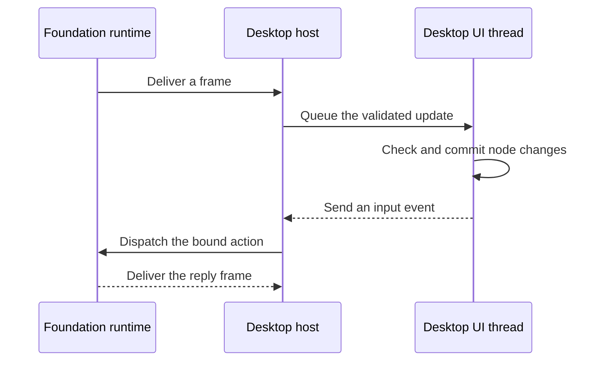

# Evaluate the Foundation UI desktop backend

## Goal

Choose a renderer for the Foundation desktop host and record what the host must implement. Use source evidence to choose the first prototype. Require platform evidence before production adoption.

| Term | Meaning |
| --- | --- |
| Base | The unstyled control behavior and infrastructure in `gpui-base`. |
| Kit | Longbridge GPUI Kit and its selectable layers. |
| Input method editor (IME) | An operating system service that composes text from input. |
| Continuous integration (CI) | The service that builds and tests repository changes. |
| Desktop session | A real or virtual login that can open and interact with windows. |
| Root | The top-level Foundation view in a desktop window. |

## Story

| Story | Actor | Trigger | Result |
| --- | --- | --- | --- |
| S1 | Owner | Selects a candidate after Specification 69 closes | A single renderer enters the prototype with a known scope and estimate. |
| S2 | Application user | Opens the desktop example and uses its controls | The same named views and actions work on each target. |
| S3 | Maintainer | Finds a required platform or release failure | The decision records the failed check and the fallback for owner review. |

## Bounded context

| Entity | Owner | Operation |
| --- | --- | --- |
| Renderer decision and gate evidence | Specification 92 | Compare, validate and record results. |
| Window, focus, paint and input callbacks | Selected platform renderer | Open, update and close a native window. |
| Node tree, names and binding state | Foundation desktop host | Apply validated operations and resolve input to a binding. |
| Frame format, negotiation and actions | Foundation UI runtime and wire crates | Validate, negotiate and dispatch. |
| Mobile renderers and WebView control | Specification 69 | Continue under their approved plans. |
| Existing desktop WebView shell | Specification 52 | Continue under its existing contract. |

## Rules

- I1. The Foundation model owns node identity, action binding and signed state.
- I2. The renderer applies updates on its UI thread in the order of their accepted frames.
- I3. The host negotiates only a desktop contract it can apply and reports unsupported operations as errors.
- I4. The desktop renderer dependency and platform libraries remain in the desktop build.
- I5. The owner approves a refreshed plan after Specification 69 closes and before prototype code starts.
- I6. The host removes focus, subscriptions and callbacks when the owning window closes.

The update operation preserves names and parent links across a rejected frame. Closing a window removes its sender and drops later work for that window. Foundation owns each binding through the life of its node. A different incarnation receives its own render identity.

## Acceptance scenarios

| Scenario | Given | When | Then |
| --- | --- | --- | --- |
| A1. Update a named view | The example has a named list and an active window | A valid frame inserts a row and changes its text | The expected row and text appear in the same list once. |
| A2. Use an action | A text field and button have bindings | The user composes text and presses the button | The action receives the committed value and the reply updates the receiving view. |
| A3. Reject an invalid update | The window has a valid tree | A frame names a missing parent | The host returns a typed error and preserves the previous tree. |
| A4. Close while work waits | A window owns a pending reply | The user closes it before the reply arrives | The host drops the late update and the event loop stays responsive. |
| A5. Block candidate adoption | The release package cannot start in a required desktop session | The maintainer records the failure | The gate stays open and the owner receives the failed case and fallback. |
| A6. Observe accessibility | A dialog has a title, an input and a close button | A keyboard and screen reader user opens and closes it | The user hears the control names, can reach each control and returns to the opening control. |

## Technical breakdown

### Source evidence

The source review uses local checkouts. It verifies paths and declared dependencies. It does not measure performance or verify a platform build.

| Checkout | Revision and useful locations |
| --- | --- |
| Ewe `resume/combined` | `4ecc48a908715358169570a369583f4198e1753b`. See `backends/foundation_ui_native/src/{core,host,sink,resources}.rs` and `backends/foundation_ui_wire/schema/{common,ops,hello}.fbs`. |
| `/Volumes/Outside/GitSources/src.Rust/src.gpui/gpui-kit` | `b7b66f5a1613b4d237f4909228d30a1d28bd8759`. See `Cargo.toml`, `Cargo.lock`, `crates/{kit,base,component,assets,webview,shell}/Cargo.toml`, `crates/base/src` and `crates/component/src`. |
| Sibling `gpui-fast` | `79e15aa26a71a1ce32cca3ddc8a06981d0a65a72`. See `UPSTREAM`, `Cargo.toml`, `crates/gpui_platform/Cargo.toml`, `crates/gpui/src/window.rs`, `docs/releasing.md` and `release.toml`. |
| Sibling `zed` | `46375fbf64574f01dc08fd2d2998aa7bbb7f0377`. See `crates/gpui`, `crates/gpui_platform` and the platform crates. It is a separate checkout from the fork's declared import. |
| Sibling `gpui` | `8d31300b294f6acc0c5809888bd2ff29e0bb7648`. The checkout contains a redirect README and has no Cargo manifest. |

`gpui-fast/UPSTREAM` names Zed commit `f126950f9d3b62666f97437ae5d4ccac2272c4db` and fork import `9d120903587a1359c2fe1262c84d165be9dd5ddf`. Kit's release job records the Zed revision for each snapshot. The reviewed Kit lockfile identifies registry packages. It does not establish which Zed commit produced snapshot `0.3.14`.

### Current Foundation boundary

The wire enum already has `Platform::Desktop`. `NativePlatform` in `foundation_ui_native/src/core.rs` currently exposes iOS and Android. The native core already constructs the action manager, negotiates local service capabilities, publishes frames and receives events. `host.rs` supplies `FrameListener`, `EventInput` and host transport interfaces.

The node stores and frame appliers live in the platform hosts. See `mobile/ios/Sources/EweUI/NodeStore.swift` and `mobile/android/core/src/main/kotlin/ewe/ui/runtime/FrameApplier.kt`. The existing graphics handoff and mobile commands do not provide a desktop widget renderer.

The current `ClientCaps` declares platform, mount surface and vocabulary version. It has no per-control flags.
Use `Desktop` and `Native` when the desktop contract is ready.
Reject unsupported operations explicitly and document any negotiation change in the implementation plan.
See `backends/foundation_ui_wire/src/writer/config.rs` and `schema/hello.fbs`. Use the shared core and contract. Keep the desktop window, node store and backend-specific objects in a desktop Rust host.

### Control and behavior coverage

| Area | GPUI or Kit supplies | Foundation must supply or verify |
| --- | --- | --- |
| Windows, layouts and graphics | GPUI platform application, window, element layout, paint and focus. The fork adds retained rendering and optional native surface composition. | Window ownership, capability negotiation, root view, scaling and image resource mapping. Prove graphics surface lifecycle separately. |
| Basic controls | Base provides button, checkbox, switch, radio, slider, toggle and labeled control behavior. Component adds styled versions. | Map Foundation node kinds and typed properties. Translate enabled, hidden, selected and disabled states. |
| Text and editing | Base has input, selection, undo and history. Component adds input and higher-level editor behavior. | Connect focus, composition and editor value to Foundation event semantics. Check IME, selection, clipboard and Unicode on each platform. |
| Lists and overlays | Base has virtual lists, tables, select, tabs, dialog, focus trap, tooltip, popover and toast. Component adds styled variants, lists, native menu helpers and notifications. | Route by declared names and receiving views. Preserve keyed identity, modal focus, overlay order and scroll state after updates. Distinguish in-app notices from system notifications. |
| Accessibility | GPUI Fast has AccessKit integration in the window and platform crates. Kit has roles, names, states, actions and integration tests. | Map Foundation accessible names and states. Verify screen-reader output on each platform and modal focus restoration. |
| Foundation state and updates | GPUI provides entity state, event callbacks and a local executor. | Apply the Foundation operations, preserve binding and signed-state semantics, dispatch actions and route replies in sequence. GPUI entity state is a presentation cache. |
| Embedded surfaces and native commands | The optional Kit WebView wrapper uses Wry. GPUI Fast has lower-level composition interfaces. | Evaluate the existing Specification 69 WebView contract separately. Add desktop capability mappings only after there is proof for each operation. |
| Packaging | Kit includes examples and a separate script shell with bundling code. | Use Ewe's application resource, signing and release tasks. The Kit shell adds a script runtime with its own policy and distribution path. |

Kit WebView requires X11 or XWayland for WebKitGTK. Its README describes unsupported overlay and clipping cases on `gpui-pre` and an overlay limit on Windows. GPUI Fast has broader lower-level composition claims. Those claims do not prove that the Kit wrapper exposes each path. See `gpui-kit/crates/webview/README.md` and `gpui-fast/README.md`.

### Initial node mappings

Use the vocabulary from `backends/foundation_ui_wire/schema/common.fbs` and the shared operations in `schema/ops.fbs`.

| Foundation nodes | Proposed desktop mapping |
| --- | --- |
| `STACK`, `TEXT`, `IMAGE`, `SPACER`, `SCROLL` | GPUI layout, text, image and scroll elements. Resolve image resources through the Foundation host. |
| `BUTTON`, `TOOLBAR_BUTTON`, `DESTRUCTIVE_BUTTON`, `SUBMIT_BUTTON`, `CANCEL_BUTTON` | One button behavior with Foundation roles and style variants. |
| `TEXT_INPUT`, `SEARCH_INPUT`, `TOGGLE`, `SEGMENTED_CONTROL` | Base input, switch and grouped toggle. Bind Foundation change, submit and focus events. |
| `LIST`, `INSET_LIST`, `CHECKLIST_ROW`, `CHECKMARK_BUTTON`, `LIST_FOOTER` | GPUI collections and Base selection controls. Add virtualization when the example shows a need. |
| `OVERLAY`, `MODAL`, `CONFIRMATION_DIALOG`, `BOTTOM_SHEET`, `SHEET_TITLE`, `NAVIGATION_TITLE` | Map the Foundation presentation role to window chrome or the overlay and dialog helpers. Define desktop sheet layout and keyboard behavior in the approved plan. |
| `DRAWING_SURFACE` | Needs a separate graphics handoff and lifecycle check. Keep it outside the standard-control prototype. |

### Dependency, upgrade and release cost

| Item | Evidence and effect |
| --- | --- |
| Kit feature selection | Kit `0.11.0` defaults to `gpui-pre`, `component`, `assets`, `x11` and `web-threads`. Default-off selection can retain Base behavior and omit the styled catalog. The styled catalog itself depends on assets. |
| Engine versions | Kit pins `gpui-pre` and its platform and macro crates at `=0.3.14`. It offers `gpui-fast` and platform crates with a `0.1.19` range. The Kit lock resolves GPUI Fast to `0.1.19`. |
| Engine ownership | Select one GPUI core for renderer and controls. Verify feature unification and type identity through `cargo tree`. GPUI Fast's registry core still references auxiliary `gpui-pre-*` packages. |
| Upgrade | Kit's `script/check-gpui-pin.ts` documents a snapshot update that broke a published Kit. Keep Kit, platform and engine versions together. Run the desktop conformance cases on each change. |
| Source fork | GPUI Fast source uses Git revisions for graphics, fonts and transport packages. Its root patches also include a branch-only calloop reference. Cargo workspace root patches need explicit review in an Ewe integration. |
| Registry fork | GPUI Fast release scripts rename and package sibling crates. They substitute registry wgpu for the Git revision and adapt code. The release notes identify a Vulkan surface-drop fix absent from that adaptation. |
| Shared versions | Ewe uses registry wgpu `30.0.2`. The fork's registry adaptation accepts wgpu `30.0.1` and compatible versions. The source Git wgpu is a different package source. Review wgpu, Windows bindings, fonts and async crates after resolution. |
| Rust | Ewe declares Rust `1.98`, pins dev to `nightly-2026-09-20`, and sets release to `1.98.0`. GPUI Fast source pins `1.98.1`. Test the selected package on Ewe release Rust and the dev pin. |
| Native toolchain | Kit CI builds Windows with the Microsoft Visual C++ (MSVC) target. Verify the desktop target with the Windows software development kit and resource tools. Ewe's existing GNU development target does not establish compatibility. The GPUI Fast Windows source uses DirectX and DirectWrite. |
| macOS | GPUI uses AppKit and Metal. Select shader build mode deliberately. Test the supported macOS build target and complete the existing signing and packaging flow. |
| Linux | GPUI Fast selects X11 and Wayland by features. Its Linux graphics path uses wgpu. Kit's install script lists compiler, Fontconfig, Wayland, X11 keyboard libraries and Vulkan packages. The full kit script also installs WebKitGTK and audio libraries. Derive the actual build and runtime package list from the selected features. |
| Web assets | Disable browser threads for the desktop graph. Kit's browser-thread feature requires nightly for WebAssembly builds. The first desktop prototype needs neither browser output nor speech, syntax engines, charting or script tooling. |
| Distribution | Prefer registry releases for a package that Ewe publishes. A local path cannot ship as an external dependency. Verify the selected graph with `cargo package`, then install and launch packages on clean desktop systems. |
| License and assets | Kit software, GPUI crates and the fork declare Apache-2.0. Kit has a separate documentation license statement. Keep Apache license text and upstream notices. If using default icons, record `crates/assets/LICENSE-LUCIDE`. Audit all resolved platform and asset licenses before distribution. |

### Candidate comparison and recommendation

| Candidate | Advantages | Cost and decision |
| --- | --- | --- |
| Use styled Kit controls directly | Fastest route to full control behavior. Includes themes, overlays, collections, editor behavior and access roles. | Foundation must translate all typed operations and events. The styled catalog adds dependencies, assets and another source of style and state rules. Use it as a reference or for a demonstrated gap. |
| Thin Foundation adapter on GPUI | Keeps window, paint and input in GPUI. Use Base for controls where its state and events map to Foundation. Draw basic elements directly when their behavior is simple. | The adapter owns mapping, stable identity and lifecycle. Start with registry Kit Base and one engine. Use the harness to compare the fork where it solves a measured problem. |
| Thin adapter on the local GPUI Fast fork | Adds retained rendering, scroll layers and native-surface composition. A pinned revision allows targeted changes. | Carry fork sync and a different dependency graph. The registry build can differ from the local build. Promote only for a measured benefit or a required platform behavior that clears the release gate. |
| Create Foundation primitives | Gives Foundation direct control of presentation and dependency choices. Shared custom drawing can reuse a small graphics layer and Ewe resources. | The team must own windowing, input, text, access, layout, clipping, scale and graphics recovery. Native controls through AppKit, WinUI and GTK reduce drawing work. They require separate hosts and parity tests. |
| Reuse Tauri desktop and the web renderer | Uses the existing desktop shell and the shared web renderer. Can serve applications that accept browser controls. | Has a separate platform and browser distribution burden. It covers a web surface. It does not complete the Foundation desktop control contract. |

**Recommendation.** After Specification 69 closes, approve a small prototype of a thin Foundation adapter with a single pinned engine. Use `gpui-pre` with Kit Base as the baseline. Compare available GPUI Fast releases against the same test cases where rendering or composition makes a difference. Keep the application and frame fixtures identical. Prefer the registry package that meets the acceptance gates. Reject a source fork if its required modifications cannot ship through the normal release process. If both engines fail a required platform case, price the native-control adapter against the failing case before choosing a fallback.

### Adapter flow

The desktop host sends frame updates to the UI thread and sends bound input back to the runtime.

The host accepts validated frame bytes through a listener or shared runtime adapter. It carries frame order across the UI queue. It stages each node change against the current tree and commits after it validates the full update. It maps generated operation types to private desktop control state. It keeps public application calls on the existing contract.

The boundary needs one Foundation node store per window and one renderer view per active root. It translates platform input to the existing event and binding types. The UI thread never waits for the action transport. Application updates address declared names. Only renderer internals allocate numeric handles. Reuse the project context for resources and side effects. Any queue limit uses configuration and the approved runtime backpressure policy. The implementation plan must specify exact queue limits after it selects the runtime path.

| Failure | Host action | Result and state |
| --- | --- | --- |
| Reader rejects a frame | Return the validation error. | The prior tree and bindings remain active. |
| Operation validation fails | Discard the staged update. | A typed error identifies the failing operation. The earlier valid tree remains. |
| Window closes while work waits | Detach delivery and release presentation state. | Late results cannot recreate the window. |
| Candidate cannot start or package | Record platform, package, revision and failure. | The owner keeps the decision open. No production dependency enters the workspace. |

### Work and effort

Estimates are engineering days for one engineer familiar with Foundation and Rust. Assume one example, current desktop platforms, standard controls and existing release flows. Estimate excludes a new WebView, rich editor, full native menu suite and custom graphics widgets.

| Phase | Styled Kit | Thin adapter with selective Base | Own primitives or native controls |
| --- | --- | --- | --- |
| Resolve features and run the window, text and accessibility prototype | 2–4 days | 3–5 days | 5–10 days |
| Implement frame, node, resource and action integration with the example | 6–10 days | 7–12 days | 10–18 days |
| Complete standard controls, focus, accessibility and platform parity | 5–9 days | 7–12 days | 20–40 days |
| Install, sign, package and integrate platform CI | 5–9 days | 5–9 days | 8–15 days |
| Total | 18–32 days | 22–38 days | 43–83 days |

Allow another 3–7 days to qualify a fork source or registry substitution. Treat ongoing fork sync and per-platform regressions as recurring maintenance. Re-estimate once the prototype identifies its platform package and access requirements.

## Tests

| Rule and scenario | Check | Oracle |
| --- | --- | --- |
| I1 and A1 | Apply insert, append, move, replace, remove and property updates to named nodes. | Shared fixture expects the complete tree, action bindings and view identity. |
| I1 and A2 | Enter text using keyboard and IME. Trigger a local action and a service reply. | The recorded Foundation event contains the committed value. The expected update appears once. |
| I2 and A3 | Apply ordered frames, then inject an invalid operation. | The valid frames remain in order. The error appears and the prior tree is identical. |
| I3 and A5 | Send an unsupported operation and reproduce a failed package start. | The host reports an operation error. The release decision stays open. |
| I4 and A5 | Inspect dependency graphs and install release artifacts on clean systems. | Only the desktop target brings in GPUI. Each desktop artifact starts with its declared dependencies. |
| I5 | Review the implementation handoff and plan history. | Specification 69 is closed and the owner approval covers the updated plan. |
| I6 and A4 | Close while an action or subscription can still deliver. | The closed window receives zero updates. Other windows continue. |
| A6 | Run keyboard and screen-reader checks on each platform. | Focus order, dialog role, title, control roles, names and restored focus match the fixture. |

Use desktop tests under the owning crate's `tests/` directory. Run the same minimal example on macOS, Windows and Linux. Linux coverage includes X11 and Wayland. Record the input method, desktop environment, screen reader and display scale. Preserve startup, repaint and scroll measurements across candidate revisions. Record hardware and build profile with those measurements.

## Verify

- Today, run `git diff --check` and verify referenced local paths and Markdown links.
- After approval, run `cargo tree --locked -p foundation_ui_desktop -e features` and `cargo tree --locked -p foundation_ui_desktop -d` once the proposed crate exists.
- Run `cargo test --locked -p foundation_ui_desktop --profile uat` on each target operating system.
- Run `cargo package --locked -p foundation_ui_desktop` when the crate enters the package plan.
- Launch the same packaged example in desktop sessions. Record results for the acceptance cases above in the refreshed plan.
- Use existing CI package selection and queue limits. Run the full platform release checks before merging to master.

## Done when

- The owner reviews this decision, source evidence, estimates and the candidate comparison.
- Specification 69 closes before the owner approves the updated implementation plan and reference screenshots.
- A candidate passes the same example, packaging and input checks on all three desktop platforms before adoption.
- The selected dependency graph has one engine, a reproducible release source and an approved notice inventory.
- The implementation plan records every unsupported capability and assigns it to its owning specification.
