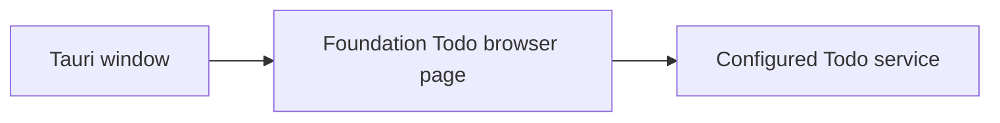

# Feature 02. Run Todo in a Tauri desktop window

The owner approves this experiment and its implementation. The production desktop renderer remains a separate decision.

## Scope

Tauri provides a desktop window with an embedded browser. Use the existing Todo browser page, controls, and application actions.
Run the first check on macOS. Record which files the window loads and where the Todo service runs.
Use the existing project settings and standard paths. Allow the developer to select the service address.
Keep the desktop build optional. Preserve normal server, browser, and mobile builds.
Use a temporary store for verification. Keep the owner's server and Todo records available.

The window displays the existing Todo page and sends actions to its service.

## Acceptance

1. Document and run the launch command from a clean shell.
2. Open a visible desktop window. Check the initial list, text entry, Add, Complete, and the selected filter.
3. Reopen the window and check the saved record. Check Mathalley entry, drawing, and return.
4. Capture the rendered Todo window. Use the [browser confirmation](../../../69-foundation-ui-v2/features/32-portable-view-targets/screenshots/verified-chrome-confirmation.png) as the visual reference.
5. Record the host, build mode, working actions, failures, and reproduction steps. Distinguish served assets from embedded assets.
6. Leave the visible example available for owner review. Report Windows and Linux coverage separately.

## Run

Use the [Todo desktop run commands](../../../../examples/ui_todo/README.md#tauri-desktop-check).
The desktop shell is a standalone Cargo package. Its build does not select the Todo server or mobile features.
The required address argument selects the existing HTTP service. The shell has no application command, plugin, or remote capability grant.
The server supplies the page, scripts, graphics assets and WebAssembly. The desktop executable contains its window icon.

## macOS result

The check ran on Apple silicon with macOS 27.2.1 (26B131) and WebKit 22625.2.8.11.9.
The debug shell used Tauri 2.12.5 and Wry 0.57.1.
The service used a local `uat` build from `3697c477d` with its matching staged browser resources.
It ran on `http://127.0.0.1:58606/` with `/tmp/ewe-spec92-todo.Eo8mFf/secondary.sqlite3`.

| Check | Result |
| --- | --- |
| Launch | Cargo builds and starts the window against the supplied address. A missing address or a file URL fails before window creation. |
| Initial list and Add | The empty list shows zero open items. The Add dialog focuses the input. A submitted title appears once. |
| Complete and filters | Complete changes the row to Reopen and the count to zero. Done shows the row. Open hides it. |
| Mathalley | The title and Train round draw in the window. Back to Todos restores the selected Done filter and completed row. |
| Relaunch | Closing and opening the window retrieves the completed row from the same service. The filter returns to All. |
| Handoff | The app stays open on Done. The scratch service stays running for review. |
| Other platforms | This check uses macOS only. Windows WebView2 and Linux WebKitGTK remain open. |

The browser reference shows the same list, filters, action feedback, and row controls.
The test uses a later Todo build with a pause button and updated browser styles.
It checks behavior and control placement across the two windows.

- [Add dialog](screenshots/tauri-add-dialog.jpg)
- [Done filter](screenshots/tauri-done-list.jpg)
- [Mathalley Train round](screenshots/tauri-mathalley-train.jpg)
