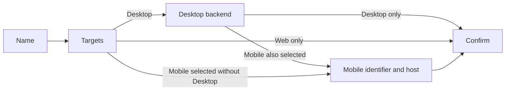
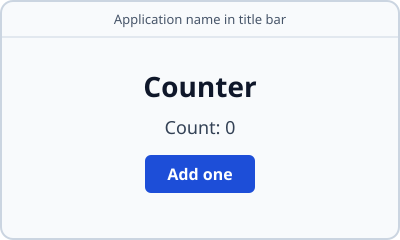

# Generate a desktop starter with ewe_ui

## Goal

A developer can select a desktop backend in the terminal wizard or through command arguments.
Tauri is the default and lands first. Direct upstream Zed GPUI follows after its example and starter pass their gates.
Both starters use the generated shared application crate.

| Term | Meaning |
| --- | --- |
| Command-line interface (CLI) | Commands and arguments that start an operation. |
| Backend | The toolkit that opens and draws the desktop window. |
| Starter | The files generated for the selected application targets. |
| Manifest | The `ewe-ui.toml` file that records the project configuration. |
| Staging | Preparing complete files in a temporary directory before publishing them. |
| WebAssembly (Wasm) | The binary format that runs the shared Rust action in the browser. |

## Story

| Story | Actor | Trigger | Result |
| --- | --- | --- | --- |
| S1 | Developer | Selects Desktop in the wizard | The wizard records the backend and generates the selected starter. |
| S2 | Automation | Passes complete command arguments | The generator creates the same files without terminal input. |
| S3 | Developer | Builds and runs the desktop starter | A window opens on the current computer and runs the shared counter action. |
| S4 | Developer | Supplies an invalid backend or encounters a build failure | The command reports the error and returns a failure status. |

## Bounded context

| Entity | Owner | Operation |
| --- | --- | --- |
| Wizard input and confirmation | `bin/ewe_ui/src/wizard.rs` | Select target and backend before generation. |
| Command arguments and dispatch | `bin/ewe_ui/src/main.rs` and `operations.rs` | Validate input and run the selected operation. |
| Manifest and starter files | `foundation_ui_project` | Validate, stage and publish the project. |
| Counter behavior | Generated `application` crate | Add one using the current shared application function. |
| Desktop window and state | Generated `desktop` package | Render, accept input and display the result. |
| Production Foundation Native mount | Specification 92 Feature 01 | Own the later frame and action adapter. |
| Existing Todo experiment | Specification 92 Feature 02 | Record Tauri behavior with a served app. |

GPUI Kit informs future control work. The generator uses Tauri and official upstream Zed GPUI.

## Rules

- I1. One desktop target selects one backend. Desktop defaults to Tauri when generation receives no backend argument.
- I2. A desktop backend requires the desktop target. A backend that has not landed returns a descriptive error.
- I3. Existing manifests with only Web, Android or iOS load without migration.
- I4. Desktop generation keeps the mobile identifier and host rules for Android and iOS.
- I5. Validation and template failure leave the project destination untouched.
- I6. Build and run use the saved backend. Desktop runs on the current host without a mobile device.
- I7. The selected desktop package owns its renderer dependencies. The generator binary embeds starter files.
- I8. The action uses shared code. One activation updates the displayed count once.
- I9. The Tauri release starter loads bundled assets and grants no product-specific native command to external pages.

## Acceptance scenarios

| Scenario | Given | When | Then |
| --- | --- | --- | --- |
| A1. Select Desktop | The terminal prompts for targets | The user selects Desktop and advances | The backend page shows Tauri first and selects it by default. |
| A2. Keep or change the choice | The backend page shows both released choices | The user selects Zed GPUI and confirms | The summary and generated manifest both name Zed GPUI. |
| A3. Generate without a terminal | Complete desktop arguments omit the backend | The command runs with redirected input | The manifest records Tauri and the process returns success. |
| A4. Reject conflicting input | Desktop is absent, or the requested backend is unavailable | The user supplies a backend argument | The command identifies the input error and leaves the destination untouched. |
| A5. Generate mixed targets | The user selects Desktop and Android or iOS | The user enters the mobile settings and confirms | The generated tree includes the requested hosts and one shared application crate. |
| A6. Preserve a prior project | A manifest predates Desktop | The current tool loads it | The previous targets and mobile parameters still work. |
| A7. Start a starter | The host has the documented prerequisites | The user builds and runs a generated project | The selected backend opens a window and updates the counter twice. |
| A8. Report a failed operation | Template rendering, compilation or launch fails | The user requests the operation | The command reports the step and returns failure. |
| A9. Install Tauri offline | A clean target has the required platform runtime and packaged starter | The user installs and runs with networking disabled | Bundled assets load and the counter action succeeds. |
| A10. Use accessible controls | The desktop window shows the counter | The user tabs to the button and activates it with the keyboard or assistive technology | The button has a name and role. The updated count is available to the user. |

## Technical breakdown

### Current source and file changes

| Location | Today | Planned change |
| --- | --- | --- |
| [Wizard](../../../../bin/ewe_ui/src/wizard.rs) | Desktop is an unavailable line in a three-target list. | Add Desktop to the target list and add a backend page. |
| [New command](../../../../bin/ewe_ui/src/main.rs) | Web, Android and iOS are the command targets. | Add desktop to `--target`. Add `--desktop-backend tauri\|gpui`. |
| [Project model](../../../../backends/foundation_ui_project/src/application.rs) | `Target` has three variants. Mobile detection treats each non-web target as mobile. | Add Desktop. Use explicit Android and iOS predicates. Add validated desktop configuration. |
| [Project templates](../../../../backends/foundation_ui_project/templates) | The project embeds templates and restores staged manifest filenames. | Add `desktop-tauri` first and `desktop-gpui` second. Preserve embedded package staging. |
| [Operations](../../../../bin/ewe_ui/src/operations.rs) | Build uses the Web or mobile path. Run requires a mobile device. | Dispatch desktop operations by manifest backend. Keep device commands mobile-specific. |
| [Application commands](../../../../bin/ewe_ui/README.md) | Application-local tasks are discovered from `ewe-ui.toml`. | Document desktop build and run. Keep task discovery and namespaces intact. |

### Selection and manifest

Use the same validation in the wizard and complete argument path.
Treat a complete desktop-only command as noninteractive even without a mobile identifier.
Reject a missing required argument in noninteractive mode before creating files. The wizard asks for desktop backend after target selection.
If mobile is selected, continue to its identifier and host pages. Otherwise, continue to confirmation.
Back follows the previous applicable page. Escape cancels before generation.
In the Tauri phase, show Tauri as available. Show Zed GPUI as pending until its phase passes.

```text
Create an Ewe application
Desktop backend

> (x) Tauri
  ( ) Zed GPUI

Arrow keys select. Enter continues.
Shift+Tab goes back. Escape cancels.
```

The proposed backend page shows the two released choices.



The wizard asks only for settings that apply to the selected targets.

Keep the existing constructor for Web and mobile callers. Add a desktop-aware constructor and one shared validation path.
Make `desktop: Option<DesktopProject>` default to absent in deserialization.
Define `DesktopBackend` with serialized values `tauri` and `gpui`.
Write the default choice explicitly for each newly generated desktop project.
Require a desktop table if the loaded manifest declares desktop. Reject an orphan desktop table.
Store the backend only. Resolve the application-relative path from the Desktop target.

```toml
name = "FieldNotes"
targets = ["desktop"]
host = "server"
shared = "application"

[desktop]
backend = "tauri"
```

Use a deterministic Tauri bundle identifier such as `com.ewe.fieldnotes`.
Derive the suffix from the validated application name by converting ASCII letters to lowercase and underscores to hyphens.
Write the identifier to `desktop/tauri.conf.json`. Describe how the owner sets a distribution identifier before release.
Desktop generation does not ask for a mobile application identifier unless mobile is also selected.

### Build, run and package

- Generate a standalone `desktop/Cargo.toml` with a path to the shared application. Lock desktop dependencies in that package.
- Stage lockfiles for the desktop-only and combined mobile graphs. The shared application uses a different build dependency source for mobile.
- Use the existing staged publication step. Validate the target and backend combination before creating the destination.
- Dispatch `ewe_ui build --target desktop` and `ewe_ui run --target desktop` to the selected backend.
- Preserve the existing mobile device requirement. Reject desktop device arguments before starting a process.
- Extend command help and the operations manuals. Keep `prepare` and `devices` scoped to their current targets.
- Use the existing command execution and task error path. Return the child error with the affected path and operation.
- Run debug by default. Route `build --target desktop --release` to the backend release build. Keep installer work under release gates.
- Use the packaged generator to prove that templates work outside the checkout. No generated manifest depends on repository-relative source beyond its own project.
- Keep official Zed Git dependencies and any required patches in the generated GPUI manifest. Stage the verified lockfile with the template.
- Generate an executable at the documented Cargo target path. Report the realized path, accounting for host executable suffix and Cargo target directory.

For Tauri, reuse the generated Web counter template and build task. In a desktop-only project, put the browser source in `desktop/web`.
In a combined Web and Tauri project, reuse the `web` target as the browser source.
Route both paths to the same application crate and Wasm counter. Parameterize the template path to that crate.
Build the selected browser manifest into `desktop/dist` before building the desktop package.
Pass `--offline` to cached browser and Cargo builds when enabled. Keep runtime offline checks separate.
Configure Tauri `frontendDist` to the generated directory. Start it using bundled assets in debug and release.
Use a minimal capability declaration and local asset policy. Keep the Todo experiment's service address path separate from the generated starter.
Check signing, notarization, offline WebView2 and Linux runtime prerequisites before installer distribution.
For GPUI, check packaged shader, font and library selection. Bundle only inputs that the installed executable needs.

For GPUI, begin with [the upstream counter example](../01-backend-evaluation/feature.md#standalone-upstream-gpui-example).
Use upstream window, layout and accessibility hooks. Call the shared Rust counter function directly.
Transport, resources and Foundation frame application belong to the later Native mount plan.



A starter places the count and one action beneath its title.

### Failure behavior

| Fault | Result | State after failure |
| --- | --- | --- |
| Target and backend disagree | The command identifies the incompatible declarations. | Existing project files stay intact. |
| A template fails to render | The command reports the template and path. | The incomplete staging directory is removed. |
| Asset generation or dependency resolution fails | Build reports the failed step and stops before opening a window. | The source and manifest remain available for retry. |
| Window creation fails | Run reports the original error and returns failure. | The next run starts a fresh counter. |

### Stages

1. Get approval for this plan and its references.
2. Land Tauri schema, wizard, templates and operations. Verify generation and the bundled starter.
3. Qualify the official upstream GPUI example. Record its graph and desktop evidence.
4. Enable Zed GPUI in the wizard and operations. Repeat generated starter checks for that backend.
5. Qualify platform installers before distribution. Keep the full Foundation adapter under its separate gate.

## Tests

| Rules and scenarios | Check | Oracle |
| --- | --- | --- |
| I1, I2, A1–A4 | Extend the terminal tests and command argument fixtures. | Confirmation, exit status and manifest match the selection. |
| I3, I4, A5, A6 | Load old fixtures and generate a mixed project. | Old settings load and each selected host has one shared application. |
| I5, A8 | Test an occupied destination and force a template or build failure. | Existing files remain untouched and the failed step appears in the error. |
| I6, I7, I8, A7 | Generate outside the repository, inspect dependencies, build and run. | One backend opens a window and shows 1, then 2. |
| I9, A9 | Install and run the Tauri release package offline. | The assets and shared action work without a network request. |
| A10 | Check keyboard and assistive activation on macOS, Windows and Linux. | Focus and accessible label, role and count match the visible control. |

Use VoiceOver on macOS, Narrator on Windows and Orca on Linux.
Run Linux checks under X11 and Wayland. Record runtime, graphics backend, display scale and test result.
Use the current macOS session for the first smoke check. Exercise Windows and Linux in the required release checks.
Record coverage per backend. Compile or dependency resolution alone does not prove window behavior.

[Platform prerequisites for Tauri](https://v2.tauri.app/start/prerequisites/) · [Tauri distribution](https://v2.tauri.app/distribute/) · [Upstream GPUI accessibility source](https://github.com/zed-industries/zed/blob/46375fbf64574f01dc08fd2d2998aa7bbb7f0377/crates/gpui/src/window/a11y.rs)

## Verify

From the repository root after implementation, run the existing generator checks.

```sh
cargo test --locked -p ewe_ui --profile uat
cargo package --locked -p foundation_ui_project --list
```

Use the executable built for the test. From a scratch parent directory, test the planned desktop commands.

```sh
ewe_ui new --name DesktopNotes --target desktop --desktop-backend tauri --output .
cd DesktopNotes
ewe_ui build --target desktop
ewe_ui run --target desktop
```

In a separate scratch directory after stage 4, repeat with `--desktop-backend gpui`.
Run the existing terminal and project operation fixtures against the built executable.
Record the package output, host, selected backend and captured window.
Use Feature 01 for direct GPUI example checks and Feature 02 for the existing Todo evidence.

## Done when

- The owner approves the plan and references.
- Tauri lands first. Its generated window uses bundled assets and the shared action.
- Zed GPUI uses the official pinned source and passes starter checks before the wizard enables it.
- Interactive and noninteractive selection agree. Old app manifests pass the existing operations.
- The reported coverage distinguishes starter checks from installer and Foundation renderer gates.
