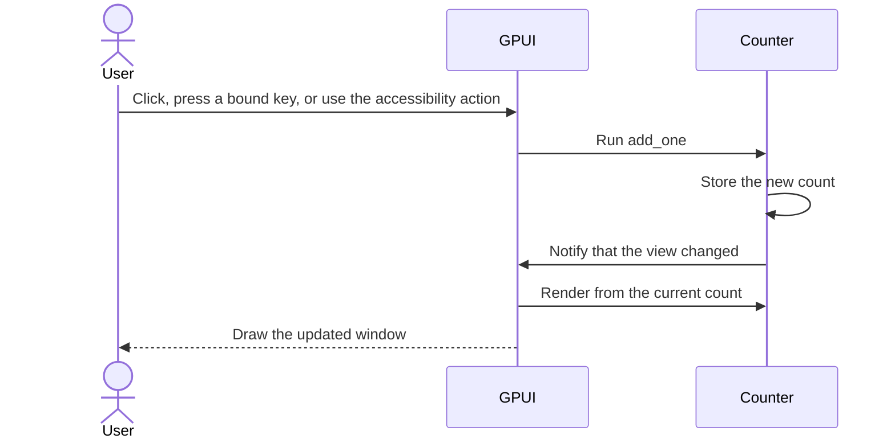

# Walk through the standalone Zed GPUI counter

Start with this page if you have never run a GPUI program. The example opens a window with one button.
Each activation adds one to the count. The example keeps the count in memory for the life of the window.

## Glossary

| Term | Meaning |
| --- | --- |
| GPUI | The name of Zed's Rust user interface framework. |
| Cargo | The Rust tool that selects dependencies, builds code, and runs programs. |
| Crate | A Rust library or executable build unit. This example produces one executable crate. |
| Workspace | A Cargo boundary that controls which packages share settings and a lockfile. |
| Manifest and lockfile | The manifest declares dependencies and build settings. The lockfile records the exact packages Cargo selected. |
| Revision | The identifier for one Git commit. A dependency pin selects that commit. |
| Profile and compiler backend | A profile selects build settings. The compiler backend turns Rust code into instructions for the processor. |
| Event loop | The part of the running application that waits for input and handles window events. |
| Entity and view | An entity stores data that GPUI manages. A view is an entity that can describe what to draw. |
| Context | The services GPUI passes to a callback for the current application or entity. |
| Element | A description of one part of a view for the current frame. |
| Focus and key context | Focus selects which element gets keyboard input. A key context limits where a key binding applies. |
| Accessibility tree | A description of controls, names, and actions that the operating system exposes to assistive software. |
| Repaint | Drawing an updated image of the window. |
| Wayland and X11 | Interfaces between Linux desktop applications and the display system. |
| Native mount | A Foundation host that renders frames with a desktop or mobile toolkit. |

## 1. Build and run the example

Start in the repository root. Install Rust and Cargo. The reviewed upstream Zed checkout specifies Rust 1.100.0.
The macOS check uses the repository's `nightly-2026-09-20` toolchain. See the prerequisites for each host. [Example run instructions](../../examples/gpui/README.md#build-requirements)

Load the repository environment from the root before a local build. Check the shared target with `cargo metadata`.
On Windows, use the configured Cargo paths in PowerShell. [Shell setup](../../examples/gpui/README.md#shell-setup)

```sh
cargo run --locked --profile uat --manifest-path examples/gpui/Cargo.toml
```

Cargo reads `examples/gpui/Cargo.toml` because `--manifest-path` selects it. Read the manifest from the top down. [Example manifest](../../examples/gpui/Cargo.toml)

1. `[package]` names the executable package `ewe-gpui-counter`. Cargo finds its entry point in `src/main.rs`.
2. `[workspace]` gives this package its own Cargo workspace. The root workspace has its own dependency graph.
3. `[dependencies]` selects `gpui` and `gpui_platform` from the same official Zed revision.
4. `gpui` supplies the application, view, layout, input and accessibility interfaces. `gpui_platform` selects the host window and graphics services.
5. The enabled platform options supply macOS text and runtime shaders, plus Wayland and X11 on Linux.
6. `Cargo.lock` records the selected versions and Git revisions. `--locked` fails if Cargo needs to change that selection.
7. `[profile.uat]` inherits the example's development settings, which disable debug symbols and incremental compilation.

Always pass `--profile uat` for local Cargo builds, runs, tests, and Clippy checks on every platform.
The repository configures LLVM for this profile. [Repository environment settings](../../mise.toml#L29)

## 2. Open the application and window

Read `main` from top to bottom. Above it, `use` imports names from Rust and GPUI that this file uses. [Imports](../../examples/gpui/src/main.rs#L1) [Startup code](../../examples/gpui/src/main.rs#L88)

```rust
gpui_platform::application()
    .with_quit_mode(QuitMode::LastWindowClosed)
    .run(|cx| {
        // Configure the application and open its window.
    });
```

`main` is the Rust entry point. `application()` creates a GPUI application for this computer.
`run` starts the event loop and calls the code inside `|cx| { ... }` when the application is ready.
Rust calls this block a closure. It is a function value that can use names from its surroundings.
Here `cx` gives the closure access to the application.

`cx.bind_keys` registers the keys in section 5. `Bounds::centered` requests 400 by 240 logical pixels on the primary display.
A logical pixel is a size unit that the system scales for the display. `None` leaves the display choice at its default.
`WindowOptions` sets the bounds and title to use. `Some` supplies an optional value. The other fields take their defaults. [Keys and window settings](../../examples/gpui/src/main.rs#L92)

`cx.open_window` opens the window and calls the closure that supplies its root view. `cx.new` creates the `Counter` entity.
A `match` selects the next step from the result. `Ok` brings the application to the foreground.
`Err` prints the reported error and exits with status 1. Closing the last window ends the normal application run. [Window creation and result handling](../../examples/gpui/src/main.rs#L109)

## 3. Give the view state and focus

A Rust `struct` groups related values. The `Counter` struct holds `count`, `window_focus`, and `button_focus`.
`#[derive(Debug)]` asks Rust to generate a debug text representation for these fields.
`count` is a nonnegative 32-bit integer. The window creation code sets it to zero.
A focus handle lets the code identify or select the element that gets keyboard input. [Counter fields](../../examples/gpui/src/main.rs#L10) [Initial state](../../examples/gpui/src/main.rs#L109)

The window starts with focus on its root. The button handle has tab index 1 and enables a tab stop.
Tab can move focus to this stop. The entity keeps both handles and the count when GPUI runs `render` again.

## 4. Turn the state into elements

A Rust trait defines operations that a type provides. The GPUI `Render` trait asks a view to describe what to draw.
`impl Render for Counter` supplies that operation for this view. `impl IntoElement` tells GPUI that the returned value can become an element.
In `render`, `&mut self` is a temporary reference that permits changes to the current `Counter`.
The `Context<Self>` parameter provides services for that entity. `Self` means `Counter` here.
The underscore in `_: &mut Window` shows that this method receives the window but does not use it. [Render entry point](../../examples/gpui/src/main.rs#L24)

The view formats the current count with `format!` and converts the result into a GPUI `SharedString`.
The status label uses a copy of the string. The visible text uses the same value.
Each call builds the current element tree. The `Counter` entity still stores the state after the elements are drawn.

| Element name | What the code does |
| --- | --- |
| `counter` | Fills the window. Uses a light background and centers a column with space between its three children. |
| `heading` | Shows **Counter** in larger type and exposes it as a level-one heading. |
| `count` | Shows **Count: 0** on the first frame and gives the status element the same name. |
| `add-one` | Shows **Add one** inside a blue button. Sets the pointer, hover color, and visible keyboard focus border. |

`div()` starts each element description. Method calls add style, text, children, and input behavior to that element.
`px` specifies logical sizes. `rgb` specifies colors from hexadecimal red, green, and blue values.
`id` gives each element a name. `role` and `aria_label` supply the control's role and spoken name to the accessibility tree. [Element tree and styles](../../examples/gpui/src/main.rs#L28)

## 5. Send input to one action

The `actions!` call is a Rust macro. A macro expands into code during compilation.
This macro declares the action types `Activate`, `Tab`, and `TabPrev` in the `counter` action namespace. [Action declarations](../../examples/gpui/src/main.rs#L8)

- `tab` and `shift-tab` reach the root view's action handlers. The handlers move focus forward and backward.
- `enter` and `space` map to `Activate` in the `CounterButton` key context.
- The element named `add-one` applies that key context. Its action handler calls `add_one` while the button has focus.
- The same element registers a pointer click with `on_click`. GPUI also exposes the click as an accessibility action.

`cx.listener` connects an input handler to the current `Counter` entity. The handler receives the entity and its context.
The pointer and keyboard handlers both call `Counter::add_one`. The accessibility click reaches the pointer handler through GPUI. [Key bindings](../../examples/gpui/src/main.rs#L92) [Focus handlers](../../examples/gpui/src/main.rs#L39) [Button handlers](../../examples/gpui/src/main.rs#L62)

## 6. Store the new value and redraw

`impl Counter` adds operations to the `Counter` type. Read `add_one` in two steps. [State update](../../examples/gpui/src/main.rs#L17)

1. `saturating_add(1)` adds one. It stops at the largest value the counter can store.
2. `cx.notify()` tells GPUI that the entity changed. GPUI can call `render` again and repaint the current count.



The entity stores the count. Each render reads it and creates the current elements.

## 7. Repeat the check

1. Run the command in section 1. Check that the window shows **Count: 0**.
2. Click **Add one** twice. Check that the count shows 1 and then 2.
3. Press Tab to reach the button. Press Enter and Space once each. Check that each key adds one.
4. Close the window. Run the same command again. Check that the new window shows **Count: 0**.

The macOS session verified launch, pointer input, keyboard activation, the accessibility click, and reset on relaunch.
The screenshot shows the count after two keyboard activations. The accessibility snapshot still reported the window as focused.
The error exit, VoiceOver, Windows, Linux, and installation require further checks.
Cargo also built and ran the test target, which has zero automated tests. [Verification record](features/01-backend-evaluation/feature.md#macos-counter-result) [Captured macOS window](features/01-backend-evaluation/screenshots/gpui-counter-macos.jpg)

## 8. Identify what Foundation would own

This example owns one window, its local state, and its input handlers.
A Foundation Native mount host would apply Foundation frame updates, keep named nodes, and route input to application action bindings.
It would also map styles, resources, focus, and accessibility to the desktop toolkit.
Tauri remains the first product desktop path. The separate Native mount plan has its own requirements and platform checks. [Desktop backend decision](requirements.md) [Future Foundation adapter flow](features/01-backend-evaluation/feature.md#future-foundation-adapter-flow)
