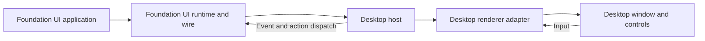

# Specification 92. Select the Foundation UI desktop renderer

## Glossary

| Term | Meaning |
| --- | --- |
| User interface (UI) | The controls a person sees and uses. |
| Graphics processing unit (GPU) | The processor that draws the desktop scene. |
| GPUI | The name of the Rust UI framework from Zed. |
| Renderer | The part that turns Foundation UI frame operations into visible desktop controls. |
| Mount | The surface that applies a frame. Native uses toolkit controls. Web uses page controls inside a browser. |
| Adapter | The code that translates between the Foundation UI model and the chosen renderer. |
| Capability | An operation or control that the desktop host can apply and can declare during negotiation. |

## Goal and scope

Use Tauri with the existing browser renderer for first product desktop delivery on the Web mount.
Reuse application actions and browser frame application. See [Specification 52](../completed/52-tauri-foundation-platform/requirements.md) for the shell.

Add Desktop to the `ewe_ui` terminal wizard. Offer Tauri first, then direct upstream Zed GPUI.
Generate the selected desktop starter with the same shared application crate. Record the selected backend in the project manifest.
Use the approved Tauri Todo check and one standalone upstream GPUI example as evidence. Keep GPUI Kit as learning material.

The owner needs a desktop host that opens a window, applies Foundation UI frames, and sends events to the same Rust actions. The owner needs a support decision and cost comparison before the host takes a dependency on an external renderer. When a candidate fails a required platform check, the owner needs the failing case and the cost of the available fallback.

The [desktop backend evaluation](features/01-backend-evaluation/feature.md) owns the source review, comparison, recommendation and acceptance gates. Specification 69 owns the wire format, runtime, WebView control and mobile hosts. Specification 52 owns the existing Tauri application shell. Specification 91 owns its Windows resource verification. The Native mount implementation plan starts after Specification 69 closes and the owner approves the updated plan.

## Architecture

The desktop host links the shared runtime to the selected platform renderer.

| Feature | Owns | Status |
| --- | --- | --- |
| [01. Evaluate the desktop backend](features/01-backend-evaluation/feature.md) | Source review, upstream GPUI counter and future Native mount gates | Upstream counter verified on macOS. |
| [02. Run Todo in a Tauri desktop window](features/02-tauri-todo-check/feature.md) | First Web mount desktop check | macOS check complete. Other platform checks open. |
| [03. Generate a desktop starter](features/03-desktop-generator/feature.md) | Wizard, command arguments, manifest, build and run | Tauri-first plan awaits approval. |

## Acceptance

- The owner can identify the revision, dependency cost, control coverage and platform risks for each candidate.
- The owner approves the generator and upstream GPUI example plans and references before implementation.
- The wizard and noninteractive command generate the same choice. Existing project manifests still load.
- A generated desktop starter builds and runs on its current host with the selected backend.
- The Native mount prototype requires Specification 69 closure and explicit approval of its plan.
- The same Foundation UI example exercises the shared contract on each desktop platform before production adoption.
