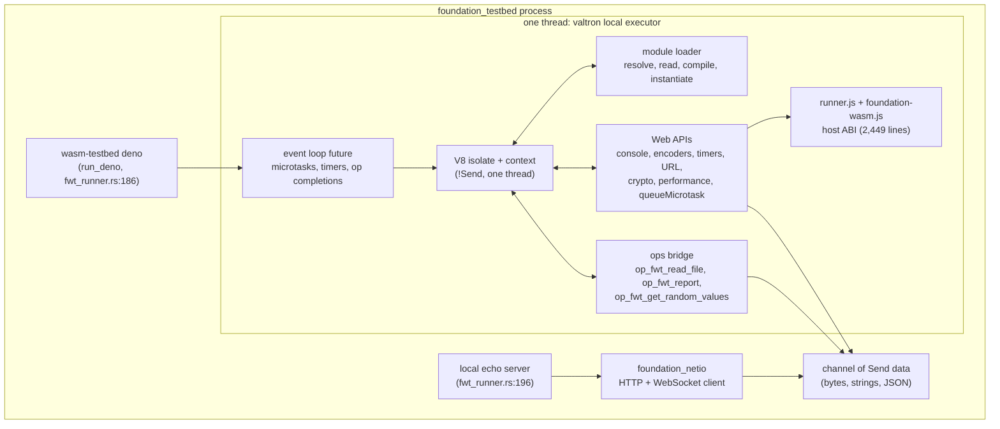
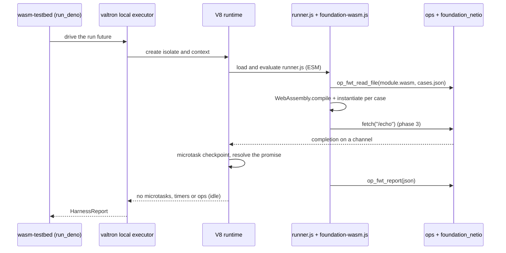

# Spec 93 — The embedded V8 runtime on a valtron event loop

_Written in ASD-STE100 Simplified Technical English (STE). Code and identifiers stay as they
are._

**Abbreviations.** application binary interface (ABI); application programming interface
(API); continuous integration (CI); Command Line Interface (CLI); ES module (ESM); Hypertext
Transfer Protocol (HTTP); JavaScript (JS); JavaScript Object Notation (JSON); Operating System
(OS); Simplified Technical English (STE); Transport Layer Security (TLS); Uniform Resource
Locator (URL); Unicode Transformation Format (UTF); WebAssembly (wasm); Web Interface
Definition Language (IDL); WebSocket (WS). ASD-STE100 is the standard of the AeroSpace and
Defence Industries Association of Europe (ASD).

Status: **draft**, owner review 2026-11-27. **Nothing is implemented.**

## 1. Glossary

| Term | Meaning in this specification |
|---|---|
| V8 | The JavaScript engine from the Chromium project. It runs JavaScript and WebAssembly. |
| `v8` crate | The Rust binding to V8 from the Deno project. Its other name is `rusty_v8`. |
| Deno | A JavaScript and TypeScript runtime. |
| `deno_core` | The Deno runtime core library. It gives an isolate, a module loader, an event loop and an ops bridge. |
| isolate | One independent V8 engine instance. It has its own heap and one thread. |
| context | One JavaScript global environment inside an isolate. |
| ESM | A JavaScript module with `import` and `export`. |
| module loader | The host code that finds, reads, compiles, links and evaluates a module. |
| microtask | A short JavaScript job. It runs after the current job and before the next timer. |
| event loop | The loop that runs microtasks, timers and completed input/output (I/O) callbacks until no work remains. |
| op | A Rust function that JavaScript calls through the runtime bridge. |
| valtron | The project task and stream runtime, `foundation_core::valtron`. |
| future | A Rust value that gives a result later. Valtron drives it. |
| `Ctx` | The context bundle with the injected clock, timer, random generator and configuration, `foundation_context::Ctx`. |
| promise | A JavaScript object that gives a value later. An op can resolve it. |
| tokio | A Rust asynchronous runtime. `deno_core` uses it for timers and input/output. |
| host ABI | The JavaScript interface that `foundation-wasm.js` gives a wasm module. |
| ABI | Application binary interface. Here, the JavaScript functions and the memory layout that the wasm module and the host exchange. |
| JSON | JavaScript Object Notation. A text format for data. |
| OS | Operating system: Linux, macOS or Windows. |
| UTF | Unicode Transformation Format. An encoding of text as bytes. |
| primordials | Deno's frozen copies of the JavaScript built-in objects. |
| Web API | A browser global such as `fetch`, `WebSocket`, `TextEncoder` or `setTimeout`. |
| WebAssembly | The bytecode format that the tests compile to. V8 executes it. |
| fetch | The Web API for an HTTP request. |
| WebSocket | A two-way message protocol over one Transmission Control Protocol (TCP) connection. |
| owned harness | A test marked `#[wasm_test]`. The macro adds a `__fwt_` export and the runner calls it directly. There is no wasm-bindgen. |
| oracle | The rule that decides if a test passed. |

## 2. Goal

Replace the embedded Deno runtime in `foundation_testbed` with the `v8` crate on a valtron
event loop. Keep the owned `#[wasm_test]` harness and its JavaScript host ABI.

Today the harness runs JavaScript in process on eight direct Deno crates: `deno_core`,
`deno_web`, `deno_webidl`, `deno_fetch`, `deno_net`, `deno_websocket`, `deno_permissions` and
`deno_error` (`backends/foundation_testbed/Cargo.toml:126-142`). It builds a current-thread
tokio runtime for each run (`backends/foundation_testbed/src/wasm/embedded_js.rs:417-422`).
The Deno team joined Cloudflare on 9 October 2026. The Deno runtime gets bug-fix and security
releases until about October 2027 (issue #139). The direct crates need one coordinated
version set, and `deno_net` 0.251 already needs `deno_core` 0.412 (issue #139).

This spec keeps the engine and removes the Deno layer:

1. The `v8` crate gives the isolate, the context, scripts, ESM, promises and `WebAssembly`.
2. New code gives the layers that Deno supplies today: a module loader, an ops bridge, an
   event loop on valtron, and the Web APIs that the harness uses.
3. The JavaScript under test does not change. `foundation-wasm.js` stays the host ABI
   (`backends/foundation_wasm/runtime/foundation-wasm.js`, 2,449 lines). `runner.js` stays
   the runner (`backends/foundation_testbed/src/wasm/templates/fwt/runner.js`, 142 lines).

**The benefit is not security.** Both runtimes are local test runtimes that grant every
permission. The Deno path installs `PermissionsContainer::allow_all`
(`embedded_js.rs:264-273`). The V8 path has no permission layer at all. The move adds no
isolation boundary. It gives three maintenance gains:

1. It removes the need to keep eight Deno crates on one version set.
2. It removes tokio from this test path.
3. It keeps the engine. V8 149.4.0 is already in the lock file (`Cargo.lock:17664-17666`)
   through `deno_core` 0.404 (`Cargo.lock:3336-3339`). The prebuilt V8 library and its build
   cost do not change.

The issue estimates 2,300 to 3,000 new lines (issue #139). This is a medium to large change.

## 3. Why V8, and not wasmtime or QuickJS

The harness does not test only wasm. It tests the pair of the wasm module and the JavaScript
host ABI that a browser or Deno provides. The engine must run both sides.

| Option | JavaScript | WebAssembly | Verdict |
|---|---|---|---|
| V8, through the `v8` crate | Full | Full: `WebAssembly.Module`, `Instance`, `RuntimeError` (used by `runner.js`) | **Chosen.** Same engine as today. |
| wasmtime | None | Full | Rejected. We must reimplement the 2,449-line host ABI in Rust, so the JavaScript side is no longer tested. |
| QuickJS, through `rquickjs` | Full | Weak or absent | Rejected. The harness compiles and instantiates wasm modules; the engine must support `WebAssembly`. |

Spec 44 reached the same conclusion for `deno_core`
(`specifications/completed/44-embedded-deno-runtime/spec.md:27-36`).

What V8 gives directly: isolate, context, scripts, modules, promises and `WebAssembly`.
What we must add:

| Part | Work | Estimate |
|---|---|---|
| 1. Runtime core | Isolate and context setup, run a script, translate a JavaScript exception to a Rust error | ~150 lines |
| 2. Module loader | Compile, resolve, instantiate, evaluate, `import.meta.url`, dynamic `import()` | ~300 lines |
| 3. Ops bridge | Bind Rust functions as V8 functions: the three harness ops and `console` | ~150 lines |
| 4. Event loop on valtron | Microtask checkpoint, timer queue, op completions, idle detection, as a future | ~300 to 400 lines |
| 5a. Small Web APIs | `console`, encoders, timers, `URL`/`URLSearchParams`, `crypto`, `performance` | ~400 lines (JS and Rust) |
| 5b. `fetch` | `Headers`, `Request`, `Response` on the `foundation_netio` client, with a streamed body | ~600 to 900 lines |
| 5c. `WebSocket` | The `WebSocket` global on the `foundation_netio` WebSocket client | ~400 to 600 lines |
| 6. Clean-up | Remove the Deno crates, tokio and the rustls provider install; update the docs | Small |
| **Runtime code total** | | **~2,300 to 2,900 lines** |

The issue total of 2,300 to 3,000 lines includes the tests, the CI edits and the docs. The
rows estimate the runtime code only. The new test files and the ported tests add more.

The estimate is from issue #139. The feature split in this spec follows the same parts:
feature 01 covers parts 1 to 4, feature 02 covers part 5a, feature 03 covers parts 5b and 5c,
and feature 04 covers part 6.

## 4. What exists today, measured

### 4.1 Call sites

The assessment comment on issue #139 says "1 module of 483 lines, 13 `JsRuntime` uses, 3 mise
tasks, 1 CI recipe". This table confirms each number against the code.

| Site | What it is | Measured |
|---|---|---|
| `backends/foundation_testbed/src/wasm/embedded_js.rs` | The whole Deno runtime | 483 lines; 13 references to `JsRuntime` (9 in code at `:58`, `:233`, `:259`, `:287`, `:372`, `:425`, `:433`, `:453`, `:470`; 4 in doc comments at `:6`, `:29`, `:231`, `:278`) |
| `embedded_js.rs:68-145` | The globals bootstrap | 1 script |
| `embedded_js.rs:151-193` | The three ops (`op_fwt_read_file`, `op_fwt_report`, `op_fwt_get_random_values`) | 3 ops |
| `embedded_js.rs:259-263` | `FsModuleLoader` | 1 loader |
| `embedded_js.rs:417-422` | The current-thread tokio runtime | 1 runtime per run |
| `embedded_js.rs:432-442` | `mod_evaluate` + `run_event_loop` | 1 event-loop drive |
| `backends/foundation_testbed/src/wasm/mod.rs:15` | Module declaration | 1 |
| `backends/foundation_testbed/src/wasm/fwt_runner.rs:186-212` | `run_deno`; calls `run_staged_harness` at `:198` | 1 caller |
| `backends/foundation_testbed/tests/embedded_js_tests.rs` | Runtime tests, gated at `:1` | 8 tests (`:21`, `:27`, `:38`, `:64`, `:85`, `:110`, `:145`, `:188`) |
| `backends/foundation_testbed/tests/fwt_runner_tests.rs` | Runner tests | 2 gated tests (`:35`, `:65`) |
| `mise.wasm.toml:18`, `:95`, `:144` | The three embedded-runtime tasks | 3 |
| `backends/foundation_ci/src/execution/recipes.rs:143` | The CI wasm recipe | 1 |
| `backends/foundation_testbed/Cargo.toml:60-74` | The `wasm-embedded-js` feature | 1 feature |
| `backends/foundation_testbed/Cargo.toml:126-142` | The dependency block | 8 direct Deno crates |

### 4.2 Test inventory

The measured inventory is 106 real owned cases (`#[wasm_test]` or
`#[valtron_wasm_test]`) in four files.

| File | Cases |
|---|---|
| `backends/foundation_core/integration/wasm_tests/src/lib.rs` | 47 |
| `backends/foundation_http/integration/wasm_owned/src/lib.rs` | 40 |
| `backends/foundation_connectrpc/integration/wasm_owned/src/lib.rs` | 13 |
| `backends/foundation_testbed/integration/module/src/lib.rs` | 6 |
| **Total** | **106** |

The `foundation_core` file holds 34 `#[wasm_test]` and 13 `#[valtron_wasm_test]` attributes.
Both macros add a `__fwt_` export, so both count as cases
(`backends/foundation_macros/src/lib.rs:668-698`, `backends/foundation_testbed/src/wasm/fwt.rs:24`).
A count that reads only `#[wasm_test]` finds 34 and misses 13.

One case uses `fetch`: `echo_endpoint_answers`
(`backends/foundation_testbed/integration/module/src/lib.rs:98-116`, the fetch at `:72`).
The other 105 cases do not use the network. The sample template adds three markers
(`backends/foundation_testbed/src/wasm/templates/fwt/sample_wasm_test.rs`), but it is
scaffolding, not a run case.

Issue #139 says "about 20 files" hold `#[wasm_test]` cases. The measured count is four case
files. This spec uses the measured count for its gates.

### 4.3 The CI gap

The package test matrix runs `foundation_testbed` with `runs = ["", "vms"]`
(`ci/packages.toml:426-434`). It does not enable `wasm-embedded-js`. Therefore:

- `tests/embedded_js_tests.rs` starts with `#![cfg(feature = "wasm-embedded-js")]` (`:1`).
  The matrix does not compile it.
- The two run tests in `tests/fwt_runner_tests.rs` are gated at `:35` and `:65`. The matrix
  does not run them.

The wasm recipe runs the `wasm-testbed deno` binary with the feature instead
(`recipes.rs:143`). The binary path is proven. The runtime unit tests are not. Issue #139
step 2 asks to run both feature sets in CI. Feature 01 closes this gap. Issue #1094 records
the gap as a bug.

### 4.4 Dependencies to remove

| Crate | What it does today |
|---|---|
| `deno_core` | Isolate, loader, event loop, ops, `console` |
| `deno_web` | `TextEncoder`/`TextDecoder`, timers, `URL`, `console` helpers |
| `deno_webidl` | Web Interface Definition Language (IDL) bindings that `deno_web` needs |
| `deno_fetch` | `fetch`, `Headers`, `Request`, `Response` |
| `deno_net` | TLS and network for `fetch` |
| `deno_websocket` | The `WebSocket` global |
| `deno_permissions` | The allow-all permissions container |
| `deno_error` | `JsErrorBox` for the ops |
| `tokio` | The event loop and timer driver (`Cargo.toml:142`) |
| `sys_traits` | `RealSys` for the permission descriptor parser (`Cargo.toml:139`) |
| `rustls` | The `aws-lc-rs` provider that `deno_tls` needs (`Cargo.toml:140`; install at `embedded_js.rs:407-413`) |

`foundation_compact` stays. It supplies OS entropy for `crypto.getRandomValues`
(`embedded_js.rs:175-178`).

## 5. Architecture

### 5.1 New module and public names

The new code lives in `backends/foundation_testbed/src/wasm/v8_runtime/`.

| File | Role |
|---|---|
| `mod.rs` | Public entry: `run_staged_harness`, `run_module`, `HarnessReport` |
| `isolate.rs` | Isolate, context, handle scope, `TryCatch`, one thread |
| `loader.rs` | Resolve, read, compile, instantiate, evaluate, `import.meta.url`, dynamic `import()` |
| `ops.rs` | The three ops and the promise table |
| `event_loop.rs` | Microtask checkpoint, timers, op completions, idle detection |
| `web/mod.rs` | Web APIs: `console`, encoders, timers, `URL`, `crypto`, `performance`, `queueMicrotask` |
| `net.rs` | `fetch`, `Headers`, `Request`, `Response`, `WebSocket` on `foundation_netio` |

The public names stay `run_module` and `run_staged_harness`. The old module already gives
them (`embedded_js.rs:297` for `run_module`, `:315` for `run_staged_harness`, `:209-227` for
`HarnessReport`). `fwt_runner.rs:198` and the tests then change only the import path.

### 5.2 Isolate, threads and the event loop

- An isolate is not `Send` and is bound to one thread (issue #139, comment "Design note:
  isolates and threads"). Each run gets one isolate on one thread.
- The event-loop future holds the isolate, so it is also not `Send`. Valtron drives it on a
  local executor. The existing choices are `LocalThreadExecutor`
  (`backends/foundation_core/src/valtron/executors/local.rs:2944`) and `block_on_future`
  (`backends/foundation_core/src/valtron/executors/non_sendables.rs:461`).
- A timer reads `Ctx::clock().now()` (`backends/foundation_context/src/lib.rs:474`) and waits
  with `Ctx::timer().sleep_until(ctx, deadline)`
  (`backends/foundation_context/src/env/timer.rs:17-23`). It reads no global clock and no
  global sleep.
- An asynchronous op runs on its own task. It sends only `Send` data (bytes, strings, JSON)
  back over a channel. No V8 handle crosses a thread.
- The loop is idle when there are no microtasks, no armed timers, no pending ops and no
  promise jobs. Then it returns the `HarnessReport`.
- A run timeout is configuration, not a constant. It stops a missing wake from hanging the
  test forever.

### 5.3 Module loader

1. Resolve a specifier relative to the importer or to the file URL.
2. Read the file with `std::fs::read`. The staged harness is local and self-contained
   (`fwt_runner.rs:114-136`).
3. Compile with `v8::ScriptCompiler::CompileModule`. Set the resource name so
   `import.meta.url` works.
4. Instantiate with a resolve callback. Evaluate.
5. Send a dynamic `import()` through the same path.

The runner uses `new URL(path, import.meta.url)` (`runner.js:15`). The loader must give a
correct `import.meta.url` for the staged `runner.js`.

### 5.4 Ops bridge

The three ops keep their names and contracts:

| Op | Contract | Source |
|---|---|---|
| `op_fwt_read_file` | Read a local file, return its bytes | `embedded_js.rs:156-160` |
| `op_fwt_report` | Write the result JSON into the report sink | `embedded_js.rs:166-169` |
| `op_fwt_get_random_values` | Fill a view from OS entropy | `embedded_js.rs:175-178` |

`runner.js` feature-detects `globalThis.Deno?.core?.ops` (`runner.js:19`) and calls
`op_fwt_read_file` (`:23`) and `op_fwt_report` (`:42`). Phase 1 exposes the same object shape,
so the runner stays unchanged. The cutover decision D3 covers the name.

### 5.5 Web APIs and the host ABI

`foundation-wasm.js` is embedded with `include_str!`
(`backends/foundation_wasm/src/embedded.rs:14`). It is the code under test. Do not change it.
The runtime supplies these globals:

| Global | Used by | Source in the V8 runtime |
|---|---|---|
| `WebAssembly` | `runner.js`, host ABI | V8 built-in |
| `console` | `runner.js`, host ABI | Rust `println`/`eprintln` or `tracing` |
| `TextDecoder` | Host ABI (`:339`, `:344`, `:1042`, `:1583`) | Rust or JS; must accept `utf-16le` |
| `TextEncoder` | Host ABI (`:578`, `:736`) | Rust or JS; UTF-8 |
| `setTimeout`, `clearTimeout` | Host ABI, tests | Valtron timer and `Ctx` |
| `setInterval`, `clearInterval` | Old bootstrap (`embedded_js.rs:103-106`) | Valtron timer and `Ctx` |
| `URL`, `URLSearchParams` | `runner.js:15`, host ABI | The `url` crate (`Cargo.toml:166`) |
| `crypto.getRandomValues` | Host ABI (`:2050`), bootstrap (`embedded_js.rs:118-143`) | `foundation_compact::entropy::fill` |
| `performance.now` | Host ABI (`:2036`) | `Ctx::clock().now()` |
| `performance.timeOrigin` | Host ABI (`:2040`) | `Ctx::clock().wall_now()`, in milliseconds since the Unix epoch |
| `Date.now` | Host ABI (`:1668`, `:2038`, `:2043`) | `Ctx::clock().wall_now()`, in milliseconds since the Unix epoch |
| `queueMicrotask` | Host ABI (`:1476-1477`) | `Isolate::EnqueueMicrotask` |
| `requestAnimationFrame` | Optional; host ABI falls back to a timer (`:1660-1668`) | Not provided; the fallback is enough |
| `fetch`, `Headers`, `Request`, `Response` | Host ABI (`:2327`), sample echo case | Phase 3, on `foundation_netio` |
| `WebSocket` | Runtime tests, the netio wasm client | Phase 3, on `foundation_netio` |

The host ABI reads `response.ok`, `response.status` and `response.body?.cancel()` before it
streams a module (`foundation-wasm.js:2327-2347`). The Phase 3 `Response` must supply them.

The `foundation_netio` clients are already in the tree: the native HTTP client builder
(`backends/foundation_netio/src/network_client.rs:57`), the WebSocket client
(`backends/foundation_netio/src/websocket/shared/client.rs:245`), and the wasm fetch client
that today uses the browser `fetch` (`backends/foundation_netio/src/wasm/client/client.rs:56`).

### 5.6 Architecture diagram

_Figure 1: one V8 isolate on a valtron local executor, with the loader, the ops bridge, the Web APIs and the unchanged host ABI._

_Figure 2: one harness run from the CLI to the report, with the V8 event loop driven by valtron._

## 6. Phases and gates

| Phase | Feature | Work | Gate |
|---|---|---|---|
| 0 | [Spike](features/00-spike/feature.md) | Isolate, one ESM from disk, one op, one `setTimeout` on a valtron loop | The spike test is green. The feature tree has no `tokio` edge. |
| 1 | [V8 core](features/01-v8-core/feature.md) | Runtime core, module loader, ops, event loop, public API, feature flag, CI | The core tests pass: the two engine tests (JavaScript and WebAssembly), the trap test and the new core test. Both feature sets run in CI. |
| 2 | [Web APIs](features/02-web-apis/feature.md) | `console`, encoders, timers, `URL`, `crypto`, `performance`, `queueMicrotask` | The 105 non-network cases pass (47 + 40 + 13 + 5). The loader and sample-fixture tests pass. |
| 3 | [Fetch and WebSocket](features/03-fetch-and-websocket/feature.md) | `fetch`, `Headers`, `Request`, `Response`, `WebSocket` on `foundation_netio` | All 106 cases pass. The three network tests pass. The `echo_endpoint_answers` case passes. No network test is deleted. |
| 4 | [Cutover](features/04-cutover/feature.md) | Make V8 the default, delete the Deno module and crates, remove tokio, update the docs | The feature tree has no `deno_*` and no `tokio` edge. All 106 cases pass on V8. The docs name V8. Issue #139 is closed. |

Phase 1 removes tokio from the new V8 path. The Deno feature keeps tokio until Phase 4
removes the feature. Phase 2 is the first phase that runs the harness cases, because the host
ABI needs the Web APIs. Phase 3 is the first phase that runs every case.

## 7. Risks

| Risk | Effect | Mitigation |
|---|---|---|
| The `v8` crate is also from the Deno team. Its maintenance after October 2027 is not confirmed (issue #139). | A future engine/binding gap. | Keep every engine call in `isolate.rs`, so a move to SpiderMonkey (`mozjs`, from the Servo project) changes one module. Keep the engine version pinned in one place. |
| The `v8` crate version tracks the V8 version. A bump can change the embedding API. | Build breaks on a bump. | Pin one version in the workspace `[workspace.dependencies]` (root rule 17). Bump in one change and run the full gate. |
| Behaviour drift between our Web APIs and Deno's. | A test passes on Deno and fails on V8, or the reverse. | Run the existing tests unchanged as the acceptance gate. Compare each Web API against the Web standard, not against Deno's source. Do not copy Deno's JavaScript: it uses `Deno.core` internals and primordials (issue #139). |
| An isolate is `!Send`. | A runtime cannot move between threads. | One isolate per thread. Send only bytes, strings and JSON over channels. |
| A missing wake or a lost timer hangs a run. | A CI job hangs. | Idle detection needs all four conditions. A configurable run timeout ends the run with an error. |
| `WebAssembly.instantiateStreaming` may not accept a hand-written `Response`. | The host ABI `loadURL` path fails. | Test it in Phase 3. The fallback is `arrayBuffer()` and `WebAssembly.instantiate`, which the runner already uses. |
| The V8 build is heavy and the platform matrix is large. | A slow free-tier CI. | Run both feature sets on the wasm recipe as issue #139 asks. Keep V8 out of the default feature set (spec 44 §7). |
| The host ABI is 2,449 lines and uses more globals than the runner. | A gap that only a UI test finds. | Feature 02 loads the whole host ABI and constructs `FoundationWasm`. |
| A panic inside a V8 callback ends the isolate. | A run loses its report. | Use `TryCatch` at every callback boundary. Keep the `read_diagnostics` behaviour (`embedded_js.rs:367-402`) so the failing case is named. |

## 8. Decision points for the owner

| # | Decision | Options | Recommendation |
|---|---|---|---|
| D1 | Do this move now, or bump the Deno set as one group? The assessment on issue #139 says a complete set resolves: `deno_core` 0.413, `deno_web` 0.291, `deno_fetch` 0.284, `deno_net` 0.252, `deno_websocket` 0.265, `deno_webidl` 0.260. | (a) Start this spec now. (b) Bump the set and keep #139 as the contingency. | The assessment recommends (b) until Deno maintenance ends or tokio must leave the test path. This spec exists so the owner can choose (a) with full information. |
| D2 | What is the feature name, and when does V8 become the default? | (a) `wasm-embedded-v8` beside `wasm-embedded-js`, then switch at Phase 4. (b) Reuse `wasm-embedded-js` and replace the body. | (a). It lets both paths run in CI and keeps the old path as the oracle. |
| D3 | What is the ops object shape? | (a) Keep `Deno.core.ops` in phases 1 to 3. (b) Add `Foundation.core.ops` and change `runner.js`. | (a) during the move, so `runner.js` does not change. Remove the Deno name in Phase 4. |
| D4 | What happens to the network tests while Phases 2 and 3 are incomplete? | (a) Keep them on `wasm-embedded-js`. (b) Move them to the external `deno` binary. (c) Mark them ignored. | (a). Issue #139 says do not delete them. |
| D5 | Do we accept the `v8` crate maintenance risk after October 2027? | (a) Accept, with all engine calls in one module. (b) Stay on Deno. (c) Plan a SpiderMonkey move. | (a), with the one-module rule as the exit path. |
| D6 | What are the limits? | Timer count per run, fetch body cap, WebSocket message cap, module size cap, run timeout. | Configuration fields with builder methods, not constants (root rule 8). Pick defaults from nginx and Go `net/http`, and say which. |
| D7 | What is the public API shape? | `run_staged_harness` is synchronous today (`embedded_js.rs:315`). | Make the driver an `async fn` on valtron. Keep a synchronous wrapper for `fwt_runner.rs:198` until the CLI is async (root rule 6). |
| D8 | How much CI does the move cost? | (a) Both feature sets on every affected pull request. (b) V8 on pull requests, Deno nightly. | (a) while the move is open. Phase 4 removes the double build. |

## 9. Done when

- The owner settles D1 to D8 in this file.
- Feature 00 to 04 are complete, each with its gate green.
- All 106 `#[wasm_test]` cases pass on the V8 path, with the same verdicts as on Deno.
- The ported runtime tests and the 2 gated runner tests pass on V8 and run in CI.
- `cargo tree -p foundation_testbed --no-default-features --features wasm-embedded-v8 --edges
  normal` prints no `deno_*` line and no `tokio` line.
- `embedded_js.rs` is deleted and the docs name V8.
- Issue #139 is closed.

## 10. References

- Issue #139: "foundation_testbed: replace deno_core with the v8 crate on a valtron event
  loop". The phases, the line estimate and the design note on isolates.
- Issue #1094: the embedded runtime unit tests do not run in CI.
- Comment `7215271035` on issue #139: the measured call sites and the Deno-set assessment.
- `specifications/completed/44-embedded-deno-runtime/spec.md`: the current Deno runtime.
- `specifications/completed/88-wasm-runtime-coverage/requirements.md:80-90`: the runner
  inventory.
- `specifications/92-sandbox-and-agent-rpc-closure/requirements.md` section 2: this move is
  out of scope for spec 92.
- `backends/foundation_testbed/src/wasm/embedded_js.rs`: the code this spec replaces.
- `backends/foundation_wasm/runtime/foundation-wasm.js`: the host ABI under test.
