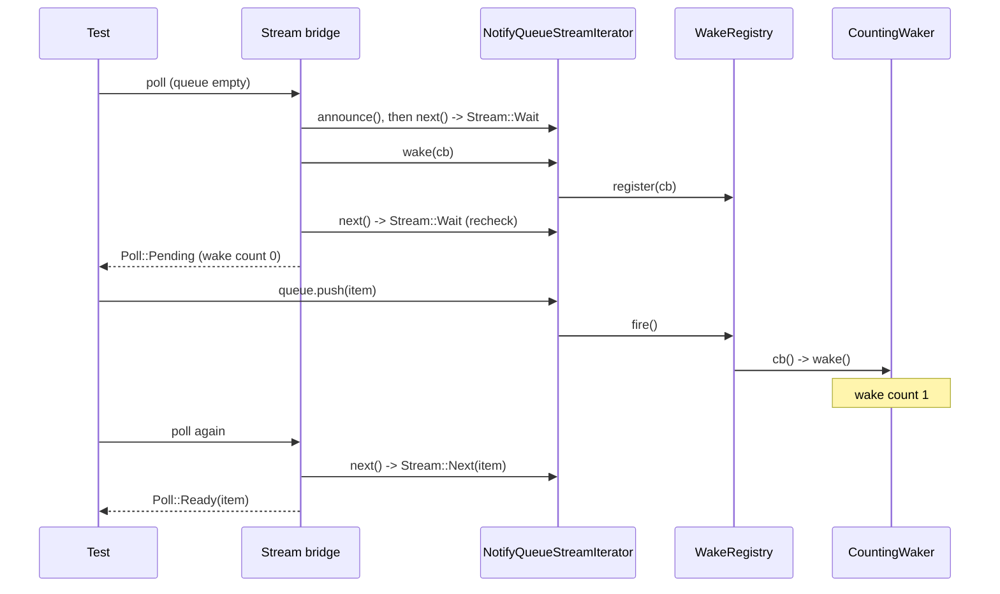

## Glossary

| Term | Meaning in this specification |
|---|---|
| WebAssembly (wasm) | A portable binary instruction format. The target here is `wasm32-unknown-unknown`. |
| JavaScript (JS) | The host language of the browser and Deno. The executor yields to its event loop. |
| JavaScript event loop | The single thread that runs JS tasks, timers and microtasks. A parked wasm task returns control to it. |
| Chrome DevTools Protocol (CDP) | The JSON-RPC control channel of a Chromium browser. `foundation_browser` speaks it in Rust. |
| Deno | A JavaScript and TypeScript runtime. The testbed embeds it in process. |
| continuous integration (CI) | The automated checks that run on every push and pull request. |
| condition variable (CondVar) | A thread primitive that waits for a signal. `foundation_nostd` has a spin-wait variant for wasm. |
| parking | Returning `Poll::Pending` after registering a one-shot wake callback, instead of spinning. |
| owned harness | A test case marked `#[wasm_test]` or `#[valtron_wasm_test]`. The macro exports `__fwt_<name>` and the testbed calls it. There is no wasm-bindgen. |
| wasm-bindgen harness | A test case marked `#[wasm_bindgen_test]`. The wasm-bindgen runner calls it. |
| application binary interface (ABI) | The fixed import and export surface between the wasm module and its host. |

## 1. What exists today (measured 2026-11-20)

Valtron already runs on wasm. These surfaces exist and work:

| Surface | Location | State |
|---|---|---|
| Owned wasm suite | `backends/foundation_core/integration/wasm_tests/src/lib.rs` | 18 cases. All pass in embedded Deno on 2026-11-20. |
| Workers example | `examples/cf-valtron-counter/src/lib.rs` | Runs `execute` over a `TaskIterator`, with `TaskStatus::Pending` and `TaskStatus::Wait`, and streams the ticks through a `ReadableStream`. CI compiles it. |
| wasm-bindgen suite | `backends/foundation_core/tests/valtron/wasm_js_yield_integration.rs` | 15 cases. `mise run test:wasm-bindgen:deno` runs them under Deno. CI runs that task. |
| Native bridge contract | `tests/valtron/bridge_park.rs`, `stream_future.rs`, `wakeable_stream.rs` | Complete. Gated `not(target_family = "wasm")` in `tests/valtron/mod.rs`. |
| Shared readiness scenarios | `tests/valtron/wasm_wake_support.rs` | 7 scenarios plus the waitgroup clock case. The owned suite and the wasm-bindgen suite both run all 7 and the waitgroup case. |

The 18 owned cases cover:

1. `js_yield_returns_immediately`
2. `js_yield_callback_reschedules_executor`
3. `concurrent_tasks_make_progress`
4. `no_deadlock_with_js_yield`
5. `depends_task_parks_until_wake_signal_fires`
6. `microtask_runs_before_zero_delay_timeout`
7. `scheduled_callback_can_reschedule`
8. `host_abi_clock_advances_and_matches_wall_clock`
9. `host_abi_entropy_fills_past_the_web_crypto_limit`
10. `host_abi_entropy_seeds_the_thread_rng`
11. `resume_signal_set_by_host_timer_wakes_parked_task`
12. `event_queue_push_from_host_wakes_parked_consumer`
13. `event_queue_close_from_host_wakes_parked_consumer`
14. `deadline_only_park_resumes_at_its_deadline`
15. `any_readiness_resumes_when_a_child_is_ready`
16. `sleep_task_ends_at_its_deadline`
17. `timeout_task_ends_at_its_timeout`
18. `waitgroup_idle_wait_timeout_reads_the_clock`

So the executor, the JS-yield path, `WakeSignal`, `EventQueue`, `ReadinessWaker`, sleep and timeout all run at runtime on wasm today. The old version of this spec said that nothing did. That was wrong.

## 2. The actual gap

`backends/foundation_core/integration/wasm_tests/src/lib.rs` is valtron's wasm
test home. It already holds the 18 executor and readiness cases in section 1.
This spec extends that file. It does not create a new crate or a second wasm
suite.

The **stream-to-future bridges** have no wasm runtime test:

| Bridge | API | Native test | Wasm test |
|---|---|---|---|
| Collect | `into_collect_future` / `StreamCollectFuture` | Yes | No |
| First value | `into_ready_future` / `StreamReadyFuture` | Yes | No |
| Pending value | `into_pending_future` / `StreamPendingFuture` | Yes | No |
| Item stream | `into_next_stream` / `StreamNextStream` | Yes | No |
| Full-enum stream | `into_future_stream` / `StreamParkingFutureStream` | Yes | No |
| Raw lens | `into_pure_future_stream` / `StreamAsFutureStream` | Yes | No |
| Wake registry | `WakeRegistry` | Yes | No host runs it |

`tests/valtron/mod.rs` gates `bridge_park`, `stream_future` and `wakeable_stream`
with `#[cfg(not(target_family = "wasm"))]`. `wake_registry` is dual-target, but no
host runs the `mod` target. CI compiles it and does not run it. The owned suite
uses `WakeSignal`, `EventQueue` and `ReadinessWaker`, not the bridge wake path.

Spec 83 depends on the bridge parking contract. These behaviours only appear at
runtime on the single-threaded executor:

- A bridge returns `Poll::Pending` on `Wait`, `Pending`, `Init` and `Delayed`,
  and does not self-wake.
- A push or a close fires the registered wake exactly once.
- The raw lens forwards those control items and never parks.
- A `NotSupported` stream falls back to `wake_by_ref()` and still finishes.
- `WakeRegistry` fires each waiter once and clears its list.

That contract, on wasm and in a browser, is the scope of this spec.

## 3. Why the native template ports (and why the first draft was wrong)

On the default `wasm32-unknown-unknown` target (no `atomics` target feature),
`std::sync::Condvar` is `sys/sync/condvar/no_threads.rs`. `notify_one` and
`notify_all` do nothing. `wait` panics with "condvar wait not supported".
`wait_timeout` calls `thread::sleep`, and `thread::sleep` panics with "can't
sleep". A real condvar wait therefore cannot work on this target. With
`-C target-feature=+atomics`, std uses the futex CondVar over
`memory.atomic.wait32`, but the owned build does not enable that feature.

The native template uses `NotifyQueue` and `NotifyQueueStreamIterator` with a
`CountingWaker`. Two facts make it safe on `wasm32-unknown-unknown`:

1. **`foundation_nostd` has a spin-wait `CondVar`.** With `std` and without
   `js-event-loop`, it re-exports `std::sync::Condvar`. With `no_std`, or with
   `js-event-loop`, it uses a spin-wait implementation. Its `wait_timeout` loops
   with backoff for `duration / 10 µs` iterations and never parks a thread.
   `foundation_core`'s `js-wasmbindgen` feature already enables
   `foundation_nostd/js-event-loop`. Its `js-foundation-wasm` feature does not.
   This spec adds that one line. The owned wasm build then uses the spin
   `CondVar` everywhere, not only in the test crate.
2. **The bridges never wait on an empty queue.** Every bridge calls `prime()` on
   its first poll, and `prime()` calls `announce()`. On
   `NotifyQueueStreamIterator`, `announce()` sets `woken_consumer = true`. From
   then on an empty `next()` returns `Stream::Wait` at once. It does not call
   `wait_for_item`.

The raw lens does not call `prime()`. Its case therefore uses a queue that is
already filled and closed.

### 3.1 The browser host's 30 s command latency

`foundation_browser`'s CDP engine connected with `read_timeout = 30 s`. The
netio WebSocket task drains one outbound message per poll and then blocks in a
read for that timeout. A send during the read does not wake the task. Measured
with frame timestamps, every CDP command took about 29.7 s:

```
[0.27s]  -> Target.attachToTarget
[29.84s] <- attached + response
[30.11s] -> Page.enable
[59.84s] <- response
```

The first command returned at once, because it was queued before the task
entered the read. `Page.enable` then timed out at the 30 s command deadline.

The fix is configuration (root rule 8): `RpcConfig` holds `call_timeout`,
`read_timeout` and `sleep_timeout`. The default `read_timeout` is 5 ms, so the
task re-polls the outbound pipe 200 times per second. The netio wake defect is
issue #610; the driver config is the bounded workaround.

### 3.2 Two more browser-host defects

With the latency fixed, the page loaded but stayed at `running…`:

1. `foundation_http`'s `StaticFileHandler` mapped `.js` but not `.mjs`. Chrome
   refuses a `type="module"` script served as `application/octet-stream`, so
   `runner.mjs` never ran. Issue #611. Fix: map `mjs` to
   `application/javascript`, with a test in `static_file_tests.rs`.
2. The testbed took the **first** line of `#output` as the verdict. The first
   line is `ok <case>`, so a green run exited 1. Issue #612. Fix: select the
   `test result:` line and print the full output.

### 3.3 Prior work and the missing line

Previous work made the queue safe for the wasm-bindgen path:

| Work | Effect |
|---|---|
| Spec 30, feature 01 | `wait_for_item` returns after `max_spins` timeouts instead of looping forever. |
| Spec 30, feature 02 | The JS yielder and the cooperative spin waiter. |
| `foundation_nostd` `js-event-loop` | Routes `CondVar` and `Mutex` to the spin implementation. |
| `js-wasmbindgen` | Enables `foundation_nostd/js-event-loop`. |
| Commit `58a68b048` | `announce()` and `woken_consumer` stop an async consumer from blocking in `next()`. |

`js-foundation-wasm` came later for the owned path. It does not enable
`js-event-loop`. That one missing line is the defect this task fixes.

## 4. Goals

- Enable `foundation_nostd/js-event-loop` in `js-foundation-wasm`.
- Add a regression case that reaches `NotifyQueue::wait_for_item` on wasm and
  proves it returns instead of panicking.
- Add nine polling wasm cases for the bridge contract to
  `integration/wasm_tests/src/lib.rs`.
- Add one case for `run_future_iter`, after its JS-wasm gate is removed.
- Add four `async fn` cases that `.await` the bridges directly, with no manual
  `poll()`, to prove a standard Rust async function works on wasm.
- Run the fifteen cases in embedded Deno and in headless Chromium.
- Fix the browser driver's command latency: its 30 s socket read timeout makes
  every CDP command wait 30 s. Move the channel timeouts into `RpcConfig`.
- Keep the real producer path: `NotifyQueue` push and close, a real
  `WakeRegistry`, and a `CountingWaker`.
- Record the findings that this review measured: the stale "nothing runs" claim,
  the missing `js-event-loop` line, and the `run_future_iter` gate.

## 5. Requirements

1. **Extend the existing tests.** All test changes are in `foundation_core`'s
   existing test surface. No new crate and no new root `Cargo.toml` `exclude`
   entry.
2. **Owned harness only.** The new cases are `#[wasm_test]` or
   `#[valtron_wasm_test]`. Do not use wasm-bindgen. Do not call
   `initialize_pool` by hand in the new cases.
3. **Use the real producer.** The cases use `NotifyQueue`,
   `NotifyQueueStreamIterator`, `WakeRegistry` and `CountingWaker`. Do not add a
   test-local stream type.
4. **The bridge contract.** The cases assert all of these:
   - `StreamReadyFuture`, `StreamCollectFuture`, `StreamPendingFuture`,
     `StreamNextStream` and `StreamParkingFutureStream` return `Poll::Pending`
     with wake count 0.
   - `push` or `close` fires the registered wake exactly once.
   - The re-poll resolves with the expected value or values.
   - `StreamAsFutureStream` yields `Stream::Wait` and `Stream::Next(7)` as items
     and never parks.
   - `WakeRegistry` fires two waiters once each, then the list is empty.
   - `StreamIter` (via `into_stream_iter`) self-wakes on `Init` and finishes.
   - A plain `async fn` awaits `into_ready_future`, `into_next_stream`,
     `into_future_stream` and `into_collect_future` with `.await`. It uses no
     manual `poll()`; the executor waker resumes it when a host timer pushes.
5. **`run_future_iter`.** Remove its JS-wasm gate in `non_sendables.rs`, because
   its single-threaded body is lazy. Keep the gate on `block_on_future`,
   `block_on_collect` and `sync_*`. Add a case that proves `Waiting` and then the
   values on one iterator.
6. **The queue wait works on the owned path.** Add
   `foundation_nostd/js-event-loop` to `js-foundation-wasm` in
   `foundation_core/Cargo.toml`. Add a case that calls
   `NotifyQueue::wait_for_item` on an empty queue and asserts
   `NotificationItem::None` after the timeout. The case must fail on the old
   wiring (the std `CondVar` panics in `thread::sleep`) and pass on the new
   wiring.
7. **Browser channel timeouts are configuration.** Add `RpcConfig` with
   `call_timeout`, `read_timeout` and `sleep_timeout`, builder methods and
   documented defaults. Add `LaunchConfig.rpc`. Pass it to the engine. Move the
   three constants out of `connect_with_retry` and `RpcEngine::connect`. Bump
   `foundation_browser` to 0.0.8 and its consumer in `foundation_testbed`.
8. **Fix the browser host defects.** Map `mjs` to `application/javascript` in
   `foundation_http`'s static file handler (#611). Make the testbed's browser
   runner take the `test result:` line as the verdict (#612). Compile the wasm
   with `await WebAssembly.compile` so a module larger than 8 MB loads (#614).
   Add a static file test for the MIME type.
9. **No other production changes.** Do not change `foundation_core`'s public API
   except the feature line and the gate in requirement 5, `foundation_browser`
   except requirement 7, and the two browser host fixes in requirement 8.
9. **Both runtimes.** The same crate runs in embedded Deno and in headless
   Chromium. Record the browser result.

## 6. Design

### 6.1 The crate dependencies

`integration/wasm_tests/Cargo.toml` adds:

```toml
futures-core = { version = "0.3", default-features = false }
```

`futures-core` supplies the `Stream` trait, so the cases can poll a bridge with
a `Context` and count wakes. The test crate does not declare `foundation_nostd`
directly. It receives the spin `CondVar` through `foundation_core`'s
`js-foundation-wasm` feature, which is the wiring under test.

### 6.2 The shared helpers

Add to `src/lib.rs`:

- `CountingWaker` (implements `std::task::Wake`) and `counting_waker()`.
- `poll_future` and `poll_next` helpers that build a `Context` from a `Waker`.
- `waking_iter<D, P>()`, which builds a `NotifyQueue`, calls
  `set_max_spins(1)`, and returns the iterator plus the queue handle. It uses
  `single::fork_ctx()`.
- `finish_iter`, a small helper that pushes items and closes the queue, for the
  raw-lens case.

### 6.3 The park and wake path



The caption: a bridge parks, the producer fires one wake, and the next poll
resolves.

### 6.4 `run_future_iter`

`non_sendables.rs` changes in three places:

- Drop the `#[cfg(not(all(target_family = "wasm", any(...))))]` attribute from
  `run_future_iter`.
- Drop the same attribute from the `ThreadedIterFuture` and `ThreadedValue`
  imports. Keep `#[cfg(any(feature = "std", feature = "alloc"))]`.
- Replace the doc paragraph "Not available on JS-hosted wasm" with the real
  rule: the iterator polls the future once per `next()` call and returns
  `ThreadedValue::Waiting` on `Pending`. A consumer must stop on `Waiting` and
  let the host run.

`run_stream_iter` has the same gate. It stays gated. Record it in a separate
issue.

**Scope note:** `run_future_iter` has no caller in the repository today. The
spec 83 path named it, and this spec keeps it because the existing requirement
and the `block_on_collect` doc both name it. If the owner later decides to drop
the API, remove T2c case 10 and T2b too.

## 7. Test cases

All go in `integration/wasm_tests/src/lib.rs`.

| # | Case | Setup | Assertions |
|---|---|---|---|
| 1 | `parking_bridge_ready_future_parks_then_wakes` | `StreamReadyFuture::new(waking_iter())` | First poll `Pending`, count 0. `push(Next(42))` fires one wake. Re-poll `Ready(Some((42, _)))`. |
| 2 | `parking_bridge_collect_future_parks_then_wakes` | `StreamCollectFuture::new(waking_iter())` | First poll `Pending`, count 0. Push 7 and 8: one wake. Re-poll `Pending`, no self-wake. `close` fires one wake. Re-poll `Ready(vec![7, 8])`. |
| 3 | `parking_bridge_next_stream_parks_then_wakes` | `StreamNextStream::new(waking_iter())` | First poll `Pending`, count 0. `push(Next(5))` fires one wake. Re-poll `Ready(Some(5))`. |
| 4 | `parking_bridge_future_stream_parks_then_wakes` | `waking_iter().into_future_stream()` | First poll `Pending`, count 0. `push(Next(9))` fires one wake. Re-poll `Ready(Some(Stream::Next(9)))`. |
| 5 | `parking_bridge_wakes_from_a_host_timer` | `StreamReadyFuture`, producer pushed from `register_schedule(20.0, ..)` | `WaitUntil(wake count == 1).await`, then re-poll `Ready`. Proves a wake across a host event-loop turn. |
| 6 | `pure_future_stream_forwards_control_items` | Filled, closed queue with `Wait`, `Next(7)`, via `into_pure_future_stream` | `Ready(Wait)`, `Ready(Next(7))`, `Ready(None)`. Wake count stays 0. |
| 7 | `pending_future_spurious_wake_reparks` | `StreamPendingFuture::new(waking_iter())` | First poll `Pending`, count 0. `push(Next(99))` fires one wake. Re-poll `Pending`, count 1. `push(Pending("ctx"))` fires one wake (count 2). Re-poll `Ready(Some(("ctx", _)))`. |
| 8 | `wake_registry_fires_each_waiter_once` | `WakeRegistry::new()`, two callbacks | First `fire()` calls both once and `pending_len() == 0`. Second `fire()` calls neither. |
| 9 | `not_supported_stream_self_wakes` | `vec![Init, Next(7)].into_iter().into_stream_iter()`, `StreamReadyFuture` | First poll `Pending`, wake count 1. Second poll `Ready(Some((7, _)))`. |
| 10 | `run_future_iter_makes_progress_on_wasm` | Public `run_future_iter`; the future is `Pending` once, then `Ready(Ok(iterator over Ok(1), Ok(2)))` | `Waiting`, `Value(Ok(1))`, `Value(Ok(2))`, then `None`. |
| 11 | `notify_queue_wait_returns_after_timeout` | `NotifyQueue::unbounded()`, `set_max_spins(1)`, empty. Call `wait_for_item(1 ms, &ctx)`. | `Some(NotificationItem::None)` and no panic. Then `push(Next(7))` gives `Ready(Next(7))`. Then `close()` gives `None`. |

| 12 | `async_ready_future_awaits_a_host_push` | `#[valtron_wasm_test] async fn`; `iterator.into_ready_future().await`; `register_schedule` pushes 42 | Awaits `Some((42, _))` with no manual poll. |
| 13 | `async_next_stream_yields_values` | `into_next_stream()`, `.next().await`; a timer pushes 7, a later timer closes | `Some(7)`, then `None`. |
| 14 | `async_future_stream_forwards_items` | `into_future_stream()`, `.next().await`; a timer pushes 9 | `Some(Stream::Next(9))`. |
| 15 | `async_collect_future_collects_pushed_items` | `into_collect_future().await`; a timer pushes 7 and 8, then closes | `vec![7, 8]`. |

Case 10 uses `#[valtron_wasm_test]` and `single::fork_ctx()` for its `Ctx`.
Cases 11 to 15 also use `#[valtron_wasm_test]` for the pool and its `Ctx`. Cases 1 to 7 use
`#[valtron_wasm_test]`, because `waking_iter` needs the pool. Cases 8 and 9 use
plain `#[wasm_test]`.

## 8. Implementation location

| File | Change |
|---|---|
| `backends/foundation_core/Cargo.toml` | Add `foundation_nostd/js-event-loop` to `js-foundation-wasm`. |
| `backends/foundation_core/integration/wasm_tests/src/lib.rs` | Helpers and fifteen cases. |
| `backends/foundation_core/integration/wasm_tests/Cargo.toml` | `futures-core`. |
| `backends/foundation_core/src/valtron/executors/non_sendables.rs` | Remove the `run_future_iter` gate, un-gate two imports, fix the doc. |
| `backends/foundation_browser/src/jsonrpc/engine.rs` | `RpcConfig`; `connect_with`. |
| `backends/foundation_browser/src/cdp/launch.rs` | `LaunchConfig.rpc` and its builder. |
| `backends/foundation_browser/src/browser.rs` | Pass `config.rpc` to the engine. |
| `backends/foundation_browser/Cargo.toml`, `backends/foundation_testbed/Cargo.toml` | Version 0.0.8 and the consumer requirement. |
| `backends/foundation_http/src/native/handlers/static_file.rs` | Map `mjs` to `application/javascript` (#611). |
| `backends/foundation_http/tests/static_file_tests.rs` | `mjs_file_is_served_as_javascript`. |
| `backends/foundation_testbed/src/wasm/browser.rs`, `fwt_runner.rs` | Take the `test result:` line as the verdict and print the full output (#612). |
| `backends/foundation_testbed/src/wasm/templates/fwt/runner.mjs` | `await WebAssembly.compile` (#614). |

No change to `mise.toml` or `mise.wasm.toml`; both tasks already name the crate.
No change to the root `Cargo.toml` `exclude` list.

## 9. Local run commands

```bash
# native contract (Tier A)
cargo test -p foundation_core valtron

# the gate fix: the owned wasm tree that CI builds
cargo check -p foundation_core --target wasm32-unknown-unknown \
  --no-default-features --features std,js-foundation-wasm
# the changed file is in the default (non-multi) tree
cargo clippy -p foundation_core --no-deps -- -D warnings

# wasm runtime, embedded Deno (Tier B)
MISE_ENV=wasm mise run test:wasm-testbed:deno

# wasm runtime, headless Chromium
mise run test:wasm-testbed:browser
```

Expect 33 of 33 cases in both runtime runs: 18 existing plus 15 new.

The browser task installs a pinned Chrome for Testing build into
`~/.cache/foundation/chromium` on first use. Set `PRIMAL_TEST_CHROMIUM_BIN` to
use an existing Chromium binary instead.

## 10. Tasks

- [x] **T1 — native bridge contract.** `bridge_park.rs`, `stream_future.rs`,
      `wakeable_stream.rs` and `wake_registry.rs` pin the contract natively.
      Gate: `cargo test -p foundation_core valtron` green.
- [x] **T2a — enable the spin CondVar on the owned path.** Add
      `foundation_nostd/js-event-loop` to `js-foundation-wasm` in
      `foundation_core/Cargo.toml`. Issue: #605 (`severity: high`). Gate: case
      11 fails before this line and passes after it, in the Deno run.
- [x] **T2b — `run_future_iter` gate.** Remove the JS-wasm gate and fix the doc
      as in section 6.4. Issue: #606 (`severity: high`). `run_stream_iter` stays
      gated under issue #607 (`severity: medium`). Gate: the `cargo check` and
      `cargo clippy` commands in section 9.
- [x] **T2c — the fifteen wasm cases.** Add the helpers, the dependency and the
      cases in section 7. Gate: `MISE_ENV=wasm mise run test:wasm-testbed:deno`
      green with 33 cases.
- [x] **T3 — browser run and driver timeouts.** Move the channel timeouts into
      `RpcConfig` (requirement 7), then run
      `mise run test:wasm-testbed:browser`; expect 33 cases. Record the result.
      Do not add a mise entry; both tasks already name the crate. The driver
      config fixes #609; the netio wake defect stays open as #610.
- [x] **T4 — CI status.** The `wasm-tests` package in `ci/packages.toml`:
      compiles the standalone crate with `cargo check --tests --target
      wasm32-unknown-unknown`, checks its formatting, and runs
      `mise run test:wasm-testbed:deno` and `mise run test:wasm-bindgen:deno`.
      The browser run is local only. Record this in `progress.md`.

## 11. Success criteria

- [x] Fifteen new cases pass in embedded Deno (33 of 33).
- [x] The same fifteen pass in headless Chromium (33 of 33).
- [x] Case 11 passes in the Deno run. It reaches
      `NotifyQueue::wait_for_item`; the std `CondVar` panics there, so the case
      fails on the old wiring.
- [x] `run_future_iter` is present in the owned wasm build and its case passes.
- [x] `block_on_future` stays absent from the public wasm path. The wasm compile
      gate proves it.
- [ ] Three issues, opened and handled: #605 `js-foundation-wasm` feature line
      (`high`), #606 `run_future_iter` gate (`high`), #607 `run_stream_iter`
      gate (`medium`). The first two close with this change; #607 stays open.
- [x] The pre-existing native failure
      (`pipe_closed_readiness::a_closed_pipe_wakes_the_closed_reader_only_once`,
      issue #608) does not count against this spec. The other native tests pass.
- [x] No new crate. The production changes are the five fixes and the
      `foundation_browser` version bump.
- [x] `learnings.md` and `progress.md` record the measured state, the stale
      claim that this rewrite removed, and the browser result.
- [x] `foundation_browser`'s smoke suite passes 18 of 18 in 3.5 s. Before the
      `RpcConfig` change it passed 6 of 18 in 61 s.

## 12. Out of scope

- A new crate or a new package name.
- The wasm-bindgen browser path (`wasm-testbed bindgen`).
- `foundation_netio`'s SSE bridge.
- A headless-browser CI stage.
- The deeper suites in spec 88 feature 01: cancellation, backpressure,
  `#[task]` transitions, and the wasm-bindgen `mod` target on every host.
- The root netio wake fix (#610). This spec sets a bounded read timeout in the
  driver; the WebSocket task should wake on a send. That change belongs to
  `foundation_netio` and has its own issue.

---

_Created: 2026-10-20_
_Rewritten: 2026-11-20 from measured state_
_Structure: Single requirements.md (has_features: false)_
