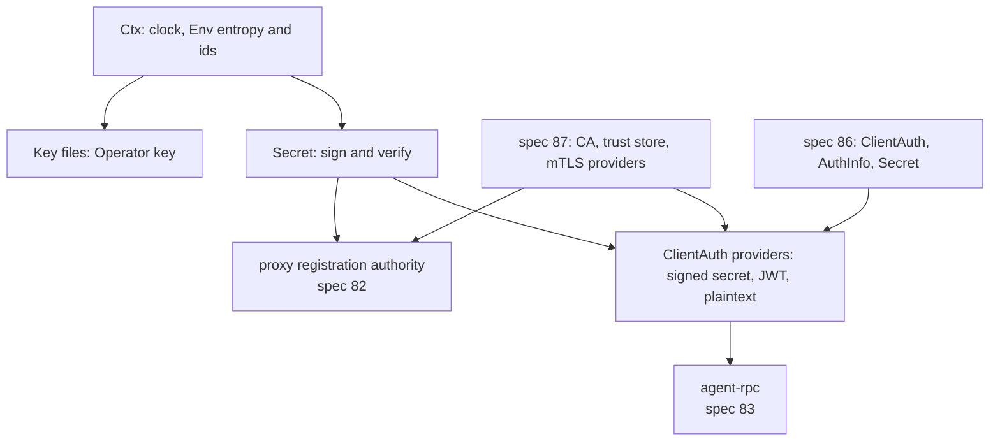

# Foundation Auth

_Written in ASD-STE100 Simplified Technical English (STE). Code and identifiers stay as they
are._

**Abbreviations in this file.** Transport Layer Security (TLS); mutual TLS (mTLS); JavaScript
Object Notation (JSON); JavaScript Web Token (JWT); Open Authorization (OAuth); OpenID Connect
(OIDC); key encryption key (KEK); key management service (KMS); Privacy-Enhanced Mail (PEM);
WebAssembly (wasm); trusted platform module (TPM); identifier (ID); AeroSpace and Defence
Industries Association of Europe (ASD), the owner of the STE standard ASD-STE100.

## Glossary

| Term | Meaning |
|---|---|
| Signed secret | Base64url JSON `{v, alg, public_key, secret, valid_from, valid_until, signature}`. It is **not** a JWT. |
| Operator key file | A private key that the operator makes with `ssh-keygen` or `openssl` and gives to the process. |
| `ClientAuth` | The provider trait that a server uses to check a client: signed secret, mTLS with a trust store, JWT, or plaintext for loopback. It is defined in spec 86. |
| Provider | One implementation of `ClientAuth`. This specification owns three of them. |
| Interceptor | Code that runs around each RPC handler. The one here runs a `ClientAuth` and puts the result in the request extensions. |

## 1. Purpose

The agent RPC server and the proxy have two independent auth links:

1. client ↔ agent-rpc: a signed secret, or mTLS on a direct connection,
2. sidecar → proxy registration authority: an enrollment token one time, then mTLS.

Both links need the same primitives. Three specifications now own them:

| Need | Owner |
|---|---|
| The `ClientAuth` trait, `AuthInfo`, `CallCredentials`, `Secret`, one constant-time compare, one bearer parser | Spec 86 |
| The certificate authority, the trust store, the rustls verifiers and the mTLS provider | Spec 87 |
| Signed secrets, operator key files, the signed-secret and JWT providers, the plaintext provider, the interceptor | This specification |

All of them live in `foundation_auth`.

`foundation_auth` already holds the application auth modules: OAuth, OIDC, JWT, sessions and
identity providers (spec 48). This specification adds the **server credential** modules. It does
not replace the existing modules.

## 2. Specification order

1. **Spec 86 lands first.** It defines `Secret`, `ClientAuth`, `AuthInfo`, `CallCredentials` and
   `AuthError`. Every provider in this specification implements that trait.
2. **Spec 87 lands next.** It adds the CA, the trust store, the verifiers and the mTLS provider.
   This specification's feature wires that provider into the provider set.
3. **Spec 80 lands before this specification.** The signed-secret code needs injected entropy
   and IDs (spec 84), and the trust store needs the migration groups.
4. **This specification unblocks 82.** The proxy registration authority's enrollment and mTLS
   come from spec 86, spec 87 and this specification.
5. **This specification unblocks 83.** The agent RPC core's provider set comes from here.

## 3. Feature index

| # | Feature | Description | Depends on | Status |
|---|---|---|---|---|
| 00 | [Foundation Auth](./features/00-foundation-auth/feature.md) | Signed secrets v1/v2 and key loading; the signed-secret, JWT and plaintext providers; the interceptor | Spec 86, spec 87, spec 80 | ⬜ Pending |

The feature keeps tasks T5 and T7 to T11 from the original spec 83 feature 11, without the CA,
trust-store and verifier tasks that moved to spec 87. Key protection at rest stays in spec 83
(feature 08), because it starts only after the agent RPC proof of concept works.

## 4. What this library owns

| Module | Types | Consumer |
|---|---|---|
| Secret | `SigningKey`, `SigningKeyConfig`, `SignedSecret`, `BootstrapSecrets` | 83 (bootstrap), 82 (enrollment token) |
| Key files | `KeySource`, `PrivateKey`, PEM parsing, file permissions, redacted `Debug` | 83, 82 |
| Providers | `SignedSecretAuth`, `JwtAuth` (feature flag), `InsecureNoAuth` | 83 |
| Interceptor | the connectrpc `auth` interceptor and the `AuthError` to Connect code map | 83 |

What this specification does **not** own:

| Item | Owner |
|---|---|
| `Secret`, `constant_time_eq`, `extract_bearer_token`, `bearer_header` | Spec 86 |
| `ClientAuth`, `AuthFuture`, `AuthInfo`, `CallCredentials`, `Principal`, `AuthMethod`, `AuthError` | Spec 86 |
| `CaStore`, `CertificateAuthority`, `TrustStore`, `ClientCertVerifier`, `ServerTlsConfig`, `MtlsConfig` | Spec 87 |
| `MtlsAuth`, `CfTlsClientAuth`, `CfMtlsAuth` | Spec 87 |
| The peer TLS facts on the connection | Spec 80, feature 00 |
| The `Env` bundle | Spec 84 |

## 5. Architecture

_The diagram shows this library's modules and the two specifications that it builds on._

**Two auth links, one library.** The client link and the sidecar link use different providers.
They share the key, secret and certificate code. A provider is chosen by configuration; a handler
sees only `AuthInfo`.

**No global crypto randomness.** Key generation and signing take entropy from `Env` (spec 84).
`ring`'s sealed random source is not used for keys that DST must replay. Certificates are signed
through a `RemoteKeyPair` with RFC 6979 nonces where the algorithm allows it (spec 87).

## 6. Success criteria (spec-wide)

- A server issues a signed secret with a time window, a client verifies it with only the public
  key, and a bad signature, a key mismatch or a time outside the window is rejected.
- An operator key file is accepted, and a corrupt file is an error, never overwritten.
- A server uses a `ClientAuth` provider without knowing the wire format. The handler sees only
  `AuthInfo`.
- No secret, private key or token appears in `Debug` or `Display` output.
- No secret is hard-coded and no key is read from a global. `Env` and the config provide both.
- The CA, the trust store, the verifiers and the mTLS providers are not defined here: spec 87
  owns them.

## 7. Out of scope

- **The auth primitives.** Spec 86 owns `Secret`, the trait and the result types.
- **The CA, the trust store and mTLS.** Spec 87 owns them. This specification names them in its
  provider set.
- **Key protection at rest.** Spec 83 feature 08 owns the keystore, KEK sources, WebCrypto and
  remote KMS. This library accepts operator key files.
- **The proxy's routing policy.** Spec 82 owns it.
- **Application login.** The existing OAuth, OIDC, JWT and session modules keep their behaviour.
- **Postgres storage.** `foundation_db` has no Postgres backend. The SQL is portable except for
  `?` placeholders; a later spec decides it.

## 8. Implementation location

- `backends/foundation_auth/src/secret/` — signed secrets and key loading.
- `backends/foundation_auth/src/client_auth/` — the providers of this specification and the
  re-export of the spec 86 primitives.
- The directories `pki/`, `trust/` and `mtls/` are **spec 87's**; this specification reads them
  and does not edit them.
- Existing modules (`oauth`, `oidc`, `jwt`, `session`, `idp`) stay where they are.

## 9. Module references

- `specifications/completed/81-foundation-auth/features/00-foundation-auth/auth.md` — the full design,
  moved from spec 83 feature 11. Sections 5, 6 and 7 are now pointers to spec 87.
- `specifications/completed/86-auth-primitives/requirements.md` — the trait and the result types.
- `specifications/completed/87-mutual-tls/mtls.md` — the CA, trust store, verifiers and mTLS providers.
- `backends/foundation_auth/src/lib.rs` — the existing public surface.
- `specifications/completed/84-context-injection/requirements.md` — entropy and ID injection.
- `specifications/completed/80-platform-prerequisites/features/00-transport-prerequisites/feature.md` —
  TLS peer facts.
- `specifications/completed/80-platform-prerequisites/features/01-migration-groups/feature.md` — the
  auth tables.

---

_Created: 2026-11-14_
_Last revised: 2026-11-15 (primitives moved to spec 86, mTLS to spec 87)._
_Structure: Feature-based (has_features: true)_
