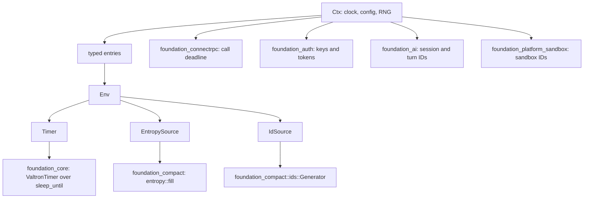

# Context Injection

_Written in ASD-STE100 Simplified Technical English (STE). Code and identifiers stay as they
are._

**Abbreviations in this file.** deterministic simulation testing (DST); random number
generator (RNG); identifier (ID); globally unique ID (GUID); WebAssembly (wasm); Hypertext
Transfer Protocol (HTTP); remote procedure call (RPC); Cloudflare Durable Object (DO);
application programming interface (API); continuous integration (CI); pull request (PR);
AeroSpace and Defence Industries Association of Europe (ASD), the owner of the STE standard
ASD-STE100.

## Glossary

| Term | Meaning |
|---|---|
| context | One value that carries the side-effect sources and a map of shared items. Spec 76 owns the type. |
| `Ctx` | The context type from spec 76. `clone` shares the same map. |
| typed entry | One value stored in the `Ctx` map under its Rust type. `Ctx::get::<T>()` reads it. |
| engine-minimum element | An element that every `Ctx` must carry: the clock, the config and the RNG (spec 76). |
| side effect | A result that depends on something outside the program: the time, the random generator, the operating system, a network. |
| effect | One injected source of a side effect: the clock, the timer, the entropy source or the ID source. |
| `Env` | The optional typed entry of this spec. It holds the timer, the entropy source and the ID source. |
| entropy source | The source of random bytes for keys, tokens and seeds. It is not the shared RNG of `Ctx`. |
| ID source | The source of new sortable IDs. |
| timer | The source of a wait that ends at a deadline. |
| host entry point | The `main` function, the test harness or the Worker entry that builds the first `Ctx` and the `Env`. |
| simulation | A test that replaces every effect with a seeded copy, so a run repeats exactly. |

## 1. Purpose

`Ctx` is the one way that code receives its side effects. Spec 76 built `Ctx` with three
engine-minimum elements: the clock, the config and the seeded RNG. Three effects are still
missing: the timer, the entropy source and the ID source.

Without this specification, each consumer adds its own parameter or its own global:

- `foundation_auth` needs entropy to make a key, a token or a certificate.
- `foundation_ai` needs IDs for a session and a turn.
- `foundation_connectrpc` needs a timer for a call deadline.
- The sandbox platform (spec 77) needs IDs for a sandbox and a timer for a boot deadline.

This specification adds the three effects to `foundation_context`, in one optional typed entry
named `Env`. Every consumer then reads them from `Ctx`. No consumer adds a parameter, a trait
bound or a global of its own.

The owner direction (2026-11-15): "Ctx should be the main means of all of such injection, env
might be something we add say for Cloudflare... lets create a small spec (featureless) that
adds the bits into foundation_context then others get it by default, we can refine the IdSource
and Env bundle idea there to make it clear and work with existing Ctx."

## 2. What spec 76 already did

| Done in spec 76 | Consequence here |
|---|---|
| `foundation_context::Ctx` exists, with `insert`, `store`, `get`, `get_cloned`, `get_or_insert`, `remove` and `contains`. | The typed entry is the mechanism. This spec adds one entry; it adds no second context type. |
| `Clock` and `MonotonicClock` live in `foundation_context`. | The clock is an engine-minimum element of `Ctx`. `Env` does not hold a second clock. |
| `Ctx` carries a seeded `ChaCha8Rng` (`ctx.rng()`). | The shared RNG stays on `Ctx`. `Env` holds the entropy source, which is a different thing. |
| `Ctx::fixed(clock)`, `Ctx::with_seed(seed)` and `Ctx::with_clock(clock)` exist. | A host builds the clock first, then the `Ctx`, then the `Env`. Section 6. |
| `SimulatedClock` stays in `foundation_core::valtron`. | The DST harness uses it as the one clock for the `Ctx` and the `Env`. |
| valtron's `sleep_until(deadline, ctx)` and `sleep_for(duration, ctx)` exist in `foundation_core::valtron::timer`. | The `Timer` impl is a thin trait object over them. Section 5.3. |

**Do not repeat spec 76.** If an item is already on master, mark it done with the commit and
write no code. A second context design is a defect.

## 3. The rule

1. Core logic reads every effect from the `Ctx`.
2. A missing `Env` is a typed error, never a silent fallback to a real global.
3. A typed entry is optional. A caller that needs one asks for it and handles absence. A caller
   that does not need one does not see it.
4. The `Ctx` carries no `Ctx`. The `Env` lives inside the `Ctx`, so no member of the `Env` may
   store a `Ctx`, directly or in a closure. A stored `Ctx` closes an `Arc` cycle, and the
   process never frees the map.
5. No new effect gets a function parameter. Add it to `Env` and read it from `Ctx`.
6. The `Env` bundle is not a second global. It is a value in the map. Two independent `Ctx`
   values can hold two different `Env` values, and each test builds its own.

Handles are not effects. A sandbox or container handle, a transport and a store are resources.
They travel in the wrapper of spec 77 section 6.0: one struct for each part
(`NativePlatform`, `DockerPlatform` or `CloudflarePlatform`), which implements the `Platform`
trait and holds the `Ctx`. Rule 4 applies to it: the wrapper holds a `Ctx`, so the `Ctx` cannot
hold the wrapper. This specification adds no method to `Ctx` for a handle, and no handle type.

## 4. Why `Ctx`, and not a process-wide `Env`

A process-wide `Env` (a `OnceLock` or a `static`) is the simplest shape and the wrong one:

| Property | `Env` in `Ctx` | `Env` in a global |
|---|---|---|
| Two tests in one process | Each test builds its own | One wins; the other sees the wrong effects |
| Two Worker requests in one isolate | Each request can carry its own | One `Env` for the isolate |
| A DST run replayed from a seed | The harness builds one `Env` per run | A second run needs a new process |
| A library embedded in another program | The host passes what it wants | The library decides for the host |
| A missing `Env` | A typed error at the use site | A panic or a fallback at start-up |

The owner note "env might be something we add say for Cloudflare" is why `Env` is optional: a
Cloudflare Worker entry builds it because `setTimeout`, WebCrypto and `Date.now` exist there in
a different shape from a native host. A native host builds it from the operating system. A
consumer that runs on both reads the same entry and names no platform.

## 5. Design

All of it is in `foundation_context`, in a new module `env`
(`backends/foundation_context/src/env/`). `foundation_context` already depends on
`foundation_compact`, which supplies the platform backends.



_The diagram shows one context with one optional entry and four consumers._

### 5.1 `Timer`

The timer waits until a monotonic deadline. It is the only effect that needs an executor, so
the trait is object-safe and the real implementation is in `foundation_core`, which owns
valtron.

```rust
// foundation_context/src/env/timer.rs
use core::future::Future;
use core::pin::Pin;

use crate::{Ctx, Instant};

/// A future that a `Timer` returns.
pub type TimerFuture = Pin<Box<dyn Future<Output = ()> + Send + 'static>>;

/// Waits until a monotonic deadline.
pub trait Timer: Send + Sync + 'static {
    /// Resolves when `deadline` has passed on the clock of `ctx`.
    ///
    /// `ctx` is a parameter and not a field: see rule 4 of section 3.
    fn sleep_until(&self, ctx: Ctx, deadline: Instant) -> TimerFuture;
}
```

The implementation is in `foundation_core`:

```rust
// foundation_core/src/valtron/timer.rs (added)
/// The real timer: valtron's `sleep_until` on the clock of the given `Ctx`.
#[derive(Debug, Clone, Copy, Default)]
pub struct ValtronTimer;

impl foundation_context::env::Timer for ValtronTimer {
    fn sleep_until(&self, ctx: Ctx, deadline: Instant) -> TimerFuture {
        Box::pin(async move { super::sleep_until(deadline, &ctx).await })
    }
}
```

`ValtronTimer` reads no clock. valtron compares the deadline with the clock of the `Ctx` that
the caller passed. So one timer works on real time and on simulated time, and the DST harness
advances the clock.

`foundation_connectrpc::DeadlineTimer` gets an adapter (`TimerDeadline`) so a call deadline
uses the injected time. `dispatch.rs` today calls `std::time::Instant::now()` for
`connect-timeout-ms`; that call panics on `wasm32-unknown-unknown` and becomes a `ctx.clock()`
read.

### 5.2 `EntropySource`

The entropy source gives random bytes. It is not the shared RNG: a key, a token or a seed must
not come from a stream that a caller can also draw from.

```rust
// foundation_context/src/env/entropy.rs
use foundation_compact::entropy;

/// The source of random bytes for keys, tokens and seeds.
pub trait EntropySource: Send + Sync + 'static {
    /// Fills `dest` with random bytes.
    ///
    /// # Errors
    /// The platform source failed. A caller must not continue with a half-filled buffer.
    fn fill(&self, dest: &mut [u8]) -> Result<(), entropy::Error>;
}

/// The operating-system source. Native: `getrandom`/`getentropy`. wasm: `crypto.getRandomValues`.
#[derive(Debug, Clone, Copy, Default)]
pub struct OsEntropy;

impl EntropySource for OsEntropy {
    fn fill(&self, dest: &mut [u8]) -> Result<(), entropy::Error> {
        foundation_compact::entropy::fill(dest)
    }
}

/// A seeded source. The same seed gives the same bytes on every run and every platform.
pub struct SeededEntropy { /* ChaCha12Rng behind a Mutex */ }

impl SeededEntropy {
    /// A source from `seed`. It cannot fail.
    #[must_use]
    pub fn new(seed: u64) -> Self;
}
```

`SeededEntropy` uses `ChaCha12Rng` from `foundation_compact::rng`, which already builds on every
target. It exists only for tests and for the DST harness; the type is available in every build
so that a test crate needs no extra feature.

### 5.3 `IdSource`

```rust
// foundation_context/src/env/ids.rs
use std::sync::Arc;

use foundation_compact::entropy;
use foundation_compact::ids::Id;

use crate::{Clock, Duration};

/// A source of new, sortable IDs.
pub trait IdSource: Send + Sync + 'static {
    /// A new ID. It does not fail after construction.
    fn next_id(&self) -> Id;
}

/// scru128 IDs from an injected clock and an injected entropy source.
pub struct Scru128Source { /* foundation_compact::ids::Generator behind a Mutex */ }

impl Scru128Source {
    /// Takes a 32-byte seed from `entropy` one time.
    ///
    /// # Errors
    /// The entropy source failed.
    pub fn new(clock: Arc<dyn Clock>, entropy: &dyn EntropySource) -> Result<Self, entropy::Error>;
}

impl IdSource for Scru128Source { /* generator.generate() */ }

/// A counter: `1`, `2`, `3`, … as the low bits of an `Id`. Deterministic, for tests.
pub struct CounterSource { /* AtomicU64 */ }

impl CounterSource {
    #[must_use]
    pub fn new(start: u64) -> Self;
}
```

`Scru128Source` builds the existing `foundation_compact::ids::Generator` with two adapters: a
`RandSource` over a seeded ChaCha12 and a `TimeSource` over the `Arc<dyn Clock>` that the
caller passes. The seed is read one time, so `next_id` cannot fail. With `SimulatedClock` and
`SeededEntropy`, the IDs are the same on every run.

`CounterSource` gives short, readable IDs for a test that asserts on a value. It is not for
production.

### 5.4 `Env`

```rust
// foundation_context/src/env/mod.rs
use std::sync::Arc;

/// The side-effect sources that are not engine-minimum elements of `Ctx`.
///
/// Clone is cheap: each field is an `Arc`. The `Ctx` holds one `Env` as a typed entry.
#[derive(Clone)]
pub struct Env {
    timer: Arc<dyn Timer>,
    entropy: Arc<dyn EntropySource>,
    ids: Arc<dyn IdSource>,
}

impl Env {
    /// An `Env` from three sources.
    #[must_use]
    pub fn new(timer: Arc<dyn Timer>, entropy: Arc<dyn EntropySource>, ids: Arc<dyn IdSource>) -> Self;

    #[must_use] pub fn timer(&self) -> Arc<dyn Timer>;
    #[must_use] pub fn entropy(&self) -> Arc<dyn EntropySource>;
    #[must_use] pub fn ids(&self) -> Arc<dyn IdSource>;

    /// Builders for a test that replaces one member and keeps the rest.
    #[must_use] pub fn with_timer(self, timer: Arc<dyn Timer>) -> Self;
    #[must_use] pub fn with_entropy(self, entropy: Arc<dyn EntropySource>) -> Self;
    #[must_use] pub fn with_ids(self, ids: Arc<dyn IdSource>) -> Self;
}

/// Why an `Env` is not available.
#[derive(Debug, Clone, PartialEq, Eq, derive_more::Display, derive_more::Error)]
pub enum EnvError {
    /// The context holds no `Env`. The host did not install one.
    #[display("the context holds no Env (the host did not install one)")]
    Missing,
    /// A real source failed while the host built the `Env`.
    #[display("the effect source failed: {_0}")]
    Source(#[error(not(source))] String),
}
```

The `Ctx` accessors are inherent methods in `foundation_context/src/lib.rs`:

```rust
impl Ctx {
    /// The `Env` entry, when the host installed one.
    #[must_use]
    pub fn env(&self) -> Option<Arc<Env>> { self.get::<Env>() }

    /// The `Env` entry.
    ///
    /// # Errors
    /// [`EnvError::Missing`] when the host installed no `Env`.
    pub fn require_env(&self) -> Result<Arc<Env>, EnvError> {
        self.env().ok_or(EnvError::Missing)
    }
}
```

`Ctx::get::<T>()` keys on `TypeId`, so a trait object cannot be a typed entry on its own. The
`Env` struct is the entry. This is the reason for a bundle and not three separate entries: a
caller that wants all three makes one `get` and gets one error.

### 5.5 What each host builds

The builders are in `foundation_core::env`. They need `ValtronTimer`, and `foundation_core`
depends on `foundation_context`, not the reverse.

```rust
// foundation_core/src/env.rs
/// The real effects of a native host.
///
/// # Errors
/// [`EnvError::Source`] when the operating-system entropy source fails.
pub fn system(ctx: &Ctx) -> Result<Env, EnvError>;

/// The real effects of a Worker or a browser page.
///
/// # Errors
/// [`EnvError::Source`] when WebCrypto entropy fails.
pub fn wasm(ctx: &Ctx) -> Result<Env, EnvError>;

/// The effects of a simulation. The same `ctx` clock and the same `seed` replay the run.
///
/// # Errors
/// [`EnvError::Source`] when the seeded source cannot be built.
pub fn simulated(ctx: &Ctx, seed: u64) -> Result<Env, EnvError>;

/// Stores the result in `ctx` and returns it.
///
/// # Errors
/// The error of the builder that `build` calls.
pub fn install(ctx: &Ctx, build: fn(&Ctx) -> Result<Env, EnvError>) -> Result<Env, EnvError>;
```

| Host | Clock | Timer | Entropy | IDs |
|---|---|---|---|---|
| Native program, CLI, server | `MonotonicClock` | `ValtronTimer` | `OsEntropy` | `Scru128Source` |
| Cloudflare Worker, browser | `MonotonicClock` (JS `performance`) | `ValtronTimer` (valtron `setTimeout`) | `OsEntropy` (WebCrypto) | `Scru128Source` |
| Test, DST | `SimulatedClock` | `ValtronTimer` | `SeededEntropy(seed)` | `Scru128Source` over the same clock |
| Test that asserts on a value | `Ctx::fixed(..)` | `ValtronTimer` | `SeededEntropy(seed)` | `CounterSource` |

A host builds the clock first, then the `Ctx`, then the `Env`, then stores it:

```rust
let clock: Arc<dyn Clock> = Arc::new(MonotonicClock::new());
let ctx = Ctx::fixed(clock);
let env = foundation_core::env::system(&ctx)?;
ctx.store(env);
```

The `Env` is optional in the type, and required in practice by the services that need an
effect. `foundation_auth`, `foundation_ai`, `foundation_connectrpc` and the sandbox platform
return `EnvError::Missing` when a host did not install one. That is a start-up error, not a
silent fallback.

### 5.6 The `#[valtron]` macro argument

```rust
#[valtron(env = env)]
fn work(ctx: Ctx) -> WorkResult {
    // `env` is in scope, already unwrapped from `Ctx::require_env`.
    let id = env.ids().next_id();
    ...
}

#[valtron_test(env = env, seed = 7)]
fn test_work() { ... }
```

`env` takes an expression that gives `Env` or `Result<Env, E>`. The macro installs it in the
pool's root `Ctx` before the body runs, as [env.md](./env.md) section 8 specifies. Spec 82 uses
this form: `#[valtron(env = Env::system())]`. `#[valtron_test(env = .., seed = ..)]` builds
`foundation_core::env::simulated` from the seed, stores it, and runs the task on a pool that
uses that `Ctx`.

`single::initialize_pool_with(ctx)` starts the pool with a caller-built `Ctx`, so an embedding
program chooses the `Env` and the clock. The plain `initialize_pool()` builds a host `Ctx` with
`Env::system` and fails with a panic and a clear message when the entropy source is absent.

### 5.7 `IdSource` and the sandbox ID policy

Spec 77 defined `enum IdSource { Random, Fixed(SandboxId) }` as the policy of the control
plane: generate an ID, or use the one that the caller gives (a Cloudflare DO name). It is the
same name as the trait of section 5.3 and a different idea.

The owner direction (2026-11-15): one of the two changes name. The trait keeps `IdSource`,
because it is the effect. The sandbox policy is renamed `SandboxIdPolicy` in spec 77 feature
00. Spec 77 then reads:

```rust
pub enum SandboxIdPolicy { Random, Fixed(SandboxId) }
```

A sandbox policy that generates an ID calls `env.ids().next_id()`. The rename is part of this
specification's change set, and spec 77 records it as decision D16.

## 6. Enforcement

1. A `clippy.toml` in `foundation_core`, `foundation_auth`, `foundation_ai`,
   `foundation_connectrpc`, `foundation_platform_sandbox` and `foundation_http` lists the
   globals that core code may not call:

   ```toml
   disallowed-methods = [
     { path = "std::time::SystemTime::now", reason = "read ctx.clock().wall_now()" },
     { path = "std::time::Instant::now", reason = "read ctx.clock().now()" },
     { path = "rand::thread_rng", reason = "read ctx.rng() or ctx.require_env()?.entropy()" },
     { path = "foundation_compact::entropy::fill", reason = "read ctx.require_env()?.entropy()" },
     { path = "foundation_compact::ids::new_scru128", reason = "read ctx.require_env()?.ids()" },
   ]
   ```

2. A test crate turns the lint off in its own `clippy.toml`. Tests build effects on purpose.
3. A host entry point is the only place that names `OsEntropy`, `MonotonicClock` or a
   `Scru128Source`. `grep -rn "OsEntropy" backends/*/src` returns host wiring only.

## 7. Acceptance scenarios

**S1 — A library reads an ID.**
Given a test that stores `Env::new(.., .., CounterSource::new(1))` in a `Ctx`,
when it calls `ctx.require_env()?.ids().next_id()` two times,
then the IDs are `1` and `2`, and the test asserts on them directly.

**S2 — A host forgot the `Env`.**
Given a `Ctx` with no `Env` entry,
when code calls `ctx.require_env()`,
then the result is `Err(EnvError::Missing)` with the text "the context holds no Env",
and no real clock, entropy source or ID generator is used.

**S3 — A simulation replays.**
Given a `SimulatedClock` and `env::simulated(&ctx, 7)`,
when a run makes 100 IDs and 10 waits and the harness replays it with seed 7,
then every ID, every deadline and every wake order is equal.

**S4 — A Worker builds its own effects.**
Given a Worker entry that calls `env::wasm(&ctx)`,
when a request asks for a timer wait and for a key,
then the wait uses `setTimeout`, the key uses WebCrypto entropy, and no native call is made.

**S5 — A call deadline uses the injected clock.**
Given a connectrpc call with `connect-timeout-ms` under a `SimulatedClock`,
when the harness advances the clock past the deadline,
then the call ends with `DeadlineExceeded` and `std::time::Instant::now` was never called.

**S6 — The `Env` does not store the `Ctx`.**
Given a stored `Env`,
when the `Ctx` that holds it is dropped,
then the `Arc` count of the map reaches zero and the map is freed.

## 8. Tests

All tests are in `backends/foundation_context/tests/` and `backends/foundation_core/tests/`,
never inline (root rule 7).

| Law or scenario | Test | Oracle |
|---|---|---|
| S1 | `counter_ids` | expected outcome |
| S2 | `missing_env_is_typed` (the exact variant and text) | expected outcome |
| S3 | `simulated_replay` (two runs, same seed, equal traces) | identity |
| S4 | `wasm_env` (wasm target, `wasm-bindgen-test`) | expected outcome |
| S5 | `deadline_on_simulated_clock` | expected outcome |
| S6 | `env_does_not_hold_ctx` (`Arc::strong_count` of the map after drop) | bound |
| `Scru128Source` is sortable | `ids_are_sortable` (1000 IDs are strictly increasing) | property |
| `SeededEntropy` repeats | `seeded_entropy_repeats` | identity |
| `Timer` uses the given `Ctx` | `timer_uses_ctx_clock` | expected outcome |
| The lint is active | `no_global_clock_in_core` (a source scan of the listed crates) | expected outcome |
| The `Env` is `Send + Sync` | `env_is_send_sync` (a compile-time bound) | build |

## 9. Tasks

| Task | What | Main files | Done when |
|---|---|---|---|
| T1 | `Timer`, `EntropySource`, `IdSource` traits; `OsEntropy`, `SeededEntropy`, `Scru128Source`, `CounterSource` | `foundation_context/src/env/` | the contract tests pass natively and on wasm |
| T2 | `Env`, `EnvError`, `Ctx::env`, `Ctx::require_env`; `foundation_core::env::{system, wasm, simulated, install}`; `ValtronTimer` | `foundation_context/src/{env,lib}.rs`, `foundation_core/src/{env.rs,valtron/timer.rs}` | `env_tests`, `missing_env_is_typed`, `simulated_replay` pass |
| T3 | `#[valtron(env = …)]`, `#[valtron_test(env = …, seed = …)]`; `single::initialize_pool_with` | `foundation_macros/src/`, `foundation_core/src/valtron/single.rs` | the macro tests pass on the `uat` profile |
| T4 | The lint: six `clippy.toml` files and one `clippy.toml` exemption for tests | the six crates | `no_global_clock_in_core` passes and `cargo clippy` is clean |
| T5 | `foundation_ai` reads IDs and time through `Env` (`SessionId::from_id`) | `foundation_ai/src/agentic/` | the agent loop runs under a simulated `Env` with stable IDs |
| T6 | The DST replay test and its harness | `foundation_core/tests/`, `foundation_testing/src/` | the same seed gives the same trace in two processes |

The task numbers T1, T2 and T12 of the old spec 80 feature 00 keep their meaning; T12 is T5
here.

## 10. Verify

```bash
cargo test -p foundation_context --profile uat
cargo test -p foundation_core --profile uat env
cargo test -p foundation_ai --profile uat agentic
cargo clippy -p foundation_context -p foundation_core -p foundation_ai --profile uat -- -D warnings
# wasm target (the Worker and the browser share this code)
cargo test -p foundation_context --target wasm32-unknown-unknown --profile uat
```

The `uat` profile is the verification profile (see the valtron test profile note). The `dev`
profile uses cranelift and is for development only.

## 11. Done when

- `foundation_context` holds `Env` and the three traits, and `Ctx` has `env` and `require_env`.
- A host builds the `Env` in `foundation_core::env` and stores it in one line.
- `foundation_ai`, `foundation_auth`, `foundation_connectrpc` and the sandbox platform name no
  global clock, entropy call or ID generator in core logic; the lint proves it.
- A DST run with one seed gives the same trace on a second run.
- Spec 77 uses `SandboxIdPolicy` and names no `IdSource` enum.
- `progress.md` and `LEARNINGS.md` are current.

## 12. Open questions

| # | Question | State |
|---|---|---|
| Q1 | Is a separate `Env` bundle needed at all, or are three typed entries better? | Closed (2026-11-15): one bundle. `Ctx::get` keys on one type, so one `get` and one error are simpler than three. |
| Q2 | Does `Env` hold the clock? | Closed (2026-11-15): no. The clock, the config and the RNG are engine-minimum elements of `Ctx` (spec 76). A second clock would break the "one clock per run" law of the DST harness. |
| Q3 | Is `Timer` in `foundation_core` or `foundation_context`? | Closed (2026-11-15): the trait in `foundation_context`, the valtron implementation in `foundation_core`. The dependency runs one way, `foundation_core` → `foundation_context`. |
| Q4 | What happens when a host installs no `Env`? | Closed (2026-11-15): `EnvError::Missing` at the first use. A service that needs an effect fails at start-up with that error. |
| Q5 | Can a `Timer` store the `Ctx`? | Closed (2026-11-15): no. It takes the `Ctx` as an argument. A stored `Ctx` is an `Arc` cycle (rule 4). |

---

_Created: 2026-11-15_
_Structure: Single document (has_features: false). The design of the effects and the bundle
started as spec 80 feature 00; this specification owns it now._
