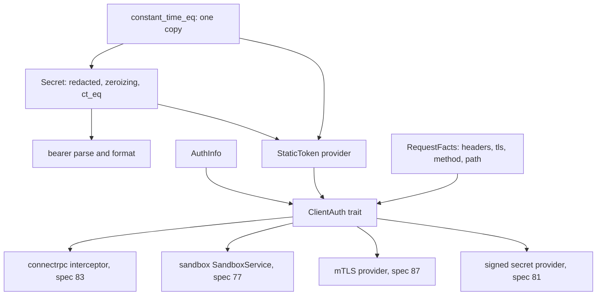

# Auth Primitives

_Written in ASD-STE100 Simplified Technical English (STE). Code and identifiers stay as they
are._

**Abbreviations in this file.** Transport Layer Security (TLS); mutual TLS (mTLS); remote
procedure call (RPC); Hypertext Transfer Protocol (HTTP); Request for Comments (RFC), an
internet standard document; JavaScript Object Notation (JSON); WebAssembly (wasm); client-side
JavaScript (CSJS); application programming interface (API); continuous integration (CI);
AeroSpace and Defence Industries Association of Europe (ASD), the owner of the STE standard
ASD-STE100.

## Glossary

| Term | Meaning |
|---|---|
| secret | A text that a caller must keep private: a token, a password, a key in text form. |
| redacted | A value whose `Debug` and `Display` forms print no part of the secret. |
| bearer token | A secret in the `Authorization: Bearer <token>` header (RFC 9110). The holder may use it. |
| constant-time comparison | A comparison whose running time does not depend on where the two values differ. |
| principal | The identity that a server knows about a caller after authentication. |
| `AuthInfo` | The result of one authentication: the principal, its scopes, and the artifacts that the provider proved. |
| `ClientAuth` | The trait of one authentication provider: a static token, a signed secret, mTLS, a JSON Web Token (JWT). |
| provider | One implementation of `ClientAuth`. |
| interceptor | The connectrpc hook that authenticates a call before the handler runs. |

## 1. Purpose

Three specifications need the same small auth types, and two of them planned their own copy:

| Planned before this specification | Where | Duplicate |
|---|---|---|
| `pub struct Secret(String)` | Spec 77 feature 00, section 6.10 | A second redacted string type; `foundation_auth::ConfidentialText` is the first. |
| `pub fn check_bearer(header, token) -> SandboxResult<()>` | Spec 77 feature 02, section 6.10 | A second bearer parser; `foundation_auth::extract_bearer_token` is the first. |
| `ClientAuth`, `AuthInfo`, the providers | Spec 81 feature 00 | The trait exists only there; a sandbox server cannot use it without spec 81. |

The owner direction (2026-11-15): "lets have another small spec own this and implement all the
need bits into foundation_auth, then others depend on it and refine it as needed."

So this specification puts the building blocks in `foundation_auth`, before spec 81 (signed
secrets), spec 87 (mutual TLS), spec 77 (sandbox service auth) and spec 83 (agent RPC auth).
Each of them implements `ClientAuth` and does not define a secret type or a bearer parser.

## 2. What exists today

| Item | State on master |
|---|---|
| `ConfidentialText` | `foundation_auth/src/shared/types.rs:17`. A `Zeroizing<String>` newtype. `Display` prints `Confidential(<first char><stars>)`, so it leaks the first character and the length. |
| `extract_bearer_token` | `foundation_auth/src/shared/middleware.rs:123`. Case-insensitive per RFC 9110. Returns a `String`. |
| `AuthContext` | `foundation_auth/src/shared/middleware.rs:15`. A principal: subject, token, scopes. |
| `AuthInfo` | `foundation_connectrpc/src/shared/auth.rs:56`. Holds `AuthContext` and an `Extensions` map. |
| `AuthFunc` | `foundation_connectrpc/src/shared/auth.rs:118`. An async closure shape for connectrpc. It stays in connectrpc. |
| `ClientAuth` | Does not exist in the workspace. |
| `constant_time_eq` | One public copy in `foundation_auth/src/shared/two_factor.rs:355` and three private copies in `server/models/client.rs:49`, `server/models/token.rs:38` and `shared/password_hash.rs:239`. |
| `TlsInfo` | `foundation_netio/src/shared/context.rs:69`. Holds the peer certificate chain in DER (Distinguished Encoding Rules) and the negotiated server name. |
| `SimpleHeaders` | `foundation_netio/src/shared/http/impls.rs:667`. |

`foundation_connectrpc` already depends on `foundation_auth`, so moving `AuthInfo` there
reverses no dependency.

## 3. Design



_The diagram shows one secret type, one comparison, one trait and four providers._

All of it is in `foundation_auth`, in a new module `server_credential`. The existing
application modules (`oauth`, `oidc`, `jwt`, `session`, `idp`) do not change.

```rust
// foundation_auth/src/server_credential/mod.rs
mod secret;
mod bearer;
mod call;
mod client_auth;
mod static_token;

pub use secret::Secret;
pub use bearer::{extract_bearer_token, bearer_header};
pub use call::CallCredentials;
pub use client_auth::{AuthError, AuthFuture, AuthInfo, AuthMethod, ClientAuth, Principal};
pub use static_token::StaticToken;
pub use crate::shared::constant_time_eq;
```

### 3.1 `Secret`

```rust
/// A text that must stay private.
///
/// It is zeroized on drop. `Debug` and `Display` print `<redacted>`, so a log line, an error
/// message or a panic cannot show it. Comparison is constant-time.
#[derive(Clone, From)]
pub struct Secret(Zeroizing<String>);

impl Secret {
    /// A secret from a value.
    #[must_use]
    pub fn new(value: impl Into<String>) -> Self;

    /// The text. Every call site is a place where the secret may leak; keep them few.
    #[must_use]
    pub fn expose(&self) -> &str;

    #[must_use]
    pub fn is_empty(&self) -> bool;

    /// Constant-time equality.
    #[must_use]
    pub fn ct_eq(&self, other: &Secret) -> bool;

    /// The secret from an `Authorization: Bearer` value (RFC 9110).
    ///
    /// # Errors
    /// `None` when the header is absent, when the scheme is not `Bearer`, or when the token
    /// is empty. A non-ASCII or control byte is not a valid token and gives `None`.
    #[must_use]
    pub fn from_bearer(header: Option<&str>) -> Option<Self>;
}

impl fmt::Debug for Secret    { /* "Secret(<redacted>)" */ }
impl fmt::Display for Secret  { /* "<redacted>" */ }
impl PartialEq for Secret     { /* ct_eq */ }
impl Eq for Secret            {}
impl Serialize for Secret     { /* the text, for a JSON manifest */ }
impl<'de> Deserialize<'de> for Secret { /* from a JSON string */ }

/// The old name of `Secret`. It is an alias for one release, then it is removed.
pub type ConfidentialText = Secret;
```

Rules:

1. `Display` and `Debug` show `<redacted>`. No character of the secret and no length is shown.
   The old `ConfidentialText` form showed the first character and the length; that is a small
   leak and it is removed.
2. `expose()` is the only way to read the text. `grep -rn "\.expose()" backends/` is the list
   of the places to audit.
3. Comparison uses the one `constant_time_eq` of section 3.2. A derived `PartialEq` on a
   secret is a defect.
4. `from_bearer` accepts only the ASCII visible range `0x21..=0x7E` for the token, so a header
   with a control byte is refused and not passed to a verifier.

### 3.2 One `constant_time_eq`

```rust
// foundation_auth/src/shared/mod.rs
/// Constant-time equality of two byte strings. The running time depends on the lengths only.
#[must_use]
pub fn constant_time_eq(a: &[u8], b: &[u8]) -> bool;
```

The four existing copies become calls to it. A copy in a test crate is acceptable and must say
why it does not use the shared one.

### 3.3 Bearer

```rust
// foundation_auth/src/server_credential/bearer.rs
/// The token from an `Authorization: Bearer` value (RFC 9110). The scheme is case-insensitive.
#[must_use]
pub fn extract_bearer_token(auth_header: Option<&str>) -> Option<String>;

/// The header value for a secret: `Bearer <token>`.
#[must_use]
pub fn bearer_header(secret: &Secret) -> String;
```

`extract_bearer_token` keeps its signature and its home, so the existing callers do not change.
It is now one line over `Secret::from_bearer`. `bearer_header` is the one place that builds the
header, so a client and a test do not write `format!("Bearer {}", ..)`.

### 3.4 `AuthInfo` and `AuthContext`

`AuthInfo` moves from `foundation_connectrpc` to `foundation_auth`:

```rust
/// The result of one successful authentication.
#[derive(Clone, Debug)]
pub struct AuthInfo {
    /// The principal: subject, scopes, roles.
    pub context: AuthContext,
    /// The artifacts that the provider proved: verified claims, a peer certificate, a session.
    pub artifacts: Extensions,
}

impl AuthInfo {
    #[must_use] pub fn new(context: AuthContext) -> Self;
    #[must_use] pub fn with_artifact<T: Send + Sync + 'static>(self, artifact: T) -> Self;
}
```

`foundation_connectrpc::shared::auth` re-exports it (`pub use foundation_auth::AuthInfo;`), so
`get_auth_info`, `get_auth_artifact`, `JwtAuthenticator`, `CompositeAuthenticator` and
`AuthzInterceptor` keep their names and their behaviour. `AuthFunc` stays in connectrpc,
because it is a hook of that framework.

`AuthContext` stays in `foundation_auth/src/shared/middleware.rs`. It already carries the
subject, the token and the scopes.

### 3.5 `CallCredentials` and `ClientAuth`

The shape of these two types is not new. Spec 81 feature 00 section 8.1 designed it. It moves
here unchanged, because a sandbox server needs the same trait and must not depend on spec 81.
The names stay the same, so the providers of spec 81 and spec 87 read the same text.

```rust
// foundation_auth/src/server_credential/call.rs
use foundation_netio::shared::context::ConnectionContext;
use foundation_netio::shared::http::{Extensions, SimpleHeaders};

/// What a provider may look at for one call.
#[derive(Clone, Copy)]
pub struct CallCredentials<'a> {
    /// The full procedure path, for example "/ewe.sandbox.control.v1.SandboxService/Create".
    pub procedure: &'a str,
    /// The request headers.
    pub headers: &'a SimpleHeaders,
    /// Peer address and TLS facts. The peer certificate is here on a native mTLS host.
    pub connection: &'a ConnectionContext,
    /// Facts that the host added, for example `CfTlsClientAuth` on a Worker.
    pub extensions: &'a Extensions,
}
```

```rust
// foundation_auth/src/server_credential/client_auth.rs
/// The result of one successful authentication.
#[derive(Clone, Debug)]
pub struct AuthInfo {
    /// The principal: subject, scopes, roles.
    pub context: AuthContext,
    /// The artifacts that the provider proved: verified claims, a peer certificate, a session.
    pub artifacts: Extensions,
}

impl AuthInfo {
    #[must_use] pub fn new(context: AuthContext) -> Self;
    #[must_use] pub fn with_artifact<T: Send + Sync + 'static>(self, artifact: T) -> Self;
}

/// Who called. Every provider puts one into `AuthInfo::artifacts`.
#[derive(Debug, Clone, PartialEq, Eq)]
pub struct Principal {
    pub subject: String,
    pub method: AuthMethod,
    pub roles: Vec<String>,
}

#[derive(Debug, Clone, PartialEq, Eq)]
pub enum AuthMethod {
    ClientCertificate { fingerprint_sha256: String },
    SignedSecret { secret_id: String },
    Jwt { issuer: String },
    CloudflareMtls { fingerprint_sha256: String },
    /// One shared token. This specification adds this variant.
    SharedToken { name: String },
    /// `InsecureNoAuth` (development only).
    Insecure,
    /// A Durable Object: the Worker already checked the caller.
    Forwarded,
}

pub type AuthFuture<'a> = Pin<Box<dyn Future<Output = Result<Option<AuthInfo>, AuthError>> + Send + 'a>>;

/// Checks the credentials of one call.
pub trait ClientAuth: Send + Sync + 'static {
    /// The mode for logs and for `GetCapabilities.auth_modes`.
    fn mode(&self) -> &'static str;

    /// - `Ok(Some(info))`: the caller is known.
    /// - `Ok(None)`: the call has no credentials of this kind; try the next provider.
    /// - `Err(_)`: the call has credentials of this kind, and they are not good.
    fn authenticate<'a>(&'a self, call: CallCredentials<'a>) -> AuthFuture<'a>;
}

/// Why authentication did not succeed.
#[derive(Debug, Clone, PartialEq, Eq, derive_more::Display, derive_more::Error)]
pub enum AuthError {
    #[display("invalid credentials: {_0}")]
    Invalid(#[error(not(source))] String),
    #[display("credentials expired")]
    Expired,
    #[display("credentials not valid yet")]
    NotYetValid,
    #[display("credentials revoked")]
    Revoked,
    #[display("credentials already used")]
    Spent,
    #[display("not allowed: {_0}")]
    Forbidden(#[error(not(source))] String),
    #[display("auth store unavailable: {_0}")]
    Unavailable(#[error(not(source))] String),
    #[display("auth misconfigured: {_0}")]
    Misconfigured(#[error(not(source))] String),
}
```

Rules:

1. `Ok(None)` means "no credential of this kind". It is not an error. A composite provider
   (`AnyOf`, spec 83 feature 03) tries the next provider after `Ok(None)` and stops after
   `Err`.
2. `AuthError` maps to Connect codes as spec 81 feature 00 section 8.1 says: `Invalid`,
   `Expired`, `NotYetValid`, `Revoked` and `Spent` → `UNAUTHENTICATED`; `Forbidden` →
   `PERMISSION_DENIED`; `Unavailable` → `UNAVAILABLE`; `Misconfigured` → `INTERNAL`.
3. The message names the failure and never contains the credential, a key or a fingerprint of
   the token.
4. A provider reads the credential from `call`, never from a thread-local or a global.
5. A provider that needs entropy, a clock or a key takes it from the `Ctx` at construction
   (spec 84). `authenticate` has no `Ctx` parameter: the provider is a service, built one time.

### 3.6 `StaticToken`

```rust
// foundation_auth/src/server_credential/static_token.rs
/// One shared token. Every caller that shows the token is the same principal.
pub struct StaticToken {
    token: Secret,
    name: String,
}

impl StaticToken {
    /// A provider for `token`. The principal name is `shared-token`.
    #[must_use]
    pub fn new(token: Secret) -> Self;

    /// A provider with a principal name.
    #[must_use]
    pub fn named(self, name: impl Into<String>) -> Self;
}

impl ClientAuth for StaticToken {
    fn mode(&self) -> &'static str { "shared-token" }

    /// `Ok(Some(..))` on a match; `Ok(None)` with no header;
    /// `Err(AuthError::Invalid)` with a wrong token.
    fn authenticate<'a>(&'a self, call: CallCredentials<'a>) -> AuthFuture<'a>;
}
```

This is the provider that the sandbox Worker (spec 77 feature 08), the sandbox control plane
(spec 77 feature 02) and a loopback test use. It is not for production on an open network: one
token is one principal, and revocation means a restart.

## 4. Consumers

| Consumer | Uses | Its own work |
|---|---|---|
| Spec 77 feature 00 | `Secret` (delete its own struct) | Replace `Secret(String)` with `foundation_auth::Secret`; delete the doc comment that says the type must be local |
| Spec 77 feature 02 | `StaticToken`, `extract_bearer_token` (delete `check_bearer`) | `ControlService` holds an `Arc<dyn ClientAuth>`; the token error becomes `SandboxError::Unauthorized` |
| Spec 77 feature 07, 08 | `Secret`, `bearer_header`, `StaticToken` | The DO client uses `bearer_header`; the Worker entry uses `StaticToken` |
| Spec 81 feature 00 | `AuthInfo`, `CallCredentials`, `ClientAuth`, `AuthError`, `Secret` | Its signed-secret and JWT providers implement `ClientAuth`; section 8.1 of its `auth.md` moves here |
| Spec 87 | `ClientAuth`, `AuthInfo`, `CallCredentials` | Its mTLS provider implements `ClientAuth` and reads `call.connection.tls` |
| Spec 83 feature 03, 04 | `AuthInfo` (through the connectrpc re-export) | No change to the interceptor |

## 5. Acceptance scenarios

**S1 — A secret never prints.**
Given `Secret::new("hunter2")`, when the value is formatted with `{:?}` and with `{}`, then the
text is `Secret(<redacted>)` and `<redacted>`, and `hunter2` appears in neither.

**S2 — A wrong token is refused in constant time.**
Given a `StaticToken` with a 32-byte token, when a caller sends a 32-byte wrong token, then the
result is `AuthError::Invalid`, and the comparison time does not depend on the first differing
byte (a statistical test over 1000 samples passes).

**S3 — A missing header is `Ok(None)`.**
Given a request with no `Authorization` header, when `StaticToken::authenticate` runs, then the
result is `Ok(None)`, never a panic and never an error. A composite provider then tries the
next provider.

**S4 — A header with a control byte is refused.**
Given `Authorization: Bearer tok\0en`, when `Secret::from_bearer` runs, then the result is
`None`, and no verifier sees the value.

**S5 — The scheme is case-insensitive.**
Given `authorization: bearer abc`, when `extract_bearer_token` runs, then the result is
`Some("abc")`.

**S6 — `AuthInfo` has one home.**
Given a crate that uses `foundation_connectrpc::shared::auth::AuthInfo`, when it is rebuilt
after this change, then the same path resolves to the `foundation_auth` type and the code
compiles with no change.

**S7 — One comparison.**
Given the five crates that compare credentials, when the tree is searched for a private
`fn constant_time_eq`, then only the one in `foundation_auth::shared` exists.

## 6. Tests

All tests are in `backends/foundation_auth/tests/`.

| Law or scenario | Test | Oracle |
|---|---|---|
| S1 | `secret_is_redacted` | expected outcome |
| S2 | `static_token_constant_time` (the statistical test) | property |
| S3 | `static_token_no_header_is_none` | expected outcome |
| S4 | `bearer_control_byte` | expected outcome |
| S5 | `bearer_case_insensitive` | expected outcome |
| S6 | `auth_info_single_home` (a compile test that uses both paths) | build |
| S7 | `one_constant_time_eq` (a source scan) | expected outcome |
| `Secret` equals itself; a one-character change is unequal | `secret_eq` (property) | property |
| `bearer_header` round-trips | `bearer_round_trip` (property) | identity |
| `extract_bearer_token` accepts no token with a space | `bearer_no_space` | expected outcome |
| `AuthError` text holds no secret | `auth_error_no_secret` (each message against the token) | expected outcome |

## 7. Tasks

| Task | What | Main files | Done when |
|---|---|---|---|
| T1 | `Secret`; the `ConfidentialText` alias; redacted `Debug` and `Display`; `PartialEq` by `ct_eq`; serde | `foundation_auth/src/server_credential/secret.rs` | `secret_is_redacted`, `secret_eq` pass |
| T2 | One `constant_time_eq`; delete the four copies | `foundation_auth/src/shared/mod.rs` and the four files | `one_constant_time_eq` passes |
| T3 | `extract_bearer_token` over `Secret::from_bearer`; `bearer_header` | `foundation_auth/src/server_credential/bearer.rs`, `shared/middleware.rs` | `bearer_round_trip`, `bearer_case_insensitive`, `bearer_control_byte` pass |
| T4 | `AuthInfo` moves to `foundation_auth`; connectrpc re-exports it | `foundation_auth/src/server_credential/client_auth.rs`, `foundation_connectrpc/src/shared/auth.rs` | `auth_info_single_home` compiles; the connectrpc auth tests pass |
| T5 | `CallCredentials`, `ClientAuth`, `AuthInfo`, `Principal`, `AuthMethod`, `AuthError`; the `SharedToken` variant | `foundation_auth/src/server_credential/{call,client_auth}.rs` | the trait is object-safe (`Arc<dyn ClientAuth>` compiles) |
| T6 | `StaticToken`; version bumps and the consumer list in section 4 | `foundation_auth/src/server_credential/static_token.rs` | `static_token_missing`, `static_token_constant_time` pass |

The `foundation_auth` version moves by one minor version (new public types). Each crate that
takes the new requirement moves with it: `foundation_connectrpc`, `foundation_platform_sandbox`
(when it lands), `foundation_agent_rpc` (when it lands), `foundation_proxy` (when it lands).

## 8. Verify

```bash
cargo test -p foundation_auth --profile uat
cargo test -p foundation_connectrpc --profile uat auth
cargo clippy -p foundation_auth -p foundation_connectrpc --profile uat -- -D warnings
grep -rn "fn constant_time_eq" backends/    # one hit
grep -rn "struct Secret" backends/          # one hit
```

## 9. Done when

- `foundation_auth` holds `Secret`, `extract_bearer_token`, `bearer_header`,
  `constant_time_eq`, `AuthInfo`, `AuthContext`, `CallCredentials`, `ClientAuth`, `AuthError`,
  `Principal`, `AuthMethod` and `StaticToken`.
- `foundation_connectrpc` re-exports `AuthInfo` and keeps `AuthFunc` and the interceptors.
- No other crate defines a secret type, a bearer parser or a constant-time comparison.
- Spec 77 feature 00 and feature 02 use these types and delete their own.
- `progress.md` and `LEARNINGS.md` are current.

## 10. Open questions

| # | Question | State |
|---|---|---|
| Q1 | Is `Secret` a second redacted type next to `ConfidentialText`? | Closed (2026-11-15): no. `ConfidentialText` becomes an alias of `Secret` and is removed one release later. |
| Q2 | Does `Secret`'s `Display` keep the first character? | Closed (2026-11-15): no. It prints `<redacted>`. The first character and the length are information about the secret. |
| Q3 | Does `ClientAuth` take a `Ctx`? | Closed (2026-11-15): no. A provider is built with the `Ctx` it needs and the method takes `CallCredentials`. |
| Q4 | Is `AuthFunc` merged into `ClientAuth`? | Closed (2026-11-15): no. `AuthFunc` is a connectrpc hook and its shape belongs to that framework. A `ClientAuth` can be used from an `AuthFunc`. |
| Q5 | Where does the bearer parser live? | Closed (2026-11-15): `foundation_auth`. It is auth code and two servers need it. |

---

_Created: 2026-11-15_
_Structure: Single document (has_features: false). Extracted from the overlap between spec 77
features 00 and 02 and spec 81 feature 00._
