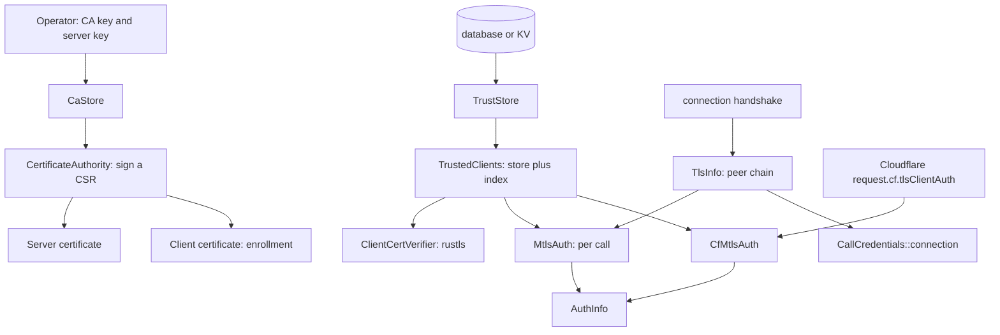

# Mutual TLS

_Written in ASD-STE100 Simplified Technical English (STE). Code and identifiers stay as they
are._

**Abbreviations in this file.** Transport Layer Security (TLS); mutual TLS (mTLS); certificate
authority (CA); certificate signing request (CSR); public key infrastructure (PKI); elliptic
curve digital signature algorithm (ECDSA); Rivest–Shamir–Adleman (RSA), a public-key algorithm;
Probabilistic Signature Scheme (PSS), a padding mode for RSA signatures; Distinguished Encoding
Rules (DER); Privacy-Enhanced Mail (PEM); Distinguished Name (DN); Secure Hash Algorithm with
256 bits (SHA-256); remote procedure call (RPC); Hypertext Transfer Protocol (HTTP); Hypertext
Transfer Protocol version 2 (HTTP/2); Domain Name System (DNS); Structured Query Language
(SQL); key-value store (KV); database (DB); Cloudflare Durable Object (DO); WebAssembly (wasm);
deterministic simulation testing (DST); JavaScript (JS); central processing unit (CPU);
AeroSpace and Defence Industries Association of Europe (ASD), the owner of the STE standard
ASD-STE100.

## Glossary

| Term | Meaning |
|---|---|
| certificate | A signed statement that binds a public key to a name, with a validity window. |
| CA | The certificate authority: the key and certificate that sign other certificates. |
| CSR | Certificate signing request: a public key plus a name, signed by the matching private key. |
| trust store | The set of client identities that a server accepts, outside the CA chain: a client must also be listed. |
| fingerprint | SHA-256 of the certificate in DER form, as lowercase hexadecimal. |
| mTLS | Mutual TLS: the client and the server each show a certificate, and each checks the other. |
| verifier | The code that checks a peer certificate inside a TLS handshake (rustls `ClientCertVerifier`). |
| provider | One implementation of the `ClientAuth` trait of spec 86. |
| `MtlsAuth` | The provider that reads the client certificate of a native connection. |
| `CfMtlsAuth` | The provider that reads Cloudflare's client-certificate facts on a Worker. |
| revocation | The removal of a client from the trust store. The next call from it fails. |
| DST | deterministic simulation testing: the same seed replays the same run. |

## 1. Purpose

Mutual TLS was one row of a large table in spec 81 ("CA", "trust", "mTLS"). The owner found
three problems with that:

1. Spec 77 deferred mTLS to spec 65 (which no longer exists), and then to spec 81. It planned no
   work for it and no task depended on it. The code would never be scheduled.
2. Spec 81 has one feature with twelve task groups. A consumer that needs mTLS needs a part of
   that feature to land first, and the part is not separable in the plan.
3. The proxy (spec 82) and the sandbox service (spec 77) both need mTLS, and both would wait
   for the whole of spec 81.

The owner direction (2026-11-15): "Lets just create a specification focused on mtls and
delivering it - this way everything else builds ontop of it."

So this specification owns the CA, the trust store, the verifiers, the peer-certificate facts
and the two mTLS providers. It has a delivery order of its own. Spec 81 keeps the signed
secrets, the key files and the other providers.

## 2. What exists today

| Item | State on master |
|---|---|
| CA, trust store, verifier in `foundation_auth` | None. No `pki`, `trust` or `mtls` module exists. |
| `CertificateAuthority` | `foundation_agent_rpc/src/auth.rs:66` (a private module of the agent RPC crate). |
| `MtlsConfig` | `foundation_agent_rpc/src/auth.rs:337`. |
| `TrustedClientStore` | `foundation_agent_rpc/src/trust.rs:95`. |
| `SignedSecret` | `foundation_agent_rpc/src/secret.rs:427`. |
| `TlsInfo` | `foundation_netio/src/shared/context.rs:69`. It already holds the peer certificate chain in DER. |
| `ConnectionContext::tls` | Reported by `foundation_netio` after a TLS handshake. Spec 80 feature 00 makes `foundation_http` fill it for every connection. |
| `foundation_cloudflare_certificates` | A Cloudflare API client. It is not a local CA and it is not in scope. |
| `rustls`, `rcgen`, `x509-parser` | `foundation_agent_rpc` uses them today. They move to `foundation_auth` with the code. |

The code of `foundation_agent_rpc::auth`, `trust` and the CA part of `secret` moves to
`foundation_auth`. `foundation_agent_rpc` then builds on the library, and does not keep a copy.

## 3. Ownership

| Item | Owner |
|---|---|
| `CaStore`, `CertificateAuthority`, `CaConfig`, CSR validation, issuance, renewal, deterministic signing | This specification |
| `TrustStore` trait; `SqlTrustStore`, `KvTrustStore`, `MemoryTrustStore`; `TrustedClient`; `TrustedClients`; revocation | This specification |
| `ClientCertVerifier`, `ServerTlsConfig`, `MtlsConfig`, peer identity extraction, the rustls time source | This specification |
| `MtlsAuth`, `CfTlsClientAuth`, `CfMtlsAuth` | This specification |
| The `ClientAuth` trait, `AuthInfo`, `CallCredentials`, `Principal`, `AuthMethod`, `AuthError`, `Secret` | Spec 86 |
| The key files that the operator gives the process | Spec 81 feature 00, section 4 |
| The signed secrets and their verifier | Spec 81 feature 00, section 3 |
| The `ConnectionContext::tls` fill after a handshake | Spec 80 feature 00 |
| The injected clock and entropy | Spec 84 |
| The server listeners and their TLS configuration | The host: spec 83 feature 04 (native), spec 82 (proxy), spec 77 (sandbox listener) |
| Certificate rotation for a long-lived fleet | Out of scope (section 9) |

## 4. Design

The detailed design is in [mtls.md](./mtls.md), moved from spec 81 feature 00 (`auth.md`)
sections 5, 6, 7 and the mTLS part of 8.3. `mtls.md` is the authority for the types and the
algorithms. This section gives the shape and the decisions.



_The diagram shows one CA, one trust store, two providers and two sources of a peer certificate._

The pieces:

| Module | Types | Job |
|---|---|---|
| `foundation_auth::pki` | `CaStore`, `CertificateAuthority`, `CaConfig`, `KeyAlgorithm`, `CertificateRequest`, `IssuedCertificate` | Load or generate the CA, validate a CSR, issue a certificate, renew one. Native only. |
| `foundation_auth::trust` | `TrustStore`, `SqlTrustStore<Q>`, `KvTrustStore<K>`, `MemoryTrustStore`, `TrustedClient`, `TrustedClients`, `TrustConfig` | Know which clients are enrolled; hold their role, their limits and their last-seen time. |
| `foundation_auth::mtls` | `ClientCertVerifier`, `ServerTlsConfig`, `MtlsConfig`, `peer_identity` | Check a peer certificate in the handshake; build the rustls server configuration. Native only. |
| `foundation_auth::client_auth::mtls` | `MtlsAuth` | Check the peer certificate of the connection on each call, against the trust store. |
| `foundation_auth::client_auth::cloudflare` | `CfTlsClientAuth`, `CfMtlsAuth` | Check Cloudflare's client-certificate facts on a Worker. |

### 4.1 What a certificate chain proves, and what the trust store adds

A CA chain proves that a certificate was signed by the CA. It does not prove that the holder is
allowed to call. Two clients with a valid certificate from the same CA must not get the same
rights.

So the check has two parts:

1. The **handshake** proves the chain: the certificate is signed by the CA, it is inside its
   validity window, and the client holds the private key.
2. The **provider** proves the right to call: the fingerprint is in the trust store, the client
   is not revoked, and the call is inside the client's limits.

The trust store is checked on every call, not only at the handshake. A revocation stops the
next call on a live keep-alive connection. The design notes this in `mtls.md` section 4.

### 4.2 The two sources of a peer certificate

| Host | Source | Provider | Why |
|---|---|---|---|
| Native listener | `ConnectionContext::tls.peer_certificates` (DER, leaf first) | `MtlsAuth` | The process ends TLS and sees the certificate. |
| Cloudflare Worker | `request.cf.tlsClientAuth` copied into the request extensions as `CfTlsClientAuth` | `CfMtlsAuth` | Cloudflare ends TLS. The Worker cannot see the chain, only these facts. |
| Cloudflare DO | the request headers, or the same extensions | `CfMtlsAuth`, or `Forwarded` | The Worker already checked the caller. |

A Worker cannot run its own mTLS. This is the reason that spec 77 question Q4 allows two
answers for the sandbox service: a bearer secret, or Cloudflare's own client certificates.

### 4.3 Time comes from the clock, never the global

`rustls` wants the current time to check a validity window, and a certificate's `not_before`
and `not_after` are compared with it. The verifier takes the time from the `Ctx` clock (spec
84). A DST run therefore tests a certificate that expires at a known point in simulated time.

`MtlsAuth` also needs the time for `TrustedClients` (the last-seen write, the 75-second
interval, and the client's expiry). It takes the same clock.

### 4.4 Determinism

A certificate that a test makes must be the same on two runs. The CA supports two algorithms:

| Algorithm | Use | Deterministic |
|---|---|---|
| ECDSA P-256 (default) | Every real host; every TLS client accepts it | No: the signature nonce is random. Use `--fixed-nonce` only in a test. |
| Ed25519 | Tests and DST | Yes: the signature is deterministic |

A browser and a rustls client accept Ed25519 in a client certificate; a browser does not accept
it in a server certificate. So a DST run uses Ed25519 for the client and a P-256 server
certificate with a fixed nonce, or no TLS at all. `mtls.md` section 1.2 has the detail.

### 4.5 Limits are configuration

| Limit | Where | Default | Source of the default |
|---|---|---|---|
| CA lifetime | `CaConfig::ca_lifetime` | 10 years | the `mkcert` root lifetime |
| Certificate backdate | `CaConfig::backdate` | 5 minutes | clock skew in MIT Kerberos (`clockskew`) |
| Client certificate lifetime | `IssueConfig::lifetime` | 30 days | the agent RPC access secret window |
| Last-seen write interval | `TrustConfig::touch_interval` | 75 seconds | `rustls` session tickets, which last 2 minutes |
| Trust store cache time | `TrustConfig::cache_ttl` | 5 minutes | shorter than one enrollment window |
| Revocation check period | `TrustConfig::revocation_ttl` | 1 hour | a compromise is rare; one hour bounds the exposure |

Every one is a field with a `with_` builder. A `const` in the code path is a defect (root rule
8).

## 5. Consumers

| Consumer | Needs | Its work |
|---|---|---|
| Spec 82 (proxy registration and registrar) | Enrollment with a one-time token, then mTLS on every call; the proxy's own CA and trust store | After this specification |
| Spec 83 (agent RPC server) | The native host's mTLS provider; the Worker's `CfMtlsAuth` | After this specification |
| Spec 77 (sandbox platform) | The native control-plane listener may add mTLS; the Worker uses Cloudflare client certificates | Its question Q4 points here |
| Spec 81 (foundation auth) | Nothing; it gives the key files that the CA reads | After spec 86 |

## 6. Acceptance scenarios

**S1 — The CA issues a certificate.**
Given a CA from a `CaStore`, when a CSR for a client name is signed with a 30-day lifetime,
then the certificate verifies against the CA, its subject is the requested name, and its
validity window is the requested one.

**S2 — A CSR for another key is refused.**
Given a CSR whose signature does not match its own public key, when the CA signs it, then the
result is a typed error and no certificate is made.

**S3 — The chain alone is not enough.**
Given a client certificate from the CA that is not in the trust store, when `MtlsAuth` checks a
call, then the result is `Err(AuthError::Invalid)`, and the reason names the trust store.

**S4 — Revocation stops the next call.**
Given an enrolled client on a keep-alive connection, when an operator revokes it, then the next
call on that connection fails, and the call that was already running completes.

**S5 — An expired certificate is refused at the clock.**
Given a client certificate valid until T, when a DST run with a simulated clock reaches T + 1 s
and the client calls, then the result is `Err(AuthError::Expired)`.

**S6 — The trust store is one trait.**
Given `MemoryTrustStore`, `SqlTrustStore` and `KvTrustStore`, when the same sequence of `put`,
`get`, `list`, `revoke` and `touch` runs against each, then the results are equal.

**S7 — A Worker uses Cloudflare's facts.**
Given `CfTlsClientAuth { cert_presented: true, cert_verified: "SUCCESS", .. }` in the request
extensions and a matching trust-store entry, when `CfMtlsAuth` checks a call, then the identity
is the fingerprint and the method is `CloudflareMtls`.

**S8 — A key never prints.**
Given a CA key and a server key, when either is formatted with `{:?}` or `{}`, then the output
holds no byte of the key.

## 7. Tests

All tests are in `backends/foundation_auth/tests/`.

| Law or scenario | Test | Oracle |
|---|---|---|
| S1 | `ca_issues_certificate` | expected outcome |
| S2 | `csr_wrong_signature_refused` | expected outcome |
| S3 | `chain_alone_refused` | expected outcome |
| S4 | `revocation_stops_next_call` | stateful model |
| S5 | `expired_at_simulated_clock` | expected outcome |
| S6 | `trust_store_same_behaviour` (one property run against three stores) | identity |
| S7 | `cf_mtls_success`, `cf_mtls_not_presented`, `cf_mtls_failed` | expected outcome |
| S8 | `keys_are_redacted` | expected outcome |
| The CA reloads from its store | `ca_round_trip` (generate, persist, reload, sign) | identity |
| A certificate is inside the CA lifetime | `certificate_within_ca_lifetime` | bound |
| Deterministic signing | `ed25519_deterministic` (two runs, same bytes) | identity |
| The verifier uses the clock | `verifier_reads_ctx_clock` | expected outcome |
| A revoked client is not listed | `revoked_not_listed` | expected outcome |

## 8. Tasks

| Task | What | Main files | Done when |
|---|---|---|---|
| T1 | `pki`: `CaStore` (file, memory), `CertificateAuthority`, `CaConfig`, `KeyAlgorithm`, CSR validation, issuance, renewal, deterministic signing | `foundation_auth/src/pki/` | `ca_issues_certificate`, `csr_wrong_signature_refused`, `ca_round_trip`, `ed25519_deterministic` pass |
| T2 | `trust`: `TrustStore` trait, `SqlTrustStore`, `KvTrustStore`, `MemoryTrustStore`, `TrustedClient`, `TrustedClients`, `TrustConfig`, revocation | `foundation_auth/src/trust/` | `trust_store_same_behaviour`, `revoked_not_listed` pass |
| T3 | `mtls`: `ClientCertVerifier`, `ServerTlsConfig`, `MtlsConfig`, `peer_identity`, the clock read | `foundation_auth/src/mtls/` | `verifier_reads_ctx_clock` passes; a rustls handshake against a test client succeeds |
| T4 | `MtlsAuth` over `ClientAuth` (spec 86) and the trust store | `foundation_auth/src/client_auth/mtls.rs` | `chain_alone_refused`, `revocation_stops_next_call`, `expired_at_simulated_clock` pass |
| T5 | `CfTlsClientAuth`, `CfMtlsAuth` | `foundation_auth/src/client_auth/cloudflare.rs` | the three `cf_mtls_*` tests pass |
| T6 | Move the code and the dependencies (`rustls`, `rcgen`, `x509-parser`) out of `foundation_agent_rpc`; leave the crate building on the library | `foundation_agent_rpc/src/{auth,trust,secret}.rs`, both `Cargo.toml` files | `cargo test -p foundation_agent_rpc` passes with no local CA code |

T6 is the one task that touches a second crate. It is last, so that the library is green before
the move.

## 9. Out of scope

- **Certificate rotation for a long-lived fleet.** A client certificate has a lifetime, and
  renewal exists (`CertificateAuthority::renew`). An automatic rotation schedule, a grace
  window and a fleet-wide rollout are a later specification.
- **A public CA.** The operator gives the CA key. The library does not ask an external CA.
- **Certificate transparency, OCSP and CRL.** Revocation is the trust store, not a CRL.
- **The Cloudflare certificates API.** `foundation_cloudflare_certificates` is a different
  product. `CfMtlsAuth` reads the facts that Cloudflare already checked.
- **Key protection at rest.** Spec 83 feature 08 owns the keystore and the key encryption key.

## 10. Verify

```bash
cargo test -p foundation_auth --profile uat pki
cargo test -p foundation_auth --profile uat trust
cargo test -p foundation_auth --profile uat mtls
cargo test -p foundation_agent_rpc --profile uat
cargo clippy -p foundation_auth -p foundation_agent_rpc --profile uat -- -D warnings
```

A rustls handshake test is a real handshake between two processes in one test, not a mock: the
verifier is the subject of the test. No external service is involved.

## 11. Done when

- `foundation_auth` holds `pki`, `trust`, `mtls`, `MtlsAuth`, `CfTlsClientAuth` and
  `CfMtlsAuth`.
- `foundation_agent_rpc` has no CA, trust store or verifier of its own.
- Spec 81 references this specification and does not own mTLS.
- Spec 82, spec 83 and spec 77 name this specification as their mTLS source.
- Every limit of section 4.5 is a config field with a builder and a documented default.
- `progress.md` and `LEARNINGS.md` are current.

## 12. Open questions

| # | Question | State |
|---|---|---|
| Q1 | One specification for mTLS, or keep it inside spec 81? | Closed (2026-11-15): its own specification, so it is scheduled and delivered before its consumers. |
| Q2 | Does `MtlsAuth` check the trust store at the handshake or on each call? | Closed (2026-11-15): on each call. A handshake check cannot see a revocation on a live connection. |
| Q3 | Can a Worker run mTLS? | Closed (2026-11-15): no. It reads `request.cf.tlsClientAuth`. `CfMtlsAuth` is the provider. |
| Q4 | Is a certificate from the CA enough to call? | Closed (2026-11-15): no. The fingerprint must also be in the trust store. |
| Q5 | Which algorithm for a test? | Closed (2026-11-15): Ed25519 for a deterministic client certificate. P-256 with a fixed nonce for a server certificate. |

---

_Created: 2026-11-15_
_Structure: Single document (has_features: false), with [mtls.md](./mtls.md) as the detailed
design moved from spec 81 feature 00._
